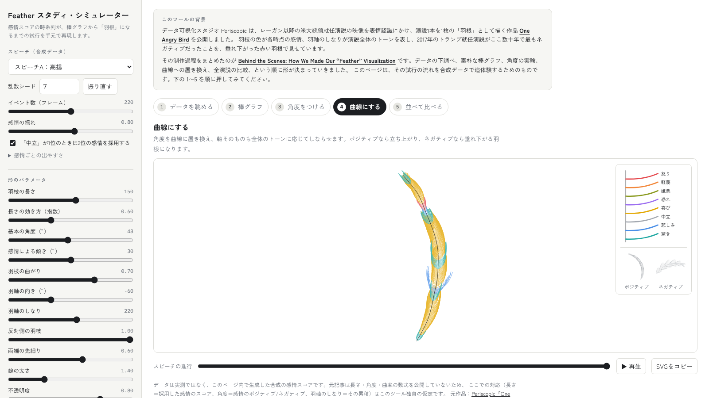

+++
author = "矢崎裕一"
title = "棒グラフが羽根になるまでを、手元で試す──Feather スタディ・シミュレーター"
slug = "feather-study-simulator"
date = "2026-11-22"
description = "Periscopic「One Angry Bird」のメイキング記事に沿って、感情スコアの時系列が棒グラフから羽根の形になるまでの5段階を、合成データとパラメータを動かしながら再現できるシミュレーターです。"
categories = [
    "technology"
]
tags = [
    "インタラクティブ",
    "Periscopic",
    "感情分析",
    "スケッチ"
]
image = "images/cover-compare-six.png"
series = ["interactive-explainers"]
series_weight = 10
seriesTitle = "棒グラフが羽根になるまでを試す──Feather スタディ・シミュレーター"
+++

「Feather スタディ・シミュレーター」は、感情スコアの時系列が、棒グラフから羽根の形になるまでの5段階を再現できるインタラクティブなページです。データ可視化スタジオ Periscopic の作品「One Angry Bird」のメイキング記事に沿って、合成データとパラメータを動かしながら、形が決まっていく流れをたどれます。

**[Feather スタディ・シミュレーターを開く](https://emotion-to-feather.visualizing.jp/)**

このページは、シミュレーターの紹介です。本編は上のリンク先にあり、ブラウザでそのまま動きます。

<!--more-->

## 元になった作品とメイキング記事

Periscopic の「One Angry Bird」は、レーガン以降の米大統領就任演説の映像を表情認識にかけ、演説1本を1枚の羽根として描いた作品です。羽枝の色が各時点の感情を、羽軸のしなりが演説全体のトーンを表します。

その制作過程をまとめたのが、Periscopic の記事「Behind the Scenes: How We Made Our “Feather” Visualization」です。データの下調べ、素朴な棒グラフ、角度の実験、曲線への置き換え、全演説の比較、という順に形が決まっていきました。シミュレーターは、この順番をそのまま5つのボタンにしています。

## 5つの段階をたどる

| 段階 | できること |
|---|---|
| 1. データを眺める | フレームごとに8つの感情スコアが並んだ時系列を、積み上げで確かめます |
| 2. 棒グラフ | 各時点で採用した感情を、棒の長さと色で並べます |
| 3. 角度をつける | 棒に角度をつけ、感情のポジティブ・ネガティブで傾きを変えます |
| 4. 曲線にする | 角度を曲線に置き換え、軸そのものも全体のトーンに応じてしならせます |
| 5. 並べて比べる | 6本のスピーチを同じ縮尺で並べ、羽根の姿勢と色だけで違いが読めるかを確かめます |

矢崎裕一／Feather スタディ・シミュレーターの画面

左の欄では、スピーチの種類、乱数シード、感情の揺れを変えられます。羽枝の長さ、角度、曲がり、羽軸のしなりなど、形のパラメータもスライダーで動かせます。「『中立』が1位のときは2位の感情を採用する」のチェックを外すと、中立ばかりになる様子が分かります。できた図は SVG としてコピーできます。

## 何が分かるか

完成した作品だけを見ると、羽根の形は最初から決まっていたように見えます。段階を順に押していくと、棒グラフに角度と曲がりを一つずつ足した結果だと分かります。どのパラメータが見た目のどこに効くかを、自分の手で確かめられます。

## 断り書き

- データは実測ではなく、ページの中で生成した合成の感情スコアです。
- 元の記事は、長さ・角度・曲率の数式を公開していません。長さを採用した感情のスコアに、角度を感情のポジティブ・ネガティブに、羽軸のしなりをその累積に対応させたのは、このツール独自の仮定です。
- 「One Angry Bird」の図を再現したものではありません。

## 参考・出典

- Feather スタディ・シミュレーター. [emotion-to-feather.visualizing.jp](https://emotion-to-feather.visualizing.jp/)
- Periscopic「One Angry Bird」. [emotions.periscopic.com/inauguration](https://emotions.periscopic.com/inauguration/)
- Periscopic「Behind the Scenes: How We Made Our “Feather” Visualization」. [medium.com/@Periscopic](https://medium.com/@Periscopic/behind-the-scenes-how-we-made-our-feather-visualization-544d727fbe5c)
