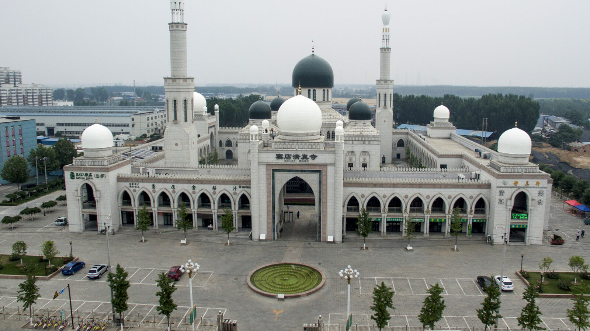
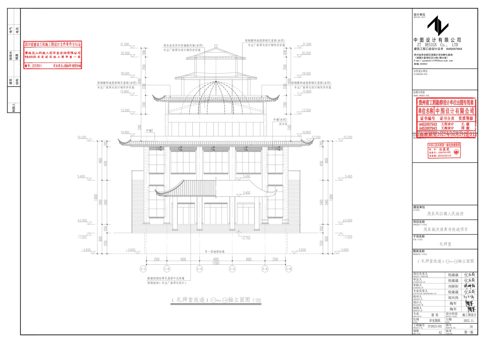
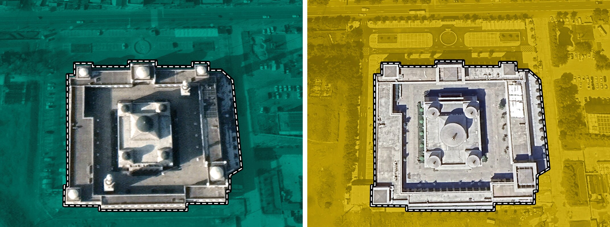

+++
author = "Yuichi Yazaki"
title = "Teal before, yellow after: the 2,312 mosques in the FT's \"How China is tearing down Islam\""
slug = "ft-china-mosques"
date = "2026-11-04"
description = "The FT examined 2,312 mosques with Islamic architecture in Google Earth and counted 1,714 that had been modified. Teal marks before and yellow marks after, used for the dots on the national map and for the before-and-after satellite switches."
categories = [
    "consume"
]
tags = [
    "data journalism",
    "Sigma Awards",
    "satellite imagery",
    "scrollytelling"
]
image = "images/doudian-satellite-2017-2023.jpg"
+++

The Financial Times (FT) examined 2,312 mosques with Islamic architecture in Google Earth satellite imagery and counted 1,714 that had been modified. It fixed teal (#35e0cb) for before and yellow (#ffec1a) for after, and uses these two colors for the dots on the national map and for the before-and-after switches between satellite photos.

The piece is "How China is tearing down Islam." It was published on 27 November 2023 as an FT Visual Investigations project, and it won a Sigma Awards 2024 prize (according to its entry page on the Sigma Awards entries site). Below, I read it in the order a reader scrolls, based on the body text and source code (HTML, CSS, JavaScript) of the project page, the Flourish data for the regional chart, and the Sigma Awards application.

<!--more-->

## It starts with one mosque in Beijing

When you open the piece, a photograph of a single mosque fills the screen. It is the Doudian Mosque on the outskirts of Beijing. The text describes it as one of the most magnificent mosques in northern China.

Source: Financial Times (© The Financial Times Limited 2023) / How China is tearing down Islam

In the next step, a second image, whose alt text reads "Mosque, outlined," fades in over three seconds. Then, as you scroll, drone footage plays. It was shot by Marine Zambrano. The text goes on:

> But earlier this year, its minarets were removed, its domes replaced with pagoda-style cones and its Arab-style arches squared off.

Summary: earlier that year the minarets were removed, the domes were replaced with pagoda-style cones, and the arches were squared off.

From here, the screen moves from a single building to a map of all China. At first only the area of Xinjiang is shaded dark blue-green, and yellow dots appear in it. In the next step, dots spread across the country. The map data contains 1,714 dots. In descending order of dot count: Xinjiang 387, Gansu 355, Ningxia 268, Henan 205, Yunnan 146, Qinghai 118.

After the map come satellite photos. First four large tiles appear, switching one by one at one-second intervals from before to after. Then a full-screen grid of 70 before-and-after satellite pairs scrolls automatically. The images date from January 2017 to March 2023.

The sequence runs from one photo of one building, to a national map, to 70 pairs of satellite photos. It can be read as a structure that first shows what happened to one building, then shows how many places the same thing happened.

## From 4,450 locations to 1,714 mosques

The numbers are given in the methodology paragraph at the end of the article.

> We built a dataset of 4,450 reported locations of mosques across China by combining search results from Baidu Maps, Google Maps, and OpenStreetMap, as well as mosques in Xinjiang from the Australian Strategic Policy Institute. We inspected each location using Google Earth satellite imagery, identifying mosques and comparing changes with their architecture over time.

Summary: the team combined search results from Baidu Maps, Google Maps and OpenStreetMap with the Xinjiang mosques from the Australian Strategic Policy Institute (ASPI) into a list of 4,450 locations. It then checked each location in Google Earth satellite imagery, confirmed whether it was a mosque, and compared how the building changed over time.

The result is in the next paragraph.

> In total, we located 2,312 mosques with Islamic architecture. Of these, 1,714 (74.3 per cent) had Arabic-style features removed between 2018 and 2023.

Summary: the team located 2,312 mosques with Islamic architecture, and in 1,714 of them (74.3%) Arabic-style features had been removed between 2018 and 2023.

Lined up by stage, the numbers look like this.

| Stage | Count | Wording in the text |
|---|---|---|
| Candidate locations | 4,450 | reported locations of mosques |
| Confirmed as Islamic architecture | 2,312 | mosques with Islamic architecture |
| Modified or removed, 2018–2023 | 1,714 (74.3%) | had Arabic-style features removed |

What was judged is minarets, domes, and other exterior Arabic-style features. The methodology also states its limits. The mosques examined are only a portion of those in China as a whole. In some regions the most recent satellite imagery dates from 2020, so buildings modified after that were not counted. It therefore presents 1,714 as probably an underestimate.

The article is not built from satellite imagery alone. The text also brings in photos taken on the ground and interviews with residents, a local government's renovation drawings in Sichuan, and an image of a planning document from Xining. In its Sigma application, the team lists Drone, Scraping, QGIS, Google Sheets, OpenStreetMap, Node.js and others among the technologies used.

Source: Renovation drawing for Maoxian (a local government document), Financial Times (© The Financial Times Limited 2023) / How China is tearing down Islam

## Teal for before, yellow for after

The page's stylesheet repeats two colors. **Teal (#35e0cb) is before the modification, and yellow (#ffec1a) is after.** This can be read as the one rule that ties the data to its appearance.

Near the top of the text, the two words "before" and "after" appear in colored bold. "Before" is teal and "after" is yellow. On the satellite tiles, the border and the date label at upper right are teal for before and yellow for after. The dots on the map of China are also small yellow squares.

Where the text discusses Doudian in detail, two satellite images sit side by side. The project page labels them 2017 and 2023 (the images themselves carry no year). The 2017 image is tinted teal and the 2023 image yellow. Around the building's perimeter runs a line made of a solid black line overlaid with a white dashed line.

Source: Financial Times (© The Financial Times Limited 2023) / How China is tearing down Islam (the two images placed side by side by the author)

The table below summarizes how the colors are used on the page.

| Presentation (location) | Data | Mapping to appearance |
|---|---|---|
| Opening photo and drone footage | One mosque, Doudian, before and after | After the before photo, an image with the alt text "Mosque, outlined" fades in over 3 seconds. Drone footage advances as you scroll |
| Map of China | Locations of the 1,714 modified mosques | Small yellow squares (thin black outline). Xinjiang first, then the whole country. Each dot appears with a delay of 0 to 750 ms |
| Colored words in the text | Before / after | "Before" in teal bold; "after" and "demolitions and modifications" in yellow bold |
| Four large satellite tiles | Four before-and-after satellite pairs | Switch from before to after every second. The before image blurs and disappears. Border and date label: teal for before, yellow for after |
| Satellite photo grid | 70 before-and-after satellite pairs | The grid scrolls automatically, and each tile that enters the screen switches from before to after |
| Before-and-after per mosque | Doudian, Najiaying and Weizhou, before and after | Satellite images and ground photos placed side by side before and after, each with its year |
| Maoxian renovation drawing | Government drawings and documents | In the text, "dome" is highlighted in teal and "pagoda-style structure" with a yellow background |
| Regional scatter plot (Flourish) | 31 provinces and regions | x = Muslim population share (log scale), y = modification rate, circle area = number of mosques with Islamic architecture, fill yellow |

The map dots are yellow, which can be read as meaning the dots are buildings "after." The 1,714 modified mosques line up on the map as yellow dots. On the satellite tiles, the same yellow goes on the frame of the after image. Whether you read the text, look at the map, or compare the photos, yellow appears to be built to mean after.

The two-color switch also helps with comparing photos. In the Doudian satellite images, the roof shape seen from above the dome differs between 2017 and 2023. Because the colors differ, you can tell which image is the before without reading the date.

## The regional scatter plot, and totals that do not match

Later in the text, a scatter plot made with Flourish is embedded. Its title is "Mosque modifications were more systematic in areas with larger Muslim populations." Each circle is one province or region. The horizontal axis is the Muslim population share (log scale), and the vertical axis is the share of mosques with Islamic architecture that were modified. Circle size represents the number of mosques with Islamic architecture examined.

In the embedded data, the figures for some regions are as follows.

| Province / region | Muslim population share | Mosques with Islamic architecture | Modification rate |
|---|---|---|---|
| Xinjiang | 56.51% | 539 | 71.8% |
| Ningxia | 35.08% | 294 | 91.16% |
| Qinghai | 18.43% | 146 | 78.77% |
| Gansu | 8.15% | 434 | 81.8% |
| Henan | 0.96% | 212 | 96.7% |
| Liaoning | 0.53% | 43 | 9.3% |

The text also says more than 90% in Ningxia and more than 80% in Gansu. The sources are given as "2020 Chinese Census" and "FT Research."

Adding up the 31 regions in this Flourish data gives 4,440 locations examined and 2,310 with Islamic architecture. These differ from the text's 4,450 and 2,312 by 10 and 2 respectively. The piece does not say why they differ.

This is a point to watch when following the numbers. The national figures (4,450 / 2,312 / 1,714) are the methodology figures in the text, while the regional figures are from the scatter plot data. When citing both in the same article, it is safer to make clear which set a number comes from.

## How third parties saw the piece

The Sigma Awards judges cite both how the data was built and how the page was put together.

> The team behind "How China is tearing down Islam" built a database of 4,450 buildings and manually reviewed each one of them for accuracy. ... This entry successfully combined photos, videos, data visualization and coherence page design to tell a powerful story.

Summary: the team built a database of 4,450 buildings and manually checked each one. It combined photos, video, data visualization and a coherent page design to tell the story. The judges also note that many of the reporters in China worked at personal risk.

The Guardian cited the FT's analysis in its article of 25 May 2024. It wrote that last year's FT analysis showed that three quarters of more than 2,300 mosques had been modified or removed since 2018. It also reports on what later happened to the mosques in Najiaying and Shadian.

The anthropologist Ruslan Yusupov made a different point in an essay for the Political Theology Network in March 2026. On the Chinese internet, he notes, even those who celebrate Sinicization use "before-and-after" paired images.

> when the narratives about Sinicization emerged online, they did so through a powerful medium of visual juxtaposition called "before-and-after" images.

Summary: when narratives about Sinicization emerged online, they did so through a powerful medium of visual juxtaposition, "before-and-after" images. Yusupov argues that paired images keep the "before" as something lacking. Yusupov is also one of the people interviewed in the FT's piece.

The three assessments make different points. The judges look at how the piece was made, The Guardian at the numbers, and Yusupov at the before-and-after form itself. Yusupov's point can be read as showing that the before-and-after form the FT used is just as available to the opposing side.

## Takeaways

What a visualization practitioner can take from this piece is to narrow the color convention down to one and keep to it to the end.

The FT's color mapping can be read as narrowed to a single rule: before = teal, after = yellow. It carries this through the words in the text, the tinting of the satellite photos, the borders and date labels of the tiles, the dots on the map, and the highlights on the drawing. It can be read as built so that it works without a legend.

This method is useful when you set different kinds of material side by side in one article. Photos, maps and drawings are each made with different tools. If you decide on one color convention first, then even when each kind of material looks different, they read as parts of the same article.

The way of counting is also worth taking. The FT put the narrowing in numbers in the text: from 4,450 candidates to 2,312, then to 1,714. It also wrote the limits in the same paragraph. In an article that presents counts, stating where the counting began and what was not counted, next to the numbers, lets readers check them.

Finally, there is Yusupov's point. The before-and-after form is powerful, but either side can use it. Placing before and after images side by side does not by itself convey what was lost. In the FT's piece, the residents' words and the government documents can be read as carrying that part.

## References

**Primary sources**

- Financial Times, "How China is tearing down Islam," 2023-11-27. [Project page](https://ig.ft.com/china-mosques/)
- Stylesheets of the piece: [styles.a686d242.css](https://ig.ft.com/china-mosques/assets/static/styles.a686d242.css), [ChinaMap.58928fe1.css](https://ig.ft.com/china-mosques/assets/static/ChinaMap.58928fe1.css)
- Scripts of the piece: [index.page.client.a5b40edf.js](https://ig.ft.com/china-mosques/assets/entries/index.page.client.a5b40edf.js), [chunk-de8e8e48.js (map of China)](https://ig.ft.com/china-mosques/assets/chunks/chunk-de8e8e48.js), [chunk-74e2fd96.js (satellite tile grid)](https://ig.ft.com/china-mosques/assets/chunks/chunk-74e2fd96.js)
- Flourish, "China Mosques - Scatter" (visualisation 15487273). [Embed](https://flo.uri.sh/visualisation/15487273/embed)
- Sigma Awards 2024, "How China is tearing down Islam" (original application text and judges' comments). [Sigma Awards entries](https://sigma-awards.data-visualization.jp/entries/2024-s-0003/)
- Sam Joiner, post on X, 2023-11-27. [Thread Reader](https://threadreaderapp.com/thread/1729038848410415345.html)
- Human Rights Watch, "China: Mosques Shuttered, Razed, Altered in Muslim Areas," 2023-11-22 (an earlier report cited in the text of the piece). [HRW](https://www.hrw.org/news/2023/11/22/china-mosques-shuttered-razed-altered-muslim-areas)

**Secondary sources**

- Sigma Awards 2024 judges' comments. [Sigma Awards entries](https://sigma-awards.data-visualization.jp/entries/2024-s-0003/)
- Amy Hawkins, Elena Morresi, "Last major Arabic-style mosque in China loses its domes," *The Guardian*, 2024-05-25. [The Guardian](https://www.theguardian.com/world/article/2024/may/25/last-major-arabic-style-mosque-in-china-loses-its-domes) (checked via a [reprint on Yahoo News UK](https://uk.news.yahoo.com/last-major-islamic-style-mosque-040015078.html))
- Ruslan Yusupov, "The Montage of Privation: Islam and the Architecture of Sinicization in China," Political Theology Network, 2026-03-10. [Political Theology Network](https://politicaltheology.com/the-montage-of-privation-islam-and-the-architecture-of-sinicization-in-china/)
