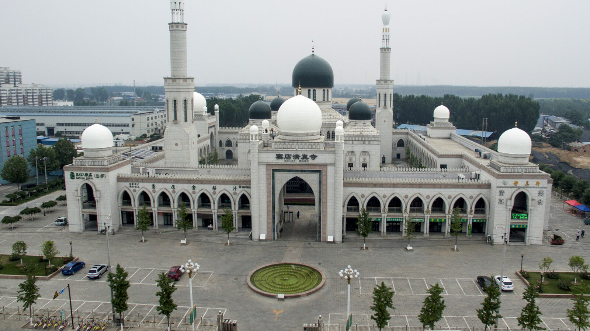
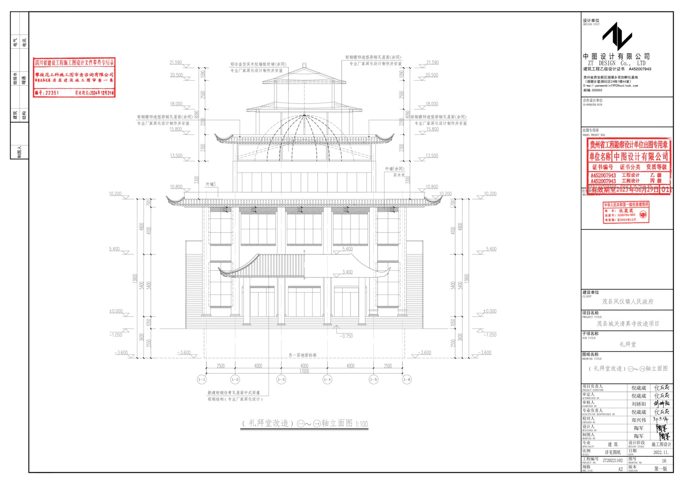
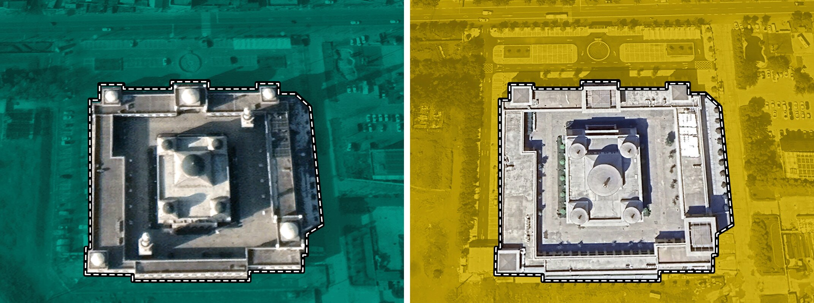

+++
author = "矢崎裕一"
title = "改修前はティール、改修後は黄──FT「How China is tearing down Islam」の2,312棟"
slug = "ft-china-mosques"
date = "2026-11-04"
description = "FT は Google Earth でイスラム様式のモスク2,312棟を調べ、1,714棟の改修を数えました。改修前をティール、改修後を黄とし、全国地図の点と衛星写真の前後の切り替えに使っています。"
categories = [
    "consume"
]
tags = [
    "データジャーナリズム",
    "Sigma Awards",
    "衛星画像",
    "スクロールテリング"
]
image = "images/doudian-satellite-2017-2023.jpg"
series = ["dataviz-journalism"]
series_weight = 7
seriesByline = "Financial Times"
seriesTitle = "前はティール、後は黄──FT 中国のモスク調査"
+++

Financial Times（フィナンシャル・タイムズ、以下 FT）は、Google Earth の衛星画像で調べたイスラム様式のモスク2,312棟のうち、1,714棟の改修を数えました。改修前をティール（#35e0cb）、改修後を黄色（#ffec1a）と決め、この2色を、全国地図の点と、衛星写真の前後の切り替えに使っています。

作品は「How China is tearing down Islam」です。FT の Visual Investigations として、2023年11月27日に公開されました。Sigma Awards 2024 の受賞作です（Sigma Awards 作品一覧サイトの作品ページによる）。以下は、作品ページの本文とソース（HTML・CSS・JavaScript）、地域別グラフの Flourish データ、Sigma Awards への応募書類に沿って、読者がスクロールする順に読みます。

<!--more-->

## 北京のモスク1棟から始まる

作品を開くと、まず1棟のモスクの写真が全画面に出ます。北京郊外の Doudian Mosque（ドウディエン・モスク）です。本文は、このモスクを北中国で最も壮麗なモスクの一つだったと書きます。

Financial Times（© The Financial Times Limited 2023）／How China is tearing down Islam より引用

写真の次の段では、alt に「Mosque, outlined」とある2枚目の画像が、3秒かけて重なります。続いてスクロールに合わせ、ドローン映像が流れます。撮影は Marine Zambrano です。本文はこう続けます。

> But earlier this year, its minarets were removed, its domes replaced with pagoda-style cones and its Arab-style arches squared off.

要旨：その年の初めに、尖塔は取り除かれ、ドームは仏塔風の円錐に替えられ、アーチは四角くされた、という内容です。

この先で、画面は一つの建物から中国全図へ切り替わります。最初は新疆の範囲だけが濃い青緑で塗られ、そこに黄色い点が現れます。次の段で、全国に点が広がります。地図のデータに含まれる点は1,714個です。点の多い順に、新疆387、甘粛355、寧夏268、河南205、雲南146、青海118と続きます。

地図の次は衛星写真です。まず大きなタイル4枚が出て、1秒ごとに1枚ずつ、改修前から改修後へ切り替わります。続いて、画面いっぱいの格子に70組の前後の衛星写真が並び、自動でスクロールします。撮影年月は2017年1月から2023年3月までです。

この順番は、1棟の写真から全国の地図へ、地図から70組の衛星写真へと進みます。一つの建物で起きたことを見せてから、同じことが何か所で起きたかを見せる構成だと読めます。

## 4,450地点から1,714棟へ

数字は、記事末の方法論の段落に書かれています。

> We built a dataset of 4,450 reported locations of mosques across China by combining search results from Baidu Maps, Google Maps, and OpenStreetMap, as well as mosques in Xinjiang from the Australian Strategic Policy Institute. We inspected each location using Google Earth satellite imagery, identifying mosques and comparing changes with their architecture over time.

要旨：Baidu Maps、Google Maps、OpenStreetMap の検索結果と、オーストラリア戦略政策研究所（ASPI）の新疆のモスクを合わせ、4,450地点の一覧を作った。各地点を Google Earth の衛星画像で調べ、モスクかどうかを確かめ、建物の変化を時期ごとに比べた、という内容です。

結果は次の段落にあります。

> In total, we located 2,312 mosques with Islamic architecture. Of these, 1,714 (74.3 per cent) had Arabic-style features removed between 2018 and 2023.

要旨：イスラム様式の建物をもつモスクを2,312棟確認し、そのうち1,714棟（74.3%）で、2018〜2023年にアラブ風の特徴が取り除かれていた、という内容です。

段階を並べると、次のようになります。

| 段階 | 件数 | 本文の言葉 |
|---|---|---|
| 地点の候補 | 4,450 | reported locations of mosques |
| イスラム様式と確認 | 2,312 | mosques with Islamic architecture |
| 2018〜2023年に改修・撤去 | 1,714（74.3%） | had Arabic-style features removed |

判定の対象は、尖塔、ドーム、その他の外観上のアラブ的な特徴です。方法論は限界も書いています。調べたモスクは中国全体の一部にすぎない。地域によっては最新の衛星画像が2020年のもので、その後に改修された建物は数えられていない。だから1,714は少なく見積もった数だろう、という書き方です。

衛星画像だけで記事ができているわけではありません。本文には、現地の写真と住民への取材、四川の地方政府の改修図面、西寧市の計画書の画像が並びます。Sigma の応募書類では、使った技術として Drone、Scraping、QGIS、Google Sheets、OpenStreetMap、Node.js などを挙げています。

茂県の改修図面（地方政府の文書）、Financial Times（© The Financial Times Limited 2023）／How China is tearing down Islam より引用

## ティールは前、黄は後

ページのスタイルシートには、2つの色が繰り返し書かれています。**改修前はティール（#35e0cb）、改修後は黄（#ffec1a）です。** データを見た目に対応させる約束は、この一つと読めます。

本文の冒頭近くには、「before」と「after」の2語が色付きの太字で出ます。before はティール、after は黄です。衛星写真のタイルは、枠線と右上の日付ラベルの色が、改修前はティール、改修後は黄です。中国全図の点も、黄色の小さな正方形です。

本文で Doudian を詳しく取り上げる箇所には、衛星画像が2枚並びます。作品ページでは、それぞれに2017年と2023年と添えられています（画像の中に年の表記はありません）。画像そのものが、2017年のものはティールに、2023年のものは黄色に色付けされています。建物の外周には、黒い実線の上に白い破線を重ねた線が引かれています。

Financial Times（© The Financial Times Limited 2023）／How China is tearing down Islam より引用（2枚を筆者が横に並べた）

ページ上での使い方を、表にまとめます。

| 見せ方（場所） | データ | 見た目への対応 |
|---|---|---|
| 冒頭の写真とドローン映像 | Doudian モスク1棟の前と後 | 改修前の写真のあとに、alt「Mosque, outlined」の画像が3秒で重なる。スクロールでドローン映像が進む |
| 中国全図 | 改修されたモスク1,714棟の位置 | 黄色の小さな正方形（黒の細い縁取り）。先に新疆、次に全国。点ごとに0〜750ミリ秒ずらして現れる |
| 本文の色付きの語 | 前／後 | before はティールの太字、after と「demolitions and modifications」は黄の太字 |
| 衛星写真の大きなタイル4枚 | 改修前後の衛星画像4組 | 1秒ごとに前から後へ切り替わる。前の画像がぼけて消える。枠線と日付ラベルは前＝ティール、後＝黄 |
| 衛星写真の格子 | 改修前後の衛星画像70組 | 格子が自動でスクロールし、画面に入ったタイルから前から後へ切り替わる |
| モスクごとの前後比較 | Doudian・Najiaying・Weizhou の前と後 | 衛星画像と地上写真を前後で並べ、各画像に撮影年を添える |
| Maoxian の改修図面 | 行政の図面と文書 | 本文の「dome」をティール、「pagoda-style structure」を黄の背景で強調する |
| 地域別の散布図（Flourish） | 31の省・地域 | 横＝ムスリム人口比（対数）、縦＝改修率、円の面積＝イスラム様式のモスク数、塗りは黄 |

地図の点が黄色なのは、点が「改修後」の建物だからだと読めます。改修された1,714棟が、地図では黄色い点として並びます。衛星写真のタイルでは、同じ黄色が改修後の画像の枠に付きます。文章を読んでも、地図を見ても、写真を見比べても、黄色は改修後を指すように作られていると読めます。

2色の切り替えは、写真の比較にも効いています。Doudian の衛星画像は、ドームの上から見た屋根の形が、2017年と2023年で違います。色が違うので、どちらが前かを、日付を読まなくても見分けられます。

## 省ごとの散布図と、合計のずれ

本文の後半には、Flourish で作った散布図が埋め込まれています。タイトルは「Mosque modifications were more systematic in areas with larger Muslim populations」です。一つの円が一つの省・地域で、横軸がムスリム人口比（対数）、縦軸がイスラム様式のモスクのうち改修された割合です。円の大きさは、調べたイスラム様式のモスクの数を表します。

埋め込みのデータを見ると、いくつかの地域の数字は次のとおりです。

| 省・地域 | ムスリム人口比 | イスラム様式の棟数 | 改修率 |
|---|---|---|---|
| 新疆 | 56.51% | 539 | 71.8% |
| 寧夏 | 35.08% | 294 | 91.16% |
| 青海 | 18.43% | 146 | 78.77% |
| 甘粛 | 8.15% | 434 | 81.8% |
| 河南 | 0.96% | 212 | 96.7% |
| 遼寧 | 0.53% | 43 | 9.3% |

本文も、寧夏では90%超、甘粛では80%超と書いています。出典の表記は「2020 Chinese Census」と「FT Research」です。

この Flourish のデータを31地域ぶん足すと、調べた地点は4,440、イスラム様式は2,310になります。本文の4,450と2,312とは、それぞれ10と2だけ合いません。合わない理由は、作品には書かれていません。

ここは、読者が数字を追うときに気をつけたい点です。全国の数（4,450／2,312／1,714）は本文の方法論の数字で、地域別の数は散布図のデータの数字です。両方を同じ記事で引くときは、どちらの数字かを書き分けておくのが安全です。

## 第三者はこの作品をどう見たか

Sigma Awards の審査員は、データの作り方と、ページの組み立ての両方を挙げています。

> The team behind "How China is tearing down Islam" built a database of 4,450 buildings and manually reviewed each one of them for accuracy. ... This entry successfully combined photos, videos, data visualization and coherence page design to tell a powerful story.

要旨：4,450棟のデータベースを作り、一つずつ手で確かめた。写真、映像、データ可視化、一貫したページ設計を組み合わせて物語を伝えた、という評価です。審査員は、中国にいる記者の多くが身の危険を冒して取材したことにも触れています。

The Guardian は2024年5月25日の記事で FT の分析を引いています。昨年の FT の分析が、2,300を超えるモスクの4分の3が2018年以降に改修・撤去されたと示した、と書きました。Najiaying や Shadian のモスクのその後も報じています。

人類学者の Ruslan Yusupov（ルスラン・ユスポフ）は、2026年3月に Political Theology Network へ寄せた論考で、別の点を突いています。中国のネット上では、中国化を祝う側も「before-and-after」の2枚組の画像を使っている、という指摘です。

> when the narratives about Sinicization emerged online, they did so through a powerful medium of visual juxtaposition called "before-and-after" images.

要旨：中国化をめぐる語りがネットに現れたとき、それは「前と後」の画像という、並べて見せる強い形式を通じてだった、という内容です。Yusupov は、2枚組の画像が「前」を、足りないものとして残し続けると論じます。なお Yusupov は、FT の記事のなかで取材を受けている人物でもあります。

3つの評価は、論点が違います。審査員は作り方を、Guardian は数字を、Yusupov は前後比較という形式そのものを見ています。Yusupov の指摘は、FT が使った前後比較の形式が、反対の立場でも同じように使えることを示していると読めます。

## 使い道

この作品から可視化の仕事に持ち帰れるのは、色の約束を一つに絞り、最後まで守ることです。

FT の色の対応は「前＝ティール、後＝黄」の一つに絞られていると読めます。それを、本文の語、衛星写真の色付け、タイルの枠と日付ラベル、地図の点、図面の強調まで通しています。凡例なしで読めるように作られていると読めます。

種類の違う素材を一つの記事に並べるときに、この方法は使えます。写真、地図、図面は、それぞれ別の道具で作られます。色の約束を先に一つ決めておけば、素材ごとの見た目が違っても、同じ記事の部品として読めます。

数え方も持ち帰れます。FT は、4,450の候補から2,312、さらに1,714へと絞った段階を、本文に数字で書きました。限界も同じ段落に書いています。数を見せる記事では、どこから数え始め、何を数えなかったかを、数字と並べて書いておくと、読者は数字を確かめられます。

最後に、Yusupov の指摘があります。前後比較は強い形式ですが、どちらの立場でも使えます。前後の画像を並べるだけでは、何が失われたのかは伝わりません。FT の作品では、住民の言葉や行政の文書が、その部分を担っていると読めます。

## 参考・出典

**一次情報**

- Financial Times, "How China is tearing down Islam," 2023-11-27. [作品ページ](https://ig.ft.com/china-mosques/)
- 作品のスタイルシート：[styles.a686d242.css](https://ig.ft.com/china-mosques/assets/static/styles.a686d242.css)、[ChinaMap.58928fe1.css](https://ig.ft.com/china-mosques/assets/static/ChinaMap.58928fe1.css)
- 作品のスクリプト：[index.page.client.a5b40edf.js](https://ig.ft.com/china-mosques/assets/entries/index.page.client.a5b40edf.js)、[chunk-de8e8e48.js（中国全図）](https://ig.ft.com/china-mosques/assets/chunks/chunk-de8e8e48.js)、[chunk-74e2fd96.js（衛星タイル格子）](https://ig.ft.com/china-mosques/assets/chunks/chunk-74e2fd96.js)
- Flourish, "China Mosques - Scatter"（visualisation 15487273）. [埋め込み](https://flo.uri.sh/visualisation/15487273/embed)
- Sigma Awards 2024, "How China is tearing down Islam"（応募書類の原文と審査コメント）. [Sigma Awards 作品一覧](https://sigma-awards.data-visualization.jp/entries/2024-s-0003/)
- Sam Joiner, X への投稿, 2023-11-27. [Thread Reader](https://threadreaderapp.com/thread/1729038848410415345.html)
- Human Rights Watch, "China: Mosques Shuttered, Razed, Altered in Muslim Areas," 2023-11-22（作品本文が引く先行報告）. [HRW](https://www.hrw.org/news/2023/11/22/china-mosques-shuttered-razed-altered-muslim-areas)

**第三者評価**

- Sigma Awards 2024 審査コメント. [Sigma Awards 作品一覧](https://sigma-awards.data-visualization.jp/entries/2024-s-0003/)
- Amy Hawkins, Elena Morresi, "Last major Arabic-style mosque in China loses its domes," *The Guardian*, 2024-05-25. [The Guardian](https://www.theguardian.com/world/article/2024/may/25/last-major-arabic-style-mosque-in-china-loses-its-domes)（[Yahoo News UK の転載](https://uk.news.yahoo.com/last-major-islamic-style-mosque-040015078.html)で確認）
- Ruslan Yusupov, "The Montage of Privation: Islam and the Architecture of Sinicization in China," Political Theology Network, 2026-03-10. [Political Theology Network](https://politicaltheology.com/the-montage-of-privation-islam-and-the-architecture-of-sinicization-in-china/)
