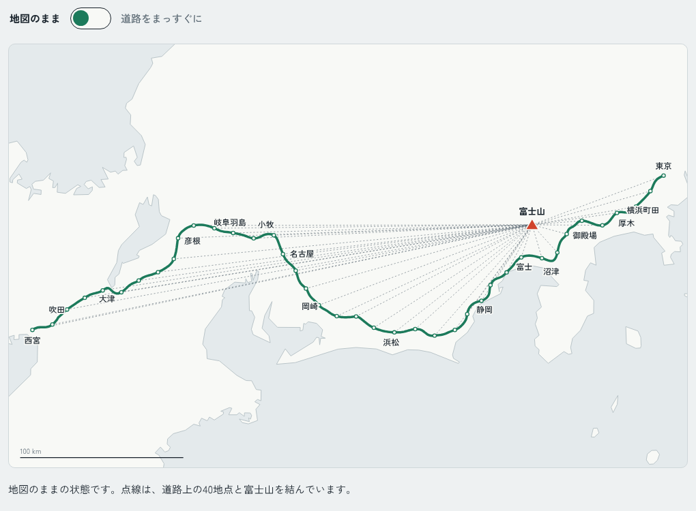

+++
author = "Yuichi Yazaki"
title = "Where to Place the Viewpoint: Thinking from Kohei Sugiura's Map of a Wandering Mount Fuji"
slug = "fuji-from-the-road"
date = "2026-11-22"
description = "An interactive essay that tests the idea of Kohei Sugiura's diagram of a wandering Mount Fuji with moving figures, compares four combinations of camera direction (fixed or following) and position (overview or eye level), and considers where to place the viewpoint when communicating data."
categories = [
    "principle"
]
tags = [
    "interactive",
    "Kohei Sugiura",
    "map",
    "viewpoint"
]
image = "images/cover-four-views.png"
+++

"Shiten o doko ni oku ka" (Where to Place the Viewpoint) is an interactive essay that you read while testing, with moving figures, the idea of Kohei Sugiura's diagram "Uō-saō suru Fujisan no chizu" (A Map of a Wandering Mount Fuji). It compares four combinations of camera direction (fixed or following) and position (overview or eye level). It explains one way to place the viewpoint: redraw the data so that it follows the reader, then turn that into an overview.

**[Open "Where to Place the Viewpoint"](https://fuji-from-the-road.visualizing.jp/)** (the essay itself is in Japanese)

This page introduces the essay. The essay is at the link above and runs in the browser.

<!--more-->

## Straighten the road, and Mount Fuji moves

Sugiura's diagram shows how the direction and distance of Mount Fuji change as you drive along the Tōmei Expressway. The essay recalculates this idea from public data. It stretches the Tōmei and Meishin expressways, from Tokyo to Nishinomiya, into one straight line. The direction and distance from each point to Mount Fuji are left unchanged.

Yuichi Yazaki / Screen of "Where to Place the Viewpoint"

The essay first asks you to predict, from three choices, where Mount Fuji will appear. Then you flip a switch in the figure, and it changes from the map state to the state with the road straightened.

## Four figures side by side

The essay organizes the figures by two questions about where the camera is placed.

| | Fixed (direction matches the ground) | Following (direction matches the traveler) |
|---|---|---|
| Overview (takes in the whole) | Map | Straightened figure |
| Eye level (seen from the spot) | Compass dial | Driver's seat |

Press "Run" or move the slider, and you can follow the same point in all four figures at once. The essay explains that only the straightened figure, the following overview, shows Mount Fuji's wandering at a glance.

## The same thing with a timetable

The second half applies the same arrangement to a railway timetable. The question is whether to fix the scale to clock time, or to make it follow the "now" of a person standing on the platform and write "minutes until departure." You can run four figures on a fictional line and schedule: a train diagram, two kinds of departure board, and a waiting-time figure.

At the end, the essay sums up the steps for redrawing your own data as five questions: who the reader is, where to put the origin, what axes and units to use, what to keep and what to discard, and whether to turn what was redrawn to follow the reader into an overview.

## Caveats

- The figures in the essay are a study recalculated from public data. They do not reproduce the original diagram. The choice of points and the precision of the road differ from the original, so the shapes do not match.
- Roads, coastlines, and lakes are public data from Natural Earth (1:10m). The alignment is simplified, and positions are off by several kilometers.
- Directions and distances are calculated on the map. From distant points, Mount Fuji cannot actually be seen.
- The timetable example is a fictional line and schedule made for explanation.

Sugiura's maps also come up in [the article on former US Ambassador to Japan Reischauer's cartogram](/en/reischauer-cartogram/).

## References

- Where to Place the Viewpoint (in Japanese). [fuji-from-the-road.visualizing.jp](https://fuji-from-the-road.visualizing.jp/)
- Calculation details and source code. [github.com/visualizing-jp/fuji-from-the-road](https://github.com/visualizing-jp/fuji-from-the-road)
- Natural Earth. [naturalearthdata.com](https://www.naturalearthdata.com/)
