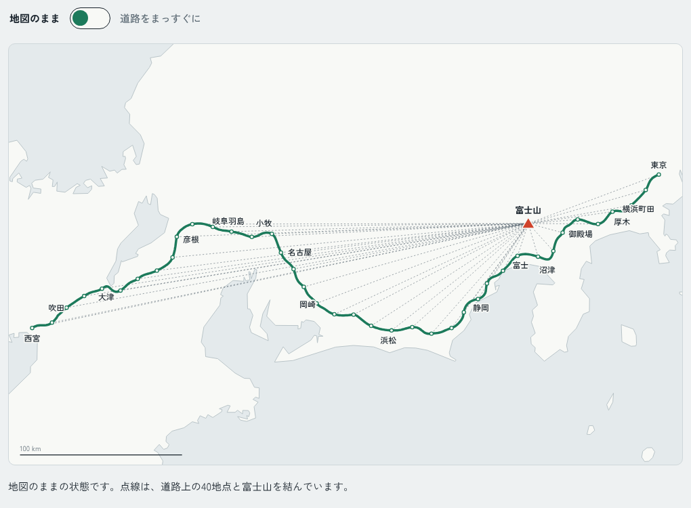

+++
author = "矢崎裕一"
title = "視点をどこに置くか──杉浦康平「右往左往する富士山の地図」から考える"
slug = "fuji-from-the-road"
date = "2026-11-22"
description = "杉浦康平「右往左往する富士山の地図」のアイデアを動く図で確かめ、カメラの向き（固定／追従）と位置（俯瞰／目線）の4つの組み合わせを比べて、データを伝えるときの視点の置き方を考える読み物です。"
categories = [
    "principle"
]
tags = [
    "インタラクティブ",
    "杉浦康平",
    "地図",
    "視点"
]
image = "images/cover-four-views.png"
series = ["interactive-explainers"]
series_weight = 20
seriesTitle = "視点をどこに置くか──右往左往する富士山の地図"
+++

「視点をどこに置くか」は、杉浦康平氏のダイアグラム「右往左往する富士山の地図」のアイデアを、動く図で確かめながら読むインタラクティブな読み物です。カメラの向き（固定／追従）と位置（俯瞰／目線）の4つの組み合わせを比べます。読み手に追従して描き直したものを俯瞰にする、という視点の置き方を説明します。

**[「視点をどこに置くか」を開く](https://fuji-from-the-road.visualizing.jp/)**

このページは、その読み物の紹介です。本編は上のリンク先にあり、ブラウザでそのまま動きます。

<!--more-->

## 道路をまっすぐにすると、富士山が動く

「右往左往する富士山の地図」は、東名高速道路を走るとき、富士山の見える方向と距離がどう変わるかを描いた図です。本編は、このアイデアを公開データで計算し直しています。東京から西宮までの東名・名神高速道路を、まっすぐな一本の線に伸ばします。各地点から富士山への方向と距離は変えません。

矢崎裕一／「視点をどこに置くか」の画面

本編では、まず富士山がどこに現れるかを3つの選択肢から予想します。そのあと図のスイッチを入れると、地図の状態から、道路をまっすぐにした状態へ図が切り替わります。

## 4つの図を並べて比べる

本編は、図をカメラの置き方についての2つの問いで整理しています。

| | 固定（向きを地面に合わせる） | 追従（向きを走る人に合わせる） |
|---|---|---|
| 俯瞰（全体を収める） | 地図 | まっすぐにした図 |
| 目線（その場から見る） | 方位盤 | 運転席 |

「走る」を押すか、スライダーを動かすと、同じ地点を4つの図で同時に追えます。富士山の右往左往が一目で分かるのは、追従の俯瞰である「まっすぐにした図」だけだと、本編は説明しています。

## 時刻表でも同じことをする

本編の後半は、同じ整理を鉄道の時刻表に当てはめます。目盛りを時刻に固定するか、ホームに立つ人の「いま」に追従させて「あと何分」で書くかです。ダイヤグラム、2種類の発車標、待ち時間の図の4つを、架空の路線とダイヤで動かせます。

最後に、自分のデータで描き直すときの手順を5つの問いにまとめています。読み手は誰か、原点をどこに置くか、軸と単位を何にするか、何を保ち何を捨てるか、追従で描き直したものを俯瞰にするか、です。

## 断り書き

- 本編の図は、公開データから計算し直した習作です。原図を再現したものではありません。地点の取り方や道路の精度が原図と違うため、形は一致しません。
- 道路・海岸線・湖は Natural Earth（1:1000万）の公開データです。線形は簡略化されていて、位置に数kmのずれがあります。
- 方向と距離は地図上の計算です。遠い地点では、実際には富士山は見えません。
- 時刻表の例は、説明のために作った架空の路線とダイヤです。

杉浦康平氏の地図については、[ライシャワー元駐日大使のカルトグラム地図の記事](/reischauer-cartogram/)でも触れています。

## 参考・出典

- 視点をどこに置くか. [fuji-from-the-road.visualizing.jp](https://fuji-from-the-road.visualizing.jp/)
- 計算の詳細とソースコード. [github.com/visualizing-jp/fuji-from-the-road](https://github.com/visualizing-jp/fuji-from-the-road)
- Natural Earth. [naturalearthdata.com](https://www.naturalearthdata.com/)
