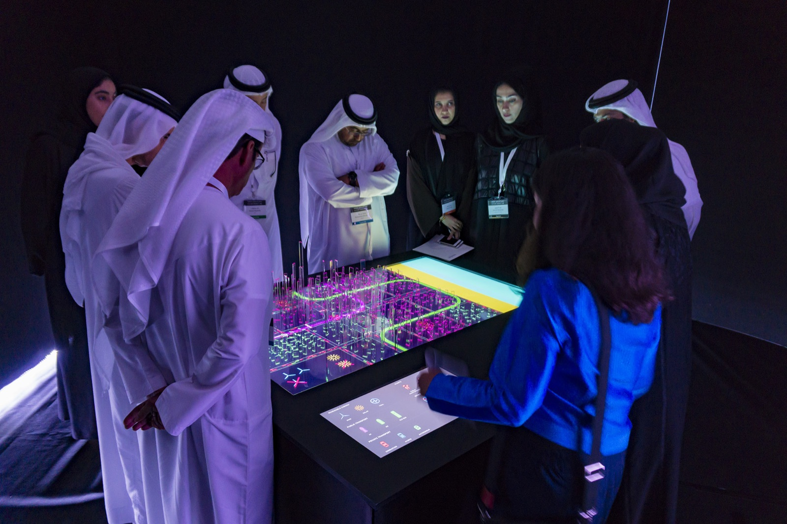
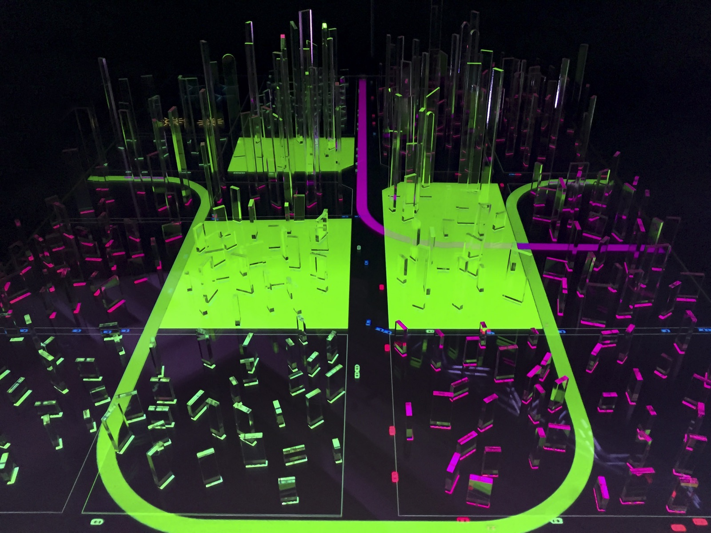
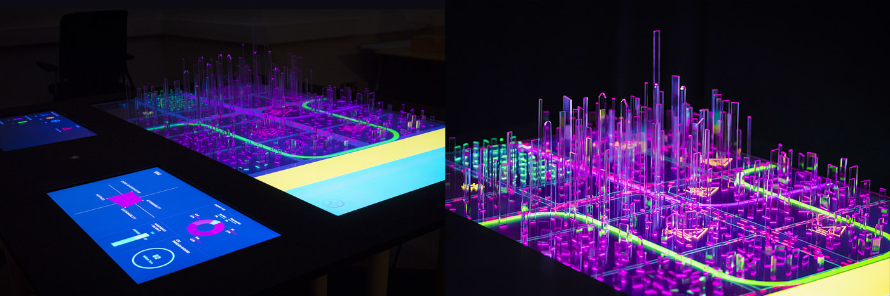
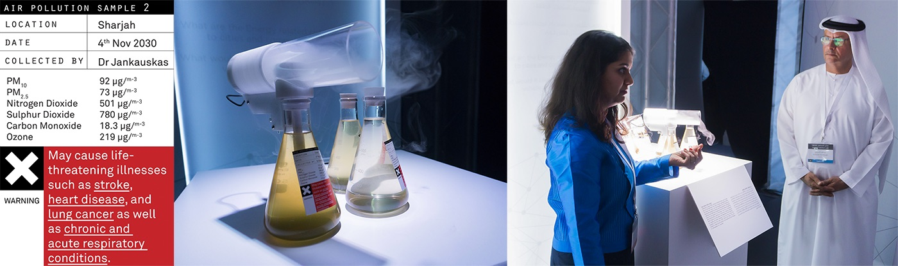
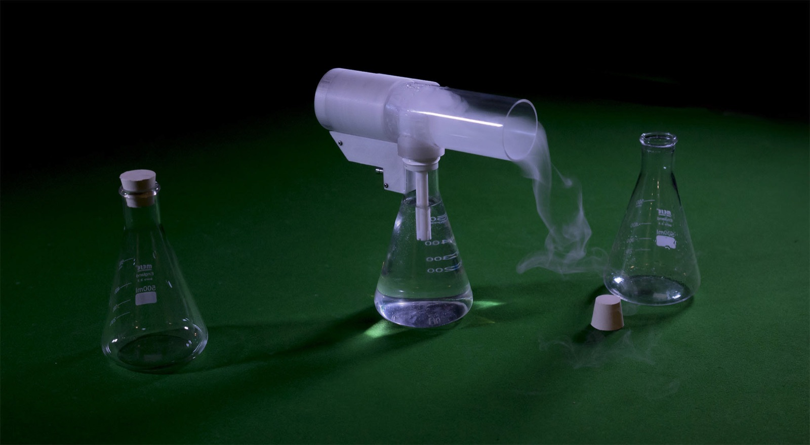

+++
author = "Yuichi Yazaki"
title = "Turning Numbers into Evidence You Can Inhale: Superflux's The Future Energy Lab"
slug = "future-energy-lab"
date = "2026-08-16"
description = "A reading of a project that turned UAE projections into a city model that policymakers gather around and a sample of future air that can be inhaled, through Anab Jain's idea that data is not evidence."
categories = [
    "consume"
]
tags = [
    "original visual transformation",
]
image = "images/cover.jpg"
series = ["speculative-design"]
series_weight = 3
seriesByline = "Superflux"
seriesTitle = "Turning Numbers into Evidence You Can Breathe"
+++

Data is not evidence, writes Anab Jain of Superflux in a Medium essay. The studio's *The Future Energy Lab* turned the United Arab Emirates' (UAE) econometric data and future projections into a city model that policymakers could gather around and operate, and into a sample of future air that could be inhaled. It left the numbers off the screen and made them evidence that could be experienced.

The clients were the UAE's Ministry of Energy and the Prime Minister's Office, and the presentation took place at a policy lab held around January 2017. What follows draws on Superflux's official page, Jain's TED talk (2017), and her Medium essay (2017-06-28). The UAE side's announcements are checked against government summaries and contemporary press reports.

<!--more-->

All photos are from the [Superflux official page](https://superflux.in/index.php/work/futureenergylab/). They are records of a policy lab held around January 2017, not of a public exhibition.

## What did the Prime Minister's Office and the Ministry of Energy ask for?

Superflux's official page states two challenges. One was to move from safety and certainty toward uncertainty. The other was to turn that uncertainty into a sense of control.

The brief was to build a way of experiencing multiple energy futures. Together with ministers and decision makers, the team would stress-test the opportunities of each future and its consequences for the system as a whole. The goal was to inform national energy policy through 2050.

The venue was called the Future Energy Lab. The official page lists the attendees as the Prime Minister, the cabinet leadership, the Ministry of Energy, policymakers, and heads of utility and energy organizations. In the same setting, the foresight company Rorosoro handled an energy simulator and a role-playing game. Superflux's part was the Future Energy Zone, which dealt with the future city.

The studio's annual review lists this project under 2016. The UAE's Energy Strategy 2050 was announced on January 10, 2017. From the primary sources, the order is that the work was done in 2016 and presented just before the strategy announcement.

The starting material was the Ministry of Energy's econometric data and projections.

## Switching between five futures on a tabletop

The core of the Future Energy Zone is a model of a future metropolis. Superflux writes that it extrapolated the ministry's data and projections and "played out" in the model what new energy policies imply for the urban landscape. The aim was to surface the link between the macro level of investment and the micro level of social and technological change.

The official photo shows a large table in a dark room. The board is a gridded city, with translucent columns of varying heights standing like buildings. Between the columns, lit from the board, run pink routes and a large yellow-green loop. The differences the official page lists are the adoption of renewable energy, alternative public transport, peer-to-peer energy trading, and social and cultural change.

Photo: from the [Superflux official page](https://superflux.in/index.php/work/futureenergylab/)

A control panel is embedded at the front. The visible labels are RENEWABLE ENERGY, PUBLIC TRANSPORT, and PRIVATE TRANSPORT. Participants are taken through five future worlds.

Numerical screens remain beside the model. According to the official page, a separate screen tracked a future happiness index, energy diversification, the affordability and sustainability of each future, and changes in cost and carbon emissions. A blue screen titled ENERGY SYSTEM shows a quadrant chart, a bar chart, and a donut chart.

Photo: from the [Superflux official page](https://superflux.in/index.php/work/futureenergylab/)

At TED, Jain says that on this city model "we visualized many possible futures." But this is not a chart on the public web. It is **a table that maps policy variables onto the shape, routes, and indicators of a city, and lets them be switched on the spot**. The model takes care of space, and the screens take care of indicators.

## Even after seeing the model: "I can't tell my son to give up his car"

At TED, Jain says that a reaction came up: "I can't tell my son to give up his car." The backbone of her story is that this failure of understanding created the need for the next piece of evidence, the air.

On an NPR program, Jain uses the term *data spectatorship*. People look at beautiful visualizations, graphs, and indicators, but they do not understand them as a story directly connected to their own lives, so no action follows. The reaction of the Lab's participants can be read as one instance of this state.

In her Medium essay, Jain takes the problem a step further. Historical and contemporary data are used as a "power of attorney" for future change. In the age of data capital, she suspects, the belief that data is evidence has hardened. What about what cannot be measured? Why do people not act even when they have information? What about the biases of those who generate the data and those who interpret it?

She then cites Brendan Clarke's definition: evidence is special data placed in a testing relationship with a hypothesis. On that basis, Superflux writes that it "makes and constructs" the air, products, and services of the future.

Starting from this definition, the author reads the question for visualization as changing. It is not enough to show the right number. The hypothesis that the number tests has to be placed in front of the audience.

## Air from 2030, impossible to inhale even in small amounts

Alongside the model, a set of artifacts belonging to each future was made. Superflux calls them "objects of possibility, not prophecy." White plinths stand in a row, and one of the five objects the official page describes in detail is the air sample.

The air sample shows the consequences of Business As Usual: the air of a city that kept burning fossil fuels. According to the official page, there are three samples, for 2020, 2028, and 2034. Based on projections of climate and fossil-fuel emissions, they contain "the most likely combination" of PM10, PM2.5, carbon monoxide, sulfur dioxide, nitrogen dioxide, and ozone.

> noxious stuff, impossible to inhale even a small amount

These are the official page's words. They mean something so harmful that even a small amount cannot be breathed in. Superflux positions the sample as delivering experiential evidence to a place that predictions and data cannot reach.

Photo: from the [Superflux official page](https://superflux.in/index.php/work/futureenergylab/)

The label in the photo hides no numbers. It reads AIR POLLUTION SAMPLE 2, location Sharjah, date 4th Nov 2030, with values for PM10, PM2.5, nitrogen dioxide, and carbon monoxide listed. Below is a warning that it may cause stroke, heart disease, lung cancer, and more. The year that TED and Medium refer to, 2030, is the year on this label. The official page's three years (2020 / 2028 / 2034) and the narrated "one breath of 2030" can be read as summaries of the same series.

At TED, Jain says she made an approximate sample with a scientist at a chemistry lab in her home city in India. The apparatus is a white tube set on an Erlenmeyer flask, from which vapor falls. In place of a graph, there is an input to the lungs.

Photo: from the [Superflux official page](https://superflux.in/index.php/work/futureenergylab/)

The other four objects are a terminal for a fund contributed to children's futures, a medal awarded to those who contributed to demand reduction, a souvenir from a maglev line linking Abu Dhabi and London, and a screen for Energycoin, a currency for trading surplus electricity. Each can be read as converting a report on 2050 into today's wallet, honor, and trade.

According to TED, the energy investment announcement came the day after the lab. Jain states a caveat about causation up front: "We don't know what part our future experiences played in this decision. But we do know that they changed energy policy to mitigate such scenarios."

The UAE's own records do not name the studio. On January 10, 2017, the Prime Minister announced the strategy. The 2050 energy mix is 44% renewables, 38% gas, 12% clean fossil, and 6% nuclear. The investment is AED 600 billion (about 163 billion dollars at the time), and that is the total, not renewables alone. Superflux's official page describes the same amount as going "to renewables." The figures match, but the two sources describe the breakdown differently.

## How did third parties see this work?

There is little design criticism that discusses the piece on its own. Its circulation centers on the episode Jain herself told at TED. Beyond that, here are three venues with different points of focus.

| Outlet | Date | Point of focus |
|---|---|---|
| NPR TED Radio Hour | 2017-09-15 | How far a causal link to policy can be claimed |
| BBC Radio 4 *Positive Thinking* | 2022-08-04 | Whether "feeling" the future produces action |
| designboom | ― | The difference between forecasting and speculative design |

On NPR, the host Guy Raz presses her. Was the air almost too dangerous? Did a minister say "we don't want this"? Jain answers, "I think it was one factor. There were many." This can be read as a record of a third-party interviewer trimming an overestimate of causation on the spot.

BBC Radio 4 took up this work in an episode on the climate crisis. The program's question was:

> Can 'feeling' the future create meaningful action to solve the climate crisis?

The question is whether feeling the future can produce meaningful action on the climate crisis. The "air of the future" made for the UAE is lined up as an early example.

designboom's feature on the studio generalizes a little more. Forecasting extends from data, while speculative design builds from imagination supported by research. Its outputs, it writes, are not reports to be read but rooms to enter, films to watch, and smells that arrive before you understand them. This is not a review specific to the Lab, but it overlaps with the position of the air sample.

## Takeaways

There are three things this project offers to visualization.

- Decide the hypothesis before you show anything. By Clarke's definition, data becomes evidence only when tied to a hypothesis. Before drawing a chart, you can write out which question the number tests, such as "what happens to the air under business as usual?"
- Divide the work between indicators and experience. The Lab did not abandon screens. The cost and carbon screens stayed beside the model, with the model handling space and the objects handling daily life. The design could be to add, next to a dashboard, one piece translated into the unit of the audience's own life.
- Don't turn it into a success story. According to TED, the strategy was announced the day after the lab, but the makers themselves say they do not know what share they contributed. In a results report, you can keep official records and self-assessment separate.

In Jain's telling, the reaction "I can't tell my son to give up his car" is what created the need for the next piece of evidence, the air. Don't end by showing numbers; look for a form the audience can receive as their own decision. That is where this work becomes useful.

## References

**Primary sources**

- [The Future Energy Lab — Superflux](https://superflux.in/index.php/work/futureenergylab/) (photos are from the same page)
- Superflux, [Back to the Future: What We Did in 2016](https://superflux.in/index.php/back-future-2016/) (2017-01-31)
- Anab Jain, [Can speculative evidence inform decision making?](https://medium.com/superfluxstudio/can-speculative-evidence-inform-decision-making-6f7d398d201f) (2017-06-28)
- Anab Jain, [Why we need to imagine different futures](https://www.ted.com/talks/anab_jain_why_we_need_to_imagine_different_futures) (TED2017) / [full transcript on the studio's site](https://superflux.in/index.php/work/why-we-need-to-imagine-different-futures-ted-talk/)
- UAE Ministry of Climate Change and Environment, [Strategies](https://site.moccae.gov.ae/en/about-ministry/irena/strategies.aspx) (official summary of Energy Strategy 2050)
- LeAnne Graves & Thamer Al Subaihi, [UAE Energy Plan aims to cut CO2 emissions 70% by 2050](https://www.thenationalnews.com/uae/uae-energy-plan-aims-to-cut-co2-emissions-70-by-2050-1.51582) (*The National*, 2017-01-10)
- [UAE unveils long-term energy strategy](https://www.world-nuclear-news.org/Articles/UAE-unveils-long-term-energy-strategy) (World Nuclear News)

**Secondary sources**

- NPR / TED Radio Hour, [Anab Jain: Can A Glimpse Of Tomorrow, Change Our Decisions Today?](https://text.npr.org/547886265) (2017-09-15)
- BBC Radio 4, *Positive Thinking* (2022-08-04). Introduced in [Superflux Featured on BBC Radio 4](https://superflux.in/index.php/superflux-featured-on-bbc-radio-4/)
- [how superflux uses speculative designs to transform our present](https://www.designboom.com/design/critical-futures-how-superflux-draws-upon-speculative-designs-transform-present/) (designboom)
