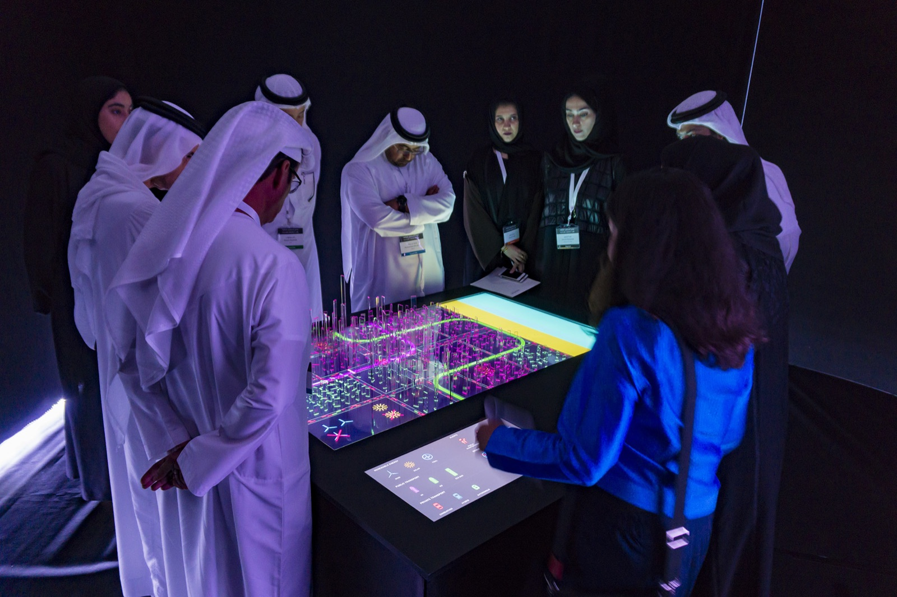
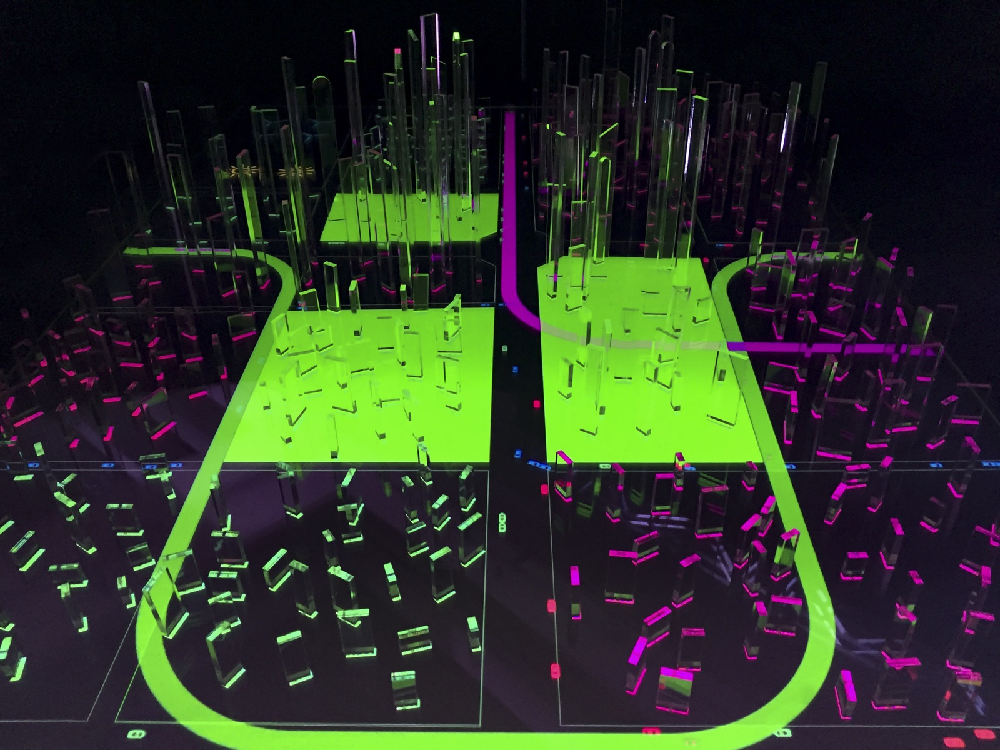
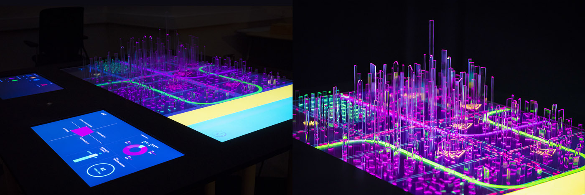
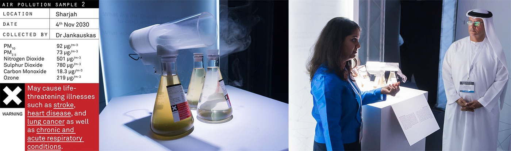
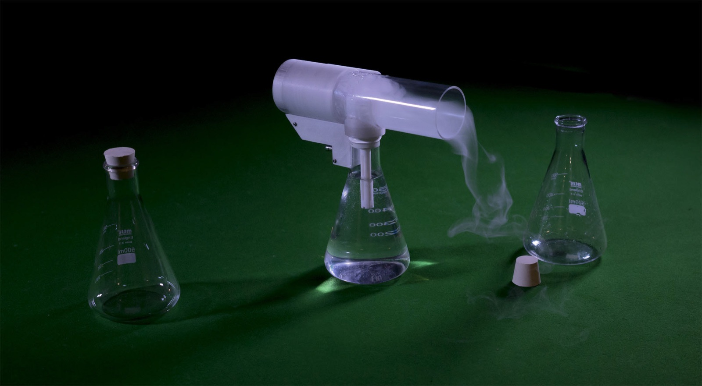

+++
author = "矢崎裕一"
title = "数字を、吸える証拠にする──Superflux『The Future Energy Lab』"
slug = "future-energy-lab"
date = "2026-08-16"
lastmod = "2026-11-01"
description = "UAE の将来推計を、政策を決める人が囲む都市模型と、吸える未来の大気試料に変えた仕事です。「データは証拠ではない」という Anab Jain の考えから読み解きます。"
categories = [
    "consume"
]
tags = [
    "オリジナルのビジュアル変換",
]
image = "images/cover.jpg"
series = ["speculative-design"]
series_weight = 3
seriesByline = "Superflux"
seriesTitle = "数字を、吸える証拠にする"
+++

データは証拠ではない、と Superflux（スーパーフラックス）の Anab Jain（アナブ・ジェイン）は Medium の論考に書いています。同スタジオの『The Future Energy Lab』は、アラブ首長国連邦（UAE）の計量経済データと将来推計を、政策を決める人が囲んで操作できる都市模型と、吸える未来の大気試料に変えました。数字を画面に残さず、体験できる証拠にした仕事です。

依頼主は UAE のエネルギー省と首相府で、提示は2017年1月前後に開かれた政策ラボの場です。以下は Superflux の公式ページと、Jain の TED トーク（2017）、Medium の論考（2017-06-28）に沿います。UAE 側の発表は、政府系の要約と当時の報道で確かめます。

<!--more-->

写真はいずれも [Superflux 公式ページ](https://superflux.in/index.php/work/futureenergylab/) より。公開体験ではなく、2017年1月前後に開催された政策ラボの記録です。

## 首相府とエネルギー省は何を頼んだか

Superflux が公式ページに書く課題は二つです。安全と確実さから、不確実さへ移ること。そして、その不確実さを制御できる感覚に変えることです。

依頼の中身は、エネルギーをめぐる複数の未来を体験する仕組みをつくることでした。各未来の機会と、システム全体への帰結を、閣僚や意思決定者と一緒にストレステストする。目標は、2050年までの国家エネルギー政策に役立てることです。

場は Future Energy Lab と呼ばれました。公式が挙げる出席者は、首相、内閣首脳、エネルギー省、政策担当者、公益事業とエネルギー部門の組織長です。同じ場で、foresight 会社の Rorosoro がエネルギーシミュレータとロールプレイングゲームを担当しました。Superflux の担当は、未来の都市を扱う Future Energy Zone です。

スタジオの年次回顧では、この仕事は2016年の項に載っています。UAE の Energy Strategy 2050 が発表されたのは、2017年1月10日です。作業は2016年、提示は戦略発表の直前、という順が一次情報から取れます。

出発点にあった材料は、エネルギー省の計量経済データと推計でした。

## テーブルの上で、五つの未来を切り替える

Future Energy Zone の中核は、未来の大都市模型です。Superflux は、省のデータと推計を外挿し、新しいエネルギー政策が都市景観に及ぼす含意を模型で「演じた」と書いています。投資というマクロと、社会・技術の変化というミクロのつながりを、表に出すためです。

公式写真に写るのは、暗い部屋の大きなテーブルです。盤面は格子状の都市で、高さの違う半透明の柱が建物のように立ちます。盤面から照らされた柱のあいだを、桃色の経路と黄緑の大きなループが走ります。公式が挙げる差分は、再生可能エネルギーの導入、代替公共交通、ピアツーピアのエネルギー取引、社会文化の変化です。

写真：[Superflux 公式ページ](https://superflux.in/index.php/work/futureenergylab/) より

手前には操作盤が埋め込まれています。見えるラベルは RENEWABLE ENERGY、PUBLIC TRANSPORT、PRIVATE TRANSPORT です。参加者は五つの未来世界を通されます。

模型の横には、数字の画面も残っています。公式によれば、future happiness index、エネルギー多様化、各未来の affordability と sustainability、費用と炭素排出の変化を、別画面で追えました。ENERGY SYSTEM と題した青い画面には、象限図・棒グラフ・ドーナツグラフが並びます。

写真：[Superflux 公式ページ](https://superflux.in/index.php/work/futureenergylab/) より

Jain は TED で、この都市模型のうえで「多くの可能な未来を可視化した」と語っています。ただし、これは公開ウェブのチャートではありません。**政策の変数を、都市の形と経路と指標へ写し、その場で切り替えるテーブル** です。空間は模型が、指標は画面が受け持ちます。

## 模型を見ても、「息子に車をやめろとは言えない」

TED で Jain は、「息子に車をやめろとは言えない」という反応が出たと語っています。理解の失敗が、次の証拠である大気を必要にした、というのが Jain の話の骨格です。

Jain は NPR の番組で、*data spectatorship* という言葉を使っています。美しい可視化やグラフ、指標を見る。しかし、自分の生活に直接つながる物語としては理解しない。だから行動が起きない、という説明です。Lab の参加者の反応は、この状態の一例として読めます。

Medium の論考で、Jain はこの問題を一歩進めます。歴史データと現代のデータは、将来の変化の「委任状」として使われる。データ資本の時代に、データは証拠だという信念が固まった、と疑います。測れないものはどうか。情報があっても人が動かないのはなぜか。生成者と解釈者のバイアスはどうか。

そこで引くのが、Brendan Clarke の定義です。証拠とは、仮説との検証関係に置かれた特別なデータである。そのうえで Superflux は、未来の空気・製品・サービスを「つくり、構成する」と書いています。

この定義に立つと、可視化の問いが変わる、と筆者は読みます。正しい数を示すだけでなく、その数がどの仮説を検証しているのかを、受け手の前に置く必要がある。

## 少量でも吸えない、2030年の大気試料

模型とあわせて、各未来に属する人工物の一式がつくられました。Superflux はそれを「予言の物体ではなく、可能性の物体」と呼びます。白い台座が並び、公式が詳しく書く五つの物体の一つが大気試料です。

大気試料は、現状維持（Business As Usual）の帰結を示します。化石燃料を燃やし続けた都市の空気です。公式ページによれば、試料は2020年、2028年、2034年の三つ。気候と化石燃料排出の推計に基づき、PM10、PM2.5、一酸化炭素、二酸化硫黄、二酸化窒素、オゾンの「もっともありそうな組み合わせ」を含みます。

> noxious stuff, impossible to inhale even a small amount

公式ページの言葉です。少量でも吸い込めないほど有害なもの、という意味です。Superflux はこの試料を、予測とデータが届かないところへ体験的な証拠を届けるもの、と位置づけています。

写真：[Superflux 公式ページ](https://superflux.in/index.php/work/futureenergylab/) より

写真のラベルは、数字を隠していません。AIR POLLUTION SAMPLE 2、場所は Sharjah、日付は 4th Nov 2030。PM10、PM2.5、二酸化窒素、一酸化炭素の値が並びます。下には、脳卒中・心疾患・肺がんなどを起こしうる、という警告があります。TED と Medium が2030年に寄せて語るのは、このラベルの年です。公式ページの三年分（2020 / 2028 / 2034）と、語りの「2030年の一吸い」は、同じ系列の要約と読めます。

Jain は TED で、インドの出身都市にある化学研究室の科学者と、近似の試料をつくったと述べています。装置は、三角フラスコの上に白い管が乗り、蒸気が落ちるものです。グラフの代わりに、肺への入力があります。

写真：[Superflux 公式ページ](https://superflux.in/index.php/work/futureenergylab/) より

残る四つの物体は、子どもの未来へ拠出する基金の端末、需要削減の功労者に贈る勲章、アブダビとロンドンを結ぶリニアの土産、余剰電力を取引する通貨 Energycoin の画面です。どれも、2050年の報告書を、いまの財布や名誉や取引へ置き換えている、と読めます。

TED によれば、エネルギー投資の発表は、このラボの翌日でした。Jain は因果を先に留保しています。「私たちの未来体験がこの決定のどの部分を担ったかは分からない。だが、そのようなシナリオを緩和するようエネルギー政策を変えたことは知っている」。

UAE 側の記録は、スタジオの名を出しません。2017年1月10日、首相が戦略を発表しました。2050年の電源構成は、再エネ 44%、ガス 38%、クリーン化石 12%、原子力 6% です。投資は AED 600 billion（当時約1630億ドル）で、再エネ単体ではなく総額です。Superflux の公式ページは同じ額を「再エネに」と書いています。数字は一致しますが、内訳の書き方は両者で違います。

## 第三者はこの仕事をどう見たか

作品単体を論じたデザイン批評は、多くありません。流通の中心は、Jain 自身が TED で語ったエピソードです。そのうえで、論点の違う三つの場を挙げます。

| 媒体 | 日付 | 見ている論点 |
|---|---|---|
| NPR TED Radio Hour | 2017-09-15 | 政策への因果をどこまで言えるか |
| BBC Radio 4 *Positive Thinking* | 2022-08-04 | 未来を「感じる」ことが行動を生むか |
| designboom | ― | 予測とスペキュラティブ・デザインの違い |

NPR では、聞き手の Guy Raz が確かめます。大気はほとんど危険すぎるほどだったか。閣僚は「これを望まない」と言ったか。Jain は「一因だったと思う。要因は多い」と答えます。第三者の聞き手が、因果の過大評価をその場で削った記録と読めます。

BBC Radio 4 は、気候危機を扱う回でこの仕事を取り上げました。番組の問いは次のとおりです。

> Can 'feeling' the future create meaningful action to solve the climate crisis?

未来を「感じる」ことは、気候危機に意味のある行動を生むか、という問いです。UAE 向けの「未来の空気」は、その初期事例として並べられています。

designboom のスタジオ特集は、もう少し一般化します。予測はデータから延びるが、スペキュラティブ・デザインは研究に支えられた想像から建てる。出力は読む報告書ではなく、入る部屋、見るフィルム、理解する前に届く匂いだ、と書きます。Lab 固有の評ではありませんが、大気試料の位置づけと重なります。

## 使い道

この仕事から可視化に持ち帰れることは、三つあります。

- 見せる前に、仮説を決める。Clarke の定義に従えば、データは仮説と結びついて初めて証拠になります。チャートを描く前に、その数字が「現状維持の空気はどうなるか」のような、どの問いを検証するのかを書き出せます。
- 指標と体験を分担させる。Lab は画面を捨てていません。費用や炭素の画面は模型の横に残り、空間は模型、生活は物体が受け持ちました。ダッシュボードの横に、受け手の生活の単位へ訳した一枚を足す、という設計にできます。
- 成功談にしない。TED によれば戦略はラボの翌日に発表されましたが、作り手自身が寄与の割合は分からないと言っています。成果報告では、公式記録と自己評価を分けて書けます。

Jain の話では、「息子に車をやめろとは言えない」という反応が、次の証拠である大気を必要にした、という筋立てになっています。数字を見せて終わりにせず、受け手が自分の決定として受け取れる形を探す。そこに、この仕事の使い道があります。

## 参考・出典

**一次情報**

- [The Future Energy Lab — Superflux](https://superflux.in/index.php/work/futureenergylab/)（写真も同ページ）
- Superflux, [Back to the Future: What We Did in 2016](https://superflux.in/index.php/back-future-2016/)（2017-01-31）
- Anab Jain, [Can speculative evidence inform decision making?](https://medium.com/superfluxstudio/can-speculative-evidence-inform-decision-making-6f7d398d201f)（2017-06-28）
- Anab Jain, [Why we need to imagine different futures](https://www.ted.com/talks/anab_jain_why_we_need_to_imagine_different_futures)（TED2017）／[スタジオ掲載の全文](https://superflux.in/index.php/work/why-we-need-to-imagine-different-futures-ted-talk/)
- UAE Ministry of Climate Change and Environment, [Strategies](https://site.moccae.gov.ae/en/about-ministry/irena/strategies.aspx)（Energy Strategy 2050 の公式要約）
- LeAnne Graves & Thamer Al Subaihi, [UAE Energy Plan aims to cut CO2 emissions 70% by 2050](https://www.thenationalnews.com/uae/uae-energy-plan-aims-to-cut-co2-emissions-70-by-2050-1.51582)（*The National*, 2017-01-10）
- [UAE unveils long-term energy strategy](https://www.world-nuclear-news.org/Articles/UAE-unveils-long-term-energy-strategy)（World Nuclear News）

**第三者評価**

- NPR / TED Radio Hour, [Anab Jain: Can A Glimpse Of Tomorrow, Change Our Decisions Today?](https://text.npr.org/547886265)（2017-09-15）
- BBC Radio 4, *Positive Thinking*（2022-08-04）。紹介は [Superflux Featured on BBC Radio 4](https://superflux.in/index.php/superflux-featured-on-bbc-radio-4/)
- [how superflux uses speculative designs to transform our present](https://www.designboom.com/design/critical-futures-how-superflux-draws-upon-speculative-designs-transform-present/)（designboom）
