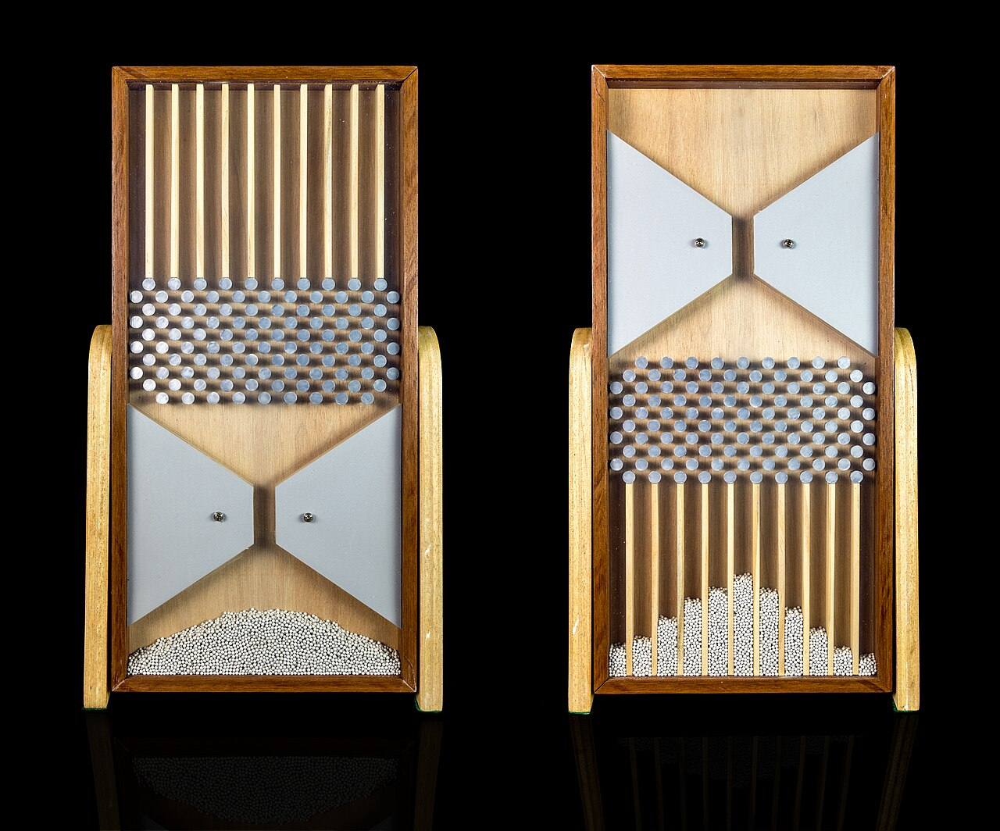
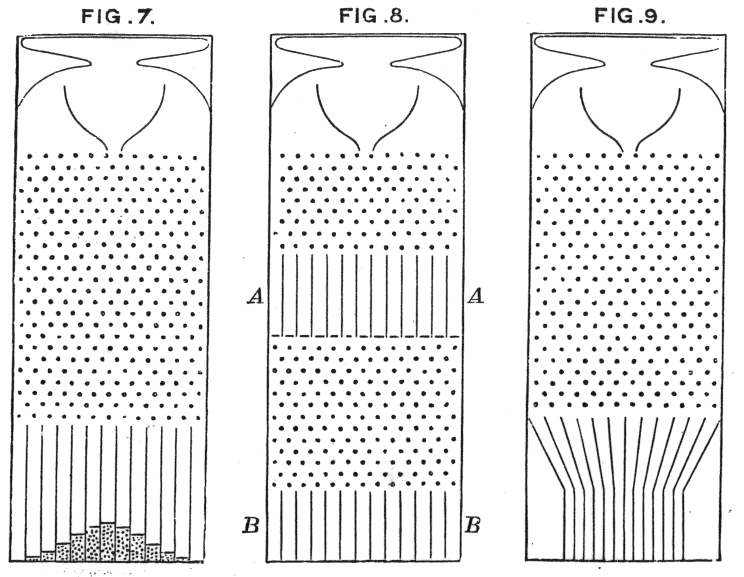
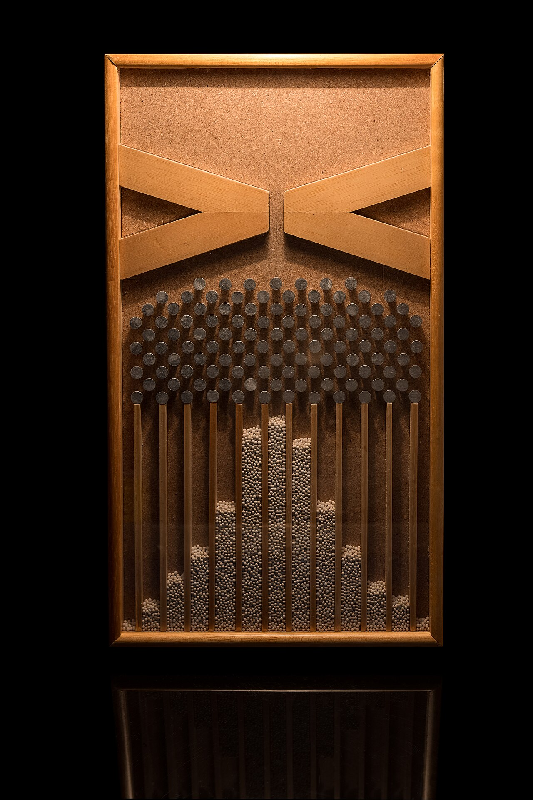

+++
author = "Yuichi Yazaki"
title = "Producing a Frequency Distribution by Dropping, Not Drawing: Galton's Quincunx"
slug = "galton-board"
date = "2026-11-01"
description = "A device in which one lead shot stands for one individual and one row of pins stands for one small chance event. Instead of drawing a frequency distribution, it produces one inside the apparatus by letting shot fall."
categories = [
    "consume"
]
tags = [
    "data physicalization",
    "histogram",
    "normal distribution",
    "Francis Galton"
]
image = "images/galton-box-replica.jpg"
series = ["data-physicalization"]
series_weight = 6
seriesByline = "Francis Galton"
seriesTitle = "Generating a Distribution by Dropping Balls: The Galton Board"
+++

Francis Galton's quincunx is the device now also known as the Galton board. One lead shot corresponds to one individual, and one row of pins corresponds to one small chance event. Rather than drawing a frequency distribution, it lets shot fall from the top and produces the distribution inside the apparatus, as the outline of the columns of shot that collect in the compartments below.

The original was made in 1873 by Tisley and Spiller of London to Galton's design, and is now in the Galton Collection at UCL (University College London). The dataphys.org entry gives the year as 1893, but UCL's record dates its manufacture to 1873. What follows is a reading based on Galton's own 1877 lecture and his 1889 book *Natural Inheritance*.

<!--more-->

## 1874: dropping lead shot at the Royal Institution

The device first appeared in public on 27 February 1874. Galton lectured at the Royal Institution in London under the title "On men of science, their nature and their nurture." The lecture abstract adds "[this was illustrated by many experiments]" at the passage on the "law of frequency of error." In his 1877 lecture he also recalls using the device "three years ago in this very theatre."

According to UCL's record (LDUGC-063), the original measures 360 × 290 × 52 mm. The historian of statistics Stephen M. Stigler writes that it has 17 rows of staggered pins.

The original carries an inscription explaining how to use it. Kunert et al. quote it from Stigler's *The History of Statistics* (1986).

> "Charge the instrument by reversing it, to send all the shots into the pocket. Then sharply re-reverse and immediately set it upright on a level table. The shot will all drop into the funnel, and running thence through its mouth, will pursue devious courses through the harrow and will accumulate in the vertical compartments at the bottom, there affording a representation of the law of dispersion."

In short: turn the body upside down to gather the shot in the pocket at the top, quickly flip it back and stand it on a level table. The shot runs from the funnel through the "harrow" (the rows of pins), collects in the compartments below, and so represents the law of dispersion.

Exhibit: Estes Objethos Atelier. Photo: Rodrigo Tetsuo Argenton. Collection: Matemateca (IME/USP). From Wikimedia Commons (CC BY-SA 4.0)

## One shot is one individual, one row of pins is one chance event

Galton described the device in detail in Chapter 5 of *Natural Inheritance* (1889).

> "I shall now illustrate the origin of the Curve of Frequency, by means of an apparatus shown in Fig. 7, that mimics in a very pretty way the conditions on which Deviation depends." (p.63)

This announces that he will show the "origin" of the frequency curve with a device that cleverly imitates the conditions on which deviation depends. It can be read as an attempt to depict not the curve itself but the conditions under which the curve arises.

Source: Francis Galton, *Natural Inheritance* (1889), Figs. 7–9. From Wikimedia Commons (public domain)

The pins are set in "quincunx fashion," and a falling shot is bound to strike a pin in every row. Each time, it goes "darting a step to the right or left," that is, it shifts one step to either side (p.64). Galton states the principle of the device as follows.

> "The principle on which the action of the apparatus depends is, that a number of small and independent accidents befall each shot in its career. … This illustrates and explains the reason why mediocrity is so common." (pp.64–65)

Many small, independent accidents befall each shot. Shifts to the right and to the left mostly cancel out, so most shot land close to directly beneath the funnel. That, he explains, is why mediocrity is so common.

The table below summarizes the correspondence between parts and meanings, drawn from Galton's text.

| Part of the device | What it stands for | Galton's words and source |
|---|---|---|
| One lead shot | One individual (in 1877, one member of a population of seeds) | "pellets which serve as representatives of a population of seeds" (1877, p.292) |
| One row of pins | One small, independent chance event | "small and independent accidents" (1889, pp.64–65) |
| Number of rows of pins | Number of independent factors that determine a value (height, for example) | "corresponds to an equal number of sets of rows of pins" (1889, p.84) |
| The vertical line through the funnel's mouth | The mean (the point of no deviation) | The vertical line through the mouth of the funnel (1889, p.65) |
| Left-right position of a compartment | Size of the deviation from the mean | The side walls of the box mark the limits of the range (1877, p.292) |
| Height of a column of accumulated shot | Frequency | "the columns of shot that accumulate" (1889, p.64) |
| Outline joining the tops of the columns | Frequency curve | "approximates to the Curve of Frequency" (1889, p.64) |

The core of the encoding can be read as two points: **position is the value, and accumulated height is the frequency.** Because one shot is one unit, the finished mound can also be read as a histogram built by stacking units.

## More rows change the width; more shot change the height

On 9 February 1877, Galton lectured in the same theatre on "Typical Laws of Heredity." He says it is easiest to "begin by showing it in action," and first sets the device going. He then speaks separately about the movement of individual shot and the shape of the whole.

> "The courses of the pellets are extremely irregular; it rarely happens that any two starting from the same point will pursue the same path from beginning to end; yet, notwithstanding this, you will observe the regularity of the outline of the heap formed by the accumulation of pellets." (1877, p.286)

Two shot starting from the same point will rarely follow the same path, and yet the outline of the heap is regular. The 1889 book likewise says the outline is "closely of the same shape however often the experiment is repeated" (p.64).

Exhibit: Estes Objethos Atelier. Photo: Rodrigo Tetsuo Argenton. Collection: Matemateca (IME/USP). From Wikimedia Commons (CC BY-SA 4.0)

What changes the shape of the mound? Galton distinguishes two factors.

- Number of rows of pins: with few rows, almost all the shot drop into the compartments directly below and form something like a "column." With a great many rows, the shot scatter widely and form something like a "horizontal bar" (1877, p.286).
- Quantity of shot: adding shot makes the mound higher. But the left-right distance that contains half of the shot does not change. This distance is the probable error, "Prob: Error," written Q in the book (1889, p.65).

In the 1877 lecture, he explains that if the curve is drawn on a rubber sheet, stretching it sideways increases the scatter and stretching it vertically increases the number. It can be read as the device separating the parts that determine a distribution's "shape" from the parts that determine its "quantity."

## Rearranging pins and boxes to explain heredity

The main subject of the 1877 lecture was heredity. Galton had been comparing the weights of sweet pea seeds between parents and offspring (Galton 1877, p.290). He kept the 1874 device as the lower stage and added a mechanism above it.

- The upper box and trap doors: the distribution of the parental generation. The shape of the mound is trimmed by a curved slit cut in the back board, and overflow shot are discarded to the back (p.292).
- Slanted chutes (shoots) inclined toward the center: reversion (regression). Every chute leads toward the central vertical line, so the width of the mound shrinks (p.292).
- The rows of pins below them: variation within a single family. Opening one trap door produces a small mound directly beneath it (p.292).

When all the trap doors are opened, the small mounds overlap and return to a mound just like the original. This showed, through a combination of parts, that the width of the distribution is preserved from one generation to the next. The lecture record describes Galton opening the trap doors one after another (p.292).

Stigler reads the text of the same lecture as indicating that there was a working model of the device representing natural selection (explanation of Fig. 3, p.474). The model has not survived. Kunert et al. write that the two-stage quincunx described in a letter of 12 January 1877 apparently was never actually built (p.150). Whether the two-stage device in the letter and the device in the lecture are the same has not been established.

In the 1889 book, the same structure is reused for thought experiments. In Fig. 8, shown above, the device is cut horizontally at an intermediate height and a box AA is inserted in the middle. If the probable error down to the middle is a, that from there to the bottom is b, and the total is q, then q² = a² + b², which is the composition of variances (pp.67–68). In Fig. 9, the shot are first gathered toward the center and then dropped, so that only the width shrinks while the shape is kept (p.69).

What Galton wanted to talk about with this device was heredity and the distribution of human ability. Kunert et al. write that Galton's main interest was "the improvement of mankind by selective breeding," and that for this purpose he coined the word eugenics (p.144). The mathematics of the device and the claims made with it need to be read separately.

## How third parties have seen the device

- As a tool for thinking: in his 2010 paper, Stigler reads the device as Galton's own instrument for arriving at regression. The slanted chutes of 1877 look at first like a "just-so story" with the conclusion built in (p.472). The decisive step was the idea of "running his quincunx backwards" (p.477): the shot in the lower boxes come, on average, not from directly above but from nearer the center.
- Both the mathematics and the context: Kunert, Montag and Pöhlmann, in their 2001 paper, describe the device as "a device, which generates a histogram which is similar to the normal distribution" (p.146). At the same time they point out that Galton's method of scaling was used to generalize about the abilities of races and "corresponded to the prevailing prejudice of that time" (pp.145–146).
- An objection from physics: in a 2006 manuscript, Kevin Judd of the University of Western Australia questions the very premise of "independent accidents." He ran a mechanical model, built with the original as a guide, on a computer and concluded that the motion of the shot does not follow a binomial process.

> "The internet abounds with so called simulations of the quincunx that are not simulations of the mechanical device, but simply simulations of a Binomial process, or random walk."

That is, many online "simulations" reproduce not the device but merely a binomial process. Judd nevertheless acknowledges the conceptual value of the statistical model.

Today the device is used to illustrate the central limit theorem (per Judd's abstract), but Galton himself did not use that term.

## Takeaways

Three things from this device can be carried back into visualization work.

The first is to assign the mechanism that produces a result, not the result itself, to parts. Viewers can look at the shot and the pins and explain, in the names of the parts, why the center ends up highest.

The second is to separate the factor that determines shape from the factor that determines quantity into different parts. Change the number of rows and the width changes; change the amount of shot and the height changes. In a chart too, keeping apart the appearance that depends on the amount of data and the appearance that expresses a property of the distribution can be read as making charts easier for people to compare.

The third is that a physical model gives form even to its premises. The moment one row of pins is called an "independent accident," that premise is built into the device. Judd's objection shows that the premise can diverge from the motion of real shot. When showing people how a visualization works, one also needs to be able to say which premise is being shown, as I read it.

Galton himself wrote that even after moving to formulas, one should not let go of the picture.

> "The visible Schemes are not, however, to be removed too soon from our imagination. It is always well to retain a clear geometric view of the facts when we are dealing with statistical problems, which abound with dangerous pitfalls …" (1889, pp.66–67)

The visible diagrams should not be removed from the imagination too soon; statistical problems abound with pitfalls, so it is wise to keep a clear geometric view of the facts. The quincunx can be read as a device that follows this attitude of "keeping it in view."

## References

**Primary sources**

- dataphys.org, "1893 – Galton Board" https://dataphys.org/list/galton-board/
- Francis Galton, *Natural Inheritance*, Macmillan, 1889, pp.62–69, 84. [Internet Archive](https://archive.org/details/naturalinherita00galtgoog) / [PDF at galton.org](https://galton.org/books/natural-inheritance/pdf/galton-nat-inh-1up-clean.pdf)
- Francis Galton, "Typical Laws of Heredity", *Proceedings of the Royal Institution* 8, 1877, pp.282–301 (lecture of 9 February 1877). [PDF at galton.org](https://galton.org/essays/1870-1879/galton-1877-roy-soc-typical-laws-heredity.pdf)
- Francis Galton, "On men of science, their nature and their nurture", *Proceedings of the Royal Institution* 7, 1874, pp.227–236 (lecture of 27 February 1874). [PDF at galton.org](https://galton.org/essays/1870-1879/galton-1874-men-of-science.pdf)
- Francis Galton, "Statistics by intercomparison, with remarks on the Law of Frequency of Error", *Philosophical Magazine*, 1875. [PDF at galton.org](https://galton.org/essays/1870-1879/galton-1875-intercomparison.pdf)
- UCL Collections Online, Quincunx, LDUGC-063 (maker, date of manufacture, dimensions, inscription). https://collections.ucl.ac.uk/Details/science/60000062
- Galton bibliography. https://galton.org/bibnew/all.html
- Images: Wikimedia Commons [Quincunx (Galton Box) - Galton 1889 diagram](https://commons.wikimedia.org/wiki/File:Quincunx_(Galton_Box)_-_Galton_1889_diagram.png) / [Galton box](https://commons.wikimedia.org/wiki/File:Galton_box.jpg) / [Tabuleiros de Galton (antes e depois)](https://commons.wikimedia.org/wiki/File:Tabuleiros_de_Galton_(antes_e_depois).jpg)

**Secondary sources**

- Stephen M. Stigler, "Darwin, Galton and the Statistical Enlightenment", *Journal of the Royal Statistical Society: Series A* 173(3), 2010, pp.469–482. [PDF](https://gwern.net/doc/statistics/bayes/2010-stigler-2.pdf) / [Bibliographic record](https://ideas.repec.org/a/bla/jorssa/v173y2010i3p469-482.html)
- Joachim Kunert, Astrid Montag, Sigrid Pöhlmann, "The quincunx: history and mathematics", *Statistical Papers* 42(2), 2001, pp.143–169. [PDF](https://www.ifa.com/pdfs/the-quincunx.pdf) / [doi:10.1007/s003620100048](https://doi.org/10.1007/s003620100048)
- Kevin Judd, "Galton's Quincunx: random walk or chaos?", 2006. [PDF](https://nolanhergert.github.io/notes_old/0media/home/quincunx.pdf)
- Stephen M. Stigler, *The History of Statistics: The Measurement of Uncertainty before 1900*, Harvard University Press, 1986, pp.275–281 (second-hand, via p.147 of Kunert et al.; the book itself was not consulted)
