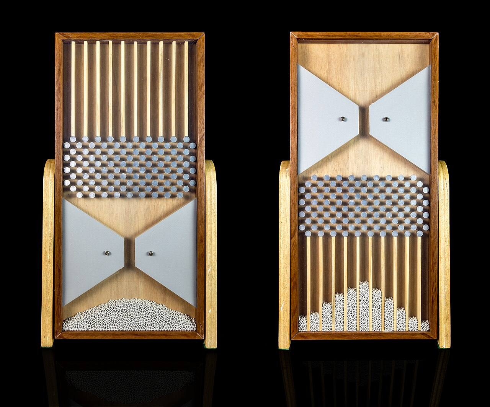
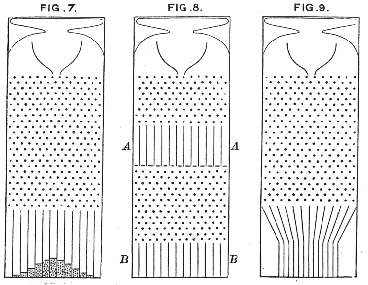
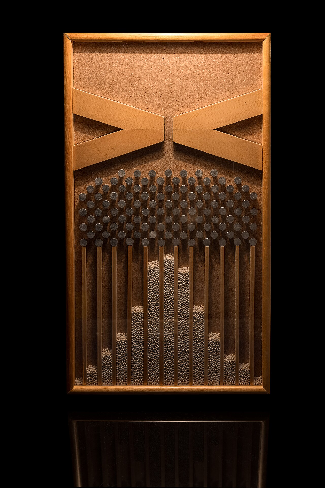

+++
author = "矢崎裕一"
title = "度数分布を描かずに、落として生み出す──Galton のクインカンクス"
slug = "galton-board"
date = "2026-11-01"
description = "鉛玉1粒を1つの個体に、釘の1段を1回の偶然に対応させた装置です。度数分布を図に描くのではなく、玉を落として、装置の中で生み出して見せます。"
categories = [
    "consume"
]
tags = [
    "データ物質化",
    "ヒストグラム",
    "正規分布",
    "Francis Galton"
]
image = "images/galton-box-replica.jpg"
series = ["data-physicalization"]
series_weight = 14
seriesByline = "Francis Galton"
seriesTitle = "度数分布を落として生み出す──ゴルトン・ボード"
+++

Francis Galton（フランシス・ゴルトン）のクインカンクス（quincunx）は、今日ゴルトン・ボードとも呼ばれる装置です。鉛玉1粒を1つの個体に、釘の1段を1回の小さな偶然に対応させています。度数分布を図に描くのではなく、玉を上から落とし、下の仕切り箱にたまった玉の柱の輪郭として、装置の中で生み出して見せます。

原器は1873年、ロンドンの Tisley and Spiller が Galton の設計で製作し、いまは UCL（ロンドン大学ユニバーシティ・カレッジ）の Galton Collection にあります。dataphys.org の項目は年を1893年としていますが、UCL の記録では製作は1873年です。以下は、Galton 自身の1877年の講演録と、1889年の著書『Natural Inheritance』に沿って読みます。

<!--more-->

## 1874年、王立研究所で鉛玉を落とす

装置が初めて人前に出たのは、1874年2月27日です。Galton はロンドンの王立研究所（Royal Institution）で "On men of science, their nature and their nurture" と題して講演しました。講演の要旨には、「誤差の頻度の法則」の箇所に "[this was illustrated by many experiments]" と添えられています。3年後の1877年の講演で、Galton はこの装置を "an apparatus that I employed three years ago in this very theatre" と呼んでいます。

UCL の記録（LDUGC-063）によると、原器の大きさは 360 × 290 × 52 mm です。前面はガラスで、背板との隙間は約1/4インチ（Galton 1889, p.63）。統計学史家の Stephen M. Stigler（スティーヴン・スティグラー）は、互い違いにずれた釘が17段あると書いています。鉛玉の入った丸箱が付属し、蓋には「8 ounces」とあります。

原器には、使い方を書いた銘文があります。Kunert らの論文が、Stigler の『The History of Statistics』（1986）から引いています。

> "Charge the instrument by reversing it, to send all the shots into the pocket. Then sharply re-reverse and immediately set it upright on a level table. The shot will all drop into the funnel, and running thence through its mouth, will pursue devious courses through the harrow and will accumulate in the vertical compartments at the bottom, there affording a representation of the law of dispersion."

本体を逆さにして玉を上部のポケットに集め、すばやく戻して水平な台に立てる。玉は漏斗から「まぐわ」（釘の列）を抜け、下の仕切り箱にたまって、分散の法則を表す、という内容です。玉は1粒ずつ落とすのではなく、一度にまとめて流れ落ちます。

展示品：Estes Objethos Atelier、写真：Rodrigo Tetsuo Argenton、所蔵：Matemateca（IME/USP）／Wikimedia Commons より引用（CC BY-SA 4.0）

## 玉1粒が1つの個体、釘1段が1回の偶然

Galton が装置を詳しく説明したのは、1889年の『Natural Inheritance』第5章です。節の題は "Mechanical Illustration of the Cause of the Curve of Frequency"（度数曲線の原因の機械的な例示）でした。

> "I shall now illustrate the origin of the Curve of Frequency, by means of an apparatus shown in Fig. 7, that mimics in a very pretty way the conditions on which Deviation depends."（p.63）

度数曲線の「起源」を、ずれが生じる条件を巧みにまねる装置で示す、という宣言です。描くのは曲線そのものではなく、曲線ができる条件です。

Francis Galton『Natural Inheritance』（1889）Fig. 7–9／Wikimedia Commons より引用（パブリックドメイン）

釘は "quincunx fashion"（五の目状）に並べてあり、落ちる玉はどの段でも必ず釘に当たります。そのたびに "darting a step to the right or left"、つまり左右どちらかへ1歩ずれます（p.64）。Galton は、装置の原理をこう書いています。

> "The principle on which the action of the apparatus depends is, that a number of small and independent accidents befall each shot in its career. … This illustrates and explains the reason why mediocrity is so common."（pp.64–65）

それぞれの玉に、小さく独立した偶然がいくつも降りかかる。右へのずれと左へのずれはたいてい打ち消し合うので、多くの玉は漏斗の真下近くに落ちる。これが「平凡なもの」が多い理由だ、という説明です。

Galton の文章から、部品と意味の対応をまとめると次のようになります。

| 装置の部品 | 対応させたもの | Galton の言葉と出典 |
|---|---|---|
| 鉛玉1粒 | 1つの個体（1877年は種子の集団の1つ） | "pellets which serve as representatives of a population of seeds"（1877, p.292） |
| 釘の1段 | 1回の小さく独立した偶然 | "small and independent accidents"（1889, pp.64–65） |
| 釘の段数 | 値（身長など）を決める独立した要素の数 | "corresponds to an equal number of sets of rows of pins"（1889, p.84） |
| 漏斗の出口を通る鉛直線 | 平均（ずれのない点） | "the perpendicular line that passes through the mouth of the funnel"（1889, p.65） |
| 仕切り箱の左右の位置 | 平均からのずれの大きさ | 箱の両側の壁が範囲の境界（1877, p.292） |
| 箱にたまった玉の柱の高さ | 度数 | "the columns of shot that accumulate"（1889, p.64） |
| 柱の頂点を結んだ輪郭 | 度数曲線 | "approximates to the Curve of Frequency"（1889, p.64） |

エンコーディングの核は、**位置が値、積み上がった高さが度数**という2つです。玉1粒が1単位なので、できあがった山は、単位を積み上げたヒストグラムとしても読めます。

## 段を増やせば幅が、玉を増やせば高さが変わる

1877年2月9日、Galton は同じ講堂で "Typical Laws of Heredity" を講演し、まずこの装置を動かして見せます。説明の順序について、本人はこう述べています。

> "The simplest way of explaining the law is to begin by showing it in action."（1877, p.286）

法則を説明するいちばん簡単な方法は、それが働くところを見せることだ、という意味です。続けて Galton は、個々の玉の動きと、全体の形を分けて語ります。

> "The courses of the pellets are extremely irregular; it rarely happens that any two starting from the same point will pursue the same path from beginning to end; yet, notwithstanding this, you will observe the regularity of the outline of the heap formed by the accumulation of pellets."（1877, p.286）

同じ点から出た2粒が同じ道をたどることはまずない。それでも、たまった山の輪郭は規則的だ、という内容です。1889年の本も、輪郭は "closely of the same shape however often the experiment is repeated"、何度繰り返してもほぼ同じ形になると書いています（p.64）。

展示品：Estes Objethos Atelier、写真：Rodrigo Tetsuo Argenton、所蔵：Matemateca（IME/USP）／Wikimedia Commons より引用（CC BY-SA 4.0）

山の形を変えるのは何か。Galton は二つの要因を分けて書いています。

- 釘の段数：段が少なければ、玉はほとんど真下の箱に入り「柱」のようになる。段がとても多ければ、玉は広く散って「水平な棒」のようになる（1877, p.286）。
- 玉の量：玉を増やすと山は高くなる。しかし、玉の半数が収まる左右の距離は変わらない。この距離が確率誤差 "Prob: Error" で、本の記号では Q です（1889, p.65）。

1877年の講演では、曲線をゴム板に描いて引き伸ばす説明も添えています。横に伸ばすと散らばりが増し、縦に伸ばすと数が増える。分布の「形」を決める部品と「量」を決める部品が、装置の中で別々になっている、と読めます。

1889年の本は、条件をさらに挙げます。釘の段がもっと多く、玉が小さく、箱が細く、玉が多ければ、輪郭は正規曲線にさらに近づく（p.64）。同じ章の次の節が、有名な "Order in Apparent Chaos" です。Galton はそこで誤差の法則を "the supreme law of Unreason"（理性なきものの至高の法則）と呼びました（p.66）。

## 釘と箱を組み替えて、遺伝を説明する

1877年の講演の本題は遺伝でした。Galton はスイートピーの種子の重さを親子で比べていて、1874年の装置を下段に残し、上に仕掛けを足します。

- 上段の箱と落とし戸：親の世代の分布。山の形は、背板に切った曲線のスリットで整え、溢れた玉は背面へ捨てる（p.292）。
- 中央へ傾いた斜めの樋（shoot）：回帰（reversion）。どの樋も中央の鉛直線へ向かうので、山の幅が縮む（p.292）。
- その下の釘の列：同じ家族の中でのばらつき。落とし戸を1つ開けると、真下に小さな山ができる（p.292）。

すべての落とし戸を開けると、小さな山が重なり、最初とそっくりの山に戻ります。世代が変わっても分布の幅が保たれることを、部品の組み合わせで示したわけです。Stigler は、講演の文面からは実際に動く模型があったと読めるが、残っていないと書いています。Kunert らは、2段式は実際には作られなかったらしいとしています。

1889年の本では、同じ構造を思考実験に使い回します。上の図の Fig. 8 では、装置を途中の高さで水平に切り、中段に箱 AA を挟みます。中段までの確率誤差を a、そこから下を b、全体を q とすると、q² = a² + b² になる、という分散の合成です（pp.67–68）。Fig. 9 では、玉をいったん中央へ寄せてから落とし、形を保ったまま幅だけを小さくします（p.69）。

ここで、装置が置かれていた文脈にも触れておきます。Galton がこの装置で語ろうとしたのは、遺伝と人間の能力の分布でした。Kunert らは、Galton の主な関心が「生殖の選択による人類の改良」で、そのために eugenics（優生学）という語をつくったと書いています（p.144）。装置の数学と、それを使って語られた主張は、分けて読む必要があります。

## 第三者はこの装置をどう見たか

評価は、それぞれ違う角度から出ています。

- 思考の道具として：Stigler は2010年の論文で、装置を Galton 自身が回帰に至るための道具として読みます。1877年の斜めの樋は、一見すると結論ありきの "just-so story" に見えると書きます（p.472）。決め手は、装置を "running his quincunx backwards"、逆向きに走らせる発想でした（p.477）。下の箱の玉は、平均すると真上ではなく、より中央寄りから来ている。
- 数学と文脈の両方を：ドルトムント大学の Kunert、Montag、Pöhlmann は2001年の論文で、装置を "a device, which generates a histogram which is similar to the normal distribution" と位置づけます（p.146）。後半は、装置で観察できる現象の極限定理を論じます。同時に、Galton の尺度化の方法が人種の能力の一般化に使われ、"corresponded to the prevailing prejudice of that time" だったと指摘しています（pp.145–146）。
- 物理からの反論：西オーストラリア大学の Kevin Judd は2006年の原稿で、「独立な偶然」という前提そのものを問います。原器を手がかりにした力学モデルを計算機で動かし、玉の動きは二項過程に従わないと結論しました。

> "The internet abounds with so called simulations of the quincunx that are not simulations of the mechanical device, but simply simulations of a Binomial process, or random walk."

ネット上の「シミュレーション」の多くは、装置ではなく二項過程を再現しているだけだ、という指摘です。Judd も、統計モデルが概念モデルとして価値を持つことは認めています。そのうえで、非線形力学のほうがよいモデルだと書いています。

今日、この装置は中心極限定理の例示に使われます（Judd の要旨）。Galton 自身はこの語を使っていません。装置が直接示すのは、二項分布が正規分布に近づくことです。Kunert らと Wikipedia は、これをド・モアブル＝ラプラスの定理として説明しています。

## 使い道

この装置から可視化の仕事に持ち帰れることは、三つあると読めます。

一つめは、結果ではなく、結果ができる仕組みを部品に割り当てることです。『Natural Inheritance』には度数曲線の図（Fig. 3）が別にあります。そのうえで Galton は、装置を "mimics … the conditions on which Deviation depends"、ずれが生じる条件をまねるものとして示しました。見る人は玉と釘を見ながら、なぜ中央が高くなるのかを、部品の名前で説明できます。

二つめは、形を決める要因と量を決める要因を、別の部品に分けることです。段数を変えれば幅が、玉の量を変えれば高さが変わる。チャートでも、データ数に左右される見た目と、分布の性質を表す見た目を分けておくと、比べる人が迷いにくいと読めます。

三つめは、物理モデルは前提まで形にしてしまう、ということです。釘の1段を「独立した偶然」と呼んだ瞬間、その前提も装置に埋め込まれます。Judd の反論は、その前提が実物の玉の動きとずれうることを示しています。可視化の仕組みを人に見せるときは、どの前提を見せているのかも言える必要がある、と読めます。

Galton 自身は、数式に移ったあとも図を手放すなと書いています。

> "The visible Schemes are not, however, to be removed too soon from our imagination. It is always well to retain a clear geometric view of the facts when we are dealing with statistical problems, which abound with dangerous pitfalls …"（1889, pp.66–67）

目に見える図を早々に想像から外してはいけない。統計の問題には落とし穴が多いので、事実を幾何学的にはっきり見ておくのがよい、という内容です。クインカンクスは、その「見ておく」ための装置でした。

## 参考・出典

**一次情報**

- dataphys.org「1893 – Galton Board」 https://dataphys.org/list/galton-board/
- Francis Galton, *Natural Inheritance*, Macmillan, 1889, pp.62–69, 84. [Internet Archive](https://archive.org/details/naturalinherita00galtgoog) / [galton.org の PDF](https://galton.org/books/natural-inheritance/pdf/galton-nat-inh-1up-clean.pdf)
- Francis Galton, "Typical Laws of Heredity", *Proceedings of the Royal Institution* 8, 1877, pp.282–301（1877年2月9日の講演）. [galton.org の PDF](https://galton.org/essays/1870-1879/galton-1877-roy-soc-typical-laws-heredity.pdf)
- Francis Galton, "On men of science, their nature and their nurture", *Proceedings of the Royal Institution* 7, 1874, pp.227–236（1874年2月27日の講演）. [galton.org の PDF](https://galton.org/essays/1870-1879/galton-1874-men-of-science.pdf)
- Francis Galton, "Statistics by intercomparison, with remarks on the Law of Frequency of Error", *Philosophical Magazine*, 1875. [galton.org の PDF](https://galton.org/essays/1870-1879/galton-1875-intercomparison.pdf)
- UCL Collections Online, Quincunx, LDUGC-063（製作者、製作年、寸法、銘文）. https://collections.ucl.ac.uk/Details/science/60000062
- Galton 文献目録. https://galton.org/bibnew/all.html
- 画像：Wikimedia Commons [Quincunx (Galton Box) - Galton 1889 diagram](https://commons.wikimedia.org/wiki/File:Quincunx_(Galton_Box)_-_Galton_1889_diagram.png) / [Galton box](https://commons.wikimedia.org/wiki/File:Galton_box.jpg) / [Tabuleiros de Galton (antes e depois)](https://commons.wikimedia.org/wiki/File:Tabuleiros_de_Galton_(antes_e_depois).jpg)

**第三者評価**

- Stephen M. Stigler, "Darwin, Galton and the Statistical Enlightenment", *Journal of the Royal Statistical Society: Series A* 173(3), 2010, pp.469–482. [PDF](https://gwern.net/doc/statistics/bayes/2010-stigler-2.pdf) / [書誌](https://ideas.repec.org/a/bla/jorssa/v173y2010i3p469-482.html)
- Joachim Kunert, Astrid Montag, Sigrid Pöhlmann, "The quincunx: history and mathematics", *Statistical Papers* 42(2), 2001, pp.143–169. [PDF](https://www.ifa.com/pdfs/the-quincunx.pdf) / [doi:10.1007/s003620100048](https://doi.org/10.1007/s003620100048)
- Kevin Judd, "Galton's Quincunx: random walk or chaos?", 2006. [PDF](https://nolanhergert.github.io/notes_old/0media/home/quincunx.pdf)
- Wikipedia「Galton board」. https://en.wikipedia.org/wiki/Galton_board
