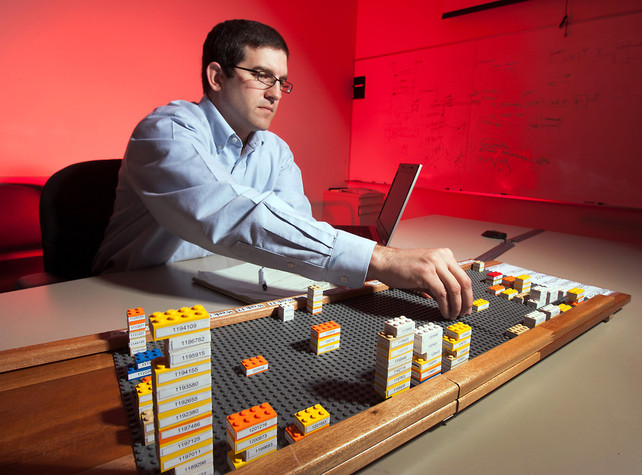
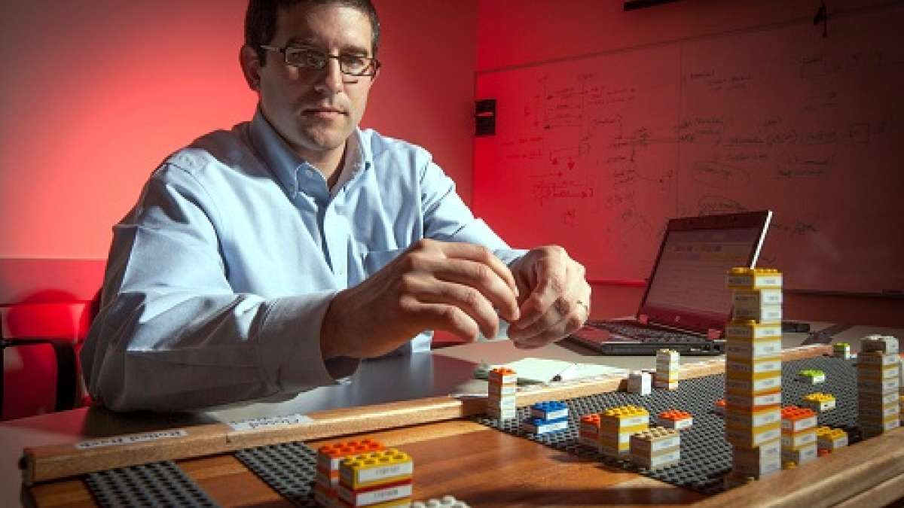

+++
author = "矢崎裕一"
title = "品質問題1件をブロック1個に置く──GM と WellStar の LEGO ボード"
slug = "gm-lego-quality-board"
date = "2026-11-01"
description = "品質問題1件をLEGOブロック1個にし、色で車両の部位、大きさで深刻さ、ボード上の位置で原因究明から解決までの段階を表した、GMとWellStarのボードです。"
categories = [
    "consume"
]
tags = [
    "データ物質化"
]
image = "images/board-dataphys.jpg"
series = ["data-physicalization"]
series_weight = 20
seriesByline = "General Motors・WellStar Health System"
seriesTitle = "品質問題1件をブロック1個に──GM の LEGO ボード"
+++

General Motors（GM）の LEGO ボードは、品質問題1件をブロック1個にし、ブロックの色で車両の部位を、大きさで問題の深刻さを、ボード上の位置で原因究明から解決策、結果までのどの段階にあるかを表すボードです。各ブロックには識別番号と発見日が付きます。GM と、米ジョージア州の病院グループ WellStar Health System が共同で作り、2012年3月26日に発表しました。両社はこの方式を「3-D Visualization」と呼んでいます。

出典の軸は、GM のプレスリリース（2012年3月26日）です。元のページは現在は消えていて、本文は業界団体のニュースレター Naylor Network に転載された全文で読みます。ThoughtWorks の P2 Magazine（2013年）は、同じボードをリリースとは違う読み方で説明しています。そこで、リリースの説明と P2 の説明は節を分けて書きます。データ物理化の目録 dataphys.org が出典に挙げる Fast Company の記事は、本文を確認できませんでした。

<!--more-->

## 2012年3月、自動車会社と病院が同じ道具を発表する

リリースによれば、二つの組織の協力は病院の救急から始まりました。GM のクロスオーバー車のチームが、リーダー育成の一環で WellStar を招き、救急部門のトリアージについて話してもらったのです。その後 GM は、医師や看護師がリーン手法を学べるよう、WellStar の研修センターへ模擬の組立ラインを寄贈しました。

WellStar は、ジョージア州マリエッタに本拠を置く、5つの病院からなる非営利の医療法人です。ボードは、GM のチーフエンジニア Tim Herrick（ティム・ヘリック）と、WellStar の業務改善の責任者 Dennis Pastor（デニス・パスター）のブレインストーミングから生まれました。パスターは以前 GM にいて、オハイオ州ロードスタウン工場で組立の production superintendent を務めました。試作は1週間でできた、とリリースは書いています。

GM・WellStar の報道用写真とみられる（撮影者不明）／List of Physical Visualizations（dataphys.org）より引用

リリースに書かれた使い道は、次のとおりです。

| 組織 | 使い道（リリースの記述） |
|---|---|
| GM | 保証修理につながる問題の追跡。設計変更と予算の追跡にも世界中で展開中。デジタル版も開発した |
| WellStar | 診療所の定刻開始、財団の5年募金計画、医療の質の指標、医師の保険者登録の工程改善（この1枚で年100万ドルの削減見込み） |

GM 側の効果は、「将来の保証修理を防ぐ変更を実施するまでの時間を、33%減らせる可能性がある」と書かれています。原文は "could reduce" で、実測ではなく見込みです。

## 1件を1個に、色・大きさ・位置を割り当てる

ボードの仕組みは、リリースの一段落にまとまっています。

> "3-D Visualization builds on GM's Problem Resolution Tracking System. If a transmission case breaks on a durability test vehicle, a problem resolution report documents the problem, and its corresponding LEGO block goes on a LEGO board. The block color identifies the area on the vehicle and the block size denotes severity; the bigger the block, the bigger the problem. Each block has an identification number and date of discovery, and the board shows its progress from root cause to solution to outcome. 3-D Visualization is applicable to any process that has volume and aging."

土台は、GM の問題解決の追跡の仕組みです。耐久試験車のトランスミッションケースが壊れたら、報告書が1通書かれ、対応するブロックが1個ボードに置かれます。色は車両の部位、大きさは深刻さで、大きいほど問題も大きい。ブロックには識別番号と発見日が付き、ボードは原因から解決策、結果への進み具合を示します。量（volume）と経過時間（aging）のある工程なら使える、と結ばれています。

| データ | ボードでの表し方 | データの型 |
|---|---|---|
| 問題1件（報告書1通） | LEGO ブロック1個 | 単位（1件＝1個） |
| 問題が起きた車両の部位 | ブロックの色 | カテゴリ |
| 問題の深刻さ | ブロックの大きさ | 順序 |
| 問題の識別 | ブロックに付けた識別番号 | 名義（文字） |
| 発見した日 | ブロックに付けた日付 | 時間（文字） |
| 原因→解決策→結果の段階 | ボード上の位置 | 順序（工程の段階） |
| 解決した | ブロックをボードから外す | 状態（次の節の発言による） |

公開資料に書かれていないこともあります。色と部位の対応表、大きさの段階の数、ボードの寸法、ブロックの総数は、どれも見当たりません。

GM・WellStar の報道用写真とみられる（撮影者不明）／Torque News より引用

報道用の写真では、ブロックに白いラベルが貼られ、番号が印字されているのが見えます。リリースの言う識別番号と読めます。多くのブロックは縦に積まれ、高さの違う柱になっています。リリースの「大きさ」が平面の広さか、積んだ高さかは、リリースからは分かりません。

最後の一文の volume と aging は、この表の読み方を示していると読めます。ブロックの数で、問題がどれだけあるかが分かる。位置と発見日で、どの問題がどの段階に、いつから留まっているかが分かる。量と滞留を一枚で見渡すための割り当てです。

## 「表計算の1行」ではなく、ボードの上の1個

GM で現行車種の品質を担当するシニアマネージャー、Jamie Pickett（ジェイミー・ピケット）は、リリースでこう話しています。

> "3-D Visualization allows us to look at issues more holistically. By visually representing a problem it is easier to see the whole scope of it and where the opportunities lie. And, unlike a line of data in a spread sheet, seeing a problem as a block on a board is a strong motivator for finding a solution to get it off the board."

問題を全体として見られ、広がりと手を打てる場所が分かりやすい。表計算の1行と違い、ボードの上のブロックは、解決して外したいという強い動機になる、という趣旨です。

比べている相手は、表計算の1行です。表の1行と違い、ブロックは外すまでボードの上に残り続けると読めます。ピケットの言葉からは、**ボードから外すことが、そのまま解決の目標になっている**と読めます。精密に読み取ることより、量を見渡し、手を動かさせることを重く見た符号化と読めます。

パスターも、工程は三次元なのに報告書は二次元だった、と Fast Company に話したと伝えられています。ただしこれは SmartData Collective が Fast Company から引いた孫引きで、原文は確認できていません。また、ボードが画面を置き換えたわけではありません。GM はデジタル版も作っています。

目録の紹介には補いが要ります。dataphys.org は、このボードを "LEGOs help business executives log and explore data." と紹介しています。けれどもリリースに executives（経営陣）という言葉はなく、名前の出る使い手はチーフエンジニアと品質担当です。技術と品質のチームの道具と読むほうが、リリースに近いと言えます。

## ThoughtWorks の記事は、行・列・高さで読んでいる

ThoughtWorks の P2 Magazine 第4号（2013年10月）の記事「3D Card Walls」は、リリースと違う読み方を書いています。筆者は Nick Thorpe（ニック・ソープ）と Paige Mulholland（ペイジ・マルホランド）です。

> "On the General Motors LEGO board, each block represents a car which needed repairs under warranty. The rows represent the faulty area of the vehicle, and there is a separate section of the board for issues which have been contained or solved on the assembly line. The height of the block itself represents the severity of the problem, and the board also uses columns to denote the time it took for the fault to appear, and colours and labels to further define each block."

ブロック1個は保証修理が必要になった車1台。行は故障した部位、ブロックの高さは深刻さ、列は故障が出るまでの時間。組立ラインで封じ込めた問題の別区画があり、色とラベルはさらに区別するために使う、という説明です。

| 項目 | GM のリリース（2012年） | P2 Magazine（2013年） |
|---|---|---|
| ブロック1個の単位 | 問題1件（報告書1通） | 保証修理が必要になった車1台 |
| 車両の部位 | ブロックの色 | ボードの行（色は補助） |
| 深刻さ | ブロックの大きさ | ブロックの高さ |
| 時間 | ブロックに付けた発見日 | ボードの列（故障が出るまでの時間） |
| 状態 | 原因→解決策→結果へ進む位置 | 封じ込め・解決した問題の別区画 |

P2 の記事は、この読み方の根拠を示していません。写真から読み取ったのか、取材があったのかは分かりません。別の時期や用途のボードを見ている可能性もあります。リリースの「大きさ」が実際には積んだ高さだった可能性もありますが、確かめる資料はありません。この記事では、作った側の説明であるリリースを軸にし、P2 は第三者の一つの読み方として扱います。

## 第三者はこのボードをどう見たか

評価は、何を手がかりに読むかで分かれています。

- かんばんの延長として見る。P2 の記事は、カードの大きさや色、位置、形まで使っても、壁のカードでは変数を表しきれない案件がある、と前置きします。ソープは GM のボードについて "The problem they're solving here is 'how do we decide what should we start next?'" と述べています。次に何に取りかかるかを決めるボード、という読みです。
- 別の場に移すと、うまくいかなかった。ジュネーブ大学の Daniel K. Schneider（ダニエル・K・シュナイダー）は EIAH 2015 の論文で、Fast Company の記事に触発され、博士論文の進み具合と深刻さを LEGO で表す構造化ボードを作ったと書いています。結果は "Cette première variante n'a eu que peu de succès puisque, par définition, le LEGO appelle à « jouer »."。LEGO は遊びを誘うので、最初の版はほとんどうまくいかなかった、という報告です。
- 三次元であること自体を評価する。SmartData Collective の Erica Driver（エリカ・ドライバー）は "Humans think in 3D." と書き、ソフトウェアの BI を三次元で身体的にする話へ広げています。

自動車メディアの紹介は軽い調子でした。The Truth About Cars は "Problem solving becomes child's play." と少し皮肉に書き、Torque News は "It can also be touched and felt and moved by hand." と、手で動かせることを利点に挙げています。

## 使い道

このボードから持ち帰れることは、物で作るかどうかより、符号化の決め方にあります。

一つ目は、1件を1個にすることです。数えるだけで量が分かり、合計の数字を別に書かなくても、積み上がりがそのまま見えます。

二つ目は、位置に工程の段階を割り当てることです。区画を分ければ、どの段階にブロックが溜まっているかが見え、発見日と合わせれば滞留の長さも追えます。

三つ目は、出口を決めておくことです。「ボードから外す」は、表示の終わりが仕事の終わりと一致する設計です。画面のダッシュボードでも、解決した項目が消える場所を作れます。

四つ目は、凡例を残すことです。色と部位の対応表は公開されておらず、外から見た P2 はリリースと違う説明を書きました。共有するボードほど、符号化の約束を書いて添える必要があります。

シュナイダーの報告は、LEGO が「遊び」を誘うため、決まった符号化で作った最初の版はうまくいかなかったと伝えています。決まった符号化と自由な組み立てがぶつかる例と読めます。GM のボードが働いたのは、報告書という既存の仕組みの上に作られ、1件1個の約束が業務の側で決まっていたからだと読めます。

## 参考・出典

**一次情報**

- General Motors, プレスリリース, 2012-03-26（元の URL。現在は news.gm.com へリダイレクトされ、本文は残っていない）. http://media.gm.com/media/us/en/gm/news.detail.html/content/Pages/news/us/en/2012/Mar/0326_lego
- 同リリースの全文転載："GM, WellStar Develop LEGO-Based Visual Management Tool," Naylor Network. https://www.naylornetwork.com/naf-nwl/articles/print-v2.asp?aid=171511
- Pierre Dragicevic（Fanny Chevalier の情報提供）, "2012 – General Motors' 3D LEGO Visualizations," *List of Physical Visualizations*（dataphys.org）. https://dataphys.org/list/general-motors-3d-lego-visualizations/
- Mark Wilson, "How GM Is Saving Cash Using Legos As A Data Viz Tool," *Fast Company / Co.Design*, 2012（ボット確認のため本文は未確認）. https://www.fastcompany.com/1669468/how-gm-is-saving-cash-using-legos-as-a-data-viz-tool
- The Daily Drive, "GM Plays with Legos (Video)," 2012（ドメインが消えていて未確認）. http://cgdailydrive.com/gm-plays-with-legos/

**第三者評価**

- Nick Thorpe & Paige Mulholland, "3D Card Walls," *P2 Magazine* Issue 4, ThoughtWorks, 2013-10. https://thoughtworks.github.io/p2/issue04/3d-cardwall
- Daniel K. Schneider, "Visualisation de projets de thèse avec un dispositif physique et constructif," EIAH 2015. https://tecfa.unige.ch/tecfa/talks/schneide/eiah-2015/Schneider_EIAH2015-lego-final.pdf （関連 wiki：https://edutechwiki.unige.ch/en/Lego-compatible_thesis_project_board ）
- Erica Driver, "Visualizing Data in 3D with Lego," *SmartData Collective*, 2012-05-09（Pastor の発言の孫引きを含む）. https://www.smartdatacollective.com/visualizing-data-3d-lego/
- Bertel Schmitt, "Latest GM Invention: Management By LEGO," *The Truth About Cars*, 2012-03-26. https://www.thetruthaboutcars.com/2012/03/latest-gm-invention-management-by-lego/
- John Goreham, "GM's adaptation of Legos could help protect your car from problems," *Torque News*, 2012-03-27. https://www.torquenews.com/1083/gms-adaptation-childs-toy-could-help-protect-your-car-problems
- Jason Siu, "General Motors Develops Lego Based Visual Management Tool," *AutoGuide*, 2012-03-26. https://www.autoguide.com/auto-news/2012/03/gm-and-wellstar-develop-lego-based-visual-management-tool.html
