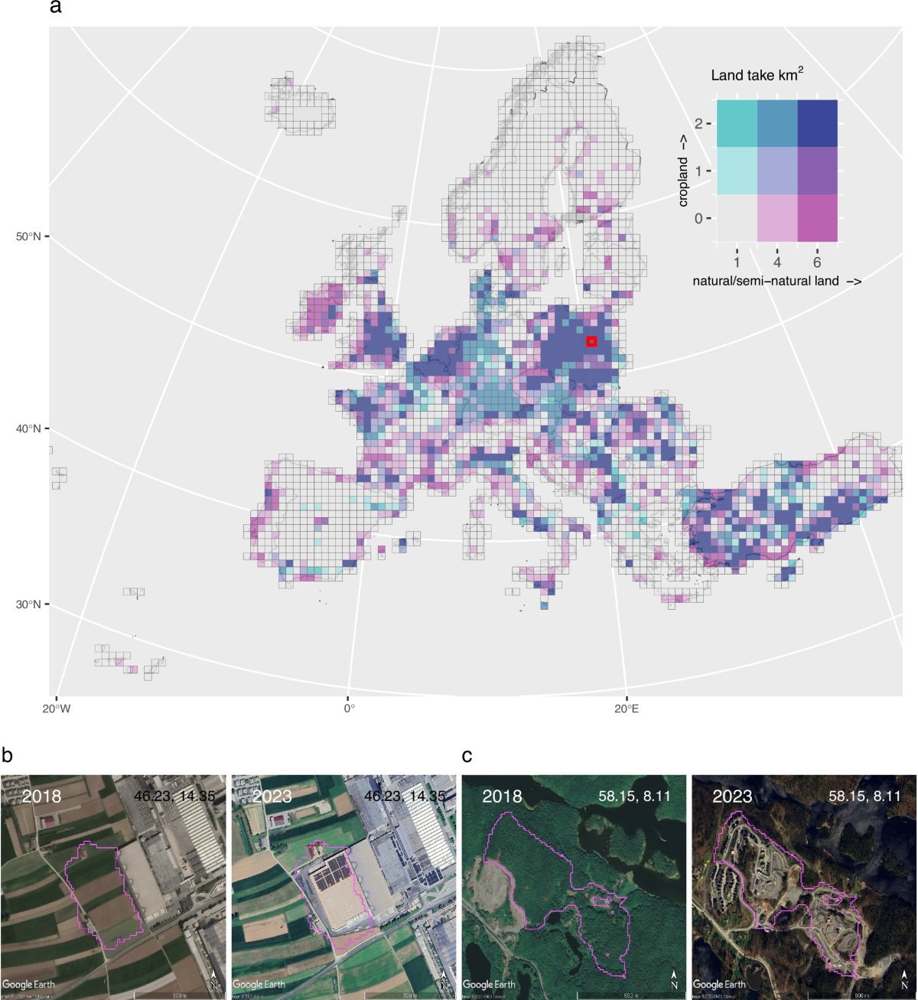
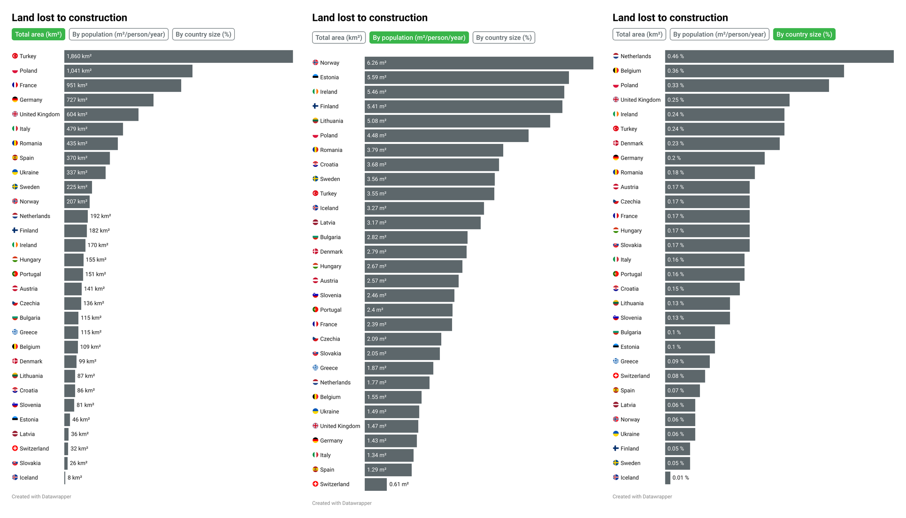
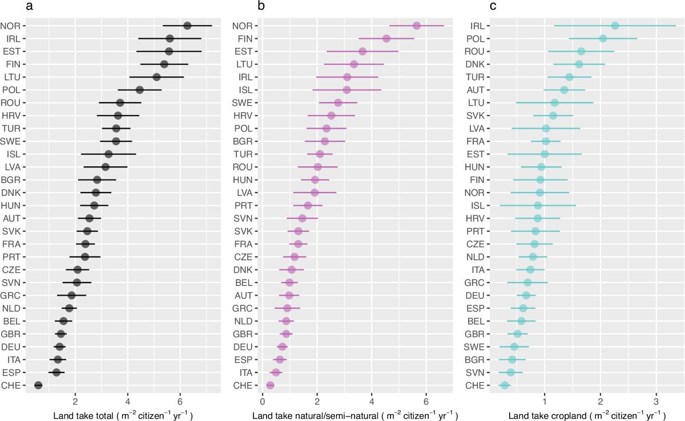

+++
author = "Yuichi Yazaki"
title = "Total Area, Per Capita, Share of Land: Country Rankings Reshuffle in Green to Grey"
slug = "green-to-grey"
date = "2026-11-04"
description = "Green to Grey shows Europe's loss of natural land three ways: total area, per capita, and share of national territory. Norway ranks 11th, 1st and 26th, so the ranking reshuffles depending on what you divide by."
categories = [
    "consume"
]
tags = [
    "data journalism",
    "Sigma Awards",
    "satellite imagery",
    "normalization"
]
image = "images/bars-three-metrics.png"
+++

Green to Grey shows the natural land and cropland that turned into buildings and roads across Europe between 2018 and 2023, country by country, in three ways: total area, per capita, and share of national territory. Norway ranks 11th by total area, 1st per capita, and 26th by share of land. Depending on what you divide by, the ranking of countries reshuffles. The three metrics are three identical grey bar charts that you switch between with buttons; they are not placed side by side in a single figure.

The work is a cross-border investigation published on October 1, 2025. It was led by the Dutch nonprofit Arena for Journalism in Europe and the Norwegian public broadcaster NRK, with scientists from the Norwegian Institute for Nature Research (NINA) and news organizations from several countries. It is a winner of the Sigma Awards 2026. Below, I read it in the order a reader sees it, drawing on the main story, the methodology page, the data behind the country charts, an interview with the creators, and a later academic paper.

<!--more-->

## Repeating "green to grey" in color

The main story opens with three sets of satellite photos: a coastal forest in Greece that became a five-star hotel, farmland in the UK that became an Amazon logistics hub, and a pine forest in Germany that became a Tesla factory. A 2018 Pléiades image and a 2023 Pléiades Neo image are stacked, and as you scroll the 2023 image fades in. It is a scroll-linked crossfade, not a before-and-after slider.

The text is split into two lines. The earlier state ("In Greece, a forest on the coast…") sits on a green background, and the later state ("became a five-star hotel.") sits on a grey one. The site's colors, in charts, maps and buttons alike, come from just two families: green `#39b54a` and grey `#5d676b`. The title's "green to grey" becomes the color scheme of the whole page.

The investigation started from a domestic Norwegian investigation that NRK published in January 2024. In 2024, Arena invited NRK, NINA and news organizations from other countries to a meeting in Bologna. The team began work in January 2025 and published in October 2025. The main story says it involved "41 journalists and scientists from 11 countries."

The encoding of each component is as follows.

| Component | Data | Mapping to the visual |
|---|---|---|
| Three opening satellite photo pairs | The same places in 2018 and 2023 | Scroll amount = opacity of the 2023 image (0 to 1) |
| Dot map | Random sample of constructions larger than 10,000 m² | Position = place, color = grey (construction), land = pale green. Dot size is unrelated to the data |
| Counter of area lost | 1,500 km² per year converted to seconds | Seconds elapsed since loading × 47.5 m² |
| Three country bar charts | Estimates for 30 countries | Length = value, all the same grey. Buttons switch to another chart |
| Wetlands of İzmir | Satellite images from 2018 and 2023 | Drag-to-compare before-and-after slider |

## The dot map shows spread, not location

The first figure in the main story is a map of Europe on which grey dots are placed. Its caption reads "Random sample of constructions larger than 10,000m² identified by our methodology." The text says each dot is one place where nature or cropland was lost.

About 16,000 dots are drawn at first, and once the map enters the screen, 100 more are added every 100 milliseconds, for about 29,000 in total. Each dot's radius is picked at random from three values: 0.5, 1.0 and 1.5. **The size of a dot does not represent the area of the construction.**

In an interview with the Royal Geographical Society (RGS), the creators Zeynep Şentek and Léopold Salzenstein explain the design of the map as follows.

> We specifically did not include a zoom feature on the map. This was to emphasise the overall of scale of nature loss within Europe rather than focusing on detailed data for local areas.

In short, they deliberately left out a zoom feature because they wanted to show the scale of loss across Europe rather than detailed local data. They also say that the dots are added as the page loads in order to show that the loss is still going on. At the end of the map sits a counter of the area lost since you started reading. The note beside it reads "(47.5 m² per second, 4.1 km² each day)."

The academic paper that came later draws the same land take in a different form. It is a map that aggregates the data into a 50 km grid and colors natural land and cropland areas with a bivariate palette.

Source: Venter et al., Nature Communications (2026), Fig. 1 (CC BY 4.0. Aerial photos: Google, © 2025 Airbus)

The paper's map lets you read where and how much was lost through color intensity. The work's dot map gives up on letting you read quantity and hands that role to the motion of dots accumulating. Even with the same data, the journalistic figure seems to have chosen to convey spread and continuity before quantity.

## Three denominators, three bar charts

The country comparison is in the "No country spared" section of the story. Above a Datawrapper horizontal bar chart sit three buttons: "Total area (km²)," "By population (m²/person/year)" and "By country size (%)." Pressing one switches to a different Datawrapper chart. Only the selected button is filled in green.

Source: Arena for Journalism in Europe, NRK et al., Green to Grey (three Datawrapper charts placed side by side by the author)

The three charts share the same bar color and ordering; only the denominator differs. Here are the rankings of four countries, taken from the values in the published charts.

| Country | Total area (km², 2018-2023) | Per capita (m²/person/year) | Share of land (%) |
|---|---|---|---|
| Norway | 207 (11th) | 6.26 (1st) | 0.06 (26th) |
| Turkey | 1,860 (1st) | 3.55 (10th) | 0.24 (6th) |
| Netherlands | 192 (12th) | 1.77 (23rd) | 0.46 (1st) |
| UK | 604 (5th) | 1.47 (26th) | 0.25 (4th) |

Countries with equal values are counted in the order they appear in the chart. Norway's 0.06% is tied with Latvia and Ukraine, and Turkey's 0.24% with Ireland.

The text also puts all three views into words. By total area, Turkey leads with 1,860 km², followed by Poland. Adjusted for the size of the country, the Netherlands and Belgium come first. Adjusted for population, the Nordic countries fare worse.

> But if we adjust the figures based on population size, Scandinavian countries fare worse. Norway's construction translates to roughly six square metres of nature and cropland every year for each resident. In Switzerland, per capita losses are ten times less.

In short, divided by population the Nordic countries look worse: in Norway it is roughly 6 m² per resident each year, and in Switzerland a tenth of that.

The units of the three charts are not aligned. Total area is a six-year sum, while per capita is "per year." Share of land corresponds to total area divided by the country's area. For the Netherlands, 192 km² divided by about 41,500 km² gives 0.46%, a cumulative figure over six years (my own check). The definition of share of land is not written in the chart.

From their headlines, The Black Sea ("Turkey Leads In European Nature Loss") seems to stand on the total-area metric, and NRK ("Nordmenn bygger ned mest natur") on the per-capita metric. The setup can be read as letting every news organization pick the denominator that makes its own country stand out.

## Method and uncertainty placed beneath the numbers

The bars in the country charts carry only point estimates. The uncertainty is gathered on a separate methodology page, signed by Salzenstein and NINA's Zander Venter.

The input is Dynamic World, from Google and the World Resources Institute, which converts 10 m resolution Sentinel-2 imagery into per-pixel land cover probabilities. For each pixel, a regression line is fitted to the 2018-2023 trend of the "probability of being built up," and a pixel counts as land take when the slope exceeds 0.05. About 84 billion pixels and nearly 185,000 images were processed.

The area is not obtained by counting pixels. People verified the extracted points, and the estimate corrected for the resulting errors is given with a 95% confidence interval. Across EEA-39 it comes to about 9,000 km², or 1,500 km² per year on average.

> Forty journalists and fact-checkers manually verified more than 10,000 locations across Europe, a process that took more than 500 hours in total.

In short, 40 journalists and fact-checkers checked over 10,000 locations by hand, taking more than 500 hours in total. The AI's judgments were hidden from them, and points were assigned regardless of country. The methodology page also has a figure comparing pixel counts with corrected values and a figure of accuracy by country.

The paper also draws per-capita values by country, with 95% confidence intervals.

Source: Venter et al., Nature Communications (2026), Fig. 2 (CC BY 4.0)

The main story shows easy-to-read point estimates, while the methodology page and the paper show estimates with ranges. This can be read as reconciling readability of the numbers with ease of verification by separating them into layers.

At the same time, the sources disagree on some numbers. For each figure I use, here is how the sources compare.

| Item | Figures by source |
|---|---|
| Participating countries | Main story: "11 countries." Counting the home countries of the two lead organizations and the 10 participating outlets gives 12 |
| Countries analyzed | The methodology page lists 30 countries but also mentions a stratum of "28 countries." The paper has 29 countries, Datawrapper 30 (including Ukraine) |
| Number of stories | About: "51 stories in 11 languages"; application: "51 stories published in 10 languages"; Arena's award announcement and The Spark: "47 publications in 10 languages" |
| Verified points | Main story and methodology: "more than 10,000"; paper: "9,893" |
| How clear-sky months were chosen | Methodology: "four-month period"; paper: "three consecutive months" |
| Ratio to earlier estimates | Main story: "up to one and a half times faster"; paper's abstract: "nearly twice as large" |
| Norway's share of land | The CSV distributed for the chart says 0.03% (which would rank 29th). The share-of-land chart rewrote this value to 0.06% in an edit on October 1, 2025 |

The last row is something I confirmed from the edit history that remains on the Datawrapper chart.

## How third parties saw the work

On the Sigma Awards listing site, the work is labeled "2026 · Winner · Large." The judges' comment cites the clarity of the presentation.

> What's more, the presentation is intuitive and married with strong storytelling and on-the-ground reporting. Sometimes it can be hard to see environmental impacts over time. This project made it easy.

In short, the presentation is intuitive and tied to storytelling and on-the-ground reporting; environmental impacts over time are hard to see, and this project made it easy.

On April 13, 2026, a paper was published in *Nature Communications*. Its authors include people from NINA, NRK and Arena, so the part that counts as third-party is the peer review. On per-capita values, the paper says Norway and Estonia are the largest and Switzerland and Spain the most efficient. It also introduces a fourth denominator, land consumption per change in population. Among countries whose population fell, Hungary is highest at "250 m2 land take per citizen lost."

The British commentary magazine Country Squire Magazine (March 11, 2026), citing the UK edition of the Guardian, wrote that the UK is "fifth-worst in Europe." It then explained this as a ranking relative to the size of the country. In the shared data, however, the UK is 5th by total area, 4th by share of land, and 26th per capita. This looks like a mix-up of denominators. I have not been able to check the Guardian's text. It can be read as an example of a ranking traveling apart from its denominator.

In a feature by Greece's iMEdD Lab (March 10, 2026), Şentek says that in many cases where they re-checked, the AI was right and the human was wrong. In the range I have searched, I have not found any article that criticizes the method itself.

## How to use it

What you can take from this work is not to settle on a single denominator. Whether you choose total area, per capita or share of land, each is a claim. Green to Grey makes all three into charts of the same form, and the text also puts all three into words.

However, the three charts are not lined up in a single figure. Unless the reader presses the buttons, the reshuffling does not come into view. If you want to show the reshuffling of ranks itself, you could also choose a figure that links the three ranks with lines. This work seems to have left the reshuffling to the words of the text.

The dot map removed meaning from dot size. If you do not use size, it is safer to make sizes uniform or to note that size is not used. Here the random radii leave room for misreading quantity.

Uncertainty can be placed in a separate layer. The main story relies on point estimates, and the methodology page and the paper show the ranges. Finally, check that the table you distribute matches the chart on screen. Norway's 0.03% versus 0.06% was something I could not have known until I saw the edit history. The more a work depends on choosing a denominator, the more you need to check the values of the denominator itself.

## References

**Primary sources**

- Zeynep Sentek, Jelena Prtoric, Hazel Sheffield, Leopold Salzenstein, "Green to Grey: How Europe is squandering the little nature it has left," Arena for Journalism in Europe et al., 2025-10-01. https://greentogrey.eu/
- Léopold Salzenstein, Zander Venter, "Data Methodology," Green to Grey. https://greentogrey.eu/methodology/
- Green to Grey, "About." https://greentogrey.eu/about/
- Green to Grey, "Publications." https://greentogrey.eu/publications/
- Country bar charts (Datawrapper): total area https://datawrapper.dwcdn.net/p3y79/5/ (data https://datawrapper.dwcdn.net/p3y79/5/dataset.csv), per capita https://datawrapper.dwcdn.net/D5ozx/7/, share of land https://datawrapper.dwcdn.net/2bLXf/5/
- Dot map data: https://greentogrey.eu/data/spots-data-static.csv, https://greentogrey.eu/data/spots-data-animated.csv
- Site JS / CSS: https://greentogrey.eu/_next/static/chunks/143-d8b84dbd4ceb054a.js, https://greentogrey.eu/_next/static/css/bb6b167e4a7bb8eb.css
- Sigma Awards 2026 entry page (original application text and Japanese translation): https://sigma-awards.data-visualization.jp/entries/2026-s-0003/
- Royal Geographical Society, "Green to Grey" (interview with the creators). https://www.rgs.org/about-us/what-is-geography/geovisualisation/green-to-grey/
- Arena for Journalism in Europe, "‘First of its kind’: Behind the scenes of Green to Grey’s groundbreaking data investigation," 2025-10-03. https://journalismarena.eu/first-of-its-kind-behind-the-scenes-of-green-to-greys-groundbreaking-data-investigation/
- Arena for Journalism in Europe, "Arena’s groundbreaking data investigation, Green to Grey, wins Sigma Award." https://journalismarena.eu/arenas-groundbreaking-data-investigation-green-to-grey-wins-sigma-award/
- The Spark (TBIJ), "‘Green to Grey’ captured Europe’s changing landscape." https://the-spark-tbij.beehiiv.com/p/green-to-grey-captured-europe-s-changing-landscape
- NRK, "Europa fra grønt til grått: Nordmenn bygger ned mest natur, viser europeisk kartlegging." https://www.nrk.no/dokumentar/xl/europa-fra-gront-til-gratt_-nordmenn-bygger-ned-mest-natur_-viser-europeisk-kartlegging-1.17577504
- NRK, "NRK avslører: 44.000 inngrep i norsk natur på fem år," 2024-01-05. https://www.nrk.no/dokumentar/xl/nrk-avslorer_-44.000-inngrep-i-norsk-natur-pa-fem-ar-1.16573560
- Venter, Czúcz, Kumano-Ensby, Salzenstein, Simensen, Solvang, Støstad, "Europe's land take and the loss of nature and cropland to artificial surfaces," *Nature Communications*, 2026-04-13. https://www.nature.com/articles/s41467-026-71931-w (doi:10.1038/s41467-026-71931-w, CC BY 4.0. Its authors overlap with the work's creators)

**Secondary sources**

- The Sigma Awards, "From Toxic Supply Chains in Africa to Baltic Sabotage to Stolen Children in Syria: 10 Data Projects Win 2026 Sigma Awards" (judges' comment). https://www.sigmaawards.org/from-toxic-supply-chains-in-africa-to-baltic-sabotage-to-stolen-children-in-syria-10-data-projects-win-2026-sigma-awards/
- *Nature Communications* (as a peer-reviewed paper). https://www.nature.com/articles/s41467-026-71931-w
- "Britain’s Disappearing Countryside," Country Squire Magazine, 2026-03-11. https://countrysquire.co.uk/2026/03/11/britains-disappearing-countryside
- Athina Thanasi, "Green to Gray: The data, the mountains, and the politics of land," iMEdD Lab, 2026-03-10. https://lab.imedd.org/en/?p=49962
