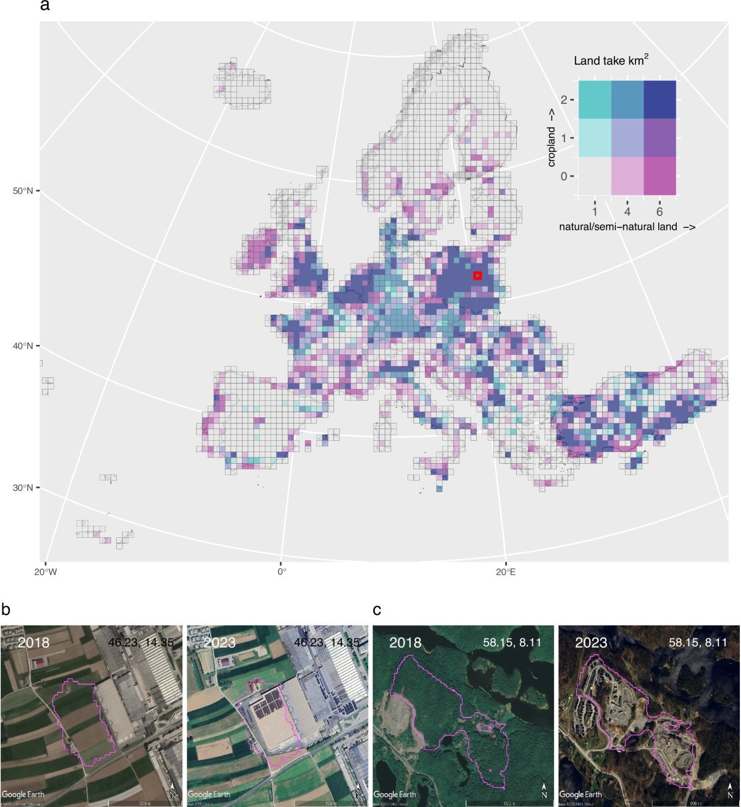
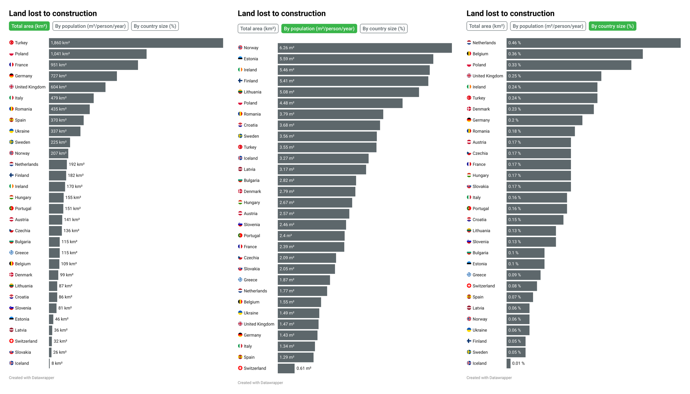
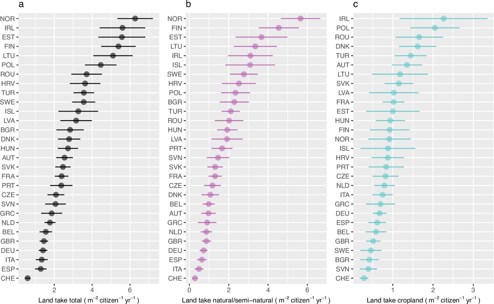

+++
author = "矢崎裕一"
title = "総面積、1人当たり、国土比で、国の順位が入れ替わる──Green to Grey"
slug = "green-to-grey"
date = "2026-11-04"
description = "Green to Grey は、欧州の自然地の喪失を総面積、1人当たり、国土比の3通りで示しました。ノルウェーは11位、1位、26位と、何で割るかで順位が入れ替わります。"
categories = [
    "consume"
]
tags = [
    "データジャーナリズム",
    "Sigma Awards",
    "衛星画像",
    "正規化"
]
image = "images/bars-three-metrics.png"
series = ["dataviz-journalism"]
series_weight = 10
seriesByline = "Arena for Journalism in Europe・NRK ほか"
seriesTitle = "何で割るかで国の順位が入れ替わる──Green to Grey"
+++

Green to Grey は、2018〜2023年に欧州で建物や道路に変わった自然地と農地を、国ごとに総面積、1人当たり、国土に対する割合の3通りで示しました。ノルウェーは総面積で11位、1人当たりで1位、国土比で26位です。何で割るかによって、国の順位が入れ替わります。3つの指標は、同じ形の灰色の棒グラフ3枚をボタンで切り替える作りで、1枚の図には並べていません。

作品は2025年10月1日に公開された越境調査報道です。オランダの非営利団体 Arena for Journalism in Europe と、ノルウェー公共放送 NRK が主導し、ノルウェー自然研究所（NINA）の科学者と各国の報道機関が加わりました。Sigma Awards 2026 の受賞作です。以下は、作品本編と方法論のページ、国別グラフのデータ、作者のインタビュー、のちに出た学術論文に沿って、読者が見る順に読みます。

<!--more-->

## 緑から灰色へ、を色で繰り返す

本編は、3組の衛星写真から始まります。ギリシャの海岸の森が5つ星ホテルに、英国の農地が Amazon の物流拠点に、ドイツの松林が Tesla の工場に変わった場所です。2018年の Pléiades と2023年の Pléiades Neo の画像を重ね、スクロールに合わせて2023年の画像を浮かび上がらせます。前後を比べるスライダーではなく、スクロールに連動したクロスフェードです。

文字は2行に分かれます。前の状態（"In Greece, a forest on the coast…"）は緑の地に、後の状態（"became a five-star hotel."）は灰色の地に置かれます。サイトの色は、グラフも地図もボタンも、緑 `#39b54a` と灰 `#5d676b` の2系統だけです。題名の「緑→灰」が、ページ全体の配色になっています。

調査のきっかけは、NRK が2024年1月に公開したノルウェー国内の調査でした。Arena は2024年、ボローニャの会議に NRK、NINA、各国の報道機関を招きました。チームは2025年1月に作業を始め、2025年10月に公開しました。本編は「41 journalists and scientists from 11 countries」と書いています。

各部品のエンコーディングは次のとおりです。

| 部品 | データ | 見た目への対応 |
|---|---|---|
| 冒頭の衛星写真3組 | 2018年と2023年の同じ場所 | スクロール量＝2023年の画像の不透明度（0→1） |
| 点の地図 | 1万m²を超える建設からの無作為抽出 | 位置＝場所、色＝灰（建設）、国土＝淡い緑。点の大きさはデータと無関係 |
| 失った面積のカウンター | 年1,500km² を秒に換算 | 読み込みからの経過秒数 × 47.5m² |
| 国別の棒グラフ3枚 | 30か国の推計 | 長さ＝値、色は全部同じ灰。ボタンで別のグラフへ移る |
| イズミルの湿地 | 2018年と2023年の衛星画像 | ドラッグで動かす前後比較のスライダー |

## 点の地図は、場所ではなく広がりを見せる

本編の最初の図は、欧州の地図に灰色の点を打っていくものです。キャプションは "Random sample of constructions larger than 10,000m² identified by our methodology." です。本文は、点の一つひとつが失われた自然か農地の一か所だ、と書いています。

点は最初に約1.6万個が描かれ、地図が画面に入ると100ミリ秒ごとに100個ずつ足されます。全部で約2.9万個です。点の半径は、0.5、1.0、1.5の3種類から無作為に選ばれます。**点の大きさは、建設の面積を表していません。**

作者の Zeynep Şentek（ゼイネップ・シェンテク）と Léopold Salzenstein（レオポルド・サルゼンスタイン）は、英国王立地理学会（RGS）のインタビューで、地図の設計をこう説明しています。

> We specifically did not include a zoom feature on the map. This was to emphasise the overall of scale of nature loss within Europe rather than focusing on detailed data for local areas.

拡大の機能は、あえて付けなかった。地域ごとの細かいデータより、欧州全体の規模を見せたかったから、という要旨です。点を読み込みながら増やしたのは、損失が今も続いていることを示すためだ、とも述べています。地図の終わりには、読み始めてから失われた面積を数えるカウンターを置きました。添え書きは "(47.5 m² per second, 4.1 km² each day)" です。

のちに出た学術論文は、同じ land take を別の形で描いています。50km の格子に集計し、自然地と農地の面積を2変量の色で塗り分けた地図です。

Venter et al.／Nature Communications（2026）Fig. 1 より引用（CC BY 4.0。空中写真は Google, © 2025 Airbus）

論文の地図は、どこでどれだけ失われたかを色の濃さで読ませます。作品の点の地図は、量を読ませることを手放し、点が増えていく動きに役目を移しています。同じデータでも、報道の図は量の読み取りより、広がりと継続を先に伝える側を選んだ、と読めます。

## 3つの分母、3枚の棒グラフ

国の比較は、本文の "No country spared" の節にあります。Datawrapper の横棒グラフの上に、3つのボタンが並びます。"Total area (km²)"、"By population (m²/person/year)"、"By country size (%)" です。押すと、別の Datawrapper のグラフに移ります。選んでいるボタンだけが緑に塗られます。

Arena for Journalism in Europe・NRK ほか／Green to Grey（Datawrapper のグラフ3枚を、筆者が横に並べたもの）より引用

3枚は棒の色も並べ方も同じで、違うのは分母だけです。公開されたグラフの値から、4か国の順位を並べます。

| 国 | 総面積（km²、2018〜2023年） | 1人当たり（m²/人/年） | 国土比（%） |
|---|---|---|---|
| ノルウェー | 207（11位） | 6.26（1位） | 0.06（26位） |
| トルコ | 1,860（1位） | 3.55（10位） | 0.24（6位） |
| オランダ | 192（12位） | 1.77（23位） | 0.46（1位） |
| 英国 | 604（5位） | 1.47（26位） | 0.25（4位） |

同値の国は、グラフの並び順で数えています。ノルウェーの0.06%はラトビア、ウクライナと、トルコの0.24%はアイルランドと同値です。

本文も、3通りすべてを言葉にしています。総面積ではトルコが1,860km² で首位、次がポーランドです。国土の大きさで調整すると、オランダとベルギーが先頭に来ます。人口で調整すると、北欧が悪くなります。

> But if we adjust the figures based on population size, Scandinavian countries fare worse. Norway's construction translates to roughly six square metres of nature and cropland every year for each resident. In Switzerland, per capita losses are ten times less.

人口で割ると北欧が悪くなる。ノルウェーでは住民1人あたり毎年約6m²、スイスはその10分の1だ、という要旨です。

3枚の単位はそろっていません。総面積は6年間の合計、1人当たりは「年あたり」です。国土比は、総面積を国の面積で割った値に当たります。オランダなら192km² を約4.15万km² で割って0.46%で、6年分の累計になります（筆者の検算）。国土比の定義は、グラフには書かれていません。

見出しの文言から、The Black Sea（"Turkey Leads In European Nature Loss"）は総面積、NRK（"Nordmenn bygger ned mest natur"）は1人当たりの指標に立っていると読めます。どの報道機関も、自国が目立つ分母を選べる作りになっている、と読めます。

## 数字の下に置いた、方法と不確かさ

国別グラフの棒には、点推定の値しかありません。不確かさは、別の方法論のページにまとめられています。署名は Salzenstein と NINA の Zander Venter（ザンダー・ヴェンター）です。

入力は、Google と World Resources Institute の Dynamic World です。Sentinel-2 の10m解像度の画像を、画素ごとに土地被覆の確率に変えたものです。画素ごとに「建物である確率」の2018〜2023年の推移に回帰直線を当て、傾きが0.05を超えたら land take とします。約840億画素、185,000枚近い画像を処理しました。

面積は、画素を数えて出してはいません。抽出した点を人が確かめ、その誤差から補正した推計と95%信頼区間を出しています。EEA-39 全体で約9,000km²、年平均1,500km² です。

> Forty journalists and fact-checkers manually verified more than 10,000 locations across Europe, a process that took more than 500 hours in total.

記者とファクトチェッカー40人が、欧州の1万か所以上を手で確かめ、延べ500時間以上かかった、という要旨です。AI の判定は伏せて、点は国に関係なく割り当てられました。方法論のページには、画素数と補正後の値の比較図や、国別の精度の図もあります。

論文も、国別の1人当たりの値を、95%信頼区間つきで描いています。

Venter et al.／Nature Communications（2026）Fig. 2 より引用（CC BY 4.0）

本編では読みやすい点推定を、方法論のページと論文では幅のある推計を見せています。数字の読みやすさと、検証のしやすさを、層を分けて両立させた、と読めます。

一方で、資料のあいだには数の食い違いがあります。使う数字ごとに、出典を並べます。

| 項目 | 資料ごとの数字 |
|---|---|
| 参加した国 | 本編「11 countries」。主導2団体と参加10社の所在国を数えると12か国 |
| 分析の対象国 | 方法論ページは30か国を挙げつつ「28 countries」の層に言及。論文は29か国、Datawrapper は30か国（ウクライナを含む） |
| 記事の数 | About「51 stories in 11 languages」、応募書類「51 stories published in 10 languages」、Arena の受賞告知と The Spark「47 publications in 10 languages」 |
| 検証した点 | 本編・方法論「more than 10,000」、論文「9,893」 |
| 晴れた月の選び方 | 方法論「four-month period」、論文「three consecutive months」 |
| 従来推計との比 | 本編「up to one and a half times faster」、論文の要旨「nearly twice as large」 |
| ノルウェーの国土比 | グラフ用に配布された CSV は0.03%（この値なら29位）。国土比のグラフは、2025年10月1日の編集でこの値を0.06%に書き換えている |

最後の行は、Datawrapper のグラフに残る編集の記録から、筆者が確かめたものです。

## 第三者はこの作品をどう見たか

Sigma Awards の一覧サイトでは、この作品は「2026 · 受賞 · 大規模」と記されています。審査のコメントは、見せ方の分かりやすさを挙げています。

> What's more, the presentation is intuitive and married with strong storytelling and on-the-ground reporting. Sometimes it can be hard to see environmental impacts over time. This project made it easy.

見せ方が直感的で、物語と現地取材に結び付いている。環境への影響は時間を追って見るのが難しいが、この作品はそれを容易にした、という要旨です。

2026年4月13日には、*Nature Communications* に論文が載りました。著者には NINA、NRK、Arena の人が入っているので、第三者と言えるのは査読の部分です。論文は1人当たりの値について、ノルウェーとエストニアが最も大きく、スイスとスペインが最も効率がよいと書いています。さらに、人口の増減あたりの土地消費という4つ目の分母も出しました。人口が減った国では、ハンガリーが「250 m2 land take per citizen lost」で最上位です。

英国の論評誌 Country Squire Magazine（2026年3月11日）は、Guardian の英国版を引いて、英国を「fifth-worst in Europe」と書きました。そのうえで、これを国土の大きさに対する順位だと説明しています。ところが共有されたデータでは、英国は総面積で5位、国土比で4位、1人当たりで26位です。分母の取り違えに見えます。Guardian の本文は確かめられていません。順位が分母と離れて伝わる例として読めます。

ギリシャの iMEdD Lab（2026年3月10日）の特集では、Şentek が、確かめ直すと AI が正しく人が間違っていた例が多かった、と語っています。方法そのものを批判した記事は、筆者が調べた範囲では見つかっていません。

## 使い道

この作品から持ち帰れるのは、分母を一つに決めないことです。総面積、1人当たり、国土比のどれを選んでも、それは一つの主張になります。Green to Grey は3つを同じ形のグラフにし、本文でも3通りを言葉にしました。

ただし、3枚は1枚の図に並んでいません。読者がボタンを押さなければ、入れ替わりは目に入りません。順位の入れ替わりそのものを見せたいなら、3つの順位を線で結ぶ図も選べます。この作品は、入れ替わりを本文の言葉に任せた、と読めます。

点の地図は、点の大きさを意味から外しました。大きさを使わないなら、大きさをそろえるか、使っていないと書き添えるのが安全です。ここでは無作為な半径が、量の読み違いを招く余地を残しています。

不確かさは、別の層に置けます。本編は点推定で読ませ、方法論と論文で幅を示しました。最後に、配布する表と画面のグラフが一致しているかを確かめます。ノルウェーの0.03%と0.06%は、編集の記録を見るまで分かりませんでした。分母を選ぶ作品ほど、分母の値そのものの確認が要ります。

## 参考・出典

**一次情報**

- Zeynep Sentek, Jelena Prtoric, Hazel Sheffield, Leopold Salzenstein, "Green to Grey: How Europe is squandering the little nature it has left," Arena for Journalism in Europe ほか, 2025-10-01. https://greentogrey.eu/
- Léopold Salzenstein, Zander Venter, "Data Methodology," Green to Grey. https://greentogrey.eu/methodology/
- Green to Grey, "About." https://greentogrey.eu/about/
- Green to Grey, "Publications." https://greentogrey.eu/publications/
- 国別の棒グラフ（Datawrapper）：総面積 https://datawrapper.dwcdn.net/p3y79/5/ （データ https://datawrapper.dwcdn.net/p3y79/5/dataset.csv ）、1人当たり https://datawrapper.dwcdn.net/D5ozx/7/ 、国土比 https://datawrapper.dwcdn.net/2bLXf/5/
- 点の地図のデータ：https://greentogrey.eu/data/spots-data-static.csv 、https://greentogrey.eu/data/spots-data-animated.csv
- サイトの JS / CSS：https://greentogrey.eu/_next/static/chunks/143-d8b84dbd4ceb054a.js 、https://greentogrey.eu/_next/static/css/bb6b167e4a7bb8eb.css
- Sigma Awards 2026 の作品ページ（応募書類の原文と日本語訳）：https://sigma-awards.data-visualization.jp/entries/2026-s-0003/
- Royal Geographical Society, "Green to Grey"（作者へのインタビュー）. https://www.rgs.org/about-us/what-is-geography/geovisualisation/green-to-grey/
- Arena for Journalism in Europe, "‘First of its kind’: Behind the scenes of Green to Grey’s groundbreaking data investigation," 2025-10-03. https://journalismarena.eu/first-of-its-kind-behind-the-scenes-of-green-to-greys-groundbreaking-data-investigation/
- Arena for Journalism in Europe, "Arena’s groundbreaking data investigation, Green to Grey, wins Sigma Award." https://journalismarena.eu/arenas-groundbreaking-data-investigation-green-to-grey-wins-sigma-award/
- The Spark（TBIJ）, "‘Green to Grey’ captured Europe’s changing landscape." https://the-spark-tbij.beehiiv.com/p/green-to-grey-captured-europe-s-changing-landscape
- NRK, "Europa fra grønt til grått: Nordmenn bygger ned mest natur, viser europeisk kartlegging." https://www.nrk.no/dokumentar/xl/europa-fra-gront-til-gratt_-nordmenn-bygger-ned-mest-natur_-viser-europeisk-kartlegging-1.17577504
- NRK, "NRK avslører: 44.000 inngrep i norsk natur på fem år," 2024-01-05. https://www.nrk.no/dokumentar/xl/nrk-avslorer_-44.000-inngrep-i-norsk-natur-pa-fem-ar-1.16573560
- Venter, Czúcz, Kumano-Ensby, Salzenstein, Simensen, Solvang, Støstad, "Europe's land take and the loss of nature and cropland to artificial surfaces," *Nature Communications*, 2026-04-13. https://www.nature.com/articles/s41467-026-71931-w （doi:10.1038/s41467-026-71931-w、CC BY 4.0。著者が作品と重なる）

**第三者評価**

- The Sigma Awards, "From Toxic Supply Chains in Africa to Baltic Sabotage to Stolen Children in Syria: 10 Data Projects Win 2026 Sigma Awards"（審査コメント）. https://www.sigmaawards.org/from-toxic-supply-chains-in-africa-to-baltic-sabotage-to-stolen-children-in-syria-10-data-projects-win-2026-sigma-awards/
- *Nature Communications*（査読付き論文として）. https://www.nature.com/articles/s41467-026-71931-w
- "Britain’s Disappearing Countryside," Country Squire Magazine, 2026-03-11. https://countrysquire.co.uk/2026/03/11/britains-disappearing-countryside
- Athina Thanasi, "Green to Gray: The data, the mountains, and the politics of land," iMEdD Lab, 2026-03-10. https://lab.imedd.org/en/?p=49962
