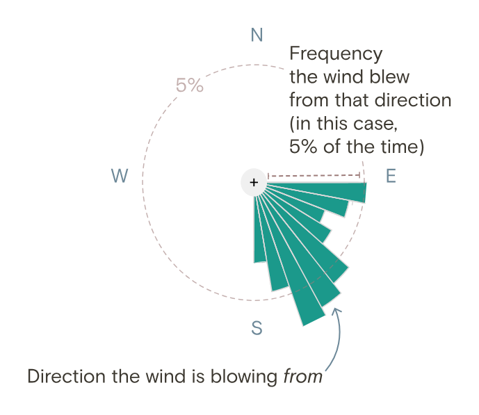
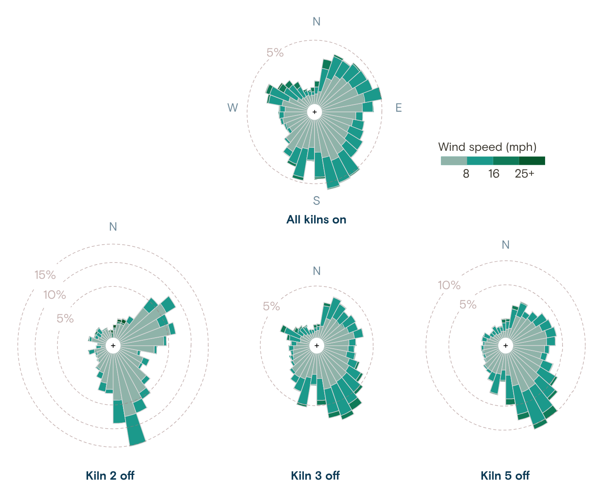
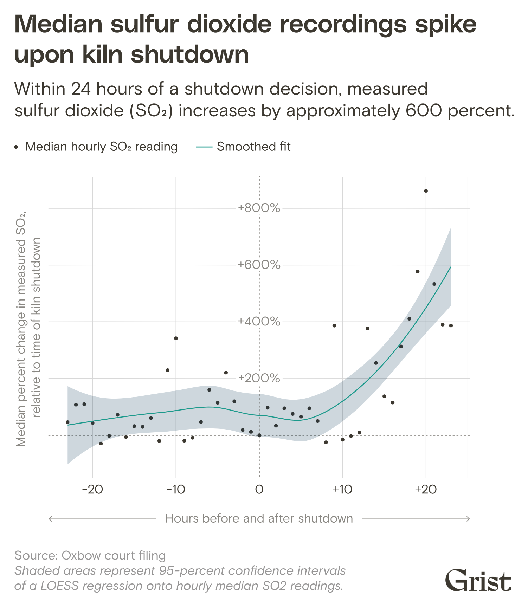
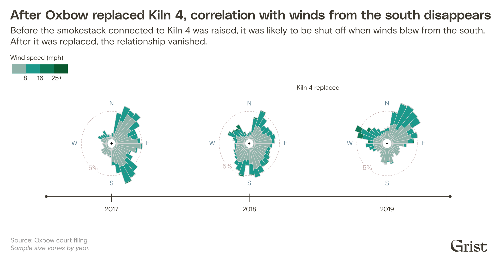

+++
author = "Yuichi Yazaki"
title = "Wind Roses for the Hours the Kilns Were Off: Grist's \"Any Way the Wind Blows\""
slug = "grist-wind-rose"
date = "2026-11-04"
description = "Grist drew wind roses separately for hours when all kilns were running and for hours when kilns 2, 3 and 5 were each shut down. In the hours the kilns were off, winds blowing toward the monitor to the north were more frequent."
categories = [
    "consume"
]
tags = [
    "data journalism",
    "Sigma Awards",
    "wind rose"
]
image = "images/windrose-kilns-off-comparison.png"
+++

Grist's investigation "Any Way the Wind Blows" (February 16, 2023) drew wind roses for the Oxbow Calcining plant in Port Arthur, Texas. The figures split the hours into those when all kilns were running and those when kilns 2, 3 and 5 were each shut down. In the wind roses for the hours the kilns were off, winds blowing toward the monitor to the north occur more often. The article presents this result as something that "suggests" a "likely violation" of the Clean Air Act.

Naveena Sadasivam did the reporting and writing, Clayton Aldern the data reporting, and Jessie Blaeser the data visualization. The piece won at the Sigma Awards 2024. The same suspicion had already been reported in 2022 by Public Health Watch and others. What Grist added, it can be read, was a statistical examination of the five-minute data filed in court, and wind roses covering one year from August 2018. Below, I follow Grist's article and the analysis notebook Aldern published on GitHub, reading in the order the figures appear in the article.

<!--more-->

## January 10, 2017: it starts with five-minute numbers

The article opens with a scene from one night. Around 2 a.m. on January 10, 2017, a monitor began recording sulfur dioxide (SO2) above the federal standard of 75 ppb. The text lists times and numbers in short lines: "3:30 a.m.: 128.7 ppb," "5:00 a.m.: 147.8 ppb."

Beside the text, 60 five-minute readings from 1:30 a.m. to 5 a.m. appear one at a time as you scroll, in a typeface like a liquid-crystal display. Values above 75 ppb are red. Checked against the public data, this sequence matched the five-minute values filed in court. During this period the wind direction was 170 to 197°, a wind blowing from south to north.

The numbers come from a lawsuit. The contractor Port Arthur Steam Energy (PASE) sued Oxbow, and discovery produced thousands of pages of internal documents. At the center is a spreadsheet filed in a Harris County court.

> The spreadsheet, which was filed in the Harris County court, contains wind direction, wind speed, sulfur dioxide monitor readings, and kiln behavior information at five-minute intervals from January 2017 through June 2019.

In short: wind direction, wind speed, SO2 and kiln operating status, every five minutes from January 2017 to June 2019. The SO2 values come from a monitor run by the state regulator TCEQ, and Oxbow pulled them in almost in real time. The article says that when the wind blew across the monitor within a 30° arc and the reading passed a threshold, managers received an email.

The opening numbers are a few rows of this table, shown as they are. Before any statistics, the reader sees the same sequence of five-minute values that Oxbow's employees received, in order of time, it can be read.

## Four panels teach how to read a wind rose

Before moving to a year of statistics, the article teaches how to read a wind rose. Six text boxes, each as tall as the screen, run down the page, and as you scroll, four fixed SVGs switch in turn. The first sentence explains how to read the figure.

> The length of each bar shows how likely the wind is to blow from that direction.

In short: bar length shows how often the wind blows from that direction.

Source: Grist / Jessie Blaeser / Clayton Aldern, from Grist, "How a Koch-owned chemical plant in Texas gamed the Clean Air Act"

The annotation on the first panel reads "Direction the wind is blowing *from*," with "from" in italics. The second panel lays a northwest-pointing arrow over a long southeast bar, and the text goes on: "the long bar at the bottom means the wind often blows from south to north." The third is a year of data for "All kilns on." The text says the monitor in the north lies in the path of the sea breeze that blows from south to north.

A wind rose extends its bars toward the direction the wind blows "from." What matters in this article is the direction the smoke is heading "to." The long bar in the south becomes the wind that carries smoke to the monitor in the north. The design settles this reversal before the comparison, it can be read.

The table below summarizes what each figure in the article maps the data to.

| Figure | Data | Visual mapping |
|---|---|---|
| Opening numeric display | Five-minute SO2 readings on January 10, 2017 | Numbers shown one by one. Red above 75 ppb, light gray at or below |
| Wind rose | Wind direction, August 2018 to July 2019 | Direction the wind comes from = bar direction. Frequency = bar length (dashed circles mark every 5%) |
| Same | Wind speed (split at 8, 16 and 25+ mph) | Color of the bands within a bar, from pale gray-green to dark green |
| Same | Kiln status | Separate figures: All kilns on, and Kiln 2 off, Kiln 3 off, Kiln 5 off |
| Before-and-after shutdown chart | Hourly median SO2 | x-axis = hours before and after shutdown (±24 hours), y-axis = percent change from the time of shutdown. Points = medians, line = LOESS, band = 95% confidence interval |
| Kiln 4 comparison | Wind direction and speed, 2017 to 2019 | Yearly wind roses placed along a time axis, with a dashed line marking the stack replacement |

## Drawing only the hours the kilns were off

The comparison comes in the fourth panel. At the top is the wind rose for "All kilns on," and below it are the wind roses for "Kiln 2 off," "Kiln 3 off" and "Kiln 5 off."

Source: Grist / Jessie Blaeser / Clayton Aldern, from Grist, "How a Koch-owned chemical plant in Texas gamed the Clean Air Act"

The text describes this figure as follows.

> Compared to normal conditions, however, we noted that when kilns were shut down during this period in Port Arthur, a more extreme bias emerged in the wind roses. Kilns 2, 3, and 5 at the plant were more likely to be shut down when the wind was blowing from south to north.

In short: the wind roses for the hours the kilns were off show a stronger bias than under normal conditions, and kilns 2, 3 and 5 were more likely to be shut down when the wind blew from south to north. The next sentence says they were also more likely to be shut down in strong southerly winds. The scale circles differ from figure to figure: up to 15% for kiln 2, up to 10% for kiln 5, and only 5% for the others. So bar lengths should not be compared across figures; they have to be read by which percentage circle the tip of the bar reaches. The south bar of kiln 2 reaches the 15% circle, and the south-southeast bar of kiln 5 reaches the 10% circle. The south bar for all kilns on only slightly exceeds the 5% circle. The kiln 3 figure is almost the same shape as the all-kilns-on figure, and the bias is hard to read from it.

The period is August 2018 to July 2019, the year after the contract with PASE ended and after the period of "experiments" that Oxbow admitted in court. Kiln 4 was being rebuilt, so it was not used for the determination.

The number in the text is that when the wind blew to the north, at least one of kilns 2, 3 and 5 was shut down about 40% of the time. Tallying the public data for this article gives 40.0% for wind directions of 180° ± 15° and 34.7% for other directions. This is not a figure Grist published, but the difference is about 5 points.

According to the Methodology at the end of the article, five-minute values resemble their neighbors, so the data were re-aggregated by hour and by time windows of random length. A cross-validated random forest was then used to classify kiln status. In the notebook, the difference in wind-direction distributions is D=0.168 by a KS test (p<2.2e-16), and the model's accuracy is 60.4%. Aldern writes:

> Okay, so this a pretty poor model of kiln behavior. But it's not worthless … We're doing better than the random guesser.

In short: a rather weak model of kiln behavior, but better than guessing at random. The wind rose shows the difference as a shape, and how certain that difference is, it can be read, is left to the Methodology and the notebook.

## The 24 hours around a shutdown, and three years of kiln 4

Next are time-series figures. Taking the moment a kiln was shut down as zero, they show the change in SO2 over the 24 hours before and after.

Source: Grist / Jessie Blaeser / Clayton Aldern, from Grist, "How a Koch-owned chemical plant in Texas gamed the Clean Air Act"

The subtitle says readings rise by about 600% within 24 hours of a shutdown decision. The text reads:

> readings tended to spike in the 24 hours following a shutdown decision, while they were relatively stable in the preceding 24 hours — suggesting that shutdowns were executed in advance of known changes in environmental conditions.

In short: readings were relatively stable before the shutdown and spiked afterward, which suggests that shutdowns were carried out in anticipation of environmental changes. Here too the word is "suggesting."

The last is kiln 4. Its stack was rebuilt 20 feet taller and about 3 feet narrower. The figure places wind roses for 2017 to 2019 along a time axis and draws a dashed line labeled "Kiln 4 replaced" between 2018 and 2019. The subtitle says that before the rebuild the kiln was more likely to be shut down in southerly winds, and after the rebuild that relationship disappeared.

Source: Grist / Jessie Blaeser / Clayton Aldern, from Grist, "How a Koch-owned chemical plant in Texas gamed the Clean Air Act"

According to the text, from 2017 through the first half of 2018, kiln 4 was shut down 11% of the time when the wind blew to the north, against 8% for other directions. In 2019 the correlation was gone.

One night's numbers, a year's distribution, the time around a shutdown, three years of a single kiln. The scales differ, but in every figure wind direction is the axis. The wind rose format stays the same and only the conditions change from figure to figure, so readers need not relearn how to read it, it can be read.

## How third parties saw the piece

The Sigma Awards 2024 judging committee praised the presentation and the combination of analysis and narrative.

> The reporters did a great job of blending data analysis with narrative and visual detail for a compelling and important story.

In short: data analysis blended into narrative and visual detail. The Sigma listing site also carries it as a 2024 winner.

The suspicion itself did not begin with Grist. In "Case closed?" on February 17, 2022, Public Health Watch and the Investigative Reporting Workshop reported PASE's claim that Oxbow cut production when the wind blew toward the monitor. The article also carries testimony that Oxbow knew from experiments that emissions reach the monitor only when the wind blows within an arc of about 30° toward it. What is new in Grist, it can be read, is that it tested this claim against a year of five-minute values and showed it in figures.

The Fund for Investigative Journalism, which funded the work, reports as an impact that an EPA spokesperson said the agency would respond to the coverage. As the funder, it is not an independent assessment.

There are rebuttals. Oxbow spokesperson Brad Goldstein called the analysis "flawed" and the conclusion "reckless and unsupportable" in the article. According to Public Health Watch on April 29, 2026, Oxbow called PASE's claim "a conspiracy theory" and ultimately won the lawsuit. On the other hand, Oxbow is said to be voluntarily installing pollution controls on two kilns by April 2027.

The application Grist submitted to Sigma says it found "clear evidence." That is stronger wording than the "suggests" in the article text. The article text, it can be read, keeps its language within what the figures can show.

## Takeaways

There are four takeaways.

First, redraw the same kind of figure with only the conditions changed. The wind rose is a common chart in meteorology. Drawn only for the hours the kilns were off, it becomes a figure that asks how operations relate to wind. Not inventing a new form is the strength, it can be read.

Second, teach the reading before the comparison. A wind rose is easy to mistake for "the direction the smoke is heading," it can be considered. Grist used three of its four panels for explanation and left the comparison for the last one.

Third, match the strength of the words to the figure. A wind rose shows a difference as a shape, but how certain the difference is cannot be read from the figure. Grist wrote "suggests" and "likely violation" in the text, left the method in the Methodology, and left the model's weakness in the notebook. **Do not claim in words more than the figure can show.**

Fourth, publish the data and the code. The notebook and the CSV of five-minute values are on GitHub at Grist-Data-Desk/windblow. You can recount the 40% figure with a different angle width. The more a topic invites rebuttal, the more this openness counts, it can be read.

## References

**Primary sources**

- Grist, Naveena Sadasivam & Clayton Aldern, "How a Koch-owned chemical plant in Texas gamed the Clean Air Act" (Any Way the Wind Blows), 2023-02-16. https://grist.org/project/accountability/koch-oxbow-port-arthur-texas-clean-air-act-pollution/
- Clayton Aldern, `windblow.Rmd` ("Any way the wind blows — Comparing kiln shutdowns to wind direction", February 2023). https://raw.githubusercontent.com/Grist-Data-Desk/windblow/main/src/analysis/windblow.Rmd
- Rendered HTML of the same notebook. https://raw.githubusercontent.com/Grist-Data-Desk/windblow/main/src/analysis/windblow.html
- GitHub repository Grist-Data-Desk/windblow (README, data, LICENSE). https://github.com/Grist-Data-Desk/windblow
- Sigma Awards listing site (Data Visualization Japan), entry page 2024-s-0002 (original text of the application). https://sigma-awards.data-visualization.jp/entries/2024-s-0002/
- Grist, Republish page for the article (republication terms). https://grist.org/project/accountability/koch-oxbow-port-arthur-texas-clean-air-act-pollution/republish/

**Secondary sources**

- The Sigma Awards, "Meet the winners of the Sigmas 2024 for data journalism". https://www.sigmaawards.org/meet-the-winners-of-the-sigmas-2024-for-data-journalism/
- Public Health Watch / Investigative Reporting Workshop, Savanna Strott & Riley Rogerson, "Case closed?", 2022-02-17. https://archive.investigativereportingworkshop.org/investigation/case-closed
- Fund for Investigative Journalism, "Grantees uncover efforts to minimize pollution detection at Koch-owned chemical plant in Texas; EPA vows action as a result of story". https://fij.org/?p=15177
- Public Health Watch, "A prodigious Port Arthur polluter will voluntarily install pollution controls — with a catch", 2026-04-29. https://publichealthwatch.org/2026/04/29/a-prodigious-port-arthur-polluter-will-voluntarily-install-pollution-controls-with-a-catch/
