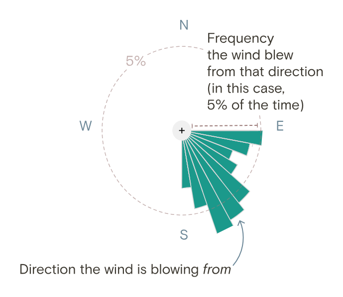
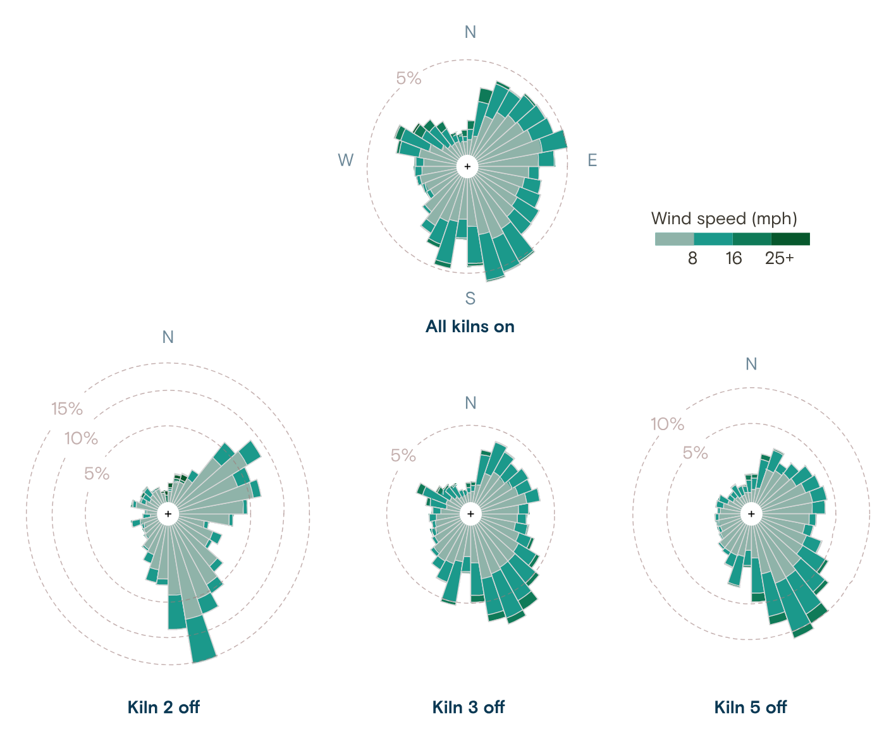
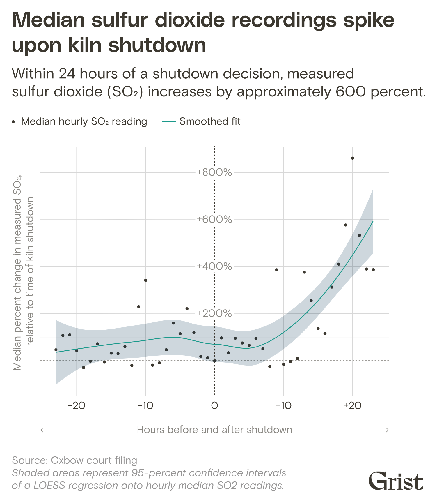
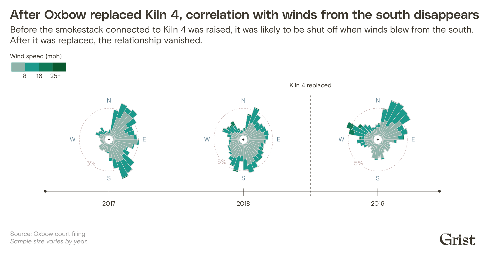

+++
author = "矢崎裕一"
title = "窯が止まっていた時間の風配図──Grist「Any Way the Wind Blows」"
slug = "grist-wind-rose"
date = "2026-11-04"
description = "Grist は、窯がすべて動いていた時間と、窯2・3・5がそれぞれ止まっていた時間に分けて風配図を描きました。止まっていた時間には、監視装置のある北へ向かう風の頻度が高かったことを示しています。"
categories = [
    "consume"
]
tags = [
    "データジャーナリズム",
    "Sigma Awards",
    "風配図"
]
image = "images/windrose-kilns-off-comparison.png"
series = ["dataviz-journalism"]
series_weight = 5
seriesByline = "Naveena Sadasivam・Clayton Aldern（Grist）"
seriesTitle = "止まった時間の風配図──Any Way the Wind Blows"
+++

Grist の調査報道「Any Way the Wind Blows」（2023年2月16日）は、テキサス州ポートアーサーにある Oxbow Calcining の工場について、風配図（wind rose）を描きました。窯がすべて動いていた時間と、窯2・3・5がそれぞれ止まっていた時間に分けた図です。止まっていた時間の風配図では、監視装置のある北へ向かう風の頻度が高くなっています。記事はこの結果を、Clean Air Act の「違反の可能性が高い」（likely violation）操業を「示唆する」（suggests）ものとして書いています。

取材と執筆は Naveena Sadasivam、データ報道は Clayton Aldern、データ可視化は Jessie Blaeserです。作品は Sigma Awards 2024 の受賞作です。同じ疑いは、2022年に Public Health Watch などがすでに報じていました。Grist が加えたのは、裁判に提出された5分ごとのデータを統計で調べ、風配図では2018年8月からの1年分を図にしたことだと読めます。以下は、Grist の記事と、Aldern が GitHub に公開した分析ノートに沿い、記事に図が出てくる順に読みます。

<!--more-->

## 2017年1月10日、5分ごとの数字から始まる

記事は、一晩の場面から始まります。2017年1月10日の午前2時ごろ、監視装置が連邦基準の 75 ppb を超える二酸化硫黄（SO2）を記録しはじめました。本文は「3:30 a.m.: 128.7 ppb」「5:00 a.m.: 147.8 ppb」と、時刻と数字を短く並べます。

本文の横には、午前1時30分から5時までの5分値60個が、液晶表示のような書体で、スクロールに合わせて1つずつ出ます。75 ppb を超えた値は赤です。公開データと照らし合わせると、この並びは裁判に提出された5分値と一致しました。この時間の風向は 170〜197°、南から北へ吹く風でした。

数字の出どころは裁判です。業者 Port Arthur Steam Energy（PASE）が Oxbow を訴え、証拠開示で内部文書が数千ページ出てきました。中心は、Harris County の裁判所に提出されたスプレッドシートです。

> The spreadsheet, which was filed in the Harris County court, contains wind direction, wind speed, sulfur dioxide monitor readings, and kiln behavior information at five-minute intervals from January 2017 through June 2019.

2017年1月から2019年6月まで、風向・風速・SO2・窯の稼働状況が5分ごとにある、という要旨です。SO2 は州の規制当局 TCEQ の監視装置の値で、Oxbow はこれをほぼリアルタイムで取り込んでいました。風が監視装置の上を 30° の幅で吹き、値がしきい値を超えると、管理職にメールが届いた、と記事は書いています。

冒頭の数字は、この表の数行をそのまま見せたものです。読者は統計より先に、Oxbow の社員が受け取っていたのと同じ5分値の並びを、時刻の順に見ることになる、と読めます。

## 風配図の読み方を、4枚で教える

1年分の統計に移る前に、記事は風配図の読み方を教えます。画面の高さの文の箱が6つ縦に並び、スクロールすると、固定された4枚の SVG が順に切り替わります。最初の文は、図の読み方です。

> The length of each bar shows how likely the wind is to blow from that direction.

棒の長さは、その方角から風が吹く頻度を表す、という要旨です。

Grist / Jessie Blaeser / Clayton Aldern／Grist「How a Koch-owned chemical plant in Texas gamed the Clean Air Act」より引用

1枚目の注記は「Direction the wind is blowing *from*」で、from が斜体です。2枚目は南東の長い棒に北西向きの矢印を重ね、本文は「下側の長い棒は、南から北へ吹く風が多いという意味」と続けます。3枚目は「All kilns on」の1年分です。北にある監視装置が、南から北へ吹く海風の通り道にある、と本文は書きます。

風配図は、風が「吹いてくる」方角で棒を伸ばします。この記事で大事なのは、煙が「向かう」方角です。南の長い棒が、北の監視装置へ煙を運ぶ風になる。この読み替えを、比較の前に済ませておく作りだと読めます。

この記事の図が、データを何に対応させているかを表にまとめます。

| 図 | データ | 見た目への対応 |
|---|---|---|
| 冒頭の数値表示 | 2017年1月10日の SO2 の5分値 | 数字を1つずつ表示。75 ppb 超は赤、以下は明るい灰色 |
| 風配図 | 2018年8月〜2019年7月の風向 | 吹いてくる方角＝棒の向き。頻度＝棒の長さ（破線の円が5%ごとの目盛り） |
| 同上 | 風速（8・16・25+ mph で区切る） | 棒の中の帯の色。淡い灰緑から濃い緑へ |
| 同上 | 窯の状態 | 図を分ける。All kilns on と、Kiln 2 off・Kiln 3 off・Kiln 5 off |
| 停止前後の推移図 | 1時間ごとの SO2 の中央値 | 横軸＝停止前後の時間（±24時間）、縦軸＝停止時点からの変化率。点＝中央値、線＝LOESS、帯＝95%信頼区間 |
| 窯4の比較図 | 2017〜2019年の風向と風速 | 年ごとの風配図を時間軸に置き、煙突の建て替えを破線で示す |

## 窯が止まっていた時間だけを描く

4枚目で比較が出ます。上に「All kilns on」、下に「Kiln 2 off」「Kiln 3 off」「Kiln 5 off」の風配図が並びます。

Grist / Jessie Blaeser / Clayton Aldern／Grist「How a Koch-owned chemical plant in Texas gamed the Clean Air Act」より引用

本文は、この図を次のように説明します。

> Compared to normal conditions, however, we noted that when kilns were shut down during this period in Port Arthur, a more extreme bias emerged in the wind roses. Kilns 2, 3, and 5 at the plant were more likely to be shut down when the wind was blowing from south to north.

窯が止まっていた時間の風配図には、通常時より強い偏りが出た。窯2・3・5は、南から北へ風が吹くときに止まりやすかった、という要旨です。続く文は、強い南風のときにも止まりやすかったと書きます。目盛りの円は、窯2が15%まで、窯5が10%まで、ほかは5%だけと、図ごとに違います。そのため棒の長さを図どうしで比べず、棒の先が届く%の円で読む必要があります。窯2の南の棒は15%の円に、窯5の南南東の棒は10%の円に届きます。全窯稼働時の南の棒は、5%の円を少し越える程度です。窯3の図は全窯稼働時とほとんど形が変わらず、偏りは図からは読み取りにくくなっています。

期間は2018年8月〜2019年7月です。PASE との契約が終わり、Oxbow が裁判で認めた「実験」の期間も過ぎた後の1年です。窯4は建て替え中だったので、判定に使っていません。

本文の数字は、北へ風が吹いていたとき、窯2・3・5の少なくとも1基が止まっていたのが約40%、というものです。公開データを本記事で集計すると、風向 180°±15° で40.0%、ほかの風向で34.7%でした。Grist の公表値ではありませんが、差は5ポイントほどです。

記事末の Methodology によれば、5分値は前後が似ているので、1時間単位と、長さをランダムにした時間窓でまとめ直しています。そのうえで、交差検証したランダムフォレストで窯の状態を分類しました。ノートでは、風向の分布の差は KS 検定で D=0.168（p<2.2e-16）、モデルの正解率は60.4%です。Aldern はこう書いています。

> Okay, so this a pretty poor model of kiln behavior. But it's not worthless … We're doing better than the random guesser.

窯の動きのモデルとしてはかなり弱いが、でたらめに当てるよりはよい、という自己評価です。風配図は差があることを形で見せ、その差がどれだけ確かかは、Methodology とノートが引き受けている、と読めます。

## 停止の前後24時間と、窯4の3年

次は時系列の図です。窯が止まった時点を0とし、前後24時間の SO2 の変化を示します。

Grist / Jessie Blaeser / Clayton Aldern／Grist「How a Koch-owned chemical plant in Texas gamed the Clean Air Act」より引用

副題は、停止判断から24時間以内に測定値が約600%上がると書きます。本文はこうです。

> readings tended to spike in the 24 hours following a shutdown decision, while they were relatively stable in the preceding 24 hours — suggesting that shutdowns were executed in advance of known changes in environmental conditions.

停止前は比較的安定し、停止後に跳ね上がった。停止は環境の変化を見越して行われたことを示唆する、という要旨です。ここでも語は「suggesting」です。

最後は窯4です。窯4の煙突は、20フィート高く、約3フィート細く建て替えられました。図は2017〜2019年の風配図を時間軸に並べ、2018年と2019年の間に「Kiln 4 replaced」の破線を引きます。副題は、建て替え前は南からの風のときに止まりやすく、建て替え後はその関係が消えた、と書きます。

Grist / Jessie Blaeser / Clayton Aldern／Grist「How a Koch-owned chemical plant in Texas gamed the Clean Air Act」より引用

本文によれば、2017年〜2018年前半、窯4は北へ風が吹くときに11%の時間止まっていました。ほかの風向では8%です。2019年には、この相関がなくなりました。

一晩の数字、1年の分布、停止の前後、1基の窯の3年。尺度は違っても、どの図も風向が軸です。風配図の形式は変えず、条件だけを変えて繰り返すので、読者は読み方を覚え直さずに済む、と読めます。

## 第三者はこの記事をどう見たか

Sigma Awards 2024 の審査委員会は、見せ方と、分析と語りの組み合わせを評価しました。

> The reporters did a great job of blending data analysis with narrative and visual detail for a compelling and important story.

データ分析を、語りと視覚的な細部に溶け込ませた、という評価です。Sigma の一覧サイトにも、2024年の受賞作として載っています。

疑いそのものは、Grist が最初ではありません。Public Health Watch と Investigative Reporting Workshop は2022年2月17日の「Case closed?」で、風が監視装置へ吹くときに生産を落とした、という PASE 側の主張を報じていました。排出が監視装置に届くのは北へ吹く約30°の幅の風のときだけだと Oxbow は実験で知っていた、という証言も載せています。Grist に新しいのは、この主張を1年分の5分値で調べ、図で見せたことだと読めます。

資金を出した Fund for Investigative Journalism は、EPA の広報が報道を受けて対応すると述べたことを、影響として報告しています。資金提供者なので、独立した評価ではありません。

反論もあります。Oxbow の広報 Brad Goldstein は、記事の中で分析を「flawed」、結論を「reckless and unsupportable」と述べました。2026年4月29日の Public Health Watch によれば、Oxbow は PASE の主張を「a conspiracy theory」と呼び、裁判に最終的に勝っています。一方で Oxbow は、2027年4月までに窯2基へ汚染防止装置を自主的に付けるとされています。

Grist が Sigma に出した応募書類は、「clear evidence」を見つけたと書いています。記事本文の「suggests」より強い言い方です。記事本文のほうが、図が示せる範囲に言葉をそろえている、と読めます。

## 使い道

持ち帰れることは、四つあります。

一つ目は、同じ形式の図を、条件だけ変えて描き直すことです。風配図は気象でよく使う図です。窯が止まっていた時間だけで描くと、それが操業と風の関係を問う図になります。新しい形を発明していない点が強さだと読めます。

二つ目は、比較の前に読み方を教えることです。風配図は「煙が向かう方角」と取り違えやすい図だと考えられます。Grist は4枚のうち3枚を説明に使い、比較を最後の1枚に回しました。

三つ目は、図と言葉の強さを合わせることです。風配図は差を形で見せますが、差の確かさは図から読めません。Grist は本文で「suggests」「likely violation」と書き、手法を Methodology に、モデルの弱さをノートに残しました。**図が示せること以上を、言葉で言い切らない**。

四つ目は、データとコードの公開です。ノートと5分値の CSV は、GitHub の Grist-Data-Desk/windblow にあります。40%という数字を、角度の幅を変えて数え直すこともできます。反論が出る題材ほど、この公開が効くと読めます。

## 参考・出典

**一次情報**

- Grist, Naveena Sadasivam & Clayton Aldern, "How a Koch-owned chemical plant in Texas gamed the Clean Air Act"（Any Way the Wind Blows）, 2023-02-16. https://grist.org/project/accountability/koch-oxbow-port-arthur-texas-clean-air-act-pollution/
- Clayton Aldern, `windblow.Rmd`（"Any way the wind blows — Comparing kiln shutdowns to wind direction", February 2023）. https://raw.githubusercontent.com/Grist-Data-Desk/windblow/main/src/analysis/windblow.Rmd
- 同ノートのレンダリング済み HTML. https://raw.githubusercontent.com/Grist-Data-Desk/windblow/main/src/analysis/windblow.html
- GitHub リポジトリ Grist-Data-Desk/windblow（README、データ、LICENSE）. https://github.com/Grist-Data-Desk/windblow
- Sigma Awards 一覧サイト（Data Visualization Japan）、作品ページ 2024-s-0002（応募書類の原文）. https://sigma-awards.data-visualization.jp/entries/2024-s-0002/
- Grist, 記事の Republish ページ（転載規定）. https://grist.org/project/accountability/koch-oxbow-port-arthur-texas-clean-air-act-pollution/republish/

**第三者評価**

- The Sigma Awards, "Meet the winners of the Sigmas 2024 for data journalism". https://www.sigmaawards.org/meet-the-winners-of-the-sigmas-2024-for-data-journalism/
- Public Health Watch / Investigative Reporting Workshop, Savanna Strott & Riley Rogerson, "Case closed?", 2022-02-17. https://archive.investigativereportingworkshop.org/investigation/case-closed
- Fund for Investigative Journalism, "Grantees uncover efforts to minimize pollution detection at Koch-owned chemical plant in Texas; EPA vows action as a result of story". https://fij.org/?p=15177
- Public Health Watch, "A prodigious Port Arthur polluter will voluntarily install pollution controls — with a catch", 2026-04-29. https://publichealthwatch.org/2026/04/29/a-prodigious-port-arthur-polluter-will-voluntarily-install-pollution-controls-with-a-catch/
