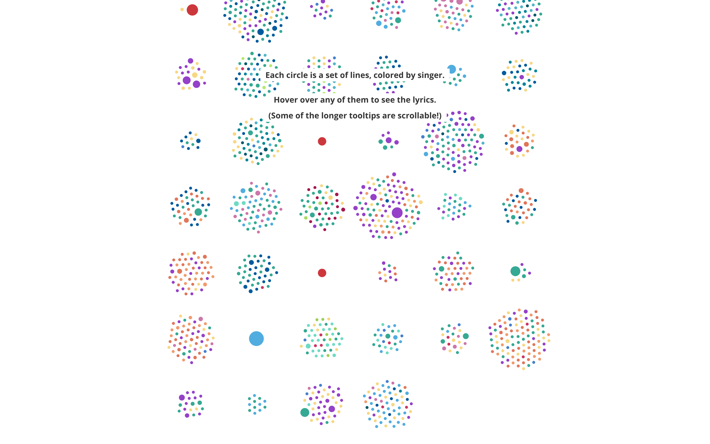
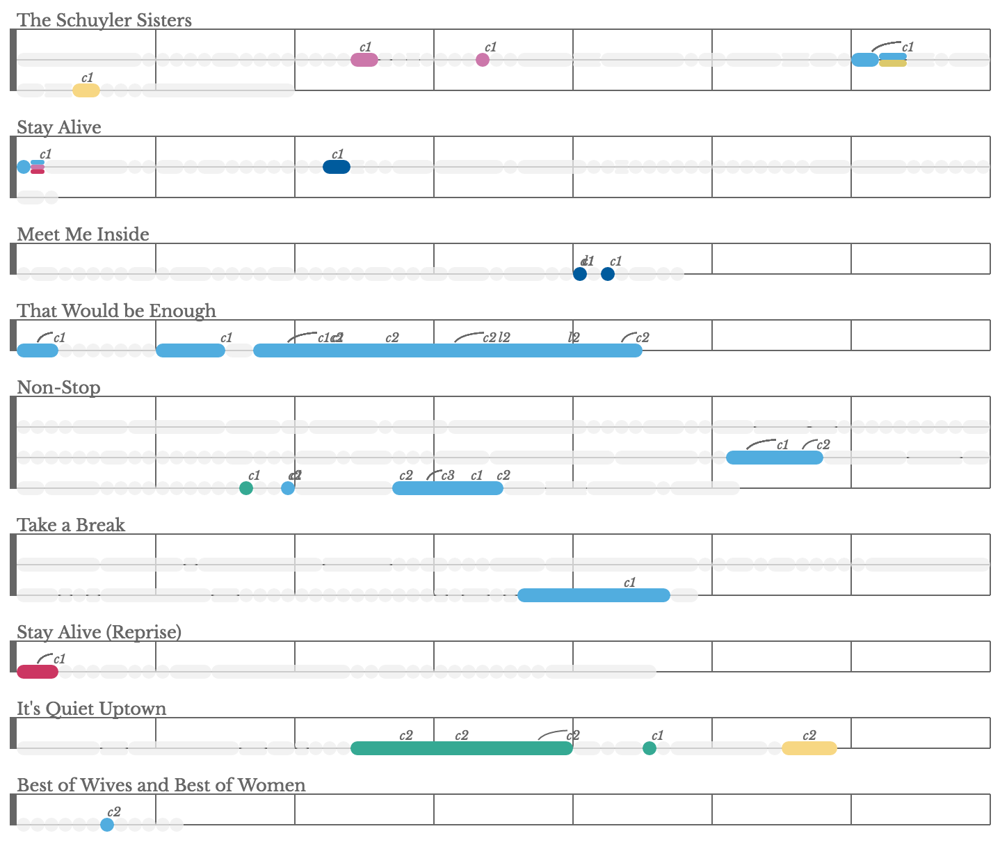
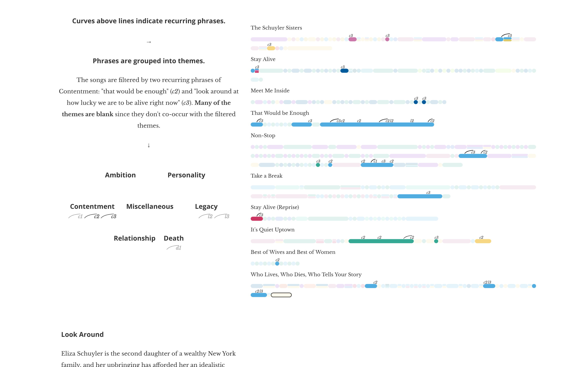

+++
author = "Yuichi Yazaki"
title = "Singers as Color, Repetitions as Arcs, Every Lyric Filterable: Shirley Wu's \"An Interactive Visualization of Every Line in Hamilton\""
slug = "hamilton-every-line"
date = "2026-11-23"
description = "Shirley Wu hand-recorded the singer, the addressee, and the repeated phrases of every line in Hamilton, drew them as circles colored by singer with arcs for repetitions, and made a tool that filters by character, conversation, and theme."
categories = [
    "consume"
]
tags = [
    "data journalism",
    "Information is Beautiful Awards",
    "interaction",
    "d3-js",
    "language"
]
image = "images/cover-lines.png"
+++

Shirley Wu recorded, by hand, the singer, the addressee, and the repeated phrases of every lyric in the musical *Hamilton*. Lines sung consecutively by the same singer become one circle, colored by singer, and repeated phrases appear as arcs above the circles. On top of that she built a tool that lets you filter by combining characters, conversations, and themes.

The work is "An Interactive Visualization of Every Line in Hamilton." The author announced its release on December 13, 2016, and it was first published on the Polygraph site (according to the author's tweet and her making-of). It can now be read at The Pudding's URL (pudding.cool/2017/03/hamilton). What follows reads along the work's page, the Data Sketches making-of, and the published data.

<!--more-->

## Summer 2016: Recording Every Lyric by Hand

In the summer of 2016, the author listened to the cast recording for months. What caught her attention was the relationships among the main characters and the repeated phrases tied to each of them. The work's page describes the scope of the record this way.

> "So I went through every single line in Hamilton (twice 😱) and recorded who sang each line, as well as who that line may have been directed towards. I've noted every phrase that was sung more than once across more than one song, and grouped them into broad themes*."

In short: she read through every line twice and recorded who sang each line and to whom. She marked phrases sung more than once across more than one song and grouped them into broad themes.

The steps, according to the making-of, were as follows.

| Stage | What the making-of says |
|---|---|
| Marking repeated phrases | She read *Hamilton: The Revolution* (known as the Hamiltome), numbered the repeated phrases, and noted them in a sketchbook |
| Lyrics | She used the existing full lyrics available online (amandavisconti/ham4corpus) |
| Characters, conversations, themes | She went through the lyrics once more and typed them in by hand in a usable format. It took "a painstaking three days" |
| Release | She published the raw data and the processed data on GitHub at sxywu/hamilton |

The Hamiltome is a book on the making of the show, and Lin-Manuel Miranda, the musical's creator, is a co-author.

On scale, the work page's description says only "21,000 words." When I counted the data the author published on GitHub, it came to 46 songs, 1,421 groups of lines, and 3,258 lines (the data embedded in the work page gives the same counts).

Production ran from the last week of August to the second week of December. A one-month plan took three months, on and off.

## Color Is the Singer, Arcs Are Repetition

The work's page first tells you how to read the figure in a single sentence.

> "Each circle is a set of lines, colored by singer."

A circle is a group of lines, and its color tells you who sang it. Hover over a circle and the lyrics appear.

Quoted from Shirley Wu, [An Interactive Visualization of Every Line in Hamilton (The Pudding)](https://pudding.cool/2017/03/hamilton/index.html)

According to the making-of, she began by placing one dot per line. But there were too many tiny dots, and the figure looked cluttered. So she decided to **merge lines sung consecutively by the same singer into one**.

The way to show repeated phrases also changed twice.

| Idea | Reason the author gives | Result |
|---|---|---|
| Diamonds spanning lines | Too many colors, cluttered. Color was already used to tell the characters apart | Dropped |
| Arcs with labels (theme initial plus number) | Simple and uses no color. It also looks like the markings on a musical score | Adopted |
| Arcs plus a musical staff | It looked cluttered and confused the people she showed it to | Removed |

The staff had been added as a scale for the length of lines: one section was 10 lines, and one row was 70 lines.

Quoted from Shirley Wu, [Data Sketches](https://www.datasketch.es/project/an-interactive-visualization-of-every-line-in-hamilton)

On the work's screen, the arc labels fall into 7 categories and 19 items: Ambition (a1 to a4), Personality (p1 to p3), Contentment (c1 to c3), Miscellaneous (m1 to m3), Legacy (l1 to l3), Relationship (r1, r2), and Death (d1).

So the roles are divided: color for the singer, arcs for the phrase. I read this as a design that lets you follow, on the same figure, both who is singing and what is being repeated.

## People Are AND, Conversations and Themes Are OR

What the author struggled with most was filtering; the making-of says "the filters were a nightmare." Sorting it out took several weeks. The final rules are as follows.

- Characters: AND. Keep only the songs in which every selected character appears
- Conversations: OR. Keep the songs that contain at least one of the selected conversations
- Themes: OR. Keep the songs that contain at least one of the selected themes
- Between categories: AND

The author adds an aside of her own: "(Again, I've no idea why I chose something so convoluted...)". It is an admission that she cannot say why she made it so tangled.

Another device is to remove the items that would leave no songs if chosen. In the making-of's example, the three songs in which Philip Hamilton appears have few other singers. So characters who do not appear in the remaining songs are made unselectable. An item has four states.

| State | Appearance |
|---|---|
| Selected | Colored, 100% opacity |
| Corresponding lines are highlighted by other conditions | Colored, translucent |
| Appears in a song but is not highlighted | Gray, translucent |
| Does not appear in the remaining songs | Dotted outline only (it disappears from view on screen) |

The work's page also explains that, as items disappear, you can tell who appears in the same songs as whom. The screen below shows the state filtered by Angelica Schuyler and Alexander Hamilton.

Quoted from Shirley Wu, [An Interactive Visualization of Every Line in Hamilton (The Pudding)](https://pudding.cool/2017/03/hamilton/index.html)

The rendering method also changed at the finishing stage. SVG had held up even with about 1,700 path elements, but lag in updates was visible when scrolling. After Sarah Drasner, whom she met at JSConf Asia, told her "Canvas! You need Canvas.", she moved everything to Canvas. For mouse hit detection she laid an invisible Canvas on top.

## Reading It as a Story of Sisters

Once the tool existed, the author used it to read the show. At first she was tracing the relationship between Alexander and Aaron Burr. Then Taia, whom she calls "my Hamilton expert," gave her some advice: there is already plenty of analysis of Alexander and Burr, and Eliza Schuyler and Angelica are far more interesting.

The author first filtered by Eliza and Angelica. Next she filtered by the pairs of Eliza and Alexander and of Angelica and Alexander, and then by their conversations. After that she looked at the themes that come up often, and here her expectation turned out to be wrong.

> "I had expected Eliza to most frequently sing "Helpless", but instead, she sang "look around at how lucky we are alive right now" and "that would be enough/what would be enough" far more often."

Her guess about Eliza's most-sung phrase was off: two other phrases outnumber "Helpless" by a wide margin.

The work opens Eliza's story from the screen filtered by these two phrases.

Quoted from Shirley Wu, [An Interactive Visualization of Every Line in Hamilton (The Pudding)](https://pudding.cool/2017/03/hamilton/index.html)

In That Would Be Enough, Eliza sings "that would be enough" to her husband. In Non-Stop, it turns into a question: "Would that be enough?" When Alexander is invited to become Treasury Secretary, he sings Eliza's "look around" back to her as his reason for leaving.

> "In return, Eliza sings only one word: helpless. It is the last time she sings helpless in the whole musical."

Eliza's reply is a single word, and the author points out that it is the last time she sings that word in the show.

In It's Quiet Uptown, Alexander echoes Eliza's words, this time asking to be allowed to stay by her side. In the final song, Who Lives, Who Dies, Who Tells Your Story, Eliza sings "Have I done enough?" The author writes that Eliza's concern has shifted from what would be enough to whether she herself has done enough.

About Angelica, she writes that Take A Break is the only song in which she sings together with Alexander, and that It's Quiet Uptown is the only song that begins with Angelica.

Follow the arcs attached to one phrase across songs, and you can see how the words pass from one singer's mouth to another's. I read the author's interpretation as resting on the way this figure is built.

## How Third Parties Saw the Work

The first is an award. At the Kantar Information is Beautiful Awards 2017, the work received Bronze in the Arts, Entertainment & Culture category. The blurb names the exploratory tool at the end.

> "Includes an interactive exploratory tool at the end, where the reader can filter by any set of characters, conversations, and themes, and dig into the remaining lines and songs to do their own analysis."

The praise is for letting readers carry out their own analysis once they have narrowed things down.

The second is a publication that introduces online resources. The Scout Report featured the work in its issues of October 19, 2018 and March 6, 2020. What it praised was how the data came to be.

> "She crafted this essay using a raw dataset that she created manually based on the musical's libretto"

It credits the hand-made raw data, built from the script. The same blurb also says that the work is designed for Chrome and for resolutions higher than 1280×800, so it may be hard to view on mobile devices.

The third is a look back from the makers' side. Built In (February 17, 2021), in an interview with the two Data Sketches creators, touched on the staging of this work.

> "experimenting with D3's force layout to make data points dance across the screen before settling into place"

The article describes an entrance animation in which the points swirl across the page and then lock into position. The making-of explains it as a device to keep readers in a long article. Asked about her favorite work, the author answered:

> "For me, I think the biggest one is Hamilton."

Her answer is that the biggest one is *Hamilton*. She gives the many reactions it drew after release as the reason.

## Takeaways

There are four judgments to carry away.

The first is to choose the unit of the figure again after you have drawn it. Because dots for every single line looked cluttered, this work merged them into "lines sung consecutively by the same singer."

The second is to give color only one meaning. Color was already used for the singers, so coloring themes with diamonds caused confusion. She switched to arcs and labels, which show phrases without using color. The staff, added as a scale, looked cluttered and confused the people she showed it to, so she removed it.

The third is to decide the filter logic according to the nature of each item. For characters, keep the songs where all of them appear (AND); for conversations and themes, keep the songs where any one of them appears (OR). In addition, items that would leave nothing cannot be selected. **The disappearance of items is itself information about who appears in the same songs.**

The fourth is to use the tool you built to test your own expectations. The author had assumed "Helpless" was the frequent one, and the tool proved her wrong. Shifting the focus to the sisters also came from the advice of someone who knew the show well. Because the data is public, readers can look for other stories. The Pudding's [Women's Pockets are Inferior](/en/pudding-womens-pockets/) also publishes its measurement data.

## References

**Primary sources**

- Shirley Wu, "An Interactive Visualization of Every Line in Hamilton," published in *Polygraph* (release announced by the author on 2016-12-13). Now published in *The Pudding*. [The work](https://pudding.cool/2017/03/hamilton/index.html)
- Shirley Wu, "An Interactive Visualization of Every Line in Hamilton," *Data Sketches* (making-of, September 2016 to December 2016). [Making-of](https://www.datasketch.es/project/an-interactive-visualization-of-every-line-in-hamilton)
- Image from the same making-of (the version with a staff). [Image](https://cdn.prod.website-files.com/5fa9d88da1855554db37b1e1/5fc62423d3d6eee7d976830a_with_staff.png)
- sxywu/hamilton (data and source code). [GitHub](https://github.com/sxywu/hamilton) / [src/data](https://github.com/sxywu/hamilton/tree/master/src/data)
- amandavisconti/ham4corpus (the lyrics corpus the author used). [GitHub](https://github.com/amandavisconti/ham4corpus/blob/master/All_Lyrics_Speakers)
- Release announcement tweet by Shirley Wu (@sxywu) (2016-12-13). Embedded in: Glen Tickle, "Interactive Visualization Breaking Down Every Line of Hamilton by Character, Conversation and Theme," *Laughing Squid*, 2017-01-05. [Article](https://laughingsquid.com/?p=601040)
- The Pudding, About (the relationship between The Pudding and Polygraph). [Page](https://pudding.cool/about/)

**Secondary sources**

- Kantar Information is Beautiful Awards 2017, "An Interactive Visualization of Every Line in Hamilton" (Arts, Entertainment & Culture, Bronze). [Showcase](https://www.informationisbeautifulawards.com/showcase/2346-an-interactive-visualization-of-every-line-in-hamilton)
- Scout Archives, "An Interactive Visualization of Every Line in Hamilton," *The Scout Report*, 2018-10-19 / 2020-03-06. [Record](https://archives.internetscout.org/r50154)
- Stephen Gossett, "The Designers Behind 'Data Sketches' on Their Eccentric Vision for Data Viz," *Built In*, 2021-02-17. [Article](https://builtin.com/data-science/data-sketches)
