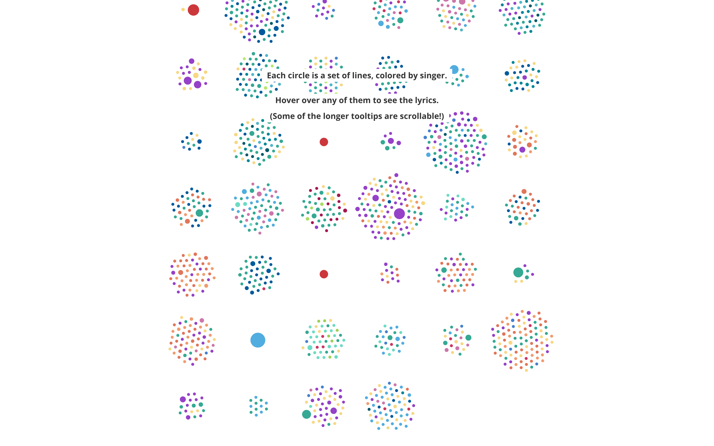
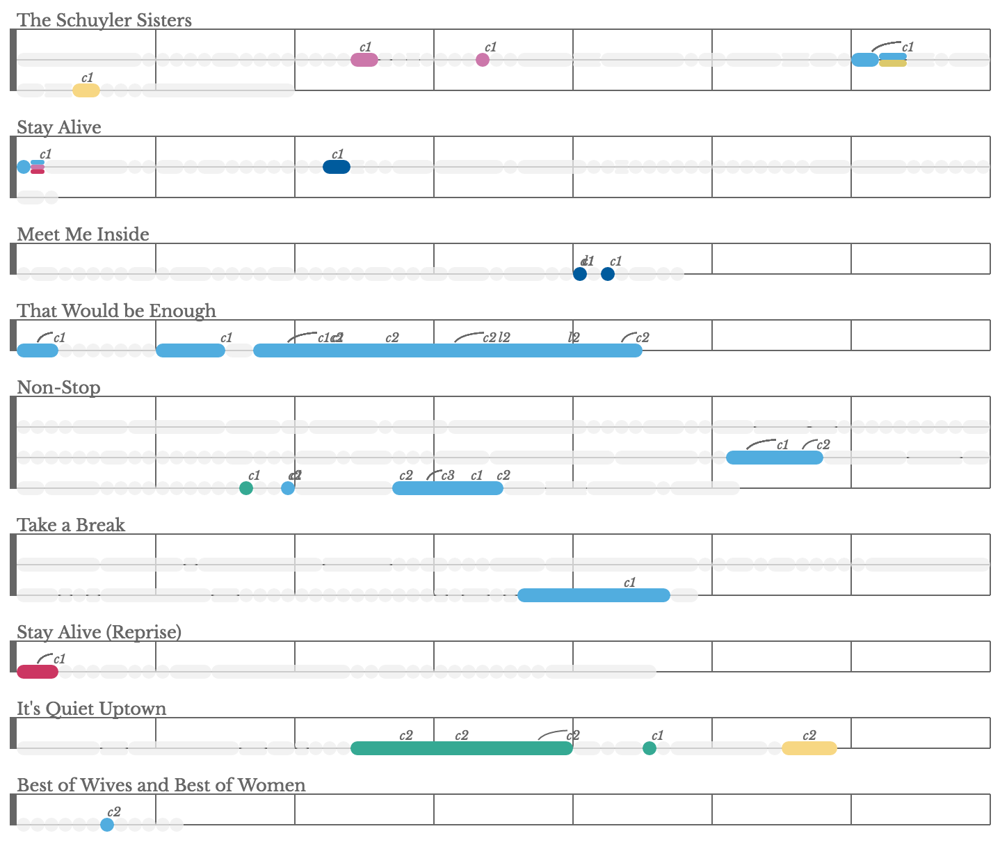
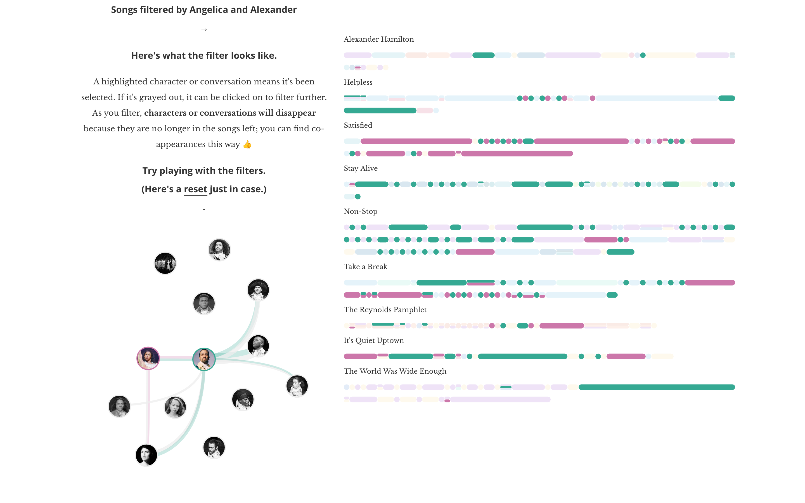
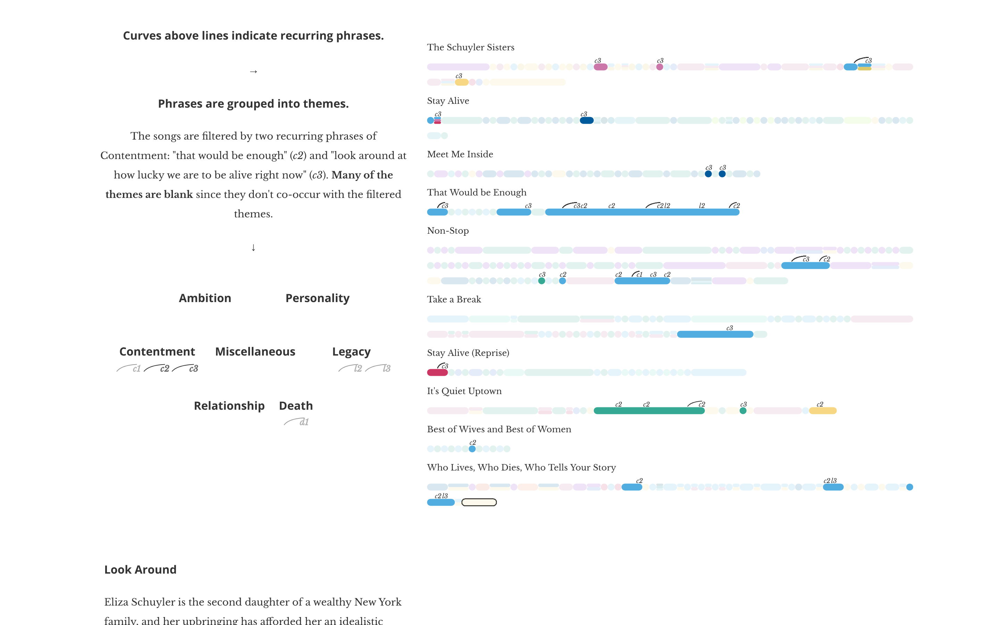

+++
author = "矢崎裕一"
title = "歌い手を円に、繰り返しを弧にして全歌詞を絞り込む──Shirley Wu「An Interactive Visualization of Every Line in Hamilton」"
slug = "hamilton-every-line"
date = "2026-11-23"
description = "Shirley Wu は『ハミルトン』の全歌詞の歌い手・歌いかけた相手・反復フレーズを手で記録し、歌い手ごとの円と反復の弧で示して、人物・会話・テーマで絞り込める道具にしました。"
categories = [
    "consume"
]
tags = [
    "データジャーナリズム",
    "Information is Beautiful Awards",
    "インタラクション",
    "d3-js",
    "言葉"
]
image = "images/cover-lines.png"
+++

Shirley Wu（シャーリー・ウー）は、ミュージカル『ハミルトン』の全歌詞について、歌い手・歌いかけた相手・繰り返されるフレーズを手で記録しました。同じ歌い手が続けて歌う行を1つの円にして歌い手ごとに色分けし、反復フレーズを円の上の弧で示しています。そのうえで、人物・会話・テーマを組み合わせて絞り込める道具にしました。

作品は「An Interactive Visualization of Every Line in Hamilton」です。初出は2016年12月13日、Polygraph のサイトでした（作者のツイートと制作記による）。いまは The Pudding の URL（pudding.cool/2017/03/hamilton）で読めます。以下は、作品のページ、Data Sketches の制作記、公開データに沿って読みます。

<!--more-->

## 2016年夏、全歌詞を手で記録する

作者は2016年の夏、キャストの録音を何か月も聴き続けました。気になったのは、主な人物どうしの関係と、人物に結びつく繰り返しのフレーズです。記録の範囲は、作品のページにこうあります。

> "So I went through every single line in Hamilton (twice 😱) and recorded who sang each line, as well as who that line may have been directed towards. I've noted every phrase that was sung more than once across more than one song, and grouped them into broad themes*."

全行を2回通して読み、各行を誰が歌い、誰に向けたかを記録した。2曲以上で2回以上歌われるフレーズに印を付け、大まかなテーマにまとめた、という内容です。

手順は、制作記のとおりです。

| 段階 | 制作記の記述 |
|---|---|
| 反復フレーズの印 | 『Hamilton: The Revolution』（通称 Hamiltome）を読み、反復フレーズに番号を振ってスケッチブックに控えた |
| 歌詞 | ネット上にある既存の全歌詞（amandavisconti/ham4corpus）を使った |
| 人物・会話・テーマ | 歌詞をもう一度通して、使える形式で手入力した。「a painstaking three days」かかった |
| 公開 | 生データと加工後のデータを GitHub の sxywu/hamilton で公開した |

Hamiltome は制作過程を記した本で、ミュージカルの作者 Lin-Manuel Miranda（リン＝マニュエル・ミランダ）が共著者です。

作品が示す規模は「21,000 words」だけです。作者が GitHub で公開したデータを筆者が数えると、46曲、行のまとまり1,421、3,258行でした（作品ページに組み込まれたデータでも同じ数になります）。

制作は8月の最終週から12月の第2週まで。1か月の予定が、断続的に3か月かかりました。

## 円は歌い手、弧は繰り返し

作品のページは、まず次の一文で図の読み方を示します。

> "Each circle is a set of lines, colored by singer."

円は行のまとまりで、色は歌い手を表す、という意味です。円にマウスを重ねると歌詞が出ます。

Shirley Wu／[An Interactive Visualization of Every Line in Hamilton（The Pudding）](https://pudding.cool/2017/03/hamilton/index.html)より引用

制作記によると、はじめは1行ごとに点を置きました。ところが、小さな点が多すぎて散らかって見えた。そこで、**同じ歌い手が続けて歌う行を1つにまとめる**ことにしました。

反復フレーズの表し方も、二度変わっています。

| 案 | 作者が書いた理由 | 結果 |
|---|---|---|
| 行をまたぐ菱形 | 色が多く散らかる。色はすでに人物の区別に使っていた | やめた |
| 弧とラベル（テーマの頭文字＋番号） | 単純で色を使わない。楽譜の記号のようにも見える | 採用 |
| 弧に加えて五線譜 | 散らかって見え、見せた人を混乱させた | 外した |

五線譜は、行の長さの目盛りとして足したもので、1区画が10行、1段で70行でした。

Shirley Wu／[Data Sketches](https://www.datasketch.es/project/an-interactive-visualization-of-every-line-in-hamilton)より引用

弧のラベルは、作品の画面では7分類・19個です。Ambition（a1〜a4）、Personality（p1〜p3）、Contentment（c1〜c3）、Miscellaneous（m1〜m3）、Legacy（l1〜l3）、Relationship（r1、r2）、Death（d1）です。

色は歌い手、弧はフレーズ、と役目を分けたことになります。同じ図の上で、誰が歌うかと、何が繰り返されるかを同時に追える作りだと読めます。

## 人物は AND、会話とテーマは OR

作者が特に苦労したのは絞り込みで、制作記には「the filters were a nightmare」とあります。整理に数週間かかりました。最終的な規則は次のとおりです。

- 人物：AND。選んだ人物が全員出てくる曲だけを残す
- 会話：OR。選んだ会話が一つでもある曲を残す
- テーマ：OR。選んだテーマが一つでもある曲を残す
- 分類どうし：AND

作者自身も「(Again, I've no idea why I chose something so convoluted...)」と書き添えています。なぜこんなに入り組ませたのか自分でもわからない、という一言です。

もう一つの工夫は、選んでも曲が残らない項目を消すことです。制作記の例では、Philip Hamilton（フィリップ）が出る3曲には、ほかの歌い手が少ない。そこで、残った曲に出てこない人物は選べないようにしました。項目の状態は四つです。

| 状態 | 見た目 |
|---|---|
| 選ばれている | 色付き、不透明度100% |
| ほかの条件で、対応する行が強調されている | 色付き、半透明 |
| 曲には出るが、強調されていない | 灰色、半透明 |
| 残った曲に出てこない | 点線の輪郭だけ（画面では表示から消える） |

作品のページも、項目が消えていくことで、誰と誰が同じ曲に出るかがわかると説明しています。

Shirley Wu／[An Interactive Visualization of Every Line in Hamilton（The Pudding）](https://pudding.cool/2017/03/hamilton/index.html)より引用

描画の方式も、仕上げの段階で変わりました。約1,700個の path 要素でも SVG は持ちこたえていましたが、スクロールすると更新の遅れが見えた。JSConf Asia で会った Sarah Drasner に「Canvas! You need Canvas.」と言われ、すべてを Canvas に移しています。マウスの判定には、見えない Canvas を重ねる方法を使いました。

## 姉妹の物語として読む

道具ができると、作者はそれで作品を読みます。最初は Alexander Hamilton（アレクサンダー・ハミルトン）と Aaron Burr（アーロン・バー）の関係を追っていました。そこへ、作者が「my Hamilton expert」と呼ぶ Taia が助言します。アレクサンダーとバーの分析はすでに多い、イライザとアンジェリカのほうがずっと面白い、という助言です。

作者は Eliza Schuyler（イライザ・スカイラー）と Angelica Schuyler（アンジェリカ・スカイラー）で絞り込み、次に二人とアレクサンダーの会話で、最後にテーマで絞りました。そこで予想が外れます。

> "I had expected Eliza to most frequently sing "Helpless", but instead, she sang "look around at how lucky we are alive right now" and "that would be enough/what would be enough" far more often."

イライザは "Helpless" を最もよく歌うと思っていた。実際には「look around…」と「that would be enough／what would be enough」をずっと多く歌っていた、という発見です。作者はこのとき彼女に惹かれた、と続けています。

作品の本文は、この二つのフレーズで絞った画面から、イライザの話を始めます。

Shirley Wu／[An Interactive Visualization of Every Line in Hamilton（The Pudding）](https://pudding.cool/2017/03/hamilton/index.html)より引用

That Would Be Enough で、イライザは「that would be enough」と夫に歌う。Non-Stop では、それが「Would that be enough?」という問いに変わる。財務長官に誘われたアレクサンダーは、イライザの「look around」を、出ていく理由として歌い返す。

> "In return, Eliza sings only one word: helpless. It is the last time she sings helpless in the whole musical."

イライザが返すのは「helpless」の一語だけで、劇中でこの語を歌うのはこれが最後だ、という指摘です。

It's Quiet Uptown では、アレクサンダーがイライザの言葉をなぞり、今度はそばにいさせてほしいと願います。最後の曲 Who Lives, Who Dies, Who Tells Your Story で、イライザは「Have I done enough?」と歌います。作者は、関心が「何があれば足りるか」から「自分は十分にやったか」へ移った、と書いています。

アンジェリカについても、本文は道具で言えることを示します。アレクサンダーと一緒に歌うのは Take A Break だけで、It's Quiet Uptown はアンジェリカから始まる唯一の曲です。

同じフレーズに付いた弧を曲をまたいで追うと、言葉が誰の口から出るかの移り変わりが見える。作者の読みは、この図の作りがあって成り立っていると読めます。

## 第三者はこの作品をどう見たか

一つ目は賞です。Kantar Information is Beautiful Awards 2017 で、Arts, Entertainment & Culture 部門の Bronze を受けました。紹介文は、最後に置かれた探索用の道具を挙げています。

> "Includes an interactive exploratory tool at the end, where the reader can filter by any set of characters, conversations, and themes, and dig into the remaining lines and songs to do their own analysis."

読者が人物・会話・テーマで絞り込み、残った行と曲で自分の分析ができる、という評価です。

二つ目は、資料紹介の誌面です。Scout Report は、2018年10月19日号と2020年3月6日号でこの作品を取り上げました。評価したのは、データの成り立ちです。

> "She crafted this essay using a raw dataset that she created manually based on the musical's libretto"

台本をもとに作者が手で作った生データを使っている、という点です。同じ紹介は、Chrome と1280×800以上の解像度向けなので、携帯端末では見づらいかもしれない、とも書いています。

三つ目は、作り手の側からの振り返りです。Built In（2021年2月17日）は、Data Sketches の二人への取材で、この作品の演出に触れました。

> "experimenting with D3's force layout to make data points dance across the screen before settling into place"

点が画面を舞ってから位置に収まる、という描写です。制作記では、長い記事に読者をとどめるための演出だと説明しています。同じ取材で、お気に入りの作品を問われた作者は、こう答えました。

> "For me, I think the biggest one is Hamilton."

いちばん大きいのは Hamilton だ、という答えです。作者は、公開後に多くの反応があったことを理由に挙げています。

## 使い道

可視化の仕事に持ち帰れる判断は、四つあります。

一つ目は、描いてみてから図の単位を選び直すことです。この作品は1行ごとの点が散らかって見えたので、「同じ歌い手が続けて歌う行」にまとめました。

二つ目は、色に一つの意味だけを持たせることです。色はすでに歌い手に使っていたので、菱形でテーマを色分けすると混乱した。弧とラベルに変えて、色を使わずにフレーズを示しました。同じ理由で、目盛りとして足した五線譜も外しています。

三つ目は、絞り込みの論理を、項目の性質ごとに決めることです。人物は全員がそろう曲（AND）、会話とテーマはどれか一つがある曲（OR）を残す。さらに、残らない項目は選べなくする。**項目が消えること自体が、同じ曲に誰が出るかの情報になります。**

四つ目は、作った道具で自分の予想を確かめることです。作者は "Helpless" が多いと思い込んでいて、道具がそれを外しました。焦点を姉妹に移したのも、詳しい人の助言でした。データも公開されているので、読者は別の物語を探せます。同じ The Pudding の [Women's Pockets are Inferior](/pudding-womens-pockets/) も、測定データを公開しています。

## 参考・出典

**一次情報**

- Shirley Wu, "An Interactive Visualization of Every Line in Hamilton," 初出 *Polygraph*, 2016-12-13. 現在の掲載先 *The Pudding*. [作品](https://pudding.cool/2017/03/hamilton/index.html)
- Shirley Wu, "An Interactive Visualization of Every Line in Hamilton," *Data Sketches*（制作記、September 2016 to December 2016）. [制作記](https://www.datasketch.es/project/an-interactive-visualization-of-every-line-in-hamilton)
- 同制作記の画像（五線譜ありの案）. [画像](https://cdn.prod.website-files.com/5fa9d88da1855554db37b1e1/5fc62423d3d6eee7d976830a_with_staff.png)
- sxywu/hamilton（データとソースコード）. [GitHub](https://github.com/sxywu/hamilton) / [src/data](https://github.com/sxywu/hamilton/tree/master/src/data)
- amandavisconti/ham4corpus（作者が使った歌詞のコーパス）. [GitHub](https://github.com/amandavisconti/ham4corpus/blob/master/All_Lyrics_Speakers)
- Shirley Wu（@sxywu）の公開告知ツイート（2016-12-13）. 次の記事に埋め込み: Glen Tickle, "Interactive Visualization Breaking Down Every Line of Hamilton by Character, Conversation and Theme," *Laughing Squid*, 2017-01-05. [記事](https://laughingsquid.com/?p=601040)
- The Pudding, About（The Pudding と Polygraph の関係）. [ページ](https://pudding.cool/about/)

**第三者評価**

- Kantar Information is Beautiful Awards 2017, "An Interactive Visualization of Every Line in Hamilton"（Arts, Entertainment & Culture, Bronze）. [ショーケース](https://www.informationisbeautifulawards.com/showcase/2346-an-interactive-visualization-of-every-line-in-hamilton)
- Scout Archives, "An Interactive Visualization of Every Line in Hamilton," *The Scout Report*, 2018-10-19 / 2020-03-06. [記録](https://archives.internetscout.org/r50154)
- Stephen Gossett, "The Designers Behind 'Data Sketches' on Their Eccentric Vision for Data Viz," *Built In*, 2021-02-17. [記事](https://builtin.com/data-science/data-sketches)
