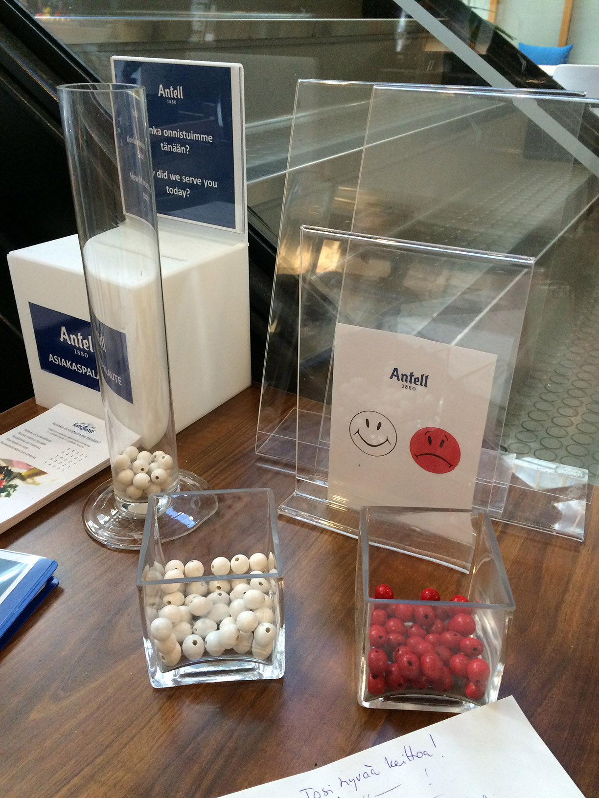

+++
author = "Yuichi Yazaki"
title = "White Beads for Satisfied, Red for Unsatisfied: The Bar Chart in the Antell Cafeteria at the University of Helsinki"
slug = "helsinki-cafeteria-bead-survey"
date = "2026-11-03"
description = "A physical bar chart stood at the exit of an Antell cafeteria on the University of Helsinki campus. Customers dropped in a white bead if they were satisfied and a red bead if they were not."
categories = [
    "consume"
]
tags = [
    "data physicalization",
    "bar chart"
]
image = "images/cover.jpg"
series = ["data-physicalization"]
series_weight = 32
seriesByline = "Antell"
seriesTitle = "White Beads for Satisfied, Red for Not: Antell's Exit Bar Chart"
+++

At the exit of an Antell cafeteria on the University of Helsinki campus, there was a physical bar chart. Customers put in a white bead (satisfied) or a red bead (unsatisfied).

The source is the entry "Physical Customer Satisfaction Survey" on dataphys.org (List of Physical Visualizations), a site that collects physical visualizations. Pierre Dragicevic added it in March 2015. The text is two sentences long, and the photo is a single image taken by Luana Micallef. This article follows those two sentences and the photo.

<!--more-->

## What stood on the table by the exit

The text of the entry reads as follows.

> Participatory physical bar charts at the exit of the Antell cafeteria at the University of Helsinki. White beads represent statisfied customers, red beads are unsatisfied ones.

In short: participatory physical bar charts at the exit of the Antell cafeteria at the University of Helsinki, where white beads stand for satisfied customers and red beads for unsatisfied ones. "statisfied" is the spelling in the original.

The Source field says "Antell", and the link goes to Antell's home page. It contains no description of the device. Since the Source field names Antell, the device can be read as belonging to the Antell outlet rather than being run by the university. Micallef, who took the photo, was in 2015 a visualization researcher affiliated with the Helsinki Institute for Information Technology (HIIT).

Photo by Luana Micallef / From dataphys.org

Here is what appears in the photo, starting from the front.

- There are two square glass bowls: the left one holds white beads, the right one red beads.
- On the card in the transparent stand behind them, a white smiling face and a red frowning face sit side by side under the Antell logo.
- On the left stands a slender glass tube, with white beads collected at the bottom.
- The sign behind the tube poses a question in Finnish and English. Part of it is hidden by the tube, but the English can be read as "How did we serve you today?"
- At the back is a white box labeled "ASIAKASPALAUTE", and a stack of paper lies at the front left.

The two faces on the card can be read as a legend for the bead colors. The two bowls in front can be read as the place where customers pick up their beads. Only one tube appears in the photo, and the beads in it are all white. The text says "bar charts" in the plural, but the photo does not show where any other tubes were.

## What was mapped to color and height

The table below lays out the mapping between data and physical properties, together with the basis for each.

| Data | Physical property | Basis |
|---|---|---|
| Customer's rating (satisfied / unsatisfied) | Bead color (white / red) | Stated in the text |
| Meaning of the colors | The card's white smiling face and red frowning face | Visible in the photo |
| Who answers | Customers put in the beads themselves | "Participatory" in the text |
| When they answer | Placement (the cafeteria exit) | Stated in the text |
| Number of responses | Height of the beads piled in the tube | Read from "bar charts" in the text and the tube in the photo |
| One respondent | One bead | Not described in the source |

**The only mapping stated in the text is color.** Reading counts from height comes from the name "bar chart" and from the tube in the photo. The source does not say how many beads one person puts in, or what the bars were divided by. The installation period, the number of beads collected, the ratio of satisfied to unsatisfied, and who designed the device are also unknown from the source.

dataphys classifies this device as a Passive physical visualization, a category of physical visualizations that use no power or electronic components. The only thing that updates the display can be read as the hands of the customers dropping in beads.

## dataphys lists it alongside devices of the same kind

The entry's Related field lists three other works alongside this device.

> Related: Also see similar contraptions by Hans Haacke (1970), Lucy Kimbell (2006), and Jennifer Payne (2014).

It is a single sentence asking readers to also see similar contraptions by Haacke (1970), Kimbell (2006), and Payne (2014). The Related field calls the three "similar contraptions", which suggests that dataphys lists this case as the same kind. This device can be read as a tool the outlet set out for a customer survey (the source does not describe its purpose).

The entry also carries the participatory tag. The tag page begins with voting by pebbles in ancient Greece and says this.

> The earliest participatory visualizations were probably voting systems.

In short: the earliest participatory visualizations were probably voting systems. Here is how the dataphys entries divide up the answers.

| Device | Year | How answers are divided |
|---|---|---|
| Pebble voting (ancient Greece) | — | Pebble color (white = for, black = against). Sometimes two urns were used |
| Hans Haacke, *MoMA Poll* | 1970 | Position of the box (left box = Yes, right box = No) |
| Lucy Kimbell, *Physical Bar Charts* | 2006 | Badges are taken out, so the more votes, the lower the bar |
| Jennifer Payne, *Physical Visual Sedimentation* | 2014 | Gumball color separates groups within the university |
| Antell's device | 2015 (year of registration) | Bead color (white = satisfied, red = unsatisfied) |

Haacke's *MoMA Poll* divided yes and no by the position of the box ([article](/en/moma-poll/)). Antell's device, like pebble voting, divides answers by color. Dividing by color suggests that the position of the bar could be assigned to something else. However, what this device divided by position cannot be confirmed.

dataphys's treatment is a classification, not an evaluation. I could not find any criticism or press coverage of this device itself in a form I could read.

## How it could be used

In this device, the act of answering and the act of showing the result happen on the same tube. The next customer walking out can also see the beads that have piled up so far, it can be read.

In this photo, the card with the smiling and frowning faces can be read as a legend. It can be read as a design that makes the meaning of white and red clear without reading any text.

The materials in the photo are beads, glass bowls and a tube, a sign, and a card. There are no electronic components. A device of this kind can be read as easy to assemble from materials at hand.

The source does not describe any tallying or record-keeping for this device. *MoMA Poll* kept the final day's vote count with a photoelectric counter ([article](/en/moma-poll/)). As a general point, when collecting on a physical object, it helps later to decide in advance how the counts will be taken and recorded.

## References

**Primary sources**

- dataphys.org "2015 – Physical Customer Satisfaction Survey" (Added by Pierre Dragicevic, registered 2015-03-12): https://dataphys.org/list/physical-customer-satisfaction-survey/
- Photo (Photo by Luana Micallef): https://dataphys.org/list/images/uploads/2015/03/antell.jpg
- Antell (the link target of the entry's Source field; it contains no description of the device): http://www.antell.fi/
- The photographer's 2015 affiliation (HIIT): https://research.aalto.fi/en/activities/creating-high-quality-figures-for-your-publications/

**Comparison and background sources (related pages on dataphys.org; these are not evaluations of this device itself)**

- dataphys.org participatory tag: https://dataphys.org/list/tags/participatory/
- dataphys.org Passive physical visualization category: https://dataphys.org/list/categories/passive-physical-visualization/
- dataphys.org Pebble Voting: https://dataphys.org/list/visualizing-opinions-with-pebbles/
- dataphys.org MoMA Poll (Haacke, 1970): https://dataphys.org/list/moma-poll-haackes-participatory-bar-chart/
- dataphys.org Inverted Participatory Bar Charts (Kimbell): https://dataphys.org/list/physical-bar-charts/
- dataphys.org Physical Visual Sedimentation (Payne, 2014): https://dataphys.org/list/physical-visual-sedimentation/
