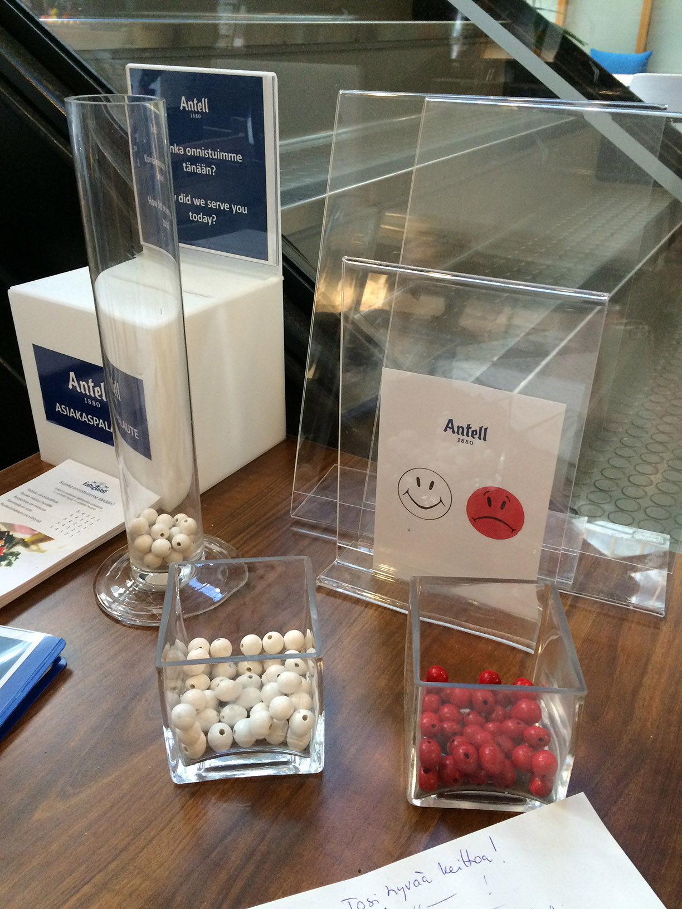

+++
author = "矢崎裕一"
title = "満足は白、不満は赤のビーズで答える──ヘルシンキ大学構内の Antell カフェテリアの棒グラフ"
slug = "helsinki-cafeteria-bead-survey"
date = "2026-11-03"
description = "ヘルシンキ大学の構内にある Antell のカフェテリアの出口に置かれた、物理的な棒グラフです。客は、満足なら白いビーズを、不満なら赤いビーズを入れます。"
categories = [
    "consume"
]
tags = [
    "データ物質化",
    "棒グラフ"
]
image = "images/cover.jpg"
series = ["data-physicalization"]
series_weight = 25
seriesByline = "Antell"
seriesTitle = "満足は白、不満は赤のビーズで──Antell の出口の棒グラフ"
+++

ヘルシンキ大学の構内にある Antell のカフェテリアの出口に、物理的な棒グラフが置かれていました。客が白いビーズ（満足）か赤いビーズ（不満）を入れる仕組みです。

出典は、物理的な可視化を集めたサイト dataphys.org（List of Physical Visualizations）の項目「Physical Customer Satisfaction Survey」です。2015年3月に Pierre Dragicevic（ピエール・ドラジチェヴィッチ）が登録しました。本文は2文で、写真は Luana Micallef（ルアナ・ミカレフ）が撮った1枚です。以下は、この2文と写真に沿います。

<!--more-->

## 出口の机に置かれたもの

項目の本文は次のとおりです。

> Participatory physical bar charts at the exit of the Antell cafeteria at the University of Helsinki. White beads represent statisfied customers, red beads are unsatisfied ones.

ヘルシンキ大学の Antell のカフェテリアの出口にある、参加型の物理的な棒グラフ。白いビーズは満足した客を、赤いビーズは満足しなかった客を表す、という要旨です。"statisfied" は原文のつづりのままです。

Source 欄は「Antell」で、リンク先は Antell のトップページです。装置についての記述はありません。Source 欄が Antell であることから、大学の運営ではなく Antell の店と読めます。撮影した Micallef は、2015年当時、ヘルシンキ情報技術研究所（HIIT）に所属していた可視化の研究者です。

Photo by Luana Micallef／dataphys.org より引用

写真に写っているものを、手前から書きます。

- 四角いガラスの器が二つあり、左の器に白いビーズ、右の器に赤いビーズが入っています。
- その奥の透明なスタンドのカードには、Antell のロゴの下に、白い笑顔と赤い困り顔が並んでいます。
- 左には細長いガラスの筒が立っていて、底に白いビーズがたまっています。
- 筒の後ろの札には、フィンランド語と英語で問いが書かれています。一部が筒に隠れていますが、英語は「How did we serve you today?」と読めます。
- 奥には「ASIAKASPALAUTE」と書いた白い箱があり、左手前には紙の束があります。

カードの二つの顔は、ビーズの色の凡例と読めます。手前の二つの器は、客がビーズを取るための置き場と読めます。写真に写っている筒は1本で、中のビーズは白だけです。本文は「bar charts」と複数形ですが、ほかの筒がどこにあったかは、写真からは分かりません。

## 色と高さに何を対応させたか

データと物の性質の対応を、根拠とあわせて表にします。

| データ | 物の性質 | 根拠 |
|---|---|---|
| 客の評価（満足／不満） | ビーズの色（白／赤） | 本文に書かれている |
| 色の意味 | カードの白い笑顔と赤い困り顔 | 写真に写っている |
| 答えた人 | 客自身がビーズを入れる | 本文の「Participatory」 |
| 答える時点 | 置き場所（カフェテリアの出口） | 本文に書かれている |
| 回答の数 | 筒にたまったビーズの高さ | 本文の「bar charts」と写真の筒からの読み |
| 回答者一人 | ビーズ一個 | 出典に記述なし |

**本文に書かれている対応は、色だけです。** 高さで数を読むという点は、「棒グラフ」という呼び方と写真の筒からの読みです。一人が何個入れるのか、棒を何で分けたのかは、出典に書かれていません。設置期間、集まったビーズの数、満足と不満の比、装置をデザインした人も、出典からは分かりません。

dataphys はこの装置を、Passive physical visualization に分類しています。動力や電子部品を使わない物理的な可視化のカテゴリです。表示を更新するのは、ビーズを入れる客の手だけだと読めます。

## dataphys は同じ型の装置と並べている

項目の Related 欄は、この装置を次の三つと並べています。

> Related: Also see similar contraptions by Hans Haacke (1970), Lucy Kimbell (2006), and Jennifer Payne (2014).

Haacke（1970）、Kimbell（2006）、Payne（2014）の、似た仕掛けも見てほしい、という一文です。Related 欄の3つを「similar contraptions（似た仕掛け）」と呼び、本件も同じ型として並べていると読めます。本件は、店が顧客アンケートのために置いた道具と読めます（出典に目的の記述はありません）。

項目には participatory（参加型）のタグも付いています。タグのページは、古代ギリシャの小石の投票から始まり、こう書いています。

> The earliest participatory visualizations were probably voting systems.

最も古い参加型の可視化は、おそらく投票の仕組みだった、という要旨です。dataphys の項目から、答えの分け方を並べます。

| 装置 | 年 | 答えをどう分けるか |
|---|---|---|
| 小石の投票（古代ギリシャ） | — | 小石の色（白＝賛成、黒＝反対）。壺を二つ使うこともあった |
| Hans Haacke『MoMA Poll』 | 1970 | 箱の位置（左の箱＝Yes、右の箱＝No） |
| Lucy Kimbell『Physical Bar Charts』 | 2006 | バッジを取り出すので、票が多いほど棒が低くなる |
| Jennifer Payne『Physical Visual Sedimentation』 | 2014 | ガムボールの色で、学内のグループを分ける |
| Antell の装置 | 2015（登録年） | ビーズの色（白＝満足、赤＝不満） |

Haacke の『MoMA Poll』は、賛否を箱の位置で分けました（[記事](/moma-poll/)）。Antell の装置は、小石の投票と同じく、答えを色で分けています。色で分けると、棒の位置には別のものを割り当てられると読めます。ただし、この装置が位置で何を分けていたかは、確かめられません。

dataphys の扱いは、評価の文ではなく分類です。この装置そのものを論じた批評や報道は、読める形では見つかりませんでした。

## 使い道

この装置では、答える行為と、結果を見せる行為が、同じ筒の上で起きます。出口を通る次の客も、それまでにたまったビーズを見られると読めます。

この写真では、笑顔と困り顔のカードが凡例と読めます。文字を読まなくても、白と赤の意味が分かる作りと読めます。

写真に写っている材料は、ビーズ、ガラスの器と筒、札とカードです。電子部品はありません。同じ型は、手元の材料で組み立てやすいと読めます。

この装置の集計や記録は、出典に書かれていません。『MoMA Poll』は、光電式カウンターで最終日の票数を残しました（[記事](/moma-poll/)）。一般論として、物の上で集める場合は、数えて記録する手順も決めておくと後で使えます。

## 参考・出典

**一次情報**

- dataphys.org「2015 – Physical Customer Satisfaction Survey」（Added by Pierre Dragicevic、2015-03-12 登録）：https://dataphys.org/list/physical-customer-satisfaction-survey/
- 写真（Photo by Luana Micallef）：https://dataphys.org/list/images/uploads/2015/03/antell.jpg
- Antell（項目の Source 欄のリンク先。装置の記述はない）：http://www.antell.fi/
- 撮影者の2015年の所属（HIIT）：https://research.aalto.fi/en/activities/creating-high-quality-figures-for-your-publications/

**比較・背景資料（dataphys.org の関連ページ。この装置そのものの評価ではありません）**

- dataphys.org participatory タグ：https://dataphys.org/list/tags/participatory/
- dataphys.org Passive physical visualization カテゴリ：https://dataphys.org/list/categories/passive-physical-visualization/
- dataphys.org Pebble Voting：https://dataphys.org/list/visualizing-opinions-with-pebbles/
- dataphys.org MoMA Poll（Haacke, 1970）：https://dataphys.org/list/moma-poll-haackes-participatory-bar-chart/
- dataphys.org Inverted Participatory Bar Charts（Kimbell）：https://dataphys.org/list/physical-bar-charts/
- dataphys.org Physical Visual Sedimentation（Payne, 2014）：https://dataphys.org/list/physical-visual-sedimentation/
