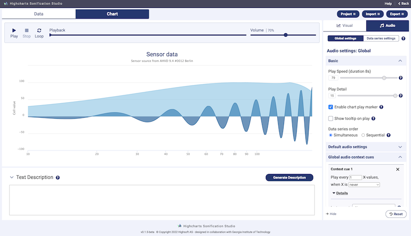
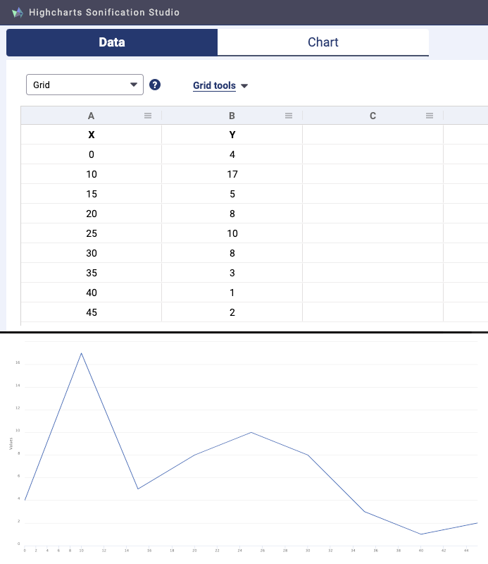
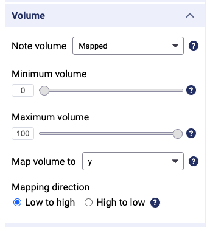
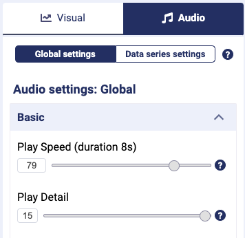

+++
author = "Yuichi Yazaki"
title = "Making a Line to See and a Line to Hear from One Table: Highcharts Sonification Studio"
slug = "highcharts-sonification-studio"
date = "2026-11-06"
description = "A tool that turns a table of data into a line chart and a sound that traces that line at the same time. Without writing code, you choose whether values map to pitch, panning, volume, and more. Three evaluations involving people with visual impairments were run during development."
categories = [
    "technology"
]
tags = [
    "sonification",
    "accessibility"
]
image = "images/app-thumbnail.png"
series = ["data-sonification"]
series_weight = 50
seriesByline = "Highsoft / Georgia Tech Sonification Lab"
seriesTitle = "A Table as a Line to See and Hear: Highcharts Sonification Studio"
+++

Highcharts Sonification Studio (HSS) is a tool that turns the data you enter in a table into a line chart and, at the same time, a sound that traces that line. In a sidebar, without writing any code, you choose whether values map to pitch, panning, volume, duration, and so on. During development, three evaluations were run that involved totally blind users and experts with visual impairments.

It was developed by Highsoft AS (Norway), the maker of Highcharts, and designed jointly with the Georgia Tech Sonification Lab. It runs in a browser, is free, and requires no login. What follows is based on the ICAD 2021 paper (Cantrell, Walker, Moseng), the GitHub source and in-app tutorial (v1.1.1), and a Georgia Tech news article (July 2021).

<!--more-->

## 2019: Moving the Java Sandbox to the browser

HSS has a predecessor: the Sonification Sandbox, a Java application that the Georgia Tech Sonification Lab maintained for about 15 years. It turned data worked on in a table into a chart you could both see and hear. The paper says that moving to the browser makes the tool easier to distribute and easier to use with screen readers. It also says that elaborate sound is harder to produce ("advanced audio can still be a challenge"). The paper calls HSS "a systematic re-implementation of the Sonification Sandbox," and also notes that not every Sandbox feature was carried over.

The first GitHub commit is dated August 26, 2019, by Øystein Moseng of Highsoft. The paper's three authors are Stanley J. Cantrell, Bruce N. Walker (director of the Sonification Lab), and Moseng. It was presented at ICAD in June 2021, and at the time of the paper (March 2021) the tool was a "public beta." v1.0.0 came in September 2022, and the latest, v1.1.1, in November 2025.

The interface has two views, a table tab and a chart tab, with settings in a sidebar on the right.

Source: Highsoft AS, [sonification-studio (GitHub)](https://github.com/highcharts/sonification-studio) (the footer in the screenshot reads v0.1.5-beta)

## Mapping values to pitch, panning, volume, and duration

The landing page states its goal as follows.

> "We want users to be able to use the tool without having to write code, and without prior sonification expertise."

In other words, the aim is that neither coding nor knowledge of sonification should be required. You put data into the table by importing a CSV or typing it in, and choose a chart type such as line, area, scatter, or bar.

Source: Highsoft AS, [HSS tutorial (GitHub)](https://github.com/highcharts/sonification-studio)

Sound settings are per series. For each parameter you choose from Default, Fixed (a fixed value), or Mapped (tied to the data). With Mapped, you set a minimum and maximum, the column to map from, and the direction (Mapping direction). Judging from the source, the only columns that can serve as the source of a mapping are x and y.

Source: Highsoft AS, [HSS tutorial (GitHub)](https://github.com/highcharts/sonification-studio)

The correspondence between data and sound that can be read from the source and the tutorial is as follows.

| Data | Sound parameter | Defaults, ranges, etc. |
|---|---|---|
| x or y | Pitch (Note pitch) | Minimum 36, maximum 90 ("number of notes from C0"). The direction can be reversed |
| x or y (default is x) | Panning (Note panning) | Controlled by "Default panning enabled" in the global settings, which is on by default. Can be overridden per series |
| x or y, or a fixed value | Volume | Overall volume defaults to 70% |
| x or y, or a fixed value | Note duration | Only has an effect on instruments that sustain, such as flute and trumpet |
| x or y | Low-pass / high-pass filter, tremolo depth and speed | ― |
| Series | Instrument | Not mapped to data. Defaults to piano |
| Series | Sound on/off | You can remove the sound while keeping the visual |

However, I could not confirm whether pitch corresponds to x or to y when set to Default.

The Highcharts library documentation, which sits underneath, lists tips for mapping as "7 tips from science." One of them is "G4 to F6 is the most accurate pitch range for most humans." The same document recommends "Dual coding," layering the same value across multiple sounds, and cautions against relying on panning alone.

If C0 is counted as 0, HSS's default of 36 to 90 corresponds to C3 through F#7, which can be read as a much wider range than the G4 to F6 the documentation recommends. **This can be read as a default that favors a range wide enough for differences to be audible over accuracy.**

## Playback speed, and thinning that keeps the peaks

The global settings are gathered under "Global settings."

| Setting | What it does | Default, etc. |
|---|---|---|
| Play speed | Sets the total playback time | Default 79, about 8 seconds. Calculating from the formula, 100 gives about 2 seconds |
| Play detail | Sets the number of notes played. Changes neither the data nor the playback time | 1 to 15, default 15 |
| Global audio context cues | A tick sound in the background, based on X values | Instrument: chop |
| Play marker | Shows the current playback position as a crosshair on the chart | On by default |
| Text description | Reads out a sentence giving, for example, the number of points and the minimum and maximum of Y | ― |

Source: Highsoft AS, [HSS tutorial (GitHub)](https://github.com/highcharts/sonification-studio)

On Play detail, the tutorial says the following.

> "When detail is low, and few notes are played, the tool will group data together and play each group as one. The minimum and maximum of each group will be played, to preserve peaks in the data."

When the detail is lowered, points are grouped into intervals, and the minimum and maximum of each interval are played so that the peaks survive. The source likewise specifies a method (minmax) that picks the minimum and maximum of y within each interval.

According to the tutorial, the context cue plays a click at each X-axis tick so that the passage of time is easier to grasp. The context cue, the crosshair, and the text description can be read as devices for conveying position within the chart, whether by sound alone or by sight alone.

## What was counted in three evaluations

The second half of the paper reports on a three-phase evaluation. The results of each phase were passed to Highsoft and used in designing the next version.

| Phase | When, version | Who evaluated |
|---|---|---|
| Phase 1 | March 2020, v0.0.4 | A 33-task study with 12 sighted participants and 1 participant who identified as totally blind (a VoiceOver and JAWS user). Separately, 1 expert who identified as legally blind |
| Phase 2 | November 2020, v0.0.9 | 4 experts (3 of whom identified as legally blind) |
| Phase 3 | February 2021, v0.0.11 | 2 experts (1 of whom identified as legally blind). An informal evaluation in which Highsoft's head of accessibility also joined, going through the screens in order |

The 33 tasks in Phase 1 range from working with the table, to playing and stopping, adjusting volume and speed, and changing the chart's title and colors. The researchers scored each task on a usability measure called PURE and reported the results as counts of tasks.

| Participants | Tasks receiving the best rating (perfect PURE rating) | Remaining tasks |
|---|---|---|
| Sighted participants (12) | 29 of 33 tasks (87.9%) | 4 tasks rated lower |
| Totally blind participant (1) | 13 of 33 tasks (39.4%) | 20 tasks rated lower, of which 4 could not be completed without the researcher's help |

Both 87.9% and 39.4% are "the share of the 33 tasks that received the best rating." They are not shares of people. The data from the totally blind participant was analyzed separately from that of the sighted participants. The four tasks that needed help were moving to the last cell of the table, entering data, stopping during playback, and pressing the button that reads out the description. The expert evaluations concluded that compatibility with JAWS and NVDA needed improvement.

Some of the experts' comments concern wording.

> "Be cautious about using the terms 'frequency' and 'panning' in the UI; these concepts cannot be assumed to be universally understood, especially students"

The point is that "frequency" and "panning" should not be assumed to be understood, especially by students. A Phase 1 task was "Adjust the minimum frequency to 10%." In the current version the heading is "Minimum note," and the tutorial likens pitch to piano keys. However, the help text still contains "pitch/frequency," and I found no document explaining why the wording was changed.

## How third parties viewed the tool

The first is the voice of a blind user. The Georgia Tech news article quotes Brandon Biggs, a blind researcher and entrepreneur.

> "I love how accessible all the components are with a screen-reader and how easy it is to create a sonification,"

The sentiment is that every component works with a screen reader and that making a sonification is easy. But this is a remark inside an article published by a co-developer, and it is not an independent evaluation.

The second is the limit of its expressiveness. In a CHI 2024 paper, Hyeok Kim, Yea-Seul Kim, and Jessica Hullman described the Sandbox's successors, HSS among them, as follows.

> "Sonification Sandbox [53] and its successors [14, 27] support more encoding channels, but developers need to use external sound editors to sequence or overlay multiple sonifications"

The point is that many sound parameters can be assigned, but sequencing or overlaying the sounds you create requires outside software. This can be read as the flip side of a design that is completed through sidebar operations.

The third is adoption and sustainability. Sofia Vallejo Budziszewski and Katharina Gross-Vogt of IEM at the University of Music and Performing Arts Graz surveyed sonification software at ICAD 2025.

> "Tools such as Tone.js [26], TwoTone [12], and Highcharts Sonification [27] have gained traction due to their ease of use and web-based deployment."

They list it alongside [TwoTone](/en/twotone-sonification/) as an example that spread through ease of use and running in the browser. The same section also says that many tools from universities end for lack of funding and institutional backing. The HSS paper positioned itself as a free resource backed by a company that sells data tools. A company taking over maintenance can be read as one reason updates continue. The ICAD 2025 paper does not say so.

There are also points where the sources disagree.

| Point | What each source says |
|---|---|
| License | The Georgia Tech news article (2021) says "MIT License." A commit on September 7, 2022 rewrote the notice to BSD 3-Clause |
| Highcharts | The article says "open-source web application Highcharts." LICENSE.md treats the Highcharts library as under a commercial license |
| Source release | The paper (as of March 2021) uses the future tense, "will be made opensource." The first commit is from August 2019, and I could not confirm when it was made public |

## Takeaways

There are four decisions that can be taken back to visualization work.

The first is to build the visual and the sound from the same table, and to let either one be removed on its own. Even if a series' sound is removed, the line stays. This can be read as a design in which people who look and people who listen share the same chart.

The second is to reduce the mapping to three choices: which column, over what range, in which direction. This can be read as carrying the domain, range, and direction of a visual scale straight over to sound. Whether to use a wide default pitch range or narrow it to the range the documentation recommends remains a choice left to the maker.

The third is to keep peaks and valleys when thinning points. Grouping by average smooths out extreme values. It is worth deciding in advance what the thinning is meant to preserve.

The fourth is to look at evaluation numbers split by whose they are and what they are a share of. On the same 33 tasks, the best rating went to 87.9% of tasks for sighted participants and 39.4% for the totally blind participant. With sighted participants alone, the result was that the tool was nearly easy to use. The paper's numbers can be read as showing that some problems become visible only when blind people use the tool.

## References

**Primary sources**

- Highcharts Sonification Studio (official site). [Site](https://sonification.highcharts.com)
- highcharts/sonification-studio (GitHub. README, LICENSE.md, `src/app/home/Home.vue`, `src/app/home/TutorialConfigureAudio.vue`, the defaults and mapping source under `src/app/editor/`, and the git history, consulted at v1.1.1). [Repository](https://github.com/highcharts/sonification-studio)
- Stanley J. Cantrell, Bruce N. Walker, Øystein Moseng, “Highcharts Sonification Studio: An Online, Open-Source, Extensible, and Accessible Data Sonification Tool,” ICAD 2021, pp. 211–216 (CC BY-NC 4.0). [doi:10.21785/icad2021.005](https://doi.org/10.21785/icad2021.005) / [PDF](https://icad2021.icad.org/wp-content/uploads/2021/06/ICAD_2021_5.pdf) / [Georgia Tech repository](https://repository.gatech.edu/entities/publication/ad4383f6-4aad-48b4-9b30-16128fb591d4)
- Joshua Preston, “New Browser-Based Chart Builder Gives Line Graphs, Scatterplots Their Own Audio Track,” Georgia Tech College of Computing, 2021-07-27. [Article](https://cc.gatech.edu/news/649087/new-browser-based-chart-builder-gives-line-graphs-scatterplots-their-own-audio-track)
- Highcharts Docs, Sonification: Getting started / Mapping. [Getting started](https://www.highcharts.com/docs/sonification/getting-started) / [Mapping](https://www.highcharts.com/docs/sonification/mapping)
- HSS Tutorials (community site on the Georgia Tech side. Live demos by Bruce Walker, etc.). [Site](https://hss-tutorials.github.io/) / [YouTube](https://www.youtube.com/@HSS-Tutorials)
- Sonification Sandbox (Georgia Tech Sonification Lab). [Page](http://sonify.psych.gatech.edu/research/sonification_sandbox/)

**Secondary sources**

- Brandon Biggs's remark (in the Georgia Tech news article above; an article from the co-developer). [Article](https://cc.gatech.edu/news/649087/new-browser-based-chart-builder-gives-line-graphs-scatterplots-their-own-audio-track)
- Hyeok Kim, Yea-Seul Kim, Jessica Hullman, “Erie: A Declarative Grammar for Data Sonification,” CHI 2024. [arXiv:2402.00156](https://arxiv.org/abs/2402.00156)
- Sofia Vallejo Budziszewski, Katharina Gross-Vogt, “Legacy, Active & Future Software Tools in Sonification Research,” ICAD 2025. [PDF](https://repository.gatech.edu/server/api/core/bitstreams/24d4ff78-cbfa-4020-9e48-fd3cd8efd4a8/content)
