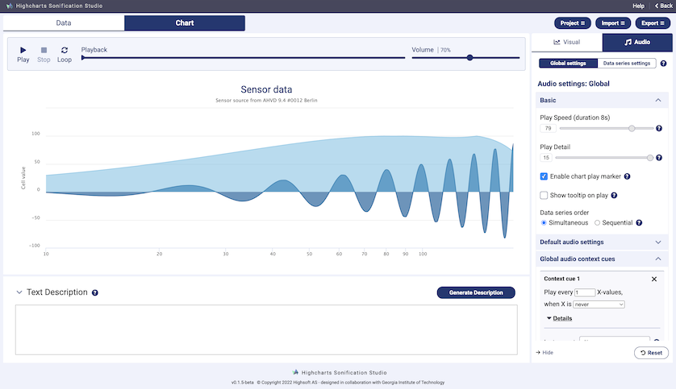
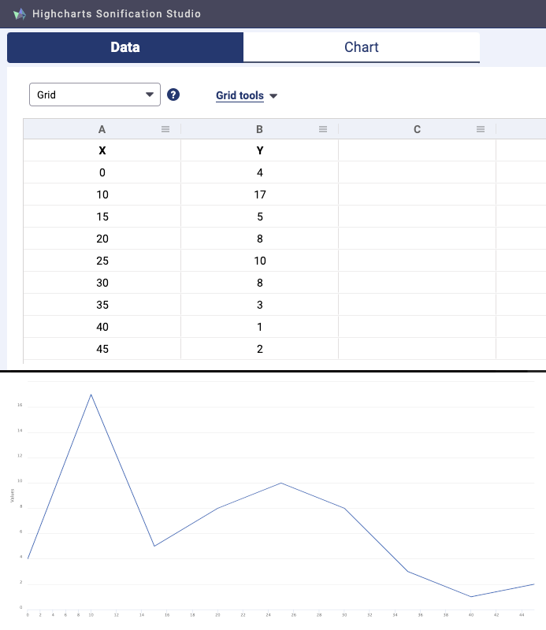
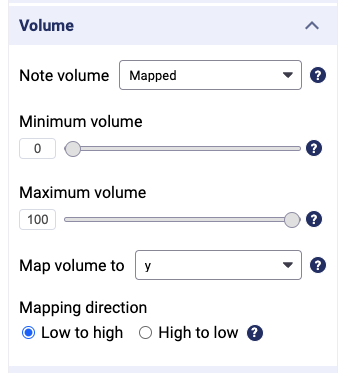
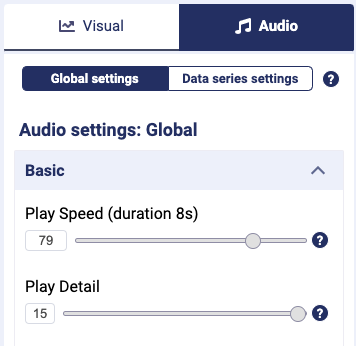
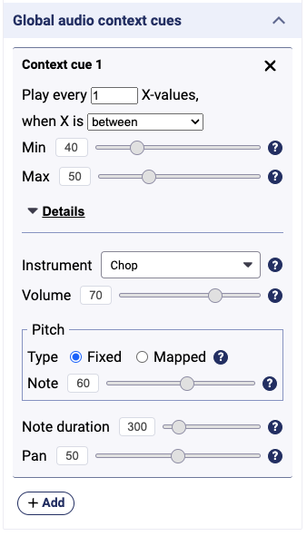

+++
author = "矢崎裕一"
title = "表から、見る線と聴く線を同時に作る──Highcharts Sonification Studio"
slug = "highcharts-sonification-studio"
date = "2026-11-06"
description = "表のデータを、線グラフと、その線をなぞる音に同時に変えるツールです。値を音の高さ・定位・音量などに割り当てる操作を、コードなしで選べます。開発中に評価を3回行いました。"
categories = [
    "technology"
]
tags = [
    "ソニフィケーション",
    "アクセシビリティ"
]
image = "images/app-thumbnail.png"
series = ["data-sonification"]
series_weight = 99
seriesByline = "Highsoft／Georgia Tech Sonification Lab"
seriesTitle = "表を、見る線と聴く線に──Highcharts Sonification Studio"
+++

Highcharts Sonification Studio（ハイチャーツ・ソニフィケーション・スタジオ、以下 HSS）は、表に入れたデータを、線グラフと、その線をなぞる音に同時に変えるツールです。値を音の高さ・定位・音量・長さなどのどれに割り当てるかを、コードを書かずにサイドバーで選べます。開発の途中で、目の見えない利用者や、視覚障害のある専門家が加わる評価を3回行っています。

開発は Highcharts の開発元である Highsoft AS（ノルウェー）で、Georgia Tech Sonification Lab と共同で設計しました。ブラウザで動き、無料で、ログインは要りません。以下は、ICAD 2021 の論文（Cantrell, Walker, Moseng）、GitHub のソースとアプリ内チュートリアル（v1.1.1）、Georgia Tech のニュース記事（2021年7月）に沿います。

<!--more-->

## 2019年、Java の Sandbox をブラウザへ移す

HSS には前身があります。Georgia Tech Sonification Lab が約15年、開発と保守を続けた Java のアプリ、Sonification Sandbox です。表で操作したデータを、見た目と音のグラフに変えるものでした。MIDI や音声ファイル、画像の書き出しと、グラフの自動説明を備えていました。`.ssp` というプロジェクト形式があり、教員が生徒に配れたと論文は書いています。

論文は、ブラウザに移す利点と代償を、こう並べます。

> "This can make deploying and using such software easier, more cross-platform compatible, cheaper, and in many cases more accessible to users of screen readers and other assistive technology. ... On the other hand, advanced audio can still be a challenge in Web applications, so there may need to be tradeoffs in terms of access and availability versus sonification variety and sophistication."

ブラウザで動かせば、配りやすく、安く、スクリーンリーダーでも使いやすくなる。その代わり、凝った音は作りにくい、という見立てです。

論文は HSS を「a systematic re-implementation of the Sonification Sandbox」と呼びます。ただし、Sandbox の機能をすべて移したわけではない、とも書いています。

GitHub の最初のコミットは2019年8月26日で、Highsoft の Øystein Moseng（エイステイン・モーセング）によるものです。コミットの大半は Moseng の手です。論文の著者は Stanley J. Cantrell（スタンリー・カントレル）、Bruce N. Walker（ブルース・ウォーカー）、Moseng の3人です。Walker は Georgia Tech Sonification Lab の所長です。主な版の流れは次のとおりです。

| 時期 | 版 | 出来事 |
|---|---|---|
| 2020年3月 | v0.0.4 | 評価の Phase 1 |
| 2020年11月 | v0.0.9 | 評価の Phase 2 |
| 2021年2月 | v0.0.11 | 評価の Phase 3 |
| 2021年6月 | ― | ICAD 2021 で論文を発表。論文の時点（2021年3月）で「public beta」 |
| 2022年9月 | v1.0.0 | 正式版 |
| 2025年8月・11月 | v1.1.0・v1.1.1 | 表の部品を AG Grid から Highcharts の Grid に替える |

画面は、データの表のタブと、グラフのタブの2面です。グラフのタブには、見た目と音の再生ボタンが並びます。設定は右のサイドバーにあり、Visual と Audio に分かれます。

Highsoft AS／[Highcharts Sonification Studio（GitHub）](https://github.com/highcharts/sonification-studio)より引用（画面下の表記は v0.1.5-beta）

## 値を、高さ・定位・音量・長さに割り当てる

ランディングページは、ツールの目的をこう書きます。

> "We want users to be able to use the tool without having to write code, and without prior sonification expertise."

コードを書かず、ソニフィケーションの知識もないまま使えるようにしたい、という意味です。

データは、CSV の取り込み、手入力、数式で埋めるなどの方法で表に入れます。グラフは、線・面・平滑線・散布図・棒などから選びます。

Highsoft AS／[Highcharts Sonification Studio のチュートリアル画像（GitHub）](https://github.com/highcharts/sonification-studio/tree/master/src/app/home/tutorialImages)より引用

音の設定は系列ごとです。各パラメータについて、Default（既定）、Fixed（固定値）、Mapped（データに対応）の3つから選びます。Mapped を選ぶと、最小値・最大値と、どちらの列に対応させるか、向き（Mapping direction）を決めます。対応づけの元にできる列は、ソースを読むかぎり x と y の2つだけです。

Highsoft AS／[Highcharts Sonification Studio のチュートリアル画像（GitHub）](https://github.com/highcharts/sonification-studio/tree/master/src/app/home/tutorialImages)より引用

ソースとチュートリアルから読める、データと音の対応は次のとおりです。

| データ | 音のどこに | 既定値・範囲など |
|---|---|---|
| x か y | 音の高さ（Note pitch） | 最小 36・最大 90。単位は「number of notes from C0」。向きを反転できる |
| ― | 音階に丸める（Round to musical notes） | 既定はオフ |
| x（時間軸） | 定位（Pan） | 全体設定の「Pan enabled」で x に対応。既定はオン、幅は100% |
| x か y、または固定値 | 音量（Volume） | 全体の音量は既定 70% |
| x か y、または固定値 | 音の長さ（Note duration） | flute、saxophone、trumpet など、長く鳴る楽器でだけ効く |
| x か y | ローパス／ハイパスフィルター | ― |
| x か y | トレモロの深さ・速さ | ― |
| 系列 | 楽器（Instrument） | データには対応させない。旋律楽器と打楽器のプリセット。既定は piano |
| 系列 | 音のオン・オフ | 「Audio enabled for series」。見た目は残したまま音だけ外せる |

チュートリアルは、Y を音量に「low to high」で対応させると、Y が上がるほど音が大きくなる、と例を挙げています。ただし、Default を選んだとき高さが x と y のどちらに対応するかは、確かめられませんでした。

もとになった Highcharts の sonification の文書は、対応づけのコツを「7 tips from science」として挙げています。HSS 本体ではなく、下にあるライブラリの文書です。

> "G4 to F6 is the most accurate pitch range for most humans, if a narrow range is acceptable."
>
> "Dual coding: It is entirely possible to map the same data property to multiple audio parameters, and this is often a good idea."

G4 から F6 が多くの人にとって最も正確な音域であること、同じ値を複数の音のパラメータに重ねてよいこと、の二つです。定位についても、ヘッドホンかステレオが要るので、それだけに頼らないように、と書いています。

C0 を0と数えると、HSS の既定の 36〜90 は C3 から F#7 に当たると読めます。文書が「最も正確」とする G4〜F6 より、ずっと広い範囲です。**正確さより、違いが聞き取れる幅を優先した既定値**と読めます。

## 再生の速さと、山を残す間引き

全体の設定は「Global settings」にまとまっています。時間とまとめ方を決めるのは、主に次の項目です。

| 設定 | 内容 | 既定値など |
|---|---|---|
| Play speed | 全体の再生時間を決める | 既定 79 で約8秒。式から計算すると、50 で約25秒、100 で約2秒 |
| Play detail | 鳴らす音の数を決める。データも再生時間も変えない | 1〜15、既定 15 |
| Data series order | 複数の系列を同時に鳴らすか、順番に鳴らすか | 既定は同時。順番のときは系列の間に 600 ミリ秒 |
| Global audio context cues | 背景で鳴る目盛りの音。いまは X の値に基づくものだけ | 楽器 chop、高さ 60、音量 70、長さ 300 ミリ秒 |
| Play marker | 再生中の位置を、グラフ上の十字線で示す | 既定はオン |
| Text description | 系列の数、点の数、Y の最小値と最大値などを文にして読み上げる | ― |

Highsoft AS／[Highcharts Sonification Studio のチュートリアル画像（GitHub）](https://github.com/highcharts/sonification-studio/tree/master/src/app/home/tutorialImages)より引用

Play detail の説明は、チュートリアルにこうあります。

> "When detail is low, and few notes are played, the tool will group data together and play each group as one. The minimum and maximum of each group will be played, to preserve peaks in the data."

細かさを下げると、点を区間ごとにまとめて鳴らす。そのとき各区間の最小値と最大値を鳴らして、データの山を残す、という説明です。ソースでも、区間の中で y の最小と最大を選ぶ方式（minmax）を指定しています。

目盛りの音は、X 軸の目盛りごとにクリック音を鳴らすような使い方を想定しています。チュートリアルは、聞き手が時間の進みをつかみやすくするため、と書いています。

Highsoft AS／[Highcharts Sonification Studio のチュートリアル画像（GitHub）](https://github.com/highcharts/sonification-studio/tree/master/src/app/home/tutorialImages)より引用

書き出しは、動画、音声のみ、MIDI、PNG、SVG、CSV、HTML などから選べます。チュートリアルは、より本物らしい楽器の音が欲しければ MIDI で書き出し、DAW（音楽制作ソフト）で開くよう勧めています。目盛りの音と十字線、文の説明は、音だけでも、見た目だけでもグラフの位置を伝えるための仕掛けと読めます。

## 3回の評価で、何が数えられたか

論文の後半は、3段階の評価の報告です。各段階の結果は Highsoft に渡され、次の版の設計に使われました。

| 段階 | 時期・版 | 誰が評価したか | 方法 |
|---|---|---|---|
| Phase 1 | 2020年3月、v0.0.4 | 晴眼の参加者12人（平均19.25歳）と、全盲と自認する参加者1人（34歳、VoiceOver と JAWS の利用者）。別に、法的盲と自認する専門家1人（支援技術の経験18年以上） | 33の課題を順に行う使いやすさの調査。PURE 尺度で採点し、Nielsen の10のヒューリスティクスで分析 |
| Phase 2 | 2020年11月、v0.0.9 | 専門家4人（うち3人が法的盲と自認） | Zoom での専門家評価 |
| Phase 3 | 2021年2月、v0.0.11 | 専門家2人（うち1人が法的盲と自認）と、Highsoft のアクセシビリティ責任者 | 非公式な評価。表のアクセシビリティと、利用者の集まりづくりを話し合う |

Phase 1 の33の課題は、表の操作（最後のセルへ移る、行を足す、データを打ち込む）から、再生・停止、音量や速さの調整、グラフの題や色の変更までです。研究者が各課題を PURE という使いやすさの尺度で採点しました。結果は、課題の数で報告されています。

| 参加者 | 最良の評価（perfect PURE rating）を受けた課題 | 残りの課題 |
|---|---|---|
| 晴眼の参加者（12人） | 33課題のうち29課題（87.9%） | 4課題（課題3・5・7・11）が低い評価 |
| 全盲の参加者（1人） | 33課題のうち13課題（39.4%） | 20課題が低い評価。課題1・5・11・21は、研究者が手を貸さないと先へ進めなかった |

つまり 87.9% と 39.4% は、どちらも「33の課題のうち、最良の評価がついた課題の割合」です。人数の割合ではありません。全盲の参加者のデータは、晴眼の参加者と分けて分析されています。論文は、この参加者がスクリーンリーダーでのアクセシビリティの問題に何度もぶつかった、と書いています。

先へ進めなかった課題は、表の最後のセルへ移る（1）、データを打ち込む（5）、再生中に停止する（11）、説明文の読み上げボタンを押す（21）です。専門家の評価では、JAWS や NVDA との相性の改善が必要だとされました。専門家の指摘には、次のものもあります。

> "Be cautious about using the terms 'frequency' and 'panning' in the UI; these concepts cannot be assumed to be universally understood, especially students"

「frequency」や「panning」という言葉は、特に生徒には通じると思わないほうがよい、という指摘です。Phase 1 の課題には「Adjust the minimum frequency to 10%」がありました。現行版の見出しは「Note pitch」「Minimum note」です。チュートリアルは、音の高さをピアノの鍵盤にたとえて説明しています。ただし、ヘルプの文には「pitch/frequency」が残っており、言葉を替えた理由を書いた資料は見つかりませんでした。

Phase 2 の専門家は、全体の使いやすさが大きく良くなったと認めたうえで、元に戻す機能やショートカットなどを求めました。Phase 3 では、ある専門家が表の作り方について、こう話しています。

> "Forgo ARIA grid and build a custom interface, similar to Google Sheets. This is complex but allows the most user-friendly experience."

ARIA の grid に頼らず、Google スプレッドシートのような独自の表を作るほうがよい、という意見です。論文の時点で表の部品は AG Grid で、置き換える予定だと書かれています。git の履歴では、2025年8月に AG Grid への依存を外し、Highcharts の Grid に替えています。この助言と置き換えを結びつける資料は、見つかりませんでした。

## 第三者はこのツールをどう見たか

評価は、それぞれ別の点に向いています。一つ目は、目の見えない利用者の声です。Georgia Tech のニュースは、全盲の研究者で起業家の Brandon Biggs（ブランドン・ビッグス）の言葉を載せています。

> "I love how accessible all the components are with a screen-reader and how easy it is to create a sonification,"

部品がすべてスクリーンリーダーで扱え、ソニフィケーションを作るのが簡単だ、という感想です。記事は、見た目のよいグラフを、自分で確かめられなくても信じて作れる点を Biggs が評価した、とも書いています。ただし、共同開発元が出した記事の中の発言で、独立した評価ではありません。

二つ目は、表現力の限界です。Hyeok Kim（ヒョク・キム）、Yea-Seul Kim（イェスル・キム）、Jessica Hullman（ジェシカ・ハルマン）は CHI 2024 の論文で、データ・ソニフィケーションの文法 Erie を提案しました。既存のツールを比べる中で、HSS を含む Sandbox の後継について、こう書いています。

> "Sonification Sandbox [53] and its successors [14, 27] support more encoding channels, but developers need to use external sound editors to sequence or overlay multiple sonifications that they created using the interface, requiring a different stack of skills."

割り当てられる音の種類は多いが、作った音どうしを並べたり重ねたりするには外の編集ソフトが要り、別の技能を求める、という指摘です。同じ論文は、既存のツールの多くに API がないことも挙げています。HSS がサイドバーの操作で完結する設計であることの裏返しと読めます。

三つ目は、普及と持続性です。Graz の IEM の Vallejo Budziszewski（バジェホ・ブジシェフスキ）と Gross-Vogt（グロス＝フォークト）は、ICAD 2025 でソニフィケーションのソフトを見渡しました。

> "Tools such as Tone.js [26], TwoTone [12], and Highcharts Sonification [27] have gained traction due to their ease of use and web-based deployment."

使いやすく、ブラウザで動くことで広まった例として、[TwoTone](/twotone-sonification/) と並べています。同じ節は、大学発のツールの多くが資金と後ろ盾の不足で終わる、とも書きます。付表では、Sandbox を「succeeded by Highcharts Sonification」としています。

HSS の論文は、このツールを、コミュニティが使い広げられる無料の資源であり、同時にデータの道具を売る会社が支えるもの、と書いていました。大学のツールを企業が引き継いで保守する形は、2025年まで更新が続いている理由の一つと読めます。ただし、ICAD 2025 の論文がそう述べているわけではありません。

資料どうしで食い違う点もあります。

| 点 | 資料ごとの記述 |
|---|---|
| ライセンス | Georgia Tech のニュース（2021年）は「MIT License」。2022年9月7日のコミットで、README とランディングページの表記を BSD 3-Clause に書き換えている |
| Highcharts の扱い | Georgia Tech のニュースは「open-source web application Highcharts」。LICENSE.md は、Highcharts ライブラリを商用ライセンスとし、商用利用には Highcharts のライセンスが要るとする |
| ソースの公開 | 論文（2021年3月時点）は「will be made opensource」と未来形。リポジトリの最初のコミットは2019年8月で、公開の時期は確かめられなかった |

## 使い道

可視化の仕事に持ち帰れる判断は、四つあります。

一つ目は、見た目と音を同じ表から作り、片方だけを外せるようにすることです。HSS では、系列の音を外しても線は残ります。見る人と聴く人が、同じデータの同じグラフを共有できる設計だと読めます。

二つ目は、割り当てを「何に、どの範囲で、どちら向きに」の3つの選択にまとめることです。HSS の Mapped は、列・最小と最大・向きを決めるだけです。視覚のスケールの定義域・値域・向きと同じ考え方を、音に移したものと読めます。既定の音域を広く取るか、Highcharts の文書が勧める狭い音域に絞るかは、作り手が選ぶ点として残ります。

三つ目は、点を間引くときに山と谷を残すことです。HSS は細かさを下げても、区間ごとの最小値と最大値を鳴らします。折れ線の点を減らすときも、平均で丸めると極端な値が消えます。何を残す間引きなのかを決めておくとよい、と読めます。

四つ目は、評価の数字を、誰の、何の割合かで分けて見ることです。同じ33の課題で、晴眼の参加者では87.9%、全盲の参加者では39.4%の課題が最良の評価でした。晴眼の参加者だけで測っていれば、HSS はほぼ使いやすいと結論できたはずです。目の見えない人のための道具を作るなら、その人に使ってもらって初めて見える問題がある、と論文の数字は示していると読めます。

## 参考・出典

**一次情報**

- Highcharts Sonification Studio（公式サイト）. [サイト](https://sonification.highcharts.com)
- highcharts/sonification-studio（GitHub。README、LICENSE.md、`src/app/home/Home.vue`、`src/app/home/TutorialConfigureAudio.vue`、`src/app/editor/` 以下の既定値と対応づけのソース、git の履歴を v1.1.1 で参照）. [リポジトリ](https://github.com/highcharts/sonification-studio)
- Stanley J. Cantrell, Bruce N. Walker, Øystein Moseng, “Highcharts Sonification Studio: An Online, Open-Source, Extensible, and Accessible Data Sonification Tool,” ICAD 2021, pp. 211–216（CC BY-NC 4.0）. [doi:10.21785/icad2021.005](https://doi.org/10.21785/icad2021.005) / [PDF](https://icad2021.icad.org/wp-content/uploads/2021/06/ICAD_2021_5.pdf) / [Georgia Tech リポジトリ](https://repository.gatech.edu/entities/publication/ad4383f6-4aad-48b4-9b30-16128fb591d4)
- Joshua Preston, “New Browser-Based Chart Builder Gives Line Graphs, Scatterplots Their Own Audio Track,” Georgia Tech College of Computing, 2021-07-27. [記事](https://cc.gatech.edu/news/649087/new-browser-based-chart-builder-gives-line-graphs-scatterplots-their-own-audio-track)
- Highcharts Docs, Sonification: Getting started / Mapping. [Getting started](https://www.highcharts.com/docs/sonification/getting-started) / [Mapping](https://www.highcharts.com/docs/sonification/mapping)
- HSS Tutorials（Georgia Tech 側のコミュニティサイト。Bruce Walker によるライブデモなど）. [サイト](https://hss-tutorials.github.io/) / [YouTube](https://www.youtube.com/@HSS-Tutorials)
- Sonification Sandbox（Georgia Tech Sonification Lab）. [ページ](http://sonify.psych.gatech.edu/research/sonification_sandbox/)

**第三者評価**

- Brandon Biggs の発言（上記 Georgia Tech のニュース内。共同開発元の記事）. [記事](https://cc.gatech.edu/news/649087/new-browser-based-chart-builder-gives-line-graphs-scatterplots-their-own-audio-track)
- Hyeok Kim, Yea-Seul Kim, Jessica Hullman, “Erie: A Declarative Grammar for Data Sonification,” CHI 2024. [arXiv:2402.00156](https://arxiv.org/abs/2402.00156)
- S. Vallejo Budziszewski, K. Gross-Vogt, “Legacy, Active & Future Software Tools in Sonification Research,” ICAD 2025. [PDF](https://repository.gatech.edu/server/api/core/bitstreams/24d4ff78-cbfa-4020-9e48-fd3cd8efd4a8/content)
