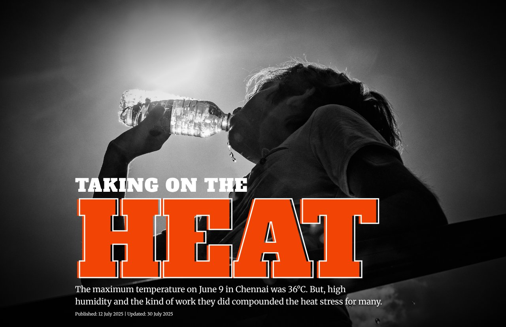
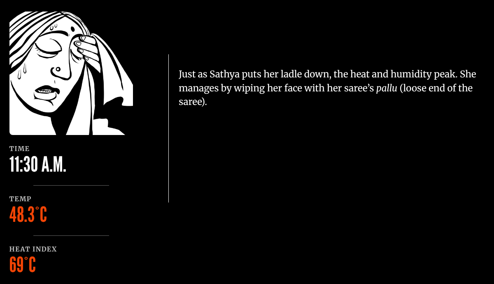
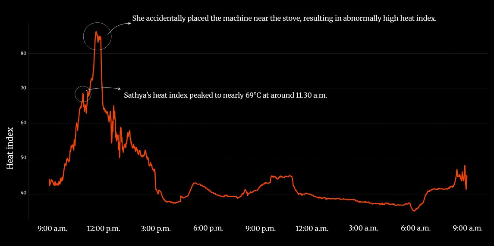
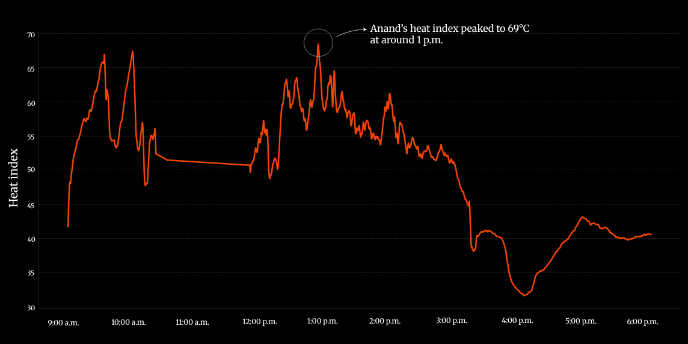
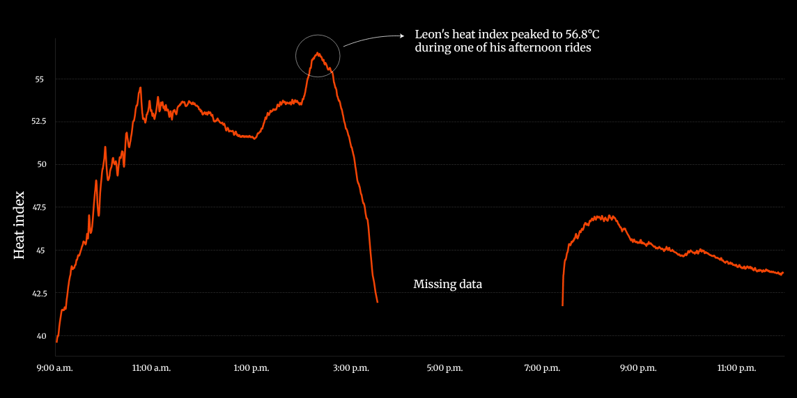

+++
author = "Yuichi Yazaki"
title = "On a Day with a High of 36°C, the Heat Index Reached 69°C: The Hindu's 'Chennai's heat index'"
slug = "hindu-chennai-heat-index"
date = "2026-11-04"
description = "The Hindu calculated a heat index from sensors carried by four workers. On a day when the piece gives the maximum temperature as 36°C, the heat index reached as high as 69°C."
categories = [
    "consume"
]
tags = [
    "data journalism",
    "Sigma Awards",
    "scrollytelling",
    "line chart"
]
image = "images/cover.jpg"
series = ["dataviz-journalism"]
series_weight = 9
seriesByline = "The Hindu Data team"
seriesTitle = "69°C on a 36°C Day: Chennai's Heat Index"
+++

The Hindu calculated a heat index from the readings of sensors carried by four workers. The piece gives the maximum temperature in Chennai, in southern India, on June 9, 2025 as 36°C. On the same day, the heat index for a street-food cook and a fisherman who went out to sea reached as high as 69°C. The sensors were Arduino Nano boards fitted with a temperature and humidity sensor, and the heat index was calculated with the formula of the U.S. National Weather Service (NWS).

The piece is a standalone interactive page published on July 12, 2025 by the Data team of The Hindu, an English-language daily in India. The page's headline is "TAKING ON THE HEAT," and its entry name in the Sigma Awards is "Chennai's heat index: How heat stressed are you?" Below, I read it in the order a visitor sees the page, following the text and code of the piece and its Sigma Awards entry.

<!--more-->

## On June 9, the high was 36°C

When you open the page, the large red-orange letters "HEAT" appear over a black-and-white photograph of a person drinking water. Below them is a single lead sentence.

Source: The Hindu Data team / The Hindu, "Heat index: how heat-stressed are you?"

> "The maximum temperature on June 9 in Chennai was 36°C. But, high humidity and the kind of work they did compounded the heat stress for many."

In short, the high was 36°C, but humidity and the kind of work made the heat stress heavier for many people. With this first line, the article can be read as fixing the maximum temperature as the thing everything else will be compared against.

Next come cards for four people, each with a portrait. A card gives the person's name, occupation, the highest heat index of the day with its time, and a quote from the person.

| Person | Occupation / place | Maximum written on the card |
|---|---|---|
| Sathya | Tiffin cook (a street-food cook) at Parry's Corner in the city center | 69°C at 11:30 a.m. |
| Anand (age 33) | Fisherman who goes out to the Bay of Bengal from Marina Beach | 69°C at sea at 12:56 p.m. |
| Prakash | Factory worker polishing stainless-steel utensils in Korukkupet | About 66°C at 3:10 p.m. |
| Leon (a pseudonym) | Auto-rickshaw driver | 56.8°C at 2:20 p.m. |

All four numbers on the cards are more than 20°C above 36°C.

## Handmade sensors and the NWS formula

The method is described in the body text after the cards.

> "The Hindu Data team used Arduino Nano devices with temperature and humidity sensors to continuously record time-stamped data on an on-device SD card. We handed these devices out to four people from different parts of Chennai."

The team recorded time-stamped data continuously on the device's SD card and handed the devices to four people working in different parts of Chennai. The piece says the recording day was June 9, 2025, that there was light rain at 4 p.m., and that this was a few weeks after the city's heat peak.

How the heat index was calculated is explained in a note at the end of the page. The team used a formula from the U.S. National Weather Service (the article writes "U.S. National Weather Service (NOAA)") that takes air temperature and relative humidity. The India Meteorological Department (IMD) provisionally divides the value into four levels: below 35°C, 36 to 45°C, 46 to 55°C, and above 55°C. The body text gives an example: 35°C at 85% relative humidity gives a heat index of 60°C. Recalculating it with the NWS formula gives 60.0°C, which matches.

**The piece does not hide gaps and outliers in its data.** The body text says that there are periods when the devices were switched off by mistake and the data is missing, and that the team filled those periods in through interviews. Sathya's chart carries a note that unusually high values appeared because the device was placed near the stove. Anand switched his device off at night, and the piece says the nighttime heat index could not be calculated.

## Three numbers that change as you scroll

Each of the four people gets one scene that follows their day. A square illustration and three numbers are pinned to the left third of the screen. The numbers are "TIME," "TEMP," and "HEAT INDEX." Paragraphs of text flow through the right two thirds, and when a paragraph reaches the middle of the screen, the illustration and numbers switch.

Source: Soumyadip Sinha (Illustrations in the piece's credits) / The Hindu, "Heat index: how heat-stressed are you?"

The figure above is the scene where Sathya sets down her ladle: 11:30 A.M., air temperature 48.3°C, heat index 69°C. Which values appear with which paragraph is written in the HTML, as the attributes `data-time`, `data-temp`, and `data-felt` on each paragraph.

The table below shows how the data is mapped to visual forms.

| Component | Data | Visual form / material | Specifics |
|---|---|---|---|
| Lead sentence | Maximum temperature given by the piece | Text | 36°C |
| Four cards | Each person's maximum heat index and its time | Portrait + name + one sentence + the person's words | 69 / 69 / about 66 / 56.8°C |
| Pinned panel: time | The time of the paragraph | Numbers animated like a clock | Counts in steps of 1 to 10 minutes depending on the time difference |
| Pinned panel: temperature | The temperature of the paragraph | Number + text color (5 levels) | Color changes at 30 / 33 / 36 / 39°C |
| Pinned panel: heat index | The heat index of the paragraph | Number + text color (5 levels) | Thresholds at 35 / 45 / 55 / 65°C, from #ffe5e5 to #f24405 |
| Pinned panel: image | The scene of the paragraph | Swapping black-and-white line illustrations | Sathya1 to 4, Fisherman1 to 5, and so on |
| Time-series line | Heat index calculated from the sensor | A single red-orange (#f24405) line on black | Horizontal axis = time, vertical axis = heat index |
| Line annotations | Peaks, outliers, missing data | White circle and curved arrow + one sentence | "peaked to 69°C at around 1 p.m." and others |

The only place where values are turned into color is the text color of the panel's temperature and heat index. The color thresholds for the heat index are the IMD's four levels (35 / 45 / 55°C) with one more boundary, 65°C, added, making five levels. As a result, the deepest red-orange appears only in the scenes of the two people at 69°C and Prakash at 66°C. Leon (56.8°C), who falls in the same "above 55°C" class under the IMD's division, stays one shade lighter. The extra step can be read as added to show differences among the four.

## The four line charts do not share a yardstick

At the end of each scene, a line chart of that person's heat index is placed. The line itself is a PNG image, while the axis numbers and annotations are HTML text. HTML comments show that the charts were finished in Adobe Illustrator and ai2html (v0.121.1).

The four charts differ from one another in both time range and vertical-axis range.

| Person | Horizontal axis | Vertical axis | Annotations |
|---|---|---|---|
| Sathya | 9:00 a.m. to 9:00 a.m. the next day (about 24 hours) | 40 to 80 (steps of 10) | Outlier near the stove / "peaked to nearly 69°C at around 11.30 a.m." |
| Anand | 9:00 a.m. to 6:00 p.m. | 30 to 70 (steps of 5) | "peaked to 69°C at around 1 p.m." (desktop version) |
| Prakash | 10:00 a.m. to 12:00 a.m. | 40 to 65 (steps of 5) | "peaked to 66°C in the afternoon" |
| Leon | 9:00 a.m. to 11:00 p.m. | 40 to 55 (steps of 2.5) | "peaked to 56.8°C during one of his afternoon rides" / "Missing data" |

The peak that reaches near the top of the frame is in the 56°C range in Leon's chart and above 80°C in Sathya's. The four are not built to be compared side by side. What lets readers compare one person with another is the numbers in the annotations and the four cards at the start. The charts can be read as cut to show the shape of each person's day.

Source: The Hindu Data team / The Hindu, "Heat index: how heat-stressed are you?"

In Sathya's chart, the line rises past the 80 mark around noon. That peak is circled in white and annotated as the device having been placed near the stove. The "69°C" note points to the lower peak before it. The 69°C on the card can be read as a value chosen with the outlier peak excluded.

Source: The Hindu Data team / The Hindu, "Heat index: how heat-stressed are you?" (desktop version)

Anand's chart contains an inconsistency. The page switches between two versions depending on screen width. In the desktop version, at widths of 1144px or more, the annotation reads "Anand's heat index peaked to 69°C at around 1 p.m." In the version for narrower screens it reads "peaked to 48°C at around 1 p.m." Both versions have a vertical axis of 30 to 70, and the shape of the line is the same. The top of the line sits just under the 70 mark, which fits the desktop version's 69°C. The 48°C on the small screen can be read as a missed rewrite. A person reading on a smartphone sees 69°C on the card and 48°C in the chart's annotation.

Source: The Hindu Data team / The Hindu, "Heat index: how heat-stressed are you?"

Leon's chart does not connect the missing hours with a line; it leaves a blank and writes "Missing data." The line color is the same single red-orange in all four charts, and it does not change with the value. Bands showing the IMD levels are not drawn in the background either.

## How do third parties see this method?

I could not find any critique that discusses this piece. Instead, I list sources that assess the method, by point at issue.

The first is the meaning of measuring personal exposure. Kuras et al. write in a 2017 paper:

> "Personal exposure research can help reveal the extent of exposure misclassification that occurs when individual exposure to heat is estimated using ambient temperature measured at fixed sites"

In short, estimating an individual's exposure from temperature measured at fixed sites causes misclassification, and personal exposure research can reveal how large it is. The piece's framing, the citywide high of 36°C against what people actually experienced, can be read as the journalistic version of this point.

The second is the limits of the heat index formula. The NWS Weather Prediction Center writes on its page explaining the formula:

> "The Rothfusz regression is not valid for extreme temperature and relative humidity conditions beyond the range of data considered by Steadman."

That is, the regression formula is not valid for extreme conditions beyond the range of Steadman's data. In a piece for Down To Earth (June 18, 2024), Ashok Gadgil and Elif Kilic of UC Berkeley caution that the heat index assumes a healthy young adult moving lightly in the shade. The piece's 69°C comes from conditions of 47 to 48°C air temperature. A fisherman at sea and a cook at a pot can be read as standing outside the formula's assumptions. The piece reveals its outliers in annotations, but it does not mention the formula's range of applicability.

The third is research using the same approach. According to an article from Princeton University Engineering (December 20, 2024), a team including Anu Ramaswami gave residents of Delhi and Chennai pendants with heat sensors. They are devices built on the same idea as the piece, computing a heat index from temperature and humidity. The difference can be read this way: the research gathers many participants, while the piece narrows to four people and one day and shows it as a story.

The piece made the shortlist of the Sigma Awards 2026. There were 543 entries from 84 countries, and 31 finalists. The Hindu's name does not appear in the announcement of the ten winners.

At the end of the piece's page, The Hindu's making-of video, "Behind the scenes: How the data and science teams measured heat stress | In Focus podcast," is embedded ([YouTube](https://www.youtube.com/watch?v=u6C08gX5uhg)). I have not watched the contents of the video.

## Takeaways

What this piece lets you take away is to fix one thing to compare against and put it first. Because the lead sentence has 36°C, the 69°C on the cards reads as "high." Show the reference number first and put the number people actually experienced beside it. This order works for reporting that re-measures something.

Next is following a small number of people with numbers and words. Four people over one day is not statistics. Instead, three numbers are tied to each person's actions, paragraph by paragraph.

The third is to state gaps and anomalies inside the chart. The blank of "Missing data" and the note about the stove tell readers how far the numbers can be trusted. On the other hand, annotations that differ between versions and yardsticks that do not match leave readers who want to compare confused. When you build charts separately for different screen widths, check even the numbers in the annotations against both versions. If you change the vertical axis for each person, provide a separate place for comparison. This piece is an example of both.

## References

**Primary sources**

- The Hindu Data team, "Heat index: how heat-stressed are you?" (headline "TAKING ON THE HEAT"), *The Hindu*, 2025-07-12 (updated 2025-07-30). Reporting and writing: Nitika Francis / Production and data: Srinivasan Ramani / Hardware Assembly: Sanjeevi Maran / Interactive and Code: Areena Arora / Illustrations: Soumyadip Sinha, and others. [The piece](https://www.thehindu.com/infographics/2025-07-12/heat-stress-in-chennai/index.html)
- The piece's scroll handling and color levels (gif.v2.js). [JavaScript](https://www.thehindu.com/infographics/2025-07-12/heat-stress-in-chennai/assets/js/gif.v2.js)
- The piece's CSS (color variables, two-column pinned layout). [gif.v2.css](https://www.thehindu.com/infographics/2025-07-12/heat-stress-in-chennai/assets/css/gif.v2.css) / [project_styles.v8.css](https://www.thehindu.com/infographics/2025-07-12/heat-stress-in-chennai/assets/css/project_styles.v8.css)
- Sigma Awards 2026 entry "Chennai's heat index: How heat stressed are you?" (2026 · Shortlist). [Sigma Awards entries](https://sigma-awards.data-visualization.jp/entries/2026-s-0012/)
- The Hindu, "Behind the scenes: How the data and science teams measured heat stress | In Focus podcast". [YouTube](https://www.youtube.com/watch?v=u6C08gX5uhg)
- The Sigma Awards, "Remarkable diversity, confronting some of the most urgent issues of our time: announcing the 2026 Sigma Awards shortlist". [Announcement](https://www.sigmaawards.org/remarkable-diversity-confronting-some-of-the-most-urgent-issues-of-our-time-announcing-the-2026-sigma-awards-shortlist/)
- The Sigma Awards, "From toxic supply chains in Africa to Baltic sabotage to stolen children in Syria: 10 data projects win 2026 Sigma Awards". [Announcement](https://www.sigmaawards.org/from-toxic-supply-chains-in-africa-to-baltic-sabotage-to-stolen-children-in-syria-10-data-projects-win-2026-sigma-awards/)

**Secondary sources**

- E. R. Kuras et al., "Opportunities and Challenges for Personal Heat Exposure Research," *Environmental Health Perspectives*, 125(8):085001, 2017. [PubMed](https://pubmed.ncbi.nlm.nih.gov/28796630/) / [doi:10.1289/EHP556](https://doi.org/10.1289/EHP556)
- NOAA/NWS Weather Prediction Center, "The Heat Index Equation". [Explanation](https://www.wpc.ncep.noaa.gov/html/heatindex_equation.shtml)
- Ashok Gadgil, Elif Kilic, "Get the Heat Index right: an important first step to protect people from heatwaves," *Down To Earth*, 2024-06-18. [Op-ed](https://www.downtoearth.org.in/climate-change/get-the-heat-index-right-an-important-first-step-to-protect-people-from-heatwaves)
- Molly Sharlach, "Measuring the human impacts of extreme heat to guide cities' climate action plans," Princeton Engineering, 2024-12-20. [Article](https://engineering.princeton.edu/news/2024/12/20/measuring-human-impacts-extreme-heat-guide-cities-climate-action-plans)
