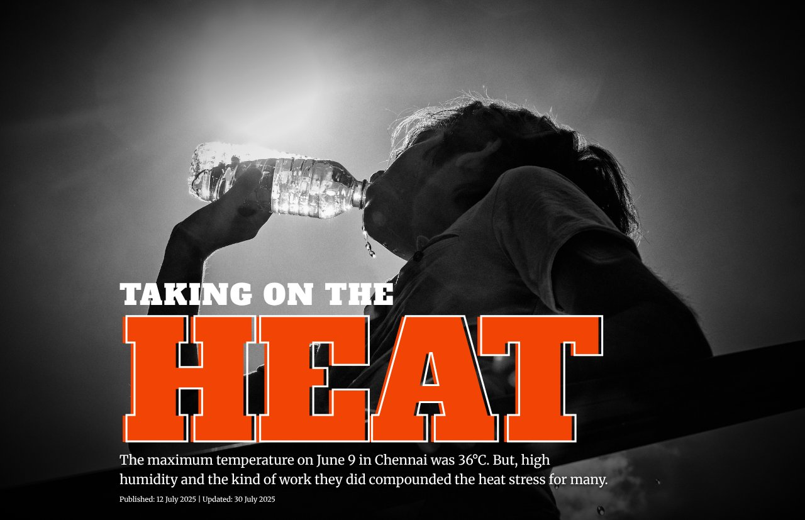
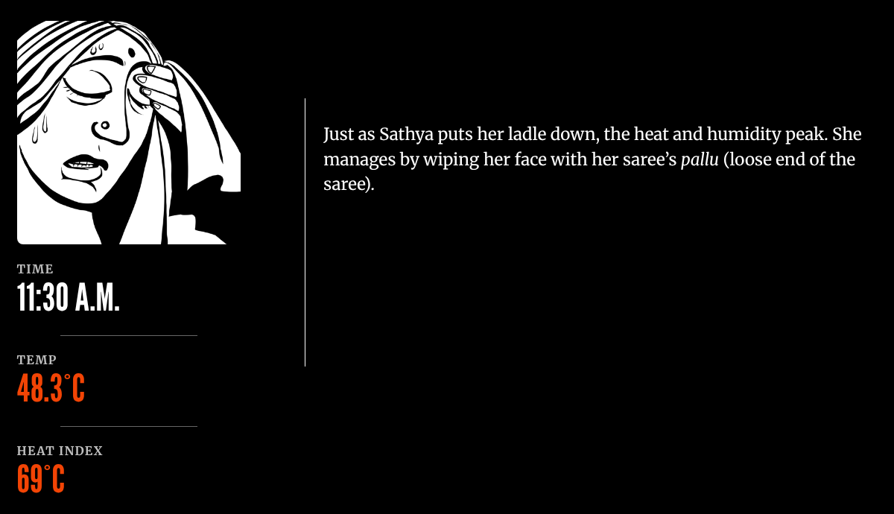
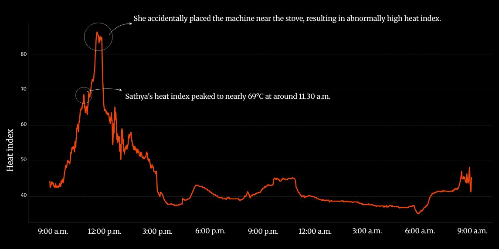
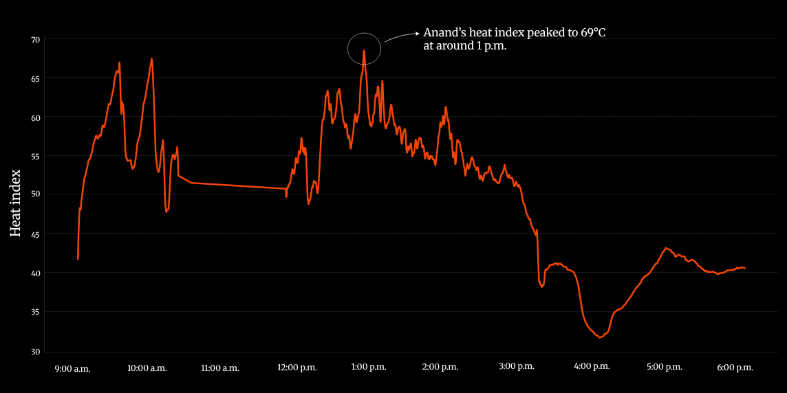
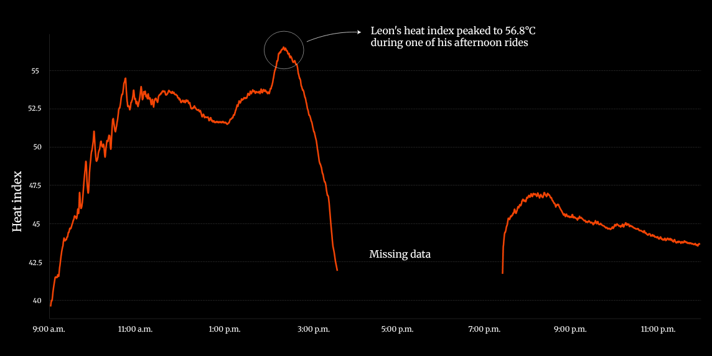

+++
author = "矢崎裕一"
title = "最高気温36°Cの日に、暑さ指数は69°Cだった──The Hindu『Chennai's heat index』"
slug = "hindu-chennai-heat-index"
date = "2026-11-04"
description = "The Hindu は、4人の働き手が持ち歩いたセンサーの値から、暑さ指数を計算しました。作品が最高気温を36°Cとする日に、暑さ指数は最大69°Cに達しています。"
categories = [
    "consume"
]
tags = [
    "データジャーナリズム",
    "Sigma Awards",
    "スクローリーテリング",
    "折れ線グラフ"
]
image = "images/cover.jpg"
series = ["dataviz-journalism"]
series_weight = 9
seriesByline = "The Hindu Data team"
seriesTitle = "最高気温36°Cの日に69°C──Chennai's heat index"
+++

The Hindu（ザ・ヒンドゥー）は、4人の働き手が持ち歩いたセンサーの値から、暑さ指数を計算しました。作品は、2025年6月9日のインド南部チェンナイの最高気温を36°Cと書いています。同じ日、屋台の調理人と海に出た漁師の暑さ指数は、最大69°Cに達しています。センサーは温度・湿度計を付けた Arduino Nano で、暑さ指数は米国気象局（NWS）の式で計算しています。

作品は、インドの英字紙 The Hindu の Data team が2025年7月12日に公開した、単独のインタラクティブページです。ページの見出しは「TAKING ON THE HEAT」で、Sigma Awards への応募名は「Chennai's heat index: How heat stressed are you?」です。以下は、作品ページの本文とコード、Sigma Awards の応募書類に沿って、ページを見る順に読みます。

<!--more-->

## 6月9日、最高気温は36°Cだった

ページを開くと、水を飲む人の白黒写真に、赤橙の大きな文字で「HEAT」と出ます。その下に、リード文が一行あります。

The Hindu Data team／The Hindu「Heat index: how heat-stressed are you?」より引用

> "The maximum temperature on June 9 in Chennai was 36°C. But, high humidity and the kind of work they did compounded the heat stress for many."

6月9日のチェンナイの最高気温は36°Cだった。しかし湿気と仕事の種類が、多くの人の暑さのストレスを重くした、という要旨です。記事は最初の一行で、比べる相手をこの最高気温に決めている、と読めます。

続いて、4人の顔写真のカードが並びます。カードには名前、職業、その日いちばん高かった暑さ指数と時刻、本人の言葉が書かれています。

| 人 | 職業・場所 | カードに書かれた最大値 |
|---|---|---|
| Sathya（サティヤ） | 中心部 Parry's Corner の tiffin cook（食事を売る屋台の調理人） | 11:30 a.m. に 69°C |
| Anand（アナンド、33歳） | Marina Beach からベンガル湾に出る漁師 | 海上で 12:56 p.m. に 69°C |
| Prakash（プラカシュ） | Korukkupet でステンレスの食器を磨く工場の労働者 | 3:10 p.m. に約 66°C |
| Leon（レオン、仮名） | オートリキシャの運転手 | 2:20 p.m. に 56.8°C |

カードの4つの数字は、どれも36°Cより20°C以上高い値です。

## 手作りのセンサーと、NWS の式

方法は、カードの後の本文にあります。

> "The Hindu Data team used Arduino Nano devices with temperature and humidity sensors to continuously record time-stamped data on an on-device SD card. We handed these devices out to four people from different parts of Chennai."

温度・湿度センサー付きの Arduino Nano で、時刻つきの記録を本体の SD カードに取り続けた。その機材を、チェンナイの別々の地域で働く4人に渡した、という要旨です。記録した日は2025年6月9日で、16時に小雨が降り、市の暑さのピークから数週間後だったと書かれています。

暑さ指数の出し方は、ページ末尾の注にあります。米国気象局（記事の表記は「U.S. National Weather Service (NOAA)」）が作った、気温と相対湿度から出す式を使った。インド気象局（IMD）はその値を、35°C未満、36〜45°C、46〜55°C、55°C超の4段階に試験的に分けている、という内容です。本文の例「35°C・相対湿度85%なら暑さ指数60°C」は、NWS の式で計算し直すと 60.0°C になり、一致しました。

**作品は、データの欠けと異常値を隠していません。**本文は「機材をうっかり切った時間があり、データが欠けている」と断り、その時間の様子は聞き取りで補ったと書いています。Sathya の図には、機材をコンロのそばに置いたため異常に高い値が出た、という注記があります。Anand は夜に機材を切ってしまい、夜の暑さ指数は計算できなかったと書かれています。

## スクロールで切り替わる、3つの数字

4人それぞれに、一日を追う場面が一つずつあります。画面の左3分の1に、正方形のイラストと3つの数字が固定されます。数字は「TIME」「TEMP」「HEAT INDEX」です。右の3分の2を本文の段落が流れ、段落が画面の中ほどに来ると、イラストと数字が切り替わります。

Soumyadip Sinha（作品のクレジット欄の Illustrations）／The Hindu「Heat index: how heat-stressed are you?」より引用

上の図は、Sathya がお玉を置いた場面です。11:30 A.M.、気温48.3°C、暑さ指数69°C。どの段落にどの値を出すかは、HTML の段落ごとに `data-time`、`data-temp`、`data-felt` の属性で書かれています。

データを、どの見た目に対応させたかを表にします。

| 部品 | データ | 見た目・素材 | 具体 |
|---|---|---|---|
| リード文 | 作品が書く最高気温 | 文字 | 36°C |
| 4人のカード | 人ごとの最大の暑さ指数と時刻 | 顔写真＋名前＋一文＋本人の言葉 | 69／69／約66／56.8°C |
| 固定パネルの時刻 | 段落の時刻 | 数字が時計のように進むアニメーション | 時刻の差に応じて1〜10分刻みで数える |
| 固定パネルの気温 | 段落の気温 | 数字＋文字色（5段階） | 30／33／36／39°C を境に色が変わる |
| 固定パネルの暑さ指数 | 段落の暑さ指数 | 数字＋文字色（5段階） | 35／45／55／65°C を境に #ffe5e5 から #f24405 まで |
| 固定パネルの画像 | 段落の場面 | 白黒の線のイラストの差し替え | Sathya1〜4、Fisherman1〜5 など |
| 時系列の折れ線 | センサーから計算した暑さ指数 | 黒地に赤橙（#f24405）の一本の線 | 横軸＝時刻、縦軸＝暑さ指数 |
| 折れ線の注記 | ピーク・異常値・欠測 | 白い円と曲がった矢印＋一文 | 「peaked to 69°C at around 1 p.m.」など |

数値を色に置き換えているのは、パネルの気温と暑さ指数の文字色だけです。暑さ指数の色の境は、IMD の4段階（35／45／55°C）に、65°C の境をもう一つ足した5段階です。そのため、いちばん濃い赤橙になるのは、69°C の2人と 66°C の Prakash の場面だけです。IMD の区分では同じ「55°C超」の Leon（56.8°C）は、一段薄い色にとどまります。色の段階は、4人の中の差を見せるために一段足されている、と読めます。

## 4枚の折れ線は、物差しがそろっていない

場面の終わりに、人ごとの暑さ指数の折れ線グラフが1枚ずつ置かれます。線の本体は PNG 画像で、軸の数字と注記は HTML の文字です。HTML のコメントから、Adobe Illustrator と ai2html（v0.121.1）で仕上げたことが分かります。

4枚は、時間の範囲も縦軸の範囲も、人ごとに違います。

| 人 | 横軸の範囲 | 縦軸の範囲 | 注記 |
|---|---|---|---|
| Sathya | 9:00 a.m.〜翌 9:00 a.m.（約24時間） | 40〜80（10刻み） | コンロのそばの異常値／「peaked to nearly 69°C at around 11.30 a.m.」 |
| Anand | 9:00 a.m.〜6:00 p.m. | 30〜70（5刻み） | 「peaked to 69°C at around 1 p.m.」（デスクトップ版） |
| Prakash | 10:00 a.m.〜12:00 a.m. | 40〜65（5刻み） | 「peaked to 66°C in the afternoon」 |
| Leon | 9:00 a.m.〜11:00 p.m. | 40〜55（2.5刻み） | 「peaked to 56.8°C during one of his afternoon rides」「Missing data」 |

図の上端近くまで届く山は、Leon の図では56°C台、Sathya の図では80°Cを超えます。4枚を並べて比べる作りではありません。人と人を比べる手がかりは、注記の数字と、冒頭の4枚のカードが担っています。図は、一人ひとりの一日の形を見せるために切られている、と読めます。

The Hindu Data team／The Hindu「Heat index: how heat-stressed are you?」より引用

Sathya の図では、線が正午ごろに80の目盛りを超えて伸びます。その山を白い円で囲み、「機材をコンロのそばに置いた」と注記しています。「69°C」の注記が指すのは、その手前の低い山です。カードの69°Cは、異常値の山を外して選んだ値だと読めます。

The Hindu Data team／The Hindu「Heat index: how heat-stressed are you?」より引用（デスクトップ版）

Anand の図には、食い違いがあります。ページは画面の幅で2つの版を切り替えます。幅1144px以上のデスクトップ版の注記は「Anand's heat index peaked to 69°C at around 1 p.m.」です。それより狭い画面の版では「peaked to 48°C at around 1 p.m.」になっています。どちらの版も縦軸は30〜70で、線の形は同じです。線の頂点は70の目盛りのすぐ下にあり、デスクトップ版の69°Cと合います。小さい画面の48°Cは、書き換え漏れだと読めます。スマートフォンで読んだ人は、カードでは69°C、図の注記では48°Cを読むことになります。

The Hindu Data team／The Hindu「Heat index: how heat-stressed are you?」より引用

Leon の図は、欠けた時間を線でつながず、空白のまま「Missing data」と書いています。線の色は4枚とも同じ赤橙の一色で、値によって色を変えてはいません。IMD の段階を示す帯も、背景には描かれていません。

## 第三者はこの方法をどう見るか

この作品を論じた批評は見つかりませんでした。代わりに、手法を測る資料を論点ごとに挙げます。

一つめは、個人の曝露を測る意味です。Kuras らは2017年の論文で、こう書いています。

> "Personal exposure research can help reveal the extent of exposure misclassification that occurs when individual exposure to heat is estimated using ambient temperature measured at fixed sites"

定点で測った気温から個人の曝露を推定すると、誤分類が起きる。その大きさを明らかにできるのが個人曝露の研究だ、という要旨です。「街の最高気温36°Cと、人が浴びた値の差」という作品の組み立ては、この指摘の報道版にあたると読めます。

二つめは、暑さ指数の式の限界です。NWS の Weather Prediction Center は、式の説明ページにこう書いています。

> "The Rothfusz regression is not valid for extreme temperature and relative humidity conditions beyond the range of data considered by Steadman."

回帰式は、Steadman のデータの範囲を超える極端な条件では有効ではない、という意味です。UC Berkeley の Ashok Gadgil と Elif Kilic は、Down To Earth への寄稿（2024年6月18日）で、暑さ指数は日陰で軽く動く健康な若い大人を前提にしている、と注意を促しています。作品の69°Cは、気温47〜48°Cという条件から出た値です。海上の漁師や、鍋の前の調理人は、式の前提の外にいると読めます。作品は異常値を注記で明かしていますが、式の適用範囲には触れていません。

三つめは、同じ方法をとる研究です。Princeton 大学 Engineering の記事（2024年12月20日）によれば、Anu Ramaswami らのチームは、デリーとチェンナイで住民に熱センサーのペンダントを配りました。温度と湿度から暑さ指数を出す、作品と同じ考え方の機材です。違いは、研究が多くの参加者を集めるのに対し、作品は4人・1日に絞って物語として見せた点だと読めます。

この作品は Sigma Awards 2026 のショートリストに入りました。応募は84か国から543件で、最終候補は31件です。受賞10作の発表に The Hindu の名前はありません。

作品ページの最後には、The Hindu のメイキング動画「Behind the scenes: How the data and science teams measured heat stress | In Focus podcast」が埋め込まれています（[YouTube](https://www.youtube.com/watch?v=u6C08gX5uhg)）。筆者は動画の中身を見ていません。

## 使い道

この作品から持ち帰れるのは、比べる相手を一つに決めて、最初に置くことです。リード文の36°Cがあるから、カードの69°Cが「高い」と読めます。基準になる数字を先に見せ、その横に、人が浴びた数字を並べる。測り直しの報道では、この順番が使えます。

次に、少ない人数を、数字と言葉で追うことです。4人・1日は統計ではありません。代わりに3つの数字が、段落ごとに本人の行動と結びつきます。

三つめは、欠けと異常を図の中で言うことです。「Missing data」の空白や、コンロのそばの注記は、数字をどこまで信じてよいかを読者に渡しています。一方で、版ごとに違う注記や、そろわない物差しは、比べる読者を迷わせます。図を画面幅で作り分けるときは、注記の数字まで両方の版で照らし合わせる。縦軸を人ごとに変えるなら、比べる場所を別に用意する。この作品は、その両方の例になっています。

## 参考・出典

**一次情報**

- The Hindu Data team, "Heat index: how heat-stressed are you?"（見出し「TAKING ON THE HEAT」）, *The Hindu*, 2025-07-12（2025-07-30 更新）. Reporting and writing: Nitika Francis／Production and data: Srinivasan Ramani／Hardware Assembly: Sanjeevi Maran／Interactive and Code: Areena Arora／Illustrations: Soumyadip Sinha ほか. [作品](https://www.thehindu.com/infographics/2025-07-12/heat-stress-in-chennai/index.html)
- 作品のスクロール処理と色の段階（gif.v2.js）. [JavaScript](https://www.thehindu.com/infographics/2025-07-12/heat-stress-in-chennai/assets/js/gif.v2.js)
- 作品の CSS（色の変数、2列の固定レイアウト）. [gif.v2.css](https://www.thehindu.com/infographics/2025-07-12/heat-stress-in-chennai/assets/css/gif.v2.css) / [project_styles.v8.css](https://www.thehindu.com/infographics/2025-07-12/heat-stress-in-chennai/assets/css/project_styles.v8.css)
- Sigma Awards 2026 応募書類 "Chennai's heat index: How heat stressed are you?"（2026 · ショートリスト）. [Sigma Awards 作品一覧](https://sigma-awards.data-visualization.jp/entries/2026-s-0012/)
- The Hindu, "Behind the scenes: How the data and science teams measured heat stress | In Focus podcast". [YouTube](https://www.youtube.com/watch?v=u6C08gX5uhg)
- The Sigma Awards, "Remarkable diversity, confronting some of the most urgent issues of our time: announcing the 2026 Sigma Awards shortlist". [発表](https://www.sigmaawards.org/remarkable-diversity-confronting-some-of-the-most-urgent-issues-of-our-time-announcing-the-2026-sigma-awards-shortlist/)
- The Sigma Awards, "From toxic supply chains in Africa to Baltic sabotage to stolen children in Syria: 10 data projects win 2026 Sigma Awards". [発表](https://www.sigmaawards.org/from-toxic-supply-chains-in-africa-to-baltic-sabotage-to-stolen-children-in-syria-10-data-projects-win-2026-sigma-awards/)

**第三者評価**

- E. R. Kuras ほか, "Opportunities and Challenges for Personal Heat Exposure Research," *Environmental Health Perspectives*, 125(8):085001, 2017. [PubMed](https://pubmed.ncbi.nlm.nih.gov/28796630/) / [doi:10.1289/EHP556](https://doi.org/10.1289/EHP556)
- NOAA/NWS Weather Prediction Center, "The Heat Index Equation". [解説](https://www.wpc.ncep.noaa.gov/html/heatindex_equation.shtml)
- Ashok Gadgil, Elif Kilic, "Get the Heat Index right: an important first step to protect people from heatwaves," *Down To Earth*, 2024-06-18. [寄稿](https://www.downtoearth.org.in/climate-change/get-the-heat-index-right-an-important-first-step-to-protect-people-from-heatwaves)
- Molly Sharlach, "Measuring the human impacts of extreme heat to guide cities' climate action plans," Princeton Engineering, 2024-12-20. [記事](https://engineering.princeton.edu/news/2024/12/20/measuring-human-impacts-extreme-heat-guide-cities-climate-action-plans)
