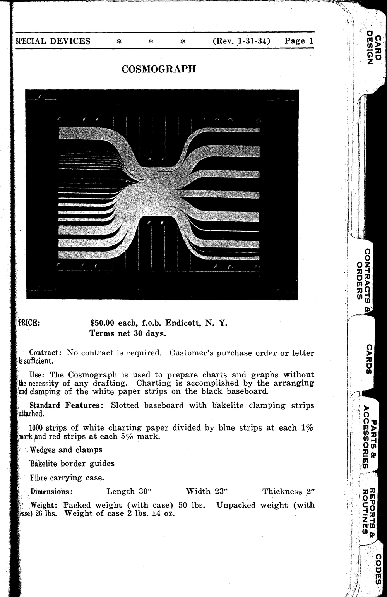
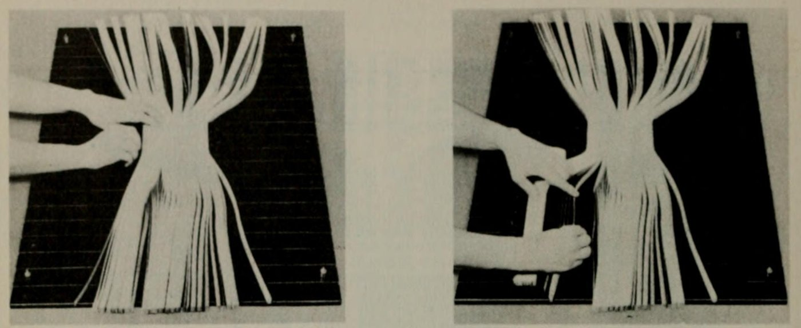
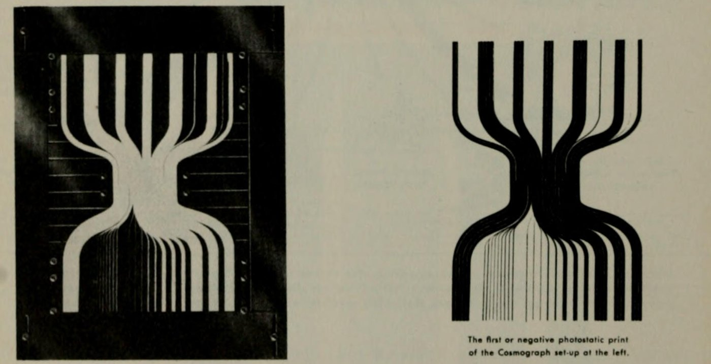
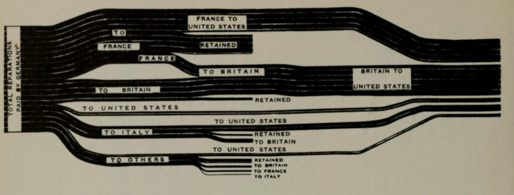
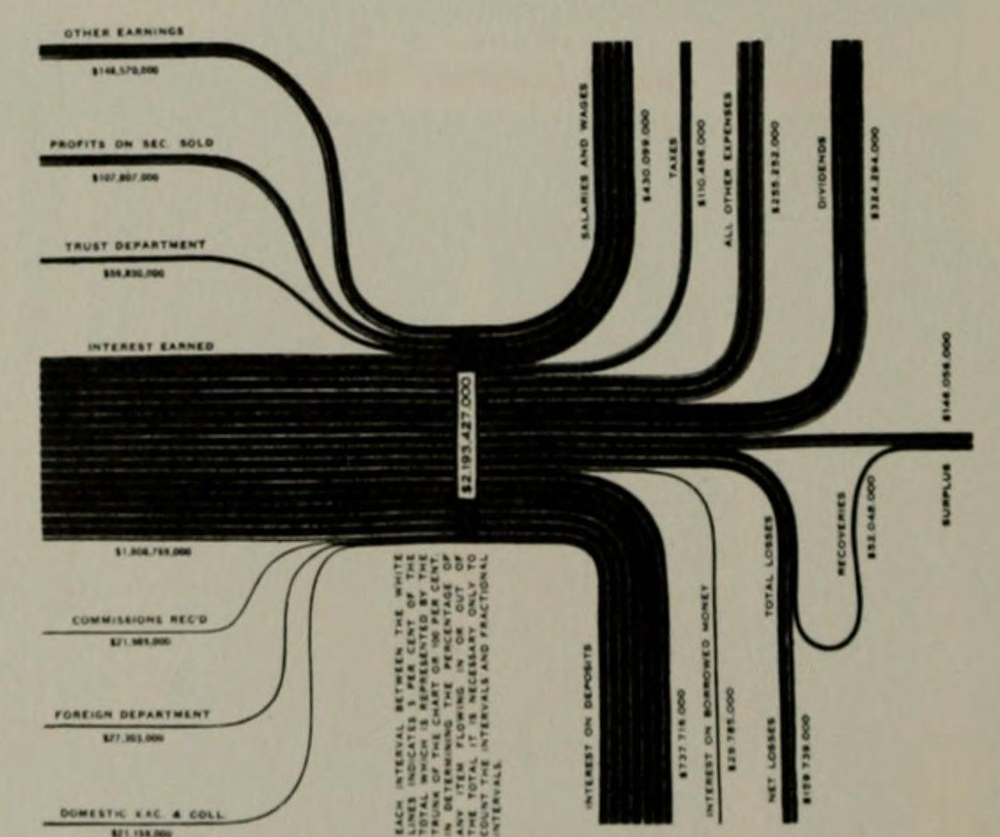

+++
author = "Yuichi Yazaki"
title = "Strip Counts Set the Band Width, and a Photograph Inverts Black and White: IBM's Cosmograph"
slug = "ibm-cosmograph"
date = "2026-11-03"
description = "The Cosmograph was a charting device in which the width of a band was expressed by the number of paper strips laid side by side (1,000 strips for 100%). The arranged strips were photographed, and the black-and-white inverted print was used as the graph."
categories = [
    "consume"
]
tags = [
    "data physicalization",
    "Sankey diagram",
    "Willard Brinton"
]
image = "images/cosmograph-board-and-negative-print.jpg"
+++

The Cosmograph (International Cosmograph) was a charting device sold by IBM. It expressed the width of a band by the number of paper strips laid side by side. One thousand white strips made 100%. On a black work board, the strips were bundled, divided, and held with clamps. The finished board was photographed with a photostat, and the negative print, with black and white inverted, was used as the graph.

The sources are IBM's sales manual (including a page revised on January 31, 1934) and Chapter 8, "Flow Charts," of Willard Cope Brinton's textbook on charts, *Graphic Presentation* (1939). The manual was found in IBM's archives in 2012 by Jim Strickland, a volunteer at the Computer History Museum, who presented it with images and a transcription. It also appears as "1933 – IBM's Cosmograph" in dataphys.org, a catalog of examples of data physicalization. What follows sticks to these materials.

<!--more-->

## A Device in IBM's 1933 Sales Manual

The 1933 U.S. copyright catalog lists a chapter of IBM's "Manual of sales instruction, 1933" as "International cosmograph. © June 9; AA 130049." What was registered was a document, a chapter of a sales manual, not rights to the device itself.

What the device was can be learned from the 1934 sales manual that Strickland found. Its preface says:

> The drawing of graphs usually requires the time and skill of an accomplished draughtsman. The Cosmograph, however, due to its simplicity of construction and operation, requires no skill or foreknowledge beyond that imparted in a few moments' instruction.

In short: drawing graphs takes the time and skill of a trained draftsman, but the Cosmograph requires no skill beyond a few moments of explanation.

Source: IBM, Manual of Business Instruction (Rev. 1-31-34), photographed by Jim Strickland, from the Computer History Museum "Volunteer Information Exchange" Vol.2 No.16

The "SPECIAL DEVICES" chapter of the same manual has a page with a photograph of the device and its price. The price is "$50.00 each, f.o.b. Endicott, N. Y.," that is, 50 dollars per unit. However, the upper right of this page reads "Rev. 1-31-34," a revision of January 31, 1934. Whether this was the 1933 price has not been confirmed.

The components are a grooved work board with Bakelite fasteners, 1,000 paper strips, wedges and clamps, edge guides, and a carrying case. The strips are described as "1000 strips of white charting paper divided by blue strips at each 1% mark and red strips at each 5% mark." The dimensions are 30 × 23 × 2 inches (about 76 × 58 × 5 cm, converted by the author).

A note on the names used at the time. IBM's wording is "International Cosmograph," and Brinton explains "Cosmograph" as a trade name for a kind of flow chart. A flow chart that shows quantity by band width is now classified as a [Sankey diagram](/en/sankey-diagram/), and the dataphys.org tag uses that name. But this is a later classification; it appears in neither the manual nor Brinton's book.

Who devised it, how many were sold, and where an actual unit survives could not be confirmed.

## Count 1,000 Strips to Make the Band Width

Page 78 of Brinton's book shows how it was used, with photographs provided by IBM.

Source: Willard C. Brinton, Graphic Presentation (1939), p.78 (plate: International Business Machines Corp.) / from the Internet Archive (Internet Archive rights status: NOT_IN_COPYRIGHT)

> One thousand strips of paper are set on edge to represent 100%, and are separated into component parts of 100%.

That is, 1,000 paper strips are stood on edge to make 100% and then divided into its components. The left photograph shows the stage of positioning the strips and holding them with clamps; the right shows wedges and bar spacers being inserted between the bundles.

The manual describes how quantity is laid out:

> It requires no measurements or computing for measurement. ... Each minimum percentage unit of data is represented by one white strip.

That is, no measuring and no calculation for measuring is needed; the smallest unit of a percentage is represented by one white strip. One strip is equivalent to 0.1% (the author's calculation).

**The width of a band is decided not by measuring with a ruler and drawing, but by counting strips.** The correspondence between data and device is summarized below.

| Data side | Device side | Source |
|---|---|---|
| The whole (100%) | 1,000 strips | Brinton p.78 |
| Smallest unit of a percentage | One white strip (0.1%, the author's calculation) | Manual |
| Share of each item | Number of strips in a bundle = band width | Manual |
| Scale mark every 1% | Blue strip | Manual |
| Scale mark every 5% | Red strip (20 strips) | Manual, Brinton p.78 |
| Divisions between items | Wedges and bars between bundles | Brinton p.78 |
| Path of a flow | Position where strips are bent and held with clamps | Brinton p.78 |
| Frame of the figure | Edge guides | Brinton p.78 |

The scale is inside the band, not outside it. The blue and red strips enter the same bundle as the white strips, at fixed positions. This can be read as a design that gives the band itself its scale, without placing an axis outside.

Because the smallest unit is one strip, proportions are placed in steps of 0.1% (the author's calculation). In exchange, the accuracy of band width is supported by the number of strips, not by drafting skill. The manual could say that no skill was required, and this mechanism can be read as the reason.

## Invert the White Strips on the Black Board with a Photograph

The finished board is not the finished product. Brinton writes that once the edge guides hide the leftover ends of the strips, "the Cosmograph is ready for photostatting." That is, it is ready to go to the photostat.

Source: Willard C. Brinton, Graphic Presentation (1939), p.78 (plate: International Business Machines Corp.) / from the Internet Archive (Internet Archive rights status: NOT_IN_COPYRIGHT)

> Note that all black portions of the device fail to reproduce. Of the one thousand strips of paper, twenty are red and are set at each 5% mark. In the negative photostat, these red strips of paper reproduce as white.

That is, all the black parts of the device fail to reproduce, and the 20 red strips, set at every 5% mark, come out white in the negative. The arrangement of white strips on the black board becomes black bands on a white ground in the print. The red strips remain as thin white lines inside the black bands. How the blue strips appeared in the negative could not be confirmed.

The manual also says that what is used as the graph is the print.

> When all groups have been arranged a photostat of the board is made. The negative print, on which the groups appear in black against a white background, is used as the graph.

That is, once all the groups are arranged, a photostat of the board is made, and the negative print, in which the groups appear black on white, is used as the graph. The strips on the board were not the final form for people to read but an intermediate form for producing a printed piece. The black board was meaningful precisely because it did not reproduce.

## Two Figures Built for Reparations and for Income and Outgo

Page 80 of Brinton's book carries two figures made with the Cosmograph. The first is the distribution of German reparations.

Source: Willard C. Brinton, Graphic Presentation (1939), p.80 (plate: International Business Machines Corp.) / from the Internet Archive (Internet Archive rights status: NOT_IN_COPYRIGHT)

On the left are the total Germany paid and the countries that received it; in the center is the amount each country kept; on the right is the amount paid from each country to the United States. The amount kept is shown by branches that stop partway. According to Brinton, this is made by pulling the strips back and aligning their ends at the center of the figure. They are only pulled back, and cutting is not mentioned, so the total number can be read as unchanged.

The second is "Simple Income and Outgo," a figure of plain income and expenditure.

Source: Willard C. Brinton, Graphic Presentation (1939), p.80 (plate: International Business Machines Corp.) / from the Internet Archive (Internet Archive rights status: NOT_IN_COPYRIGHT)

The central trunk is fixed first, the income side is assembled, and then the board is turned to assemble the outgo side. About the space for the amount on the trunk, Brinton writes:

> A short strip of black paper is pasted across the trunk to provide a white block on the negative photostatic print.

That is, pasting a short strip of black paper across the trunk makes a white block in the negative, where the total amount is entered in type. Even the label space was made on the assumption of inversion. On the printed page, the white block reads "$2,193,427,000."

The figure also has a vertical note, which the author read from the scan of the page.

> EACH INTERVAL BETWEEN THE WHITE LINES INDICATES 5 PER CENT OF THE TOTAL ... IT IS NECESSARY ONLY TO COUNT THE INTERVALS AND FRACTIONAL INTERVALS.

The note says that each interval between the white lines is 5% of the total, and that to know a proportion one need only count the intervals and fractional intervals. It can be read as a mechanism in which the reader counts the quantity the maker placed by counting strips.

## How Third Parties Viewed the Device

Jim Strickland saw "cosmograph" on an exhibit poster at the Computer History Museum, looked into what it was, and in October 2012 found the sales manual in IBM's archives.

> In 1933, for $50.00, ($850.00 in 2012) a business could buy a device to illustrate financial inputs and outputs by separating and grouping strips of white paper against a black background.

That is, in 1933, for 50 dollars, a business could buy a device that illustrated the flow of money in and out by grouping strips of white paper against a black background. The article ends with "Eat your heart out Excel!", treating the device as an ancestor of the charting features of spreadsheet software. However, the page cited for the price is the January 1934 revision.

The Thomas Fisher Rare Book Library at the University of Toronto, in its 2023 exhibition "Emerging Patterns," placed Brinton's figure in the history of the Sankey diagram and wrote:

> The replacement of 'cosmograph' with 'Sankey' is a loss for the world of data visualization.

That is, the replacement of the name Cosmograph with Sankey is a loss. The exhibition describes the method as "using pins to guide the paths of the strips," but what Brinton and the manual describe are clamps and wedges; pins do not appear.

Phineas of sankey-diagrams.com wrote in 2009 that Brinton's Chapter 8 puts its emphasis on "Cosmographs," which seems to have been an IBM trade name of the time. Another article on the same site reports that, in a discussion among Spanish-speaking makers, "cosmografías" was raised as a term in James Glenn Stovall's *Infographics* (1997). This can be read as an example of a trade name surviving as a generic name for flow charts, but I have not checked Stovall's original.

## What to Take From It

The first is a design that "counts" quantity instead of "measuring" it. When you draw by length, accuracy depends on the skill of the person drawing. When you place by number of units, accuracy can be read as supported by the counting. In exchange, precision is set by the size of the unit, which for the Cosmograph works out to steps of 0.1%. Choosing the unit also chooses the precision.

The second is a design that puts the scale inside the mark. The red strips became white lines inside the bands in the print, and counting those lines gave the proportion. Even without an axis outside, clues for reading can be left inside the band.

The third is a view that treats a physical object as an intermediate form for output. The black board was meaningful because it did not reproduce, and even the label space assumed inversion. Deciding first what the result will pass through at the end changes how colors and materials are chosen.

Finally, the name. At the time, these figures were called Cosmograph or flow chart. If you search for past figures only under the classification "Sankey diagram," you may overlook figures that went by different names.

## References

**Primary sources**

- IBM sales manual "Manual of Business Instruction" (1934): the preface, the explanatory text, and the "SPECIAL DEVICES / COSMOGRAPH" page (Rev. 1-31-34). Reproduced as images and transcription in Jim Strickland's article: http://s3data.computerhistory.org.s3.amazonaws.com/chmedu/VIE_02_016.pdf
- Catalog of Copyright Entries, New Series, Part 1 Group 2: Pamphlets, Leaflets…, Vol.30 (1933), entry "International business machines corp." with "International cosmograph. © June 9; AA 130049.": https://archive.org/details/catalogofcopyri301libr (relevant page: https://archive.org/details/catalogofcopyri301libr/page/n769/mode/1up )
- Willard Cope Brinton, *Graphic Presentation*, New York: Brinton Associates, 1939, Chapter 8 "Flow Charts," pp.73–80, and the glossary at the end: https://archive.org/details/graphicpresentat00brinrich (p.78: https://archive.org/details/graphicpresentat00brinrich/page/78/mode/1up / p.80: https://archive.org/details/graphicpresentat00brinrich/page/80/mode/1up )
- dataphys.org, "1933 – IBM's Cosmograph" (entered by Pierre Dragicevic): https://dataphys.org/list/ibms-cosmograph/

**Secondary sources**

- Jim Strickland, "Cosmograph? What's a Cosmograph?", *Volunteer Information Exchange* Vol.2 No.16, Computer History Museum, 2012-11-23: http://s3data.computerhistory.org.s3.amazonaws.com/chmedu/VIE_02_016.pdf
- Thomas Fisher Rare Book Library, University of Toronto, "Emerging Patterns: Data Visualization Through History" (2023), "Sankey and Venn Diagrams": https://fisherdigitus.library.utoronto.ca/exhibits/show/emerging-patterns--data-visual/network-diagrams/network-diagrams--sankey-and-v
- Phineas, "1939 Graphic Presentation Book", sankey-diagrams.com, 2009-09-16: https://www.sankey-diagrams.com/1939-graphic-presentation-book/
- Phineas, "Infographics Experts on Sankey Diagrams (Part 2)", sankey-diagrams.com, 2009-08-18: https://www.sankey-diagrams.com/infographics-experts-on-sankey-diagrams-part-2/
