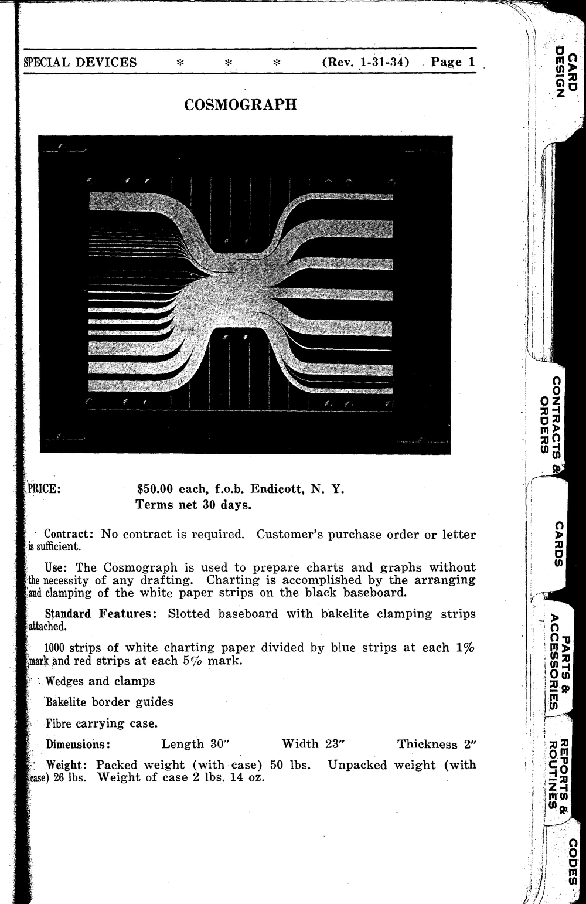
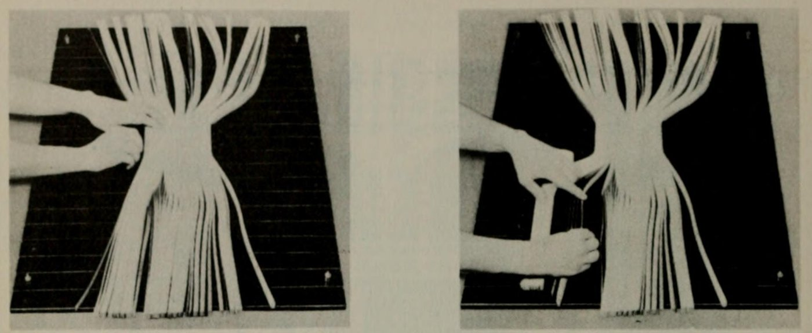
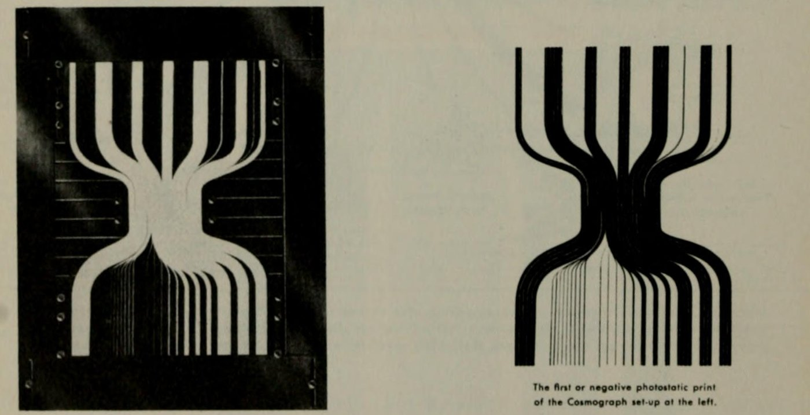
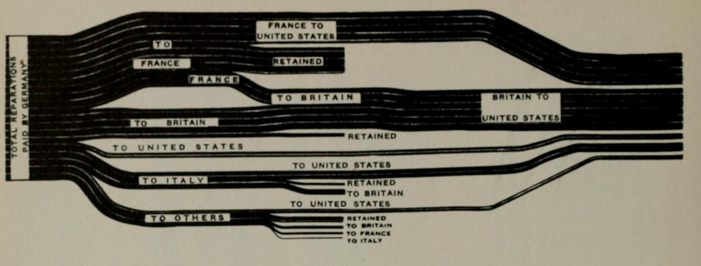
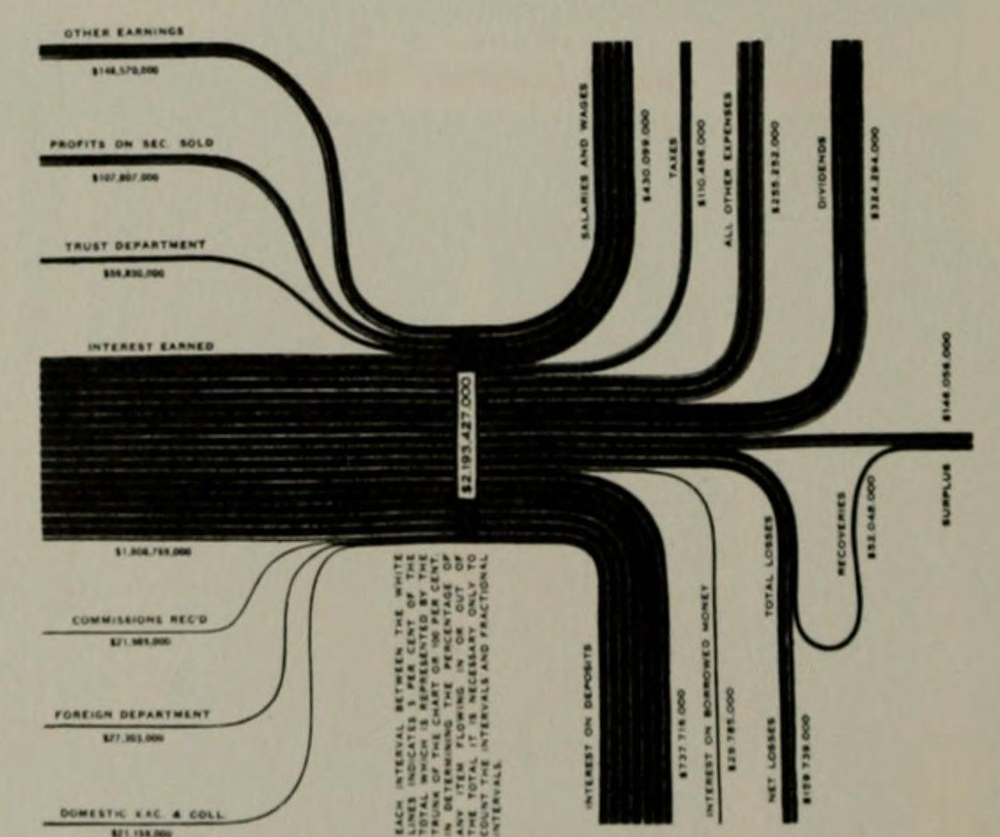

+++
author = "矢崎裕一"
title = "紙片の本数で帯の太さを決め、写真で白黒を反転させる──IBM のコスモグラフ"
slug = "ibm-cosmograph"
date = "2026-11-03"
description = "コスモグラフは、帯の太さを並べた紙片の本数（1,000本で100%）で表す作図装置でした。並べた紙片を撮影し、白黒を反転させた印画をグラフとして使いました。"
categories = [
    "consume"
]
tags = [
    "データ物質化",
    "サンキー・ダイアグラム",
    "Willard Brinton"
]
image = "images/cosmograph-board-and-negative-print.jpg"
series = ["data-physicalization"]
series_weight = 23
seriesByline = "IBM"
seriesTitle = "紙片を数えて流れ図を組む──IBM のコスモグラフ"
+++

コスモグラフ（International Cosmograph）は、IBM が売っていた作図装置です。帯の太さを、並べた紙片の本数で表しました。白い紙片1,000本で100%です。黒い作業台の上で紙片を束ね、分け、クランプで留めます。並べ終えた台を写真複写（フォトスタット）で撮り、白黒が反転したネガの印画をグラフとして使いました。

出典は、IBM の販売マニュアル（1934年1月31日改訂のページを含む）と、Willard Cope Brinton（ウィラード・C・ブリントン）の図表の教本『Graphic Presentation』（1939）の第8章「Flow Charts」です。マニュアルは、コンピュータ歴史博物館のボランティア Jim Strickland が2012年に IBM のアーカイブで見つけ、画像と転記で紹介しました。データ物理化の事例集 dataphys.org にも「1933 – IBM's Cosmograph」として載っています。以下は、これらの資料に沿います。

<!--more-->

## 1933年、IBM の販売マニュアルに載った装置

1933年の米国の著作権台帳には、IBM の「Manual of sales instruction, 1933」の章として "International cosmograph. © June 9; AA 130049." が載っています。登録されたのは販売マニュアルの章という文書で、装置そのものの権利ではありません。

装置の中身は、Strickland が見つけた1934年の販売マニュアルで分かります。序文はこう書いています。

> The drawing of graphs usually requires the time and skill of an accomplished draughtsman. The Cosmograph, however, due to its simplicity of construction and operation, requires no skill or foreknowledge beyond that imparted in a few moments' instruction.

グラフを描くには熟練した製図工の時間と技能がいるが、コスモグラフは数分の説明以上の技能を求めない、という説明です。

IBM, Manual of Business Instruction（Rev. 1-31-34）、撮影 Jim Strickland／Computer History Museum「Volunteer Information Exchange」Vol.2 No.16 より引用

同じマニュアルの「SPECIAL DEVICES」の章に、装置の写真と価格のページがあります。価格は "$50.00 each, f.o.b. Endicott, N. Y." で、1台50ドルでした。ただし、このページの右上には "Rev. 1-31-34"、つまり1934年1月31日の改訂とあります。1933年の価格だったかは確かめられていません。

構成品は、溝付きの作業台とベークライトの留め具、紙片1,000本、くさびとクランプ、縁ガイド、運搬ケースです。紙片は "1000 strips of white charting paper divided by blue strips at each 1% mark and red strips at each 5% mark." と書かれています。寸法は30×23×2インチ（約76×58×5cm、筆者の換算）です。

当時の呼び名にも触れておきます。IBM の表記は "International Cosmograph" で、Brinton は "Cosmograph" を流れ図（flow chart）の一種の商標名だと説明しています。量を帯の太さで表す流れ図は、いまは[サンキー・ダイアグラム](/sankey-diagram/)と分類され、dataphys.org のタグにもその名があります。ただし後の分類名で、マニュアルにも Brinton の本にも出てきません。

誰が考案したか、何台売れたか、実物がどこに残るかは確かめられませんでした。

## 1,000本を数えて、帯の太さにする

Brinton の本の78ページには、IBM が提供した写真で使い方が載っています。

Willard C. Brinton, Graphic Presentation (1939), p.78（図版：International Business Machines Corp.）／Internet Archive より引用（Internet Archive の表示：NOT_IN_COPYRIGHT）

> One thousand strips of paper are set on edge to represent 100%, and are separated into component parts of 100%.

1,000本の紙片を立てて並べて100%とし、それを内訳に分ける、という説明です。左の写真は紙片を位置決めしてクランプで留める段階、右は束のあいだにくさびとバーのスペーサーを差し込む段階です。

マニュアルは、量の置き方をこう書いています。

> It requires no measurements or computing for measurement. ... Each minimum percentage unit of data is represented by one white strip.

測ることも、測るための計算も要らない。割合の最小単位を、白い紙片1本で表す、という説明です。1本は0.1%にあたります（筆者の計算）。

**帯の太さは、物差しで測って描くのではなく、紙片を数えて決まります。** データと装置の対応をまとめます。

| データの側 | 装置の側 | 出典 |
|---|---|---|
| 全体（100%） | 紙片1,000本 | Brinton p.78 |
| 割合の最小単位 | 白い紙片1本（0.1%、筆者の計算） | マニュアル |
| 各項目の割合 | 束の本数＝帯の太さ | マニュアル |
| 1%ごとの目盛り | 青い紙片 | マニュアル |
| 5%ごとの目盛り | 赤い紙片（20本） | マニュアル、Brinton p.78 |
| 項目の区切り | 束のあいだのくさび・バー | Brinton p.78 |
| 流れの経路 | 紙片を曲げてクランプで留めた位置 | Brinton p.78 |
| 図の枠 | 縁ガイド | Brinton p.78 |

目盛りが、帯の外ではなく内側にあります。青と赤の紙片は、白い紙片と同じ束に決まった位置で入ります。軸を外に置かず、帯そのものに目盛りを持たせた設計と読めます。

最小単位が1本なので、割合は0.1%刻みで置くことになります（筆者の計算）。そのかわり、帯の太さの正確さは、製図の腕ではなく紙片の本数で支えられていると読めます。マニュアルが技能を求めないと言えたのは、この仕組みのためと読めます。

## 黒い台の上の白い紙片を、写真で反転させる

並べ終えた台は、完成品ではありません。Brinton は、縁ガイドで余った紙片の端を隠すと "the Cosmograph is ready for photostatting" と書きます。フォトスタットにかける準備ができた、ということです。

Willard C. Brinton, Graphic Presentation (1939), p.78（図版：International Business Machines Corp.）／Internet Archive より引用（Internet Archive の表示：NOT_IN_COPYRIGHT）

> Note that all black portions of the device fail to reproduce. Of the one thousand strips of paper, twenty are red and are set at each 5% mark. In the negative photostat, these red strips of paper reproduce as white.

装置の黒い部分はすべて写らない。20本の赤い紙片は5%ごとに置かれ、ネガでは白く出る、という説明です。黒い台に白い紙片の配置が、印画では白地に黒い帯になります。赤い紙片は、黒い帯の中の白い細線として残ります。青い紙片がネガでどう写ったかは、確かめられませんでした。

マニュアルも、グラフとして使うのは印画だと書いています。

> When all groups have been arranged a photostat of the board is made. The negative print, on which the groups appear in black against a white background, is used as the graph.

台の上の紙片は、人が読む最終形ではなく、印刷物を作るための中間形態だったと読めます。黒い台は、写らないことに意味がありました。

## 賠償金と収支を組んだ2枚

Brinton の80ページには、コスモグラフで作った図が2点載っています。1点目は、ドイツの賠償金の分配です。

Willard C. Brinton, Graphic Presentation (1939), p.80（図版：International Business Machines Corp.）／Internet Archive より引用（Internet Archive の表示：NOT_IN_COPYRIGHT）

左がドイツの支払った総額と受け取った国々、中央が各国が手元に残した額、右が各国から米国へ支払われた額です。手元に残した額は、途中で途切れた枝で表します。Brinton によれば、紙片を後ろへ引いて、端を図の中央にそろえて作ります。引き戻すだけで、切るとは書かれていないので、総数は変わらないと読めます。

2点目は「Simple Income and Outgo」、単純な収入と支出の図です。

Willard C. Brinton, Graphic Presentation (1939), p.80（図版：International Business Machines Corp.）／Internet Archive より引用（Internet Archive の表示：NOT_IN_COPYRIGHT）

中央の幹を留め、収入の側を組み、台を回して支出の側を組みます。幹の金額の欄について、Brinton はこう書きます。

> A short strip of black paper is pasted across the trunk to provide a white block on the negative photostatic print.

幹に短い黒い紙を貼ると、ネガで白い枠になり、そこに合計金額を活字で入れる、という説明です。ラベルの欄まで、反転を前提に作られています。誌面では、白い枠に "$2,193,427,000" とあります。

図の中には縦書きの注記もあり、筆者が誌面のスキャンから読み取りました。

> EACH INTERVAL BETWEEN THE WHITE LINES INDICATES 5 PER CENT OF THE TOTAL ... IT IS NECESSARY ONLY TO COUNT THE INTERVALS AND FRACTIONAL INTERVALS.

白い線のあいだの1区間が全体の5%で、割合は区間と端数を数えるだけで分かる、という注記です。作り手が本数を数えて置いた量を、読み手も数えて読む仕組みと読めます。

## 第三者はこの装置をどう見たか

Jim Strickland（ジム・ストリックランド）は、コンピュータ歴史博物館の展示ポスターに "cosmograph" とあるのを見て正体を調べ、2012年10月に IBM のアーカイブで販売マニュアルを見つけました。

> In 1933, for $50.00, ($850.00 in 2012) a business could buy a device to illustrate financial inputs and outputs by separating and grouping strips of white paper against a black background.

1933年には50ドルで、黒地に白い紙片を束ねてお金の出入りを図にする装置が買えた、という要約です。記事は "Eat your heart out Excel!" と結ばれ、表計算ソフトのグラフ機能の先祖として見ています。ただし、価格の根拠に載せたページは1934年1月の改訂版です。

トロント大学の Thomas Fisher 稀覯書図書館は、2023年の展覧会「Emerging Patterns」で Brinton の図をサンキー図の歴史に置き、こう書きました。

> The replacement of 'cosmograph' with 'Sankey' is a loss for the world of data visualization.

コスモグラフという名がサンキーに置き換わったのは損失だ、という評価です。なお、展示は作り方を「ピンで紙片の経路を導く」と説明しますが、Brinton とマニュアルにあるのはクランプとくさびで、ピンは出てきません。

sankey-diagrams.com の Phineas は2009年、Brinton の第8章は "Cosmographs" に力点があり、当時の IBM の商標名らしい、と紹介しました。同サイトの別記事は、スペイン語圏の制作者の議論で、James Glenn Stovall『Infographics』（1997）の用語として「cosmografías」が挙がったと伝えています。商標名が流れ図の一般名として残った例と読めますが、Stovall の原著は確認していません。

## 使い道

一つ目は、量を「測る」のではなく「数える」設計です。長さで描けば、正確さは描く人の腕に左右されます。単位の数で置けば、正確さは数え方で支えられる、と読めます。そのかわり精度は単位の大きさで決まり、コスモグラフでは0.1%刻みだったと計算できます。単位を決めることは、精度を決めることでもあります。

二つ目は、目盛りをマークの中に入れる設計です。赤い紙片は印画で帯の中の白い線になり、その線を数えれば割合が読めました。軸を外に置かなくても、読み取りの手がかりは帯の中に残せます。

三つ目は、物の形を、出力のための中間形態として扱う見方です。黒い台は写らないことに意味があり、ラベルの欄まで反転を前提にしていました。最後に何を通して見せるかを先に決めると、色や素材の選び方が変わります。

最後に呼び名です。当時、この図は Cosmograph か flow chart と呼ばれていました。サンキー図という分類だけで過去の図を探すと、呼び名の違う図を見落とすかもしれません。

## 参考・出典

**一次情報**

- IBM 販売マニュアル「Manual of Business Instruction」（1934年）の序文、説明文、"SPECIAL DEVICES / COSMOGRAPH"（Rev. 1-31-34）のページ。Jim Strickland の記事中に画像と転記で掲載：http://s3data.computerhistory.org.s3.amazonaws.com/chmedu/VIE_02_016.pdf
- Catalog of Copyright Entries, New Series, Part 1 Group 2: Pamphlets, Leaflets…, Vol.30 (1933), "International business machines corp." の項 "International cosmograph. © June 9; AA 130049."：https://archive.org/details/catalogofcopyri301libr （該当ページ：https://archive.org/details/catalogofcopyri301libr/page/n769/mode/1up ）
- Willard Cope Brinton, *Graphic Presentation*, New York: Brinton Associates, 1939, Chapter 8 "Flow Charts", pp.73–80 と巻末用語集：https://archive.org/details/graphicpresentat00brinrich （p.78：https://archive.org/details/graphicpresentat00brinrich/page/78/mode/1up ／p.80：https://archive.org/details/graphicpresentat00brinrich/page/80/mode/1up ）
- dataphys.org, "1933 – IBM's Cosmograph"（Pierre Dragicevic 登録）：https://dataphys.org/list/ibms-cosmograph/

**第三者評価**

- Jim Strickland, "Cosmograph? What's a Cosmograph?", *Volunteer Information Exchange* Vol.2 No.16, Computer History Museum, 2012-11-23：http://s3data.computerhistory.org.s3.amazonaws.com/chmedu/VIE_02_016.pdf
- Thomas Fisher Rare Book Library, University of Toronto, "Emerging Patterns: Data Visualization Through History"（2023）, "Sankey and Venn Diagrams"：https://fisherdigitus.library.utoronto.ca/exhibits/show/emerging-patterns--data-visual/network-diagrams/network-diagrams--sankey-and-v
- Phineas, "1939 Graphic Presentation Book", sankey-diagrams.com, 2009-09-16：https://www.sankey-diagrams.com/1939-graphic-presentation-book/
- Phineas, "Infographics Experts on Sankey Diagrams (Part 2)", sankey-diagrams.com, 2009-08-18：https://www.sankey-diagrams.com/infographics-experts-on-sankey-diagrams-part-2/
