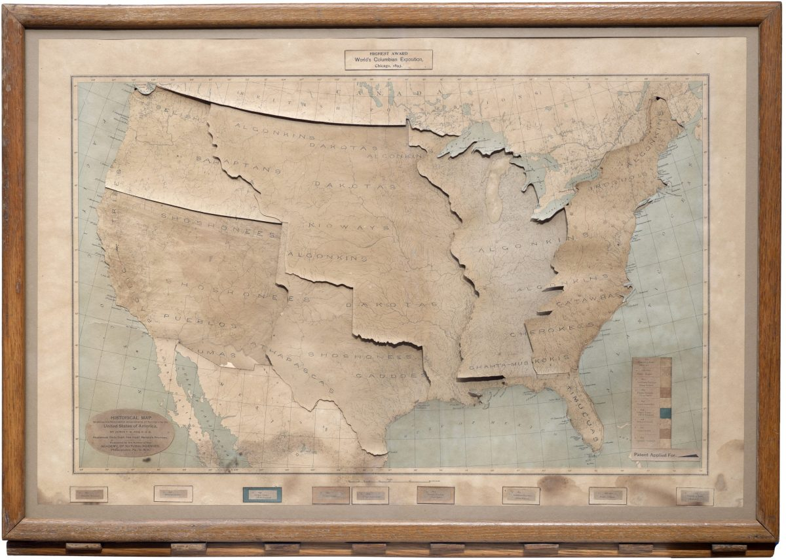
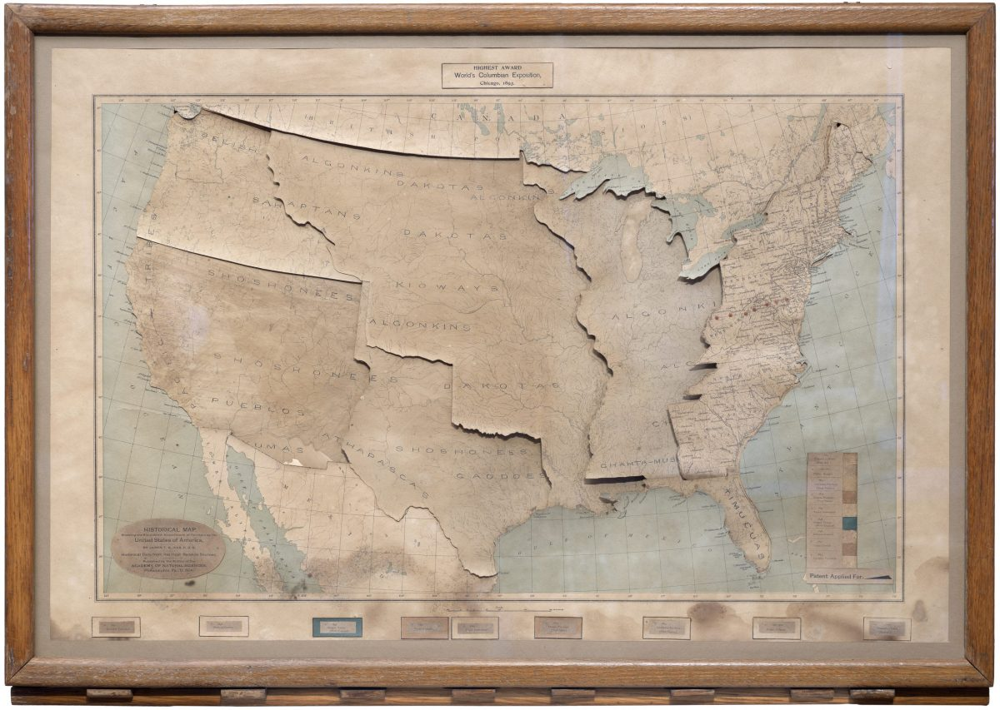
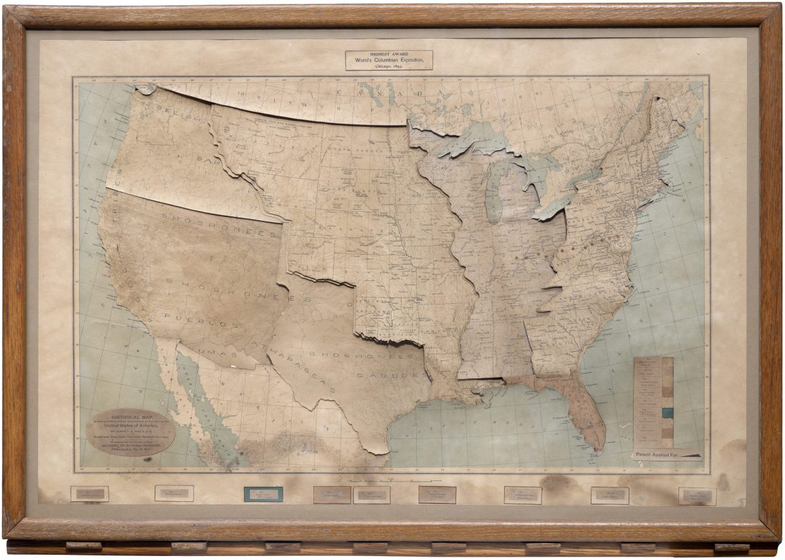
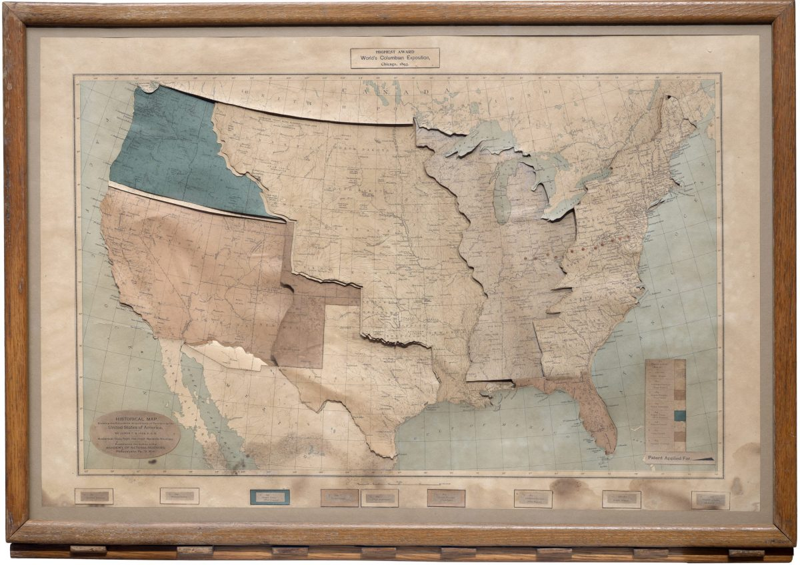
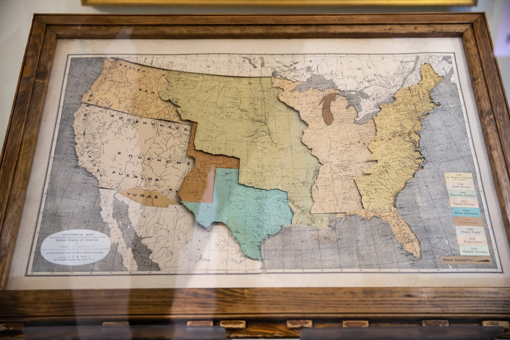

+++
author = "Yuichi Yazaki"
title = "Press the Keys in Order, and Territory Plates Cover the Tribal Map: Ives's Historical Map"
slug = "ives-historical-map"
date = "2026-11-01"
description = "A map that maps the order in which the United States acquired territory onto the order of key presses, and the area acquired onto colored plates that slide into view. The plates overlay a layer showing where Native American tribes lived, one after another."
categories = [
    "consume"
]
tags = [
    "data physicalization",
    "maps",
    "James T. B. Ives"
]
image = "images/all-segments.jpg"
+++

James T. B. Ives's *Historical Map, Showing the Successive Acquisitions of Territory by the United States of America* maps the order in which the United States acquired territory onto the order of key presses, and the area acquired onto colored plates that slide into view. The plates overlay a layer showing where Native American tribes lived, one after another. The first key brings up a plate for the 16 states that correspond to the 13 colonies, and the last key brings up a plate for the Gadsden Purchase of 1853.

The map dates from around 1897, and its frame measures 34 by 24 inches. Below, I read it in the order a viewer operates it, following the introduction in the educational journal *The School Journal* of October 2, 1897, a 1911 catalogue of teaching materials, the catalogue of the holding institution, the Boston Public Library, and the description by the antiquarian map dealer Boston Rare Maps.

<!--more-->

## 1897: A "Mechanical Map" in an Educational Journal

The earliest article on this map that I could confirm is in *The School Journal* of October 2, 1897. It ran on p. 322, in the "School Equipment" column, under the headline "Growth of the United States Shown by a Mechanical Map." The column states that it carries no paid advertising. The article calls the map a mechanism that shows the growth of the United States, and says it is set under glass in an oak frame.

The maker was James Thomas Bostock Ives. He was born in London in 1839 (1840 in another biography) and was a Fellow of the Geological Society of London (F.G.S.). He moved to Toronto in 1886, then made maps in New York and Philadelphia, where he taught geology and, later, history. In 1904 he moved to Andover, New Hampshire, and he died in 1915.

In the 1911 catalogue of the New England History Teachers' Association, the map was sold as "The Ives Historical Map" at a price of $15. Boston Rare Maps notes that this was $15 at a time when the 32-sheet set of Foster Historical Charts cost $20.

| Item | Details |
|---|---|
| Date | Around 1897 (the BPL catalogue says "approximately 1897") |
| Publication | Depending on the printing, Philadelphia (Academy of Natural Sciences) or New York (340 Fourth Avenue) |
| Size | 34 x 24 inches, framed |
| Mechanism | Several map layers stacked, connected to cut-out tin pulleys and moved by a wooden lever |
| Holdings | Boston Public Library (Leventhal Map & Education Center). According to Boston Rare Maps, also the Clements Library, the Peabody Essex Museum, and a private collection in the Midwest |

dataphys.org lists it as "1896 – James Ive's Mechanical Teaching Map." The correct spelling of the name is Ives, and "Mechanical Teaching Map" is a descriptive phrase. I could not confirm the basis for the year 1896.

## Tribal Colors Placed on a Gray River Map

With all the plates pulled out, what you see is the bottom map. The School Journal describes its contents as follows.

> Printed in neutral gray is shown, first, a simple river map of the United States. On this, grouped in distinctive colors, and arranged linguistically according to the map accompanying the eleventh census, are shown the locations of the various Indian tribes originally occupying the United States.

In short: first there is a simple river map of the United States, printed in neutral gray. On it, the locations of the tribes that originally lived in what is now the United States are shown in grouped colors, arranged by language family following the map that accompanied the eleventh census (1890).

From James T. B. Ives / Boston Rare Maps

This layer also carries early settlements. English, French, and Spanish settlements are shown as colored dots, with the color indicating nationality. Each dot has a number, and the accompanying legend gives its name and year. The 1911 catalogue describes the state with the plates pulled out as "the virgin country before European occupation," that is, the land before European occupation.

According to Boston Rare Maps, the layers consist of "eight sets of cut-outs." The lower layer of each set is printed with the main river systems and the names of Native peoples. The upper layer is printed with the state borders as of 1893, major cities, Indian reservations, and so on. The upper layer slides in on the lever and covers the lower one.

## Each Key Press Slides In a Territory Plate

The map is operated with keys lined up along the lower edge of the frame. Boston Rare Maps writes of a wooden lever, and the BPL catalogue writes of levers.

> On touching the first of a row of keys below the lower edge of the frame, a colored segment slides into view, representing the 16 states corresponding to the 13 original colonies.

That is: touching the first of the row of keys below the lower edge of the frame slides a colored plate into view, representing the 16 states that correspond to the 13 original colonies.

From James T. B. Ives / Boston Rare Maps

The first plate shows one more thing: how far the borders of the present 16 states extend beyond the watershed that France, and later Britain, claimed as the "proper limits of the colonies." The second key brings up the region between the 13 states and the Mississippi River. The 1911 catalogue says this plate is of a "different color" from the first. The third is Louisiana.

From James T. B. Ives / Boston Rare Maps

From here on, The School Journal describes the rest in one passage.

> So each accession of territory down to the Gadsden purchase in 1853 is shown on the map by pressing a different key. Eleven red dots indicate the western movement of the center of population.

In other words, each acquisition of territory, down to the Gadsden Purchase of 1853, appears on the map when a different key is pressed, and eleven red dots show the westward movement of the center of population. The number 11 can be read as corresponding to the eleven censuses from 1790 to 1890. The article, however, does not say so.

Boston Rare Maps counts the acquisitions as nine stages, citing among others the 1783 Treaty of Paris, Florida in 1819, and the annexation of Texas in 1845. The plate for the 1848 Treaty of Guadalupe Hidalgo is said to be misprinted "1850 Texan Cession."

From James T. B. Ives / Boston Rare Maps

Based on these contemporary descriptions, the correspondence between data and appearance or material can be summarized as follows.

| Data | Appearance / material | Specifics | Source |
|---|---|---|---|
| Terrain (river network) | The bottom layer, a river map printed in gray | The 1911 catalogue calls it a "government river map" | School Journal, 1911 catalogue |
| Locations of Native tribes | Printed on a lower layer, grouped by color | Color groups = language families (after the map accompanying the 1890 census) | School Journal |
| Early settlements | Colored dots; color = nationality | The dot number is looked up in the legend for name and year | School Journal |
| Territorial acquisition (where) | Colored plates that slide in and cover the lower layer | Adjacent plates change color | School Journal, 1911 catalogue |
| Order of acquisition (when) | The order of the keys (levers) along the lower edge of the frame | The first is the 16 states, the last is the 1853 Gadsden Purchase | School Journal, 1911 catalogue |
| Gap from the colonies' original extent | The offset between the first plate's border and the watershed | - | School Journal |
| Westward shift of the center of population | A row of red dots | 11 | School Journal |
| Present-day (around 1893) geography | State borders, major cities, and reservations printed on the plates | - | Boston Rare Maps, BPL catalogue |

What carries the order of acquisition is neither color nor position but the order in which the viewer presses the keys (only the westward shift of the center of population is shown by the positions of the red dots). **The map stays a single frame, while the time of acquisition has been moved to the side of the hand's operation**, as I read it.

## From a Map of Strata to a Map of Territory

Before the historical map, Ives had made geological maps. Advertisements for the Ives Strata Map and the Ives Altitude Map appear in the October 1895 issue of *The American Naturalist*.

According to the advertisement, the strata map shows the superposition of strata and outcrops, and can also show folds if the cards are bent. The altitude map has relief worked into its surface, with heights painted in strongly contrasting colors.

The advertisement says both received a diploma and a medal at the World's Columbian Exposition in Chicago in 1893. The catalogue of the Pennsylvania exhibits at the Exposition also lists "Strata and Altitude Maps." According to Boston Rare Maps, a label for this medal is pasted in the upper margin of the historical map.

The 1923 *Encyclopedia of Connecticut Biography* introduces Ives as "the inventor of the Ives Strata Map and the Ives Historical Map." This can be read as moving the mechanism that shows strata stacked up to a mechanism that shows territory stacked up. However, I have found no source in which Ives himself says so. I could not confirm the text of any explanation Ives wrote himself.

## How Third Parties Saw the Map

The School Journal of 1897 wrote that the map would help "make interesting the teaching of United States history." The mechanism is introduced as a classroom tool.

The holding institution, the Leventhal Map & Education Center, pointed out the bias of the story in an article for its 2023 event "From The Vault: Mechanical Maps."

> The map told a story of the seemingly inevitable process of expansion and emphasized nation-building by treaties rather than the violence of war.

The assessment is that the map told a story in which expansion seemed an inevitable process, and emphasized nation-building by treaty over the violence of war.

Boston Rare Maps, the antiquarian map dealer, says the maker's intent is unknown, and then reads the mechanism itself.

> However the basic design of the mechanism conveys an impression, in keeping with the myth of Manifest Destiny, of a process both orderly and inevitable. It also conveys—at least to our modern sensibility—a sense of the tragedy that befell a civilization that was literally effaced from the map.

The reading is that the basic design of the mechanism, in keeping with the myth of Manifest Destiny, conveys an impression of an orderly and inevitable process, while also conveying, at least to modern sensibilities, the tragedy of a civilization literally effaced from the map.

Source: Courtesy Aram Boghosian / WBUR

In 2019, the map appeared in the Leventhal exhibition "America Transformed: Mapping the 19th Century" (on loan from a private collection in the Midwest). WBUR's article on the exhibition, by Frank Redner, opens with a photograph of this map. Redner is a member of the Upper Sioux Community.

In the exhibition, "Viewpoint" texts from the Native side were displayed beside the institution's own captions. The article summarizes their point as "Native concepts about land are not two-dimensional." These words are not aimed at Ives's map alone, but they can be read as a clue for looking at this map, which stacks flat layers.

## Takeaways

The first is that the order of operation becomes the axis of time. The sequence of keys is the sequence of dates, and each press advances one step. This can be read as connecting to today's step-by-step timeline maps. However, there is no source showing a direct line of influence.

The second is that where you place the divisions becomes, as it is, a way of telling history. In this map, one step corresponds to one territorial acquisition (one plate). Leventhal's remark about the emphasis on "nation-building by treaties" can be read as aimed at this way of dividing. When you divide a timeline into stages, deciding what the unit of a stage is is an editorial judgment, not data.

The third is that the stacking order carries meaning. The tribal layer is at the bottom, and the territory plates cover it. In a digital map too, deciding which layer is the base and which goes on top is a claim before it is a display setting. Boston Rare Maps's phrase "effaced from the map" can be read as aimed at this stacking order.

The fourth is that what was covered can be brought back. As the 1911 catalogue writes, pulling out the plates makes the tribal layer appear. If you choose a design that covers, you should prepare an operation for returning to what was covered with equal weight. This map held both in a single frame.

## References

**Primary sources**

- Boston Public Library catalogue record, "Historical Map, Showing the Successive Acquisitions of Territory by the United States of America": https://bpl.bibliocommons.com/v2/record/S75C8129750
- *The School Journal*, Vol. 55, No. 12 (October 2, 1897), p. 322, "Growth of the United States Shown by a Mechanical Map": https://archive.org/details/sim_school-journal_1897-10-02_55_12 (full text: https://archive.org/download/sim_school-journal_1897-10-02_55_12/sim_school-journal_1897-10-02_55_12_djvu.txt / Google Books edition: https://books.google.com/books?id=ov1KAAAAYAAJ&pg=PA322 )
- New England History Teachers' Association, *A Catalogue of the Collection of Historical Material*, Simmons College, Boston, 1911, entry "The Ives Historical Map": https://archive.org/details/catalogueofcolle00newerich (the same text also appears in *The History Teacher's Magazine*, April 1911: https://archive.org/details/sim_social-studies_1911-04_2_8 )
- *The American Naturalist*, October 1895, advertisement (Ives Strata Map / Ives Altitude Map): https://archive.org/details/american_naturalist_189510
- *Encyclopedia of Connecticut Biography*, 1923, entry on the Ives family: https://archive.org/details/encyclo07unse
- *Catalogue of the Exhibits of the State of Pennsylvania and of Pennsylvanians at the World's Columbian Exposition*, 1893: https://archive.org/details/catalogueofexhib00penn
- Leventhal Map & Education Center, "Highlights from From The Vault: Mechanical Maps" (LMEC Staff, May 30, 2023): https://www.leventhalmap.org/articles/highlights-from-from-the-vault-mechanical-maps/
- Leventhal Map & Education Center post on X (Twitter), May 23, 2019: https://twitter.com/bplmaps/status/1131571980770193409
- dataphys.org, "1896 – James Ive's Mechanical Teaching Map" (registered by Pierre Dragicevic, contributed by Jason Forrest): https://dataphys.org/list/james-ives-mechanical-teaching-map/

**Secondary sources**

- Boston Rare Maps, "Ingenious mechanical map of United States territorial expansion" (Inventory ID: BRM3857): https://bostonraremaps.com/inventory/mechanical-map-of-united-states-territorial-expansion/
- Frank Redner, "This Map Exhibit Draws A Darker U.S. History — Of Expansion Into Native Lands," WBUR, October 14, 2019: https://www.wbur.org/news/2019/10/14/boston-public-library-native-americans-maps-united-states
- Jonathan Crowe, "New Leventhal Exhibition: America Transformed," The Map Room, May 9, 2019 (for the exhibition's dates): https://www.maproomblog.com/2019/05/new-leventhal-exhibition-america-transformed/
