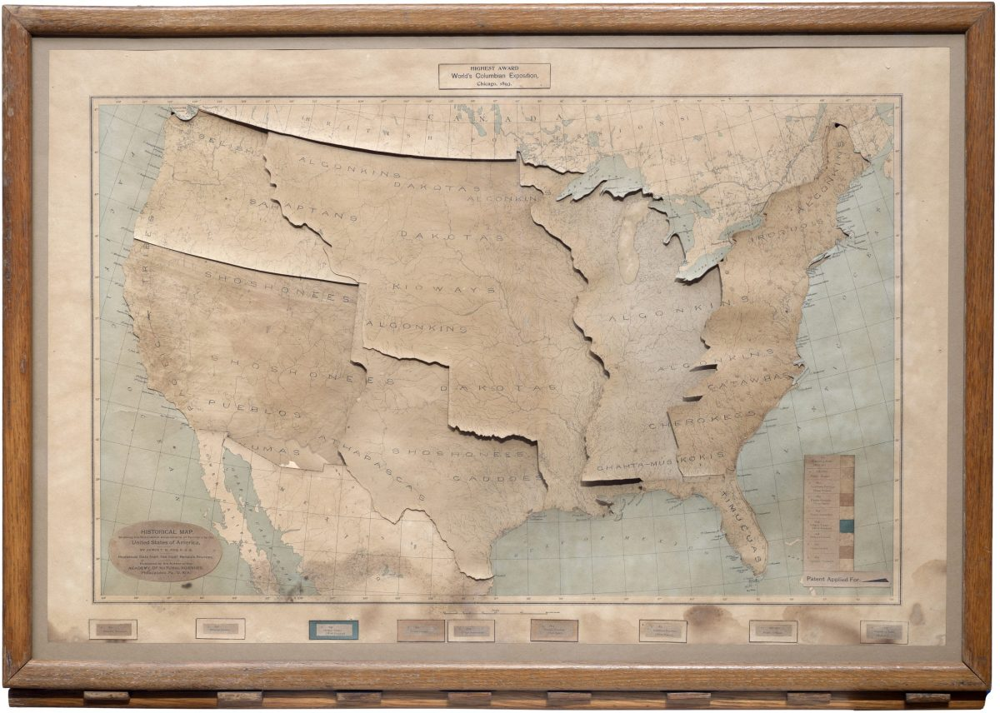
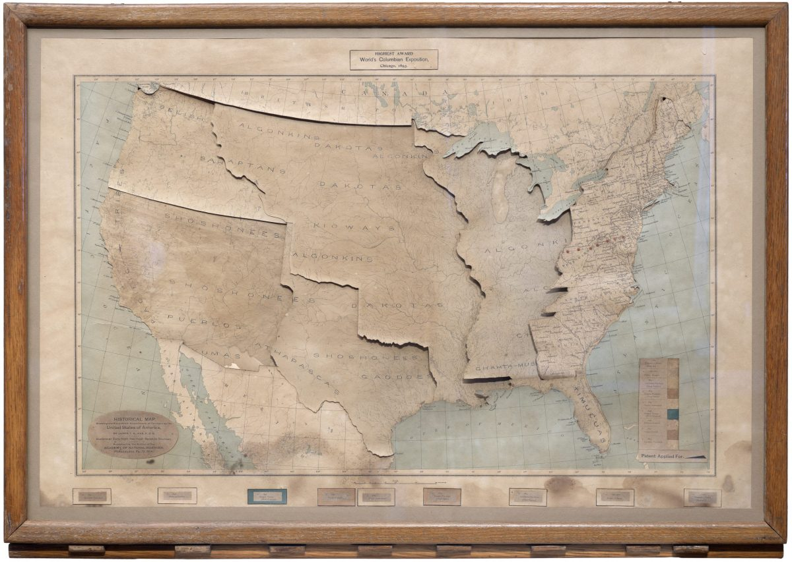
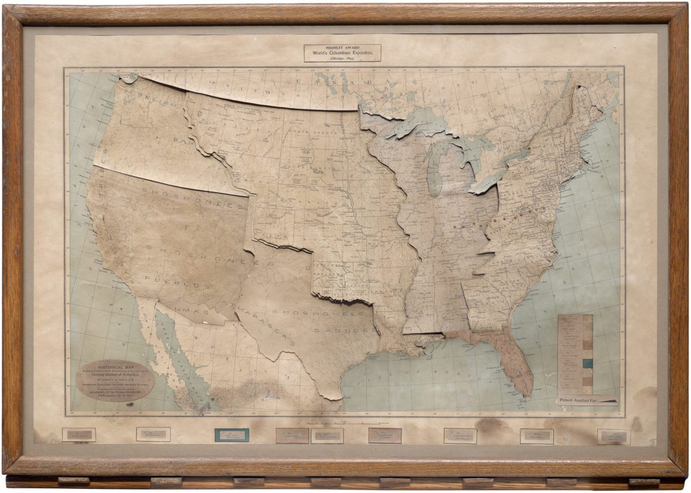
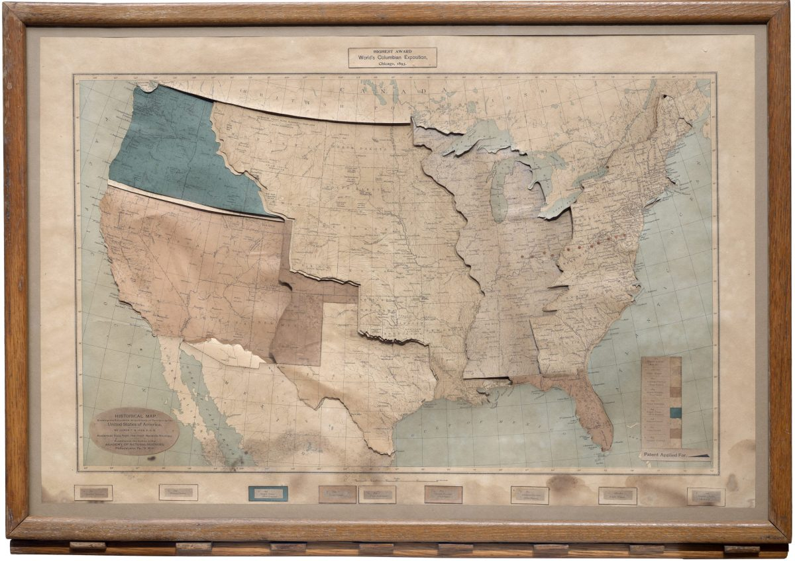
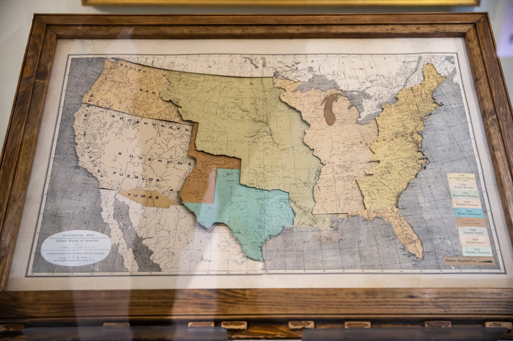

+++
author = "矢崎裕一"
title = "キーを押す順に、領土の板が部族の地図を覆う──Ives の歴史地図"
slug = "ives-historical-map"
date = "2026-11-01"
description = "合衆国が領土を得た順番を「キーを押す順番」に、得た範囲を「滑り込む色つきの板」に対応させた地図です。板は、先住民の部族の位置を描いた層の上に順に重なっていきます。"
categories = [
    "consume"
]
tags = [
    "データ物質化",
    "地図",
    "James T. B. Ives"
]
image = "images/all-segments.jpg"
series = ["data-physicalization"]
series_weight = 15
seriesByline = "James T. B. Ives"
seriesTitle = "押す順に領土の板が滑り込む──Ives の歴史地図"
+++

James T. B. Ives（ジェームズ・アイヴズ）の『Historical Map, Showing the Successive Acquisitions of Territory by the United States of America』は、合衆国が領土を得た順番を「キーを押す順番」に、得た範囲を「滑り込む色つきの板」に対応させた地図です。板は、先住民の部族の位置を描いた層の上に、順に重なっていきます。最初のキーで13植民地にあたる16州の板が現れ、最後のキーで1853年のガズデン購入の板が現れます。

地図は1897年ごろの作で、額の大きさは34×24インチです。以下は、当時の教育誌 *The School Journal* 1897年10月2日号の紹介記事、1911年の教材目録、所蔵館 Boston Public Library の目録、古地図商 Boston Rare Maps の解説に沿って、見る人が操作する順に読みます。

<!--more-->

## 1897年、教育誌に載った「機械仕掛けの地図」

活字でこの地図に触れた記事として、いちばん早く確かめられるのは *The School Journal* 1897年10月2日号です。p.322 の「School Equipment」欄に、"Growth of the United States Shown by a Mechanical Map" という見出しで載りました。同じ欄には、有料広告は載せないと明記されています。

> The accompanying cut shows in reduced fac-simile the Ives Historical Map, an interesting mechanical contrivance for illustrating the growth of the United States. The map itself, 34 by 24 inches, is mounted under glass and enclosed in an oak frame.

縮小図版で Ives Historical Map を示す。合衆国の成長を見せる、面白い機械仕掛けだ。地図は34×24インチで、ガラスの下に収め、オーク材の額に入れてある、という紹介です。

作者は James Thomas Bostock Ives です。1839年（別の伝記では1840年）にロンドンで生まれ、ロンドン地質学会のフェロー（F.G.S.）でした。1886年にトロントへ移り、のちにニューヨーク、フィラデルフィアで地図を作りながら、地質学、のちに歴史を教えています。1904年にニューハンプシャー州アンドーヴァーへ移り、1915年に亡くなりました。

1911年の New England History Teachers' Association の目録では、販売名は「The Ives Historical Map. A Mechanical Contrivance for Illustrating the Growth of the United States of America」です。価格は完品で15ドルでした。Boston Rare Maps は、Rand McNally が32枚組の Foster Historical Charts を20ドルで売っていた時代の15ドルだ、と書いています。

| 項目 | 内容 |
|---|---|
| 原題 | *Historical Map, Showing the Successive Acquisitions of Territory by the United States of America* |
| 年代 | 1897年ごろ（BPL 目録は「approximately 1897」） |
| 発行 | 刷りにより、フィラデルフィア（Academy of Natural Sciences）とニューヨーク（340 Fourth Avenue） |
| 大きさ | 額で34×24インチ。Boston Rare Maps の本は図郭内で17 1/2×28インチ |
| 機構 | 地図の層を何枚も重ね、切り抜いたブリキの滑車につなぎ、木のレバーで動かす |
| 価格 | 15ドル（1911年の目録） |
| 所蔵 | Boston Public Library（Leventhal Map & Education Center）。Boston Rare Maps によれば、ほかに Clements Library、Peabody Essex Museum、中西部の個人蔵 |

なお、データ物理化の作品を集めた dataphys.org では「1896 – James Ive's Mechanical Teaching Map」として載っています。名前は Ives が正しく、「Mechanical Teaching Map」は原題ではなく説明の言い回しです。1896年という年は、根拠を確かめられませんでした。

## 灰色の川の地図に、部族の色を置く

板をすべて引き出した状態で見えるのは、いちばん下の地図です。School Journal は、その中身をこう書いています。

> Printed in neutral gray is shown, first, a simple river map of the United States. On this, grouped in distinctive colors, and arranged linguistically according to the map accompanying the eleventh census, are shown the locations of the various Indian tribes originally occupying the United States.

まず、中間的な灰色で刷った、簡素な合衆国の河川図がある。その上に、もともと合衆国の地に住んでいた部族の位置を、色でまとめて示す。部族は、第11回国勢調査（1890年）の付図に従い、言語の系統で分けてある、という説明です。

James T. B. Ives／Boston Rare Maps「Ingenious mechanical map of United States territorial expansion」より引用

この層には、初期の入植地も載ります。英・仏・西の入植地を色つきの点で示し、色が国籍を表します。点ごとに番号があり、付属のキー（凡例）で名前と年を引けます。1911年の目録は、板を引き出した状態を「ヨーロッパ人が住みつく前の、手つかずの土地」を示すものだと説明しています。

> The colored segments being withdrawn, the government river map shows the virgin country before European occupation, the locations of the Indian tribal groups, and the actual settlements of English colonists, French military and trading posts, and the Spanish towns on the Florida coast in the west.

色つきの板を引き出すと、政府の河川図が、ヨーロッパ人の占有以前の土地、部族の位置、英国の入植地、フランスの軍事・交易拠点、フロリダ沿岸のスペインの町を示す、という文です。

Boston Rare Maps によれば、層は「8組の切り抜き」でできています。各組の下の層には、主な水系と先住民の名を刷ります。上の層には、1893年時点の州境、主要都市、インディアン居留地などを刷ります。上の層がレバーで滑り込み、下の層を覆います。

## キーを押すたびに、領土の板が滑り込む

操作は、額の下辺に並ぶキーで行います。1897年の記事は「a row of keys」と書き、Boston Rare Maps と BPL の目録は「wooden levers」と書いています。

> On touching the first of a row of keys below the lower edge of the frame, a colored segment slides into view, representing the 16 states corresponding to the 13 original colonies.

額の下辺に並ぶキーの1つ目に触れると、色つきの板が滑り込んでくる。13植民地にあたる16州を表す板だ、という説明です。

James T. B. Ives／Boston Rare Maps「Ingenious mechanical map of United States territorial expansion」より引用

1つ目の板は、もう一つのことも示します。現在の16州の境界が、フランス、のちに英国が「植民地の正しい範囲」だと主張した分水界を、どれだけ越えているかです。2つ目のキーは、13州とミシシッピ川のあいだの地域を出します。1911年の目録は、この板が1つ目と「色の違う」板だと書いています。3つ目はルイジアナです。

James T. B. Ives／Boston Rare Maps「Ingenious mechanical map of United States territorial expansion」より引用

School Journal は、ここから先をひとまとめに書きます。

> So each accession of territory down to the Gadsden purchase in 1853 is shown on the map by pressing a different key. Eleven red dots indicate the western movement of the center of population.

1853年のガズデン購入まで、領土の獲得はそれぞれ別のキーを押すことで地図に現れる。11個の赤い点が、人口重心の西への移動を示す、という文です。11という数は、1790〜1890年の国勢調査11回分にあたると読めます。ただし、記事にはそう書かれていません。

Boston Rare Maps は、獲得を9つの段階に数えています。挙げているのは、独立時の13州、1783年のパリ条約による公有地、1803年のルイジアナ購入、1819年のフロリダ、1845年のテキサス併合と1850年のテキサス割譲（同じ切り抜き）、1848年のグアダルーペ・イダルゴ条約、1853年のガズデン購入です。グアダルーペ・イダルゴ条約の板には、誤って「1850 Texan Cession」と刷られているそうです。

James T. B. Ives／Boston Rare Maps「Ingenious mechanical map of United States territorial expansion」より引用

当時の記述から、データと見た目・素材の対応をまとめると、次のようになります。

| データ | 見た目・素材 | 具体 | 出典 |
|---|---|---|---|
| 地形（河川網） | いちばん下の層。灰色で刷った河川図 | 1911年の目録は「government river map」と呼ぶ | School Journal、1911年目録 |
| 先住民の部族の位置 | 下の層に、色でまとめて刷る | 色のまとまり＝言語系統（1890年国勢調査の付図による） | School Journal |
| 初期の入植地 | 色つきの点。色＝国籍 | 点の番号から、凡例で名前と年を引く | School Journal |
| 領土の獲得（どこを） | 滑り込んで下の層を覆う、色つきの板 | 隣り合う板は色を変える | School Journal、1911年目録 |
| 獲得の順番（いつ） | 額の下辺に並ぶキー（レバー）の順番 | 1つ目が16州、最後が1853年のガズデン購入 | School Journal、1911年目録 |
| 植民地本来の範囲との差 | 1つ目の板の境界と、分水界のずれ | ― | School Journal |
| 人口重心の西への移動 | 赤い点の列 | 11個 | School Journal |
| 現在（1893年ごろ）の地理 | 板の上に刷った州境、主要都市、居留地 | ― | Boston Rare Maps、BPL 目録 |

この表で、時間を受け持っているのは色でも位置でもありません。見る人がキーを押す順番です。**地図そのものは1枚の額のまま、時間は手の操作の側に移されている**、と読めます。

## 地層の地図から、領土の地図へ

Ives は、歴史地図の前に地質の地図を作っていました。*The American Naturalist* 1895年10月号に、Ives Strata Map と Ives Altitude Map の広告が載っています。

> THE IVES STRATA MAP graphically exhibits Superposition, denudation, and outcrop of strata, with the phenomena of escarpments, outliers, inliers, dip, strike, conformability, etc., and the Cards may be bent to show synclinal or anticlinal folds.

地層図は、地層の累重、削剝、露頭などを図で示し、カードを曲げれば向斜や背斜の褶曲も示せる、という広告文です。地層図は30×24インチで17.50ドル、高度図は33×23インチで9.50ドルでした。高度図は表面に浮き彫りを施し、高さを強い対比の色で塗り分けています。

広告は、この2つの地図が1893年のシカゴ万博で賞状とメダルを受けたと書きます。万博のペンシルヴェニア州出品目録にも「Ives, James T. B., Philadelphia. Strata and Altitude Maps」とあります。Boston Rare Maps によれば、歴史地図の上の余白には、このメダルのラベルが貼られています。メダルを受けたのは地質の地図で、歴史地図ではありません。

1923年の *Encyclopedia of Connecticut Biography* は、Ives を「Ives Strata Map と Ives Historical Map の発明者」と紹介しています。地層を重ねて見せる仕組みを、領土を重ねて見せる仕組みへ移した、と読めます。ただし、Ives 自身がそう書いた資料は見つかっていません。歴史地図に付いていた解説パンフレットの本文も、確かめられませんでした。

## 第三者はこの地図をどう見たか

1897年の School Journal は、教材としての効用を書いています。

> The map will help any one to make interesting the teaching of United States history.

この地図は、合衆国の歴史の授業を面白くする助けになる、という一文です。仕掛けは、授業の道具として紹介されています。

所蔵館の Leventhal Map & Education Center は、2023年の催し「From The Vault: Mechanical Maps」の記事で、物語の偏りを指摘しました。

> The map told a story of the seemingly inevitable process of expansion and emphasized nation-building by treaties rather than the violence of war.

地図は、拡大があたかも必然の過程だったかのような物語を語り、戦争の暴力より条約による国づくりを強調した、という評価です。

古地図商の Boston Rare Maps は、作者の意図は分からないとしたうえで、機構そのものを読みます。

> However the basic design of the mechanism conveys an impression, in keeping with the myth of Manifest Destiny, of a process both orderly and inevitable. It also conveys—at least to our modern sensibility—a sense of the tragedy that befell a civilization that was literally effaced from the map.

機構の基本的な設計が、「明白な天命」の神話に沿って、整然として必然的な過程という印象を伝える。同時に、少なくとも現代の感覚には、文字どおり地図から消された文明の悲劇も伝える、という読みです。

Aram Boghosian 撮影／WBUR「This Map Exhibit Draws A Darker U.S. History — Of Expansion Into Native Lands」より引用

この地図は、2019年に Leventhal で開かれた展覧会「America Transformed: Mapping the 19th Century」にも出ました。展示されたのは、中西部の個人コレクションからの借用品です。WBUR の Frank Redner は、この展覧会の記事の冒頭写真にこの地図を使いました。Redner は、自身を Upper Sioux Community の一員だと書いています。

展示では、館の解説に、先住民の書き手による「Viewpoint」が並べられました。記事は、その論点の一つを「Native concepts about land are not two-dimensional」と紹介しています。土地についての先住民の考えは二次元ではない、という言葉です。Ives の地図だけを指した言葉ではありません。それでも、平らな層を重ねて土地の移り変わりを見せるこの地図には、そのまま当てはまる批判だと読めます。

なお、層の上下の言い方は資料で分かれます。Leventhal は部族を「base map」、領土を「upper layers」と書き、WBUR の写真説明は逆に、部族を「top map」と書いています。機構の記述では、部族の層の上に領土の板が滑り込みます。

## 使い道

この地図から持ち帰れることの一つ目は、操作の順番が時間の軸になる、ということです。キーの並びが年代の並びで、押すたびに一歩進みます。いまのスライダーやステップ式の地図と同じ構造です。ただし、直接の影響関係を示す資料はありません。

二つ目は、どこで区切るかが、そのまま歴史の語り方になることです。この地図では、一歩が一つの条約や購入にあたります。Leventhal が「条約による国づくり」の強調を指摘したのは、この区切り方に向けた言葉だと読めます。時系列を段階に分けるとき、段階の単位を何にするかは、データではなく編集の判断です。

三つ目は、重ね順が意味を持つことです。部族の層は下にあり、領土の板がそれを覆います。デジタルの地図でも、どの層を下地にし、どの層を上に載せるかは、表示の設定である前に主張になります。Boston Rare Maps が「地図から消された」と書いたのは、この重ね順に向けた言葉だと読めます。

四つ目は、覆ったものを戻せることです。1911年の目録は、板を引き出すと、ヨーロッパ人が来る前の土地が見えると書いていました。キーを戻せば、部族の層はいつでも現れます。覆う設計を選ぶなら、覆われた側へ戻る操作も同じ重さで用意しておく。この地図は、その両方を1枚の額に入れていました。

## 参考・出典

**一次情報**

- Boston Public Library 目録レコード「Historical Map, Showing the Successive Acquisitions of Territory by the United States of America」：https://bpl.bibliocommons.com/v2/record/S75C8129750
- *The School Journal*, Vol. 55, No. 12（1897年10月2日）p.322「Growth of the United States Shown by a Mechanical Map」：https://archive.org/details/sim_school-journal_1897-10-02_55_12 （全文テキスト：https://archive.org/download/sim_school-journal_1897-10-02_55_12/sim_school-journal_1897-10-02_55_12_djvu.txt ／ Google Books 版：https://books.google.com/books?id=ov1KAAAAYAAJ&pg=PA322 ）
- New England History Teachers' Association, *A Catalogue of the Collection of Historical Material*, Simmons College, Boston, 1911「The Ives Historical Map」の項：https://archive.org/details/catalogueofcolle00newerich （同じ文面が *The History Teacher's Magazine* 1911年4月号にもある：https://archive.org/details/sim_social-studies_1911-04_2_8 ）
- *The American Naturalist*, 1895年10月号の広告（Ives Strata Map / Ives Altitude Map）：https://archive.org/details/american_naturalist_189510
- *Encyclopedia of Connecticut Biography*, 1923, Ives 家の項：https://archive.org/details/encyclo07unse
- *Catalogue of the Exhibits of the State of Pennsylvania and of Pennsylvanians at the World's Columbian Exposition*, 1893：https://archive.org/details/catalogueofexhib00penn
- Leventhal Map & Education Center, "Highlights from From The Vault: Mechanical Maps"（LMEC Staff, 2023年5月30日）：https://www.leventhalmap.org/articles/highlights-from-from-the-vault-mechanical-maps/
- Leventhal Map & Education Center の X（Twitter）投稿, 2019年5月23日：https://twitter.com/bplmaps/status/1131571980770193409
- dataphys.org「1896 – James Ive's Mechanical Teaching Map」（Pierre Dragicevic 登録、Jason Forrest 提供）：https://dataphys.org/list/james-ives-mechanical-teaching-map/

**第三者評価**

- Boston Rare Maps, "Ingenious mechanical map of United States territorial expansion"（Inventory ID: BRM3857）：https://bostonraremaps.com/inventory/mechanical-map-of-united-states-territorial-expansion/
- Frank Redner, "This Map Exhibit Draws A Darker U.S. History — Of Expansion Into Native Lands," WBUR, 2019年10月14日：https://www.wbur.org/news/2019/10/14/boston-public-library-native-americans-maps-united-states
- Jonathan Crowe, "New Leventhal Exhibition: America Transformed," The Map Room, 2019年5月9日（展覧会の会期）：https://www.maproomblog.com/2019/05/new-leventhal-exhibition-america-transformed/
