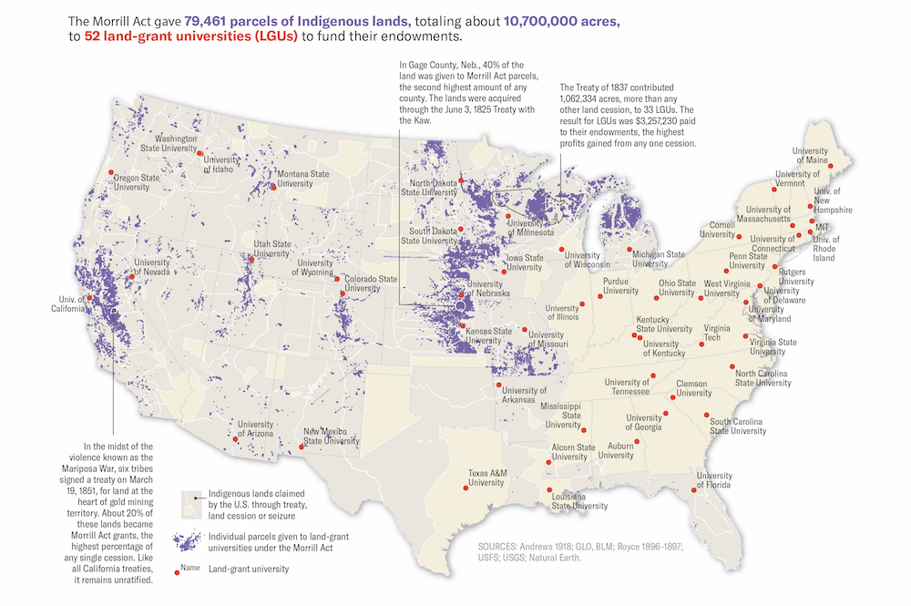
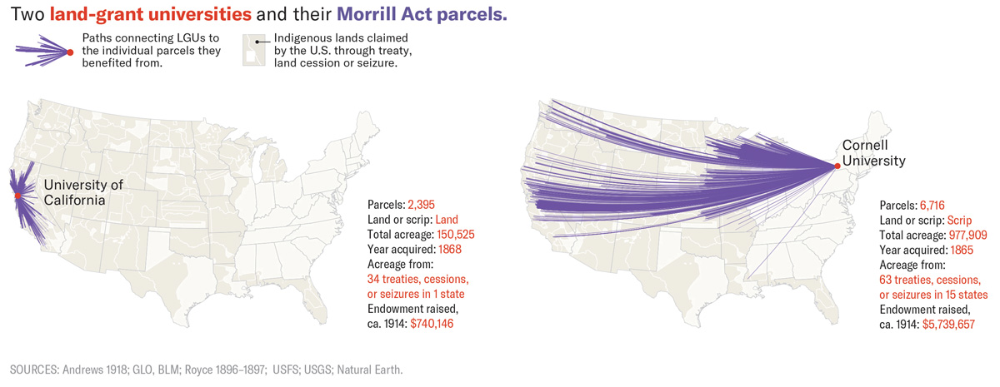
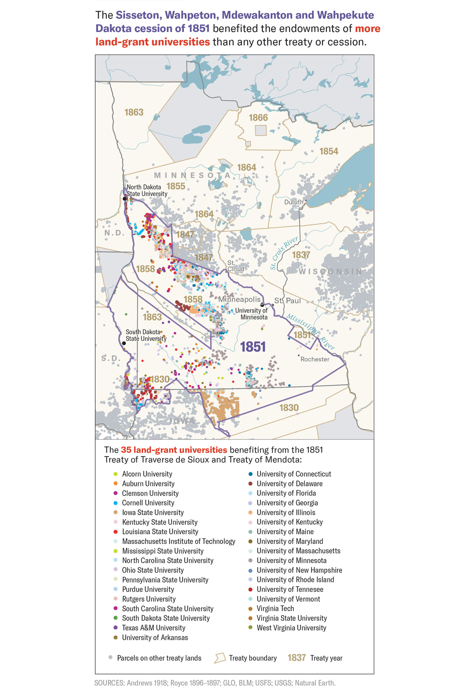
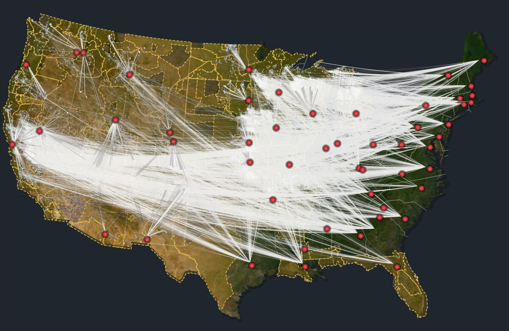
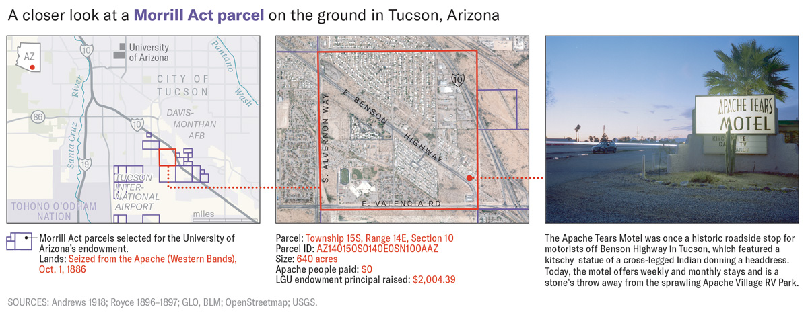

+++
author = "Yuichi Yazaki"
title = "Showing a Ledger of About 80,000 Parcels at Different Scales: High Country News's \"Land-Grab Universities\""
slug = "land-grab-universities"
date = "2026-11-04"
description = "High Country News split a ledger of about 80,000 land parcels into a national dot map, maps by cession and by university, and parcel cards, setting each parcel's payment to Indigenous nations beside the universities' estimated proceeds."
categories = [
    "consume"
]
tags = [
    "data journalism",
    "Sigma Awards",
    "maps",
    "Margaret Pearce",
    "High Country News"
]
image = "images/national-parcels-map.jpg"
series = ["dataviz-journalism"]
series_weight = 2
seriesByline = "Robert Lee, Tristan Ahtone, and Margaret Pearce"
seriesTitle = "80,000 Parcels Shown at Different Scales: Land-Grab Universities"
+++

High Country News split a ledger of about 80,000 parcels that became university endowments under the Morrill Act into three views at different scales: a national dot map, maps by cession and by university, and parcel cards. For each parcel, the project sets the amount paid to Indigenous nations beside an estimate of what the university raised. The university figure is not a sales record. It is an estimate that spreads each state's average per-acre figure across the parcel's acreage.

The work is "Land-grab universities," published on March 30, 2020. The text was written by historian Robert Lee and HCN's Tristan Ahtone. The maps come from two lines of work: the maps in the text and the print edition are by Margaret Pearce, while the interactive web map, landgrabu.org, was designed by Geoff McGhee and developed by Cody Leff. It won a Sigma Awards 2021 prize (winner). Below, I read it from the largest scale to the smallest, following the text, the methodology article, landgrabu.org, and the published data.

<!--more-->

## Turning Land Called a "Donation" into a Ledger

On July 2, 1862, Abraham Lincoln signed the Morrill Act, a law that gave states public land and used the proceeds from its sale to support colleges. The text rejects the "donation of land" story right at the start.

> Behind that myth lies a massive wealth transfer masquerading as a donation.

The sentence says that behind the myth of a gift lies a large transfer of wealth disguised as a donation. The text then explains why this went unseen.

> But with a footprint broken up into almost 80,000 parcels of land, scattered mostly across 24 Western states, its place in the violent history of North America's colonization has remained comfortably inaccessible.

In short, because the grant was scattered across almost 80,000 parcels in 24 Western states, its place in the history of colonization stayed out of view. The scattering itself can be read as the cause of the invisibility.

Lee's methodology article describes how the ledger was built in seven steps. The team extracted parcels from General Land Office patent records and collected more than 99% of each state's granted acreage. The center point of each parcel was overlaid on Charles Royce's cession maps, tying each parcel to the land cession through which the land was taken.

The data is published on GitHub under the Open Database License and CC BY-SA 3.0. When I tallied Parcels.csv myself, it had 79,461 rows and the payments totaled $397,247. That matches the text's "less than $400,000." Parcels with a $0 payment make up 29.8%, which also matches "more than a quarter."

## The National Dot Map: Placing 80,000 Parcels on One Sheet

The announcement for Pearce's talk (Northrop, University of Minnesota, 2022) describes the design of the maps this way.

> Cartographer Margaret Pearce will share how the maps and graphs are designed to amplify the project at multiple scales ...

In short, the maps and graphs were designed to work at multiple scales. Because this is an event announcement, it is impossible to tell whether the words are Pearce's own or the organizer's summary.

The largest scale is the national map. The first Pearce map in the text opens with a headline saying that 79,461 parcels, about 10.7 million acres, were given to 52 universities.

Source: Map by Margaret Pearce, from High Country News "Land-grab universities"

Parcels are small purple fills and universities are red dots. The beige background is Indigenous land that the United States acquired by treaty, cession, or seizure. The purple parcels cluster in the West and Midwest, while most of the red dots are in the East.

The web map, published on April 6, 2020, also shows the whole first as dots. In the Mapbox style embedded in the app, the background is a dark blue-gray. The parcel center points are cyan (#8ef7fb) with a small radius of 0.5 to 1 pixel, and they disappear at zoom 9. Instead, from zoom 8 the parcels' shapes appear as white dotted outlines.

The dot map can be read as the stage that keeps all 80,000 parcels intact and shows only their distribution. Which parcel belongs to which university is left to the next scale.

## Maps by Cession and by University: Connecting Distant Land with Lines

According to the text, Western states chose parcels from within their own borders. States in the East and South, and some in the Midwest, were given scrip (land vouchers), which they used to select land in the West.

> In fact, the grants were as big or bigger than major cities, and were often located hundreds or even thousands of miles away from their beneficiaries.

In short, the grants were as large as big cities and were often hundreds or thousands of miles from the schools that benefited. In her maps by university, Pearce showed this distance.

Source: Map by Margaret Pearce, from High Country News "Land-grab universities"

The legend reads "lines connecting a university to the individual parcels that funded it." The University of California received 2,395 parcels from land inside the state, and its lines stay within the state. Cornell University obtained 6,716 parcels through scrip, and its land comes from 63 cessions and other sources across 15 states. The endowment principal around 1914 was $740,146 for UC and $5,739,657 for Cornell.

There is also a map that takes a single cession as its unit: the 1851 Dakota cession.

Source: Map by Margaret Pearce, from High Country News "Land-grab universities"

Parcels inside the boundary are color-coded by the 35 universities that benefited, and parcels from other cessions are gray. According to the text, about 830,000 acres from this cession funded 35 universities. The University of Minnesota is said to have received $250 for every $1 paid to the Dakota.

The web map extends these lines to all universities. It draws arcs with deck.gl's ArcLayer from each parcel to the university in the beneficiary state. The arcs start in a cyan tone and end in red-orange, and the more arcs a university has, the thinner the lines. The site's own note reads "This map connects Indigenous land (in blue) redistributed to universities (in red)."

Source: High Country News (Web App Design: Geoff McGhee, Development: Cody Leff), from High Country News "Land-grab universities"

Cession boundaries are gold dashed lines. The lines are neither roads nor rivers; they represent the connection between a parcel and a university. **At this scale, the distance between land and university becomes visible for the first time**, as I read it.

## Parcel Cards and the Caveat of Estimation

The smallest scale is a single parcel. The text has 14 cards (covering 12 parcels), each listing fields in a fixed order beneath a photograph by Kalen Goodluck. The photographs show what is on the site today: railways, cemeteries, scrapyards.

The first card is for the Niles Canyon Railway parcel in Sunol, California.

- PARCEL ID: CA210040S0010W0SN020AE½SWAL
- OWNERSHIP TRANSFER METHOD: Seized by unratified treaty, May 28, 1851
- GRANTED TO: State of Alabama
- FOR THE BENEFIT OF: Auburn University
- AMOUNT PAID FOR INDIGENOUS TITLE: $0
- AMOUNT RAISED FOR UNIVERSITY: $72.01

Land in California ends up funding Auburn University by way of the State of Alabama. The scrip mechanism shows in the two lines "GRANTED TO" and "FOR THE BENEFIT OF." The two amounts are set side by side as plain text.

In the Arizona section, there is a figure that links three images: a map, an aerial photograph, and a photograph.

Source: Map by Margaret Pearce, from High Country News "Land-grab universities"

Within one figure, the scale steps down from a city map to an aerial photograph with one parcel outlined in red to a photograph from the ground. The parcel is 640 acres seized from the Apache in 1886, with a payment of $0 and a university endowment principal of $2,004.39.

Here I check the nature of the university-side numbers. This is Step 7 of the methodology.

> Using the principal raised and value of the unsold land for each state's grant, we calculated the average contribution to endowment per acre, then multiplied that average by the number of acres in a parcel to estimate each parcel's average contribution to an endowment.

In short, for each state the team took the principal raised and the value of unsold land, worked out a per-acre average, and multiplied it by the parcel's acreage. The "amount raised for university" is therefore an estimate, not a sales record. The payment to Indigenous nations is likewise a single cession's total, allocated by area.

Using the CSV, I compared parcels in the same section in Sunol. The Auburn parcel is 80 acres at $72.01, and the neighboring UC parcel is 39.84 acres at $195.90. That works out to about $0.90 and about $4.92 per acre. The differences in how each state sold its land can be read as showing up directly in the estimates.

The web map changes its fill by the accuracy column. According to the methodology, 99% of the acreage is accurate to the acre and 1% to the square mile. In the style, different fill patterns are applied to Aliquot and Section in the Accuracy column. These two can be read as corresponding to the methodology's one-acre and one-square-mile precision.

### How the Views Map to the Data

| Scale and medium (creator) | Data | Visual and material correspondence |
|---|---|---|
| National map (text and print, Pearce) | Parcels, cessions, universities | Parcels as purple fills, universities as red dots with names, cessions as beige areas |
| National map (web, McGhee and Leff) | Parcel center points | Cyan dots. At zoom 8 and above they give way to white dotted outlines |
| Map by university (text, Pearce) | Parcels matched to beneficiary universities | Purple lines from a university's red dot to its parcels, with parcel count, acreage, and principal added |
| Map of a cession (text, Pearce) | Parcels in the cession and beneficiary universities | Parcel dots color-coded by university inside the cession boundary |
| Arcs between parcels and universities (web, McGhee and Leff) | Parcel to university in beneficiary state | Arcs. Cyan-tone start, red-orange end; more arcs make thinner lines |
| Cession boundaries (web, McGhee and Leff) | Royce's cession areas | Gold dashed lines, with italic serif labels |
| Location accuracy (web, McGhee and Leff) | Accuracy column (Aliquot/Section) | A different fill pattern for each accuracy level |
| Parcel cards (text, photographs by Goodluck) | One row of the CSV | Beneath a photograph of the site: ID, transfer method, granted state, beneficiary university, and two amounts, all as text |

## How Third Parties Saw the Work

Map of the Week, a cartographers' blog, covered the work on April 8, 2020.

> Here is a detailed view since the map above is hard to read at this size.

In short, the national map is hard to read at this size, so the blog adds a detailed view. It also names the land lying far from the universities as a highlight. This is a review from the reader's side that shows the national figure alone is not enough and a zoomed-in scale is needed.

Tiara Roxanne wrote in February 2021 from the standpoint of Indigenous data sovereignty (IDS).

> By organizing this data utilizing differing digital markers (graph, table, map), the project contributors create a space for IDS.

In short, organizing the data in different forms (graph, table, map) created a space for data sovereignty. She also adds a note of caution that colonialism is embedded in digital infrastructure.

Historian Jon Parmenter introduced a forum in the Spring 2021 issue of *Native American and Indigenous Studies*. One of its themes, he notes, is the power of a mapping method that links specific dispossessions to the benefit of specific universities.

The work also won a George Polk Award (education reporting) and an IRE Award.

## Takeaways

What this work offers to visualization practice is a way of splitting one ledger into views at different scales.

Show the overall distribution as dots, and switch to shapes as the viewer moves closer. The aim is to keep 80,000 parcels without lumping them together. Draw the relationship between two distant parties as a line. Unlike a table, it conveys the distance as well. Turn a single record into a card and lay out the numbers as text. In a bar chart, $0 has no length, but as text "$0" reads as it is.

The other point is to treat an estimate as an estimate. The methodology states that the university-side figures are a state-average allocation, and the data is published. Making it possible for readers to check how reliable the figures are is what supports a strong claim.

## References

**Primary sources**

- Robert Lee & Tristan Ahtone, "Land-grab universities," High Country News, March 30, 2020. https://www.hcn.org/issues/52.4/indigenous-affairs-education-land-grab-universities
- Robert Lee, "How we investigated the land-grant university system," High Country News, March 30, 2020. https://www.hcn.org/articles/indigenous-affairs-education-how-we-investigated-the-land-grant-university-system/
- Land-Grab Universities (interactive site; credits and data license). https://www.landgrabu.org/
- JS of the landgrabu.org app (Mapbox style and deck.gl arc-layer). https://www.landgrabu.org/app-0797f4bb73a5a4989184.js
- HCNData/landgrabu-data, README. https://raw.githubusercontent.com/HCNData/landgrabu-data/master/README.md
- HCNData/landgrabu-data, Parcels.csv. https://raw.githubusercontent.com/HCNData/landgrabu-data/master/Morrill_Act_of_1862_Indigenous_Land_Parcels_Database/CSVs/Parcels.csv
- Kalen Goodluck, Tristan Ahtone & Robert Lee, "The land-grant universities still profiting off Indigenous homelands," High Country News, August 18, 2020. https://www.hcn.org/articles/indigenous-affairs-the-land-grant-universities-still-profiting-off-indigenous-homelands
- Sigma Awards 2021 entry page (original application and Japanese translation). https://sigma-awards.data-visualization.jp/entries/2021-s-0032/
- High Country News, "'Land-Grab Universities' wins big." https://www.hcn.org/?p=121248
- University of Cambridge, "Historian wins major journalism award for Indigenous land project." https://www.cam.ac.uk/research/news/historian-wins-major-journalism-award-for-indigenous-land-project
- University of Cambridge, "The great university land grab." https://www.cam.ac.uk/stories/great-university-land-grab
- Northrop, University of Minnesota, "Keeping Accountability at the Table: Mapping Land-Grab and What's Next," October 20, 2022. https://www.northrop.umn.edu/events/keeping-accountability-table-mapping-land-grab-and-next-2022

**Secondary sources**

- Map of the Week, "Land Grab Universities," April 8, 2020. https://mapoftheweek.blogspot.com/2020/04/land-grab-universities.html
- Tiara Roxanne, "Indigenous Data Sovereignty and the Land Grab Universities Project," Heinrich-Böll-Stiftung, Gunda-Werner-Institut, February 11, 2021. https://www.gwi-boell.de/en/2021/02/11/indigenous-data-sovereignty-and-the-land-grab-universities-project
- Jon Parmenter, "Assessing Cornell's Response to Revelations it was Funded by Taking Indigenous Land," History News Network, August 11, 2022. https://historynewsnetwork.org/article/183730
