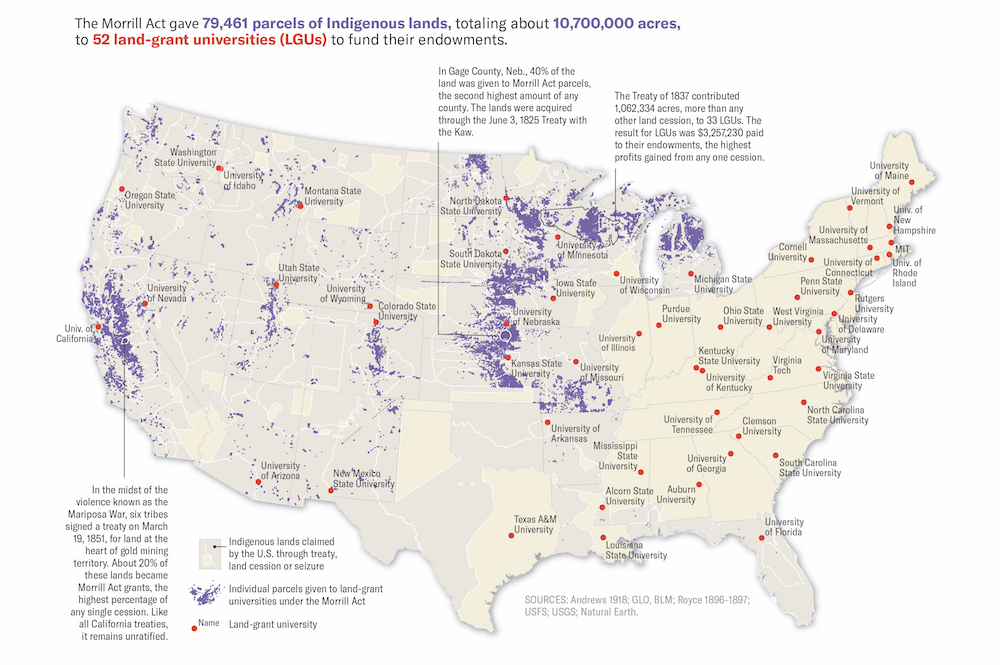
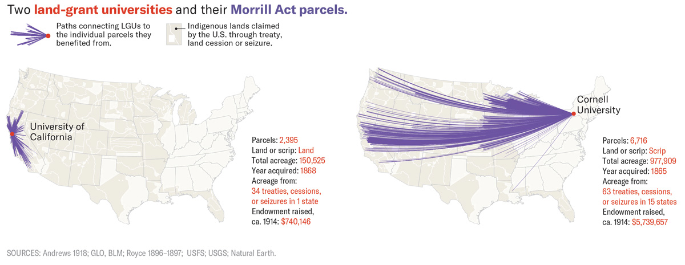
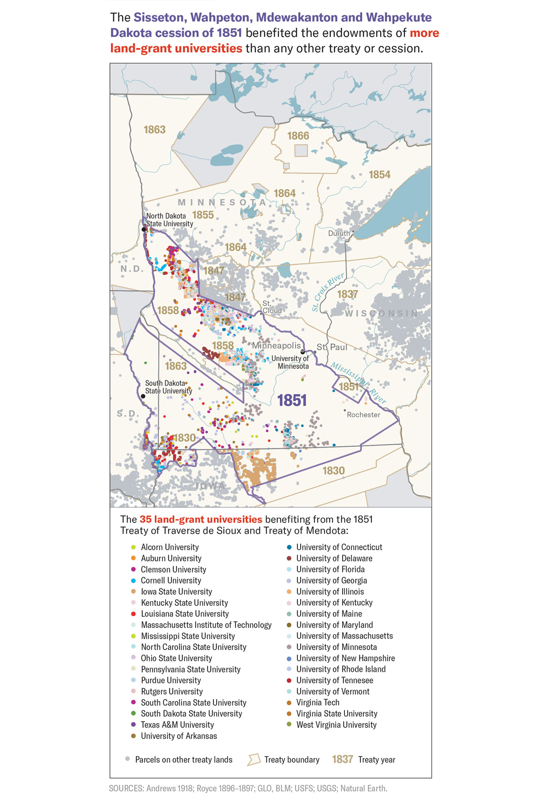
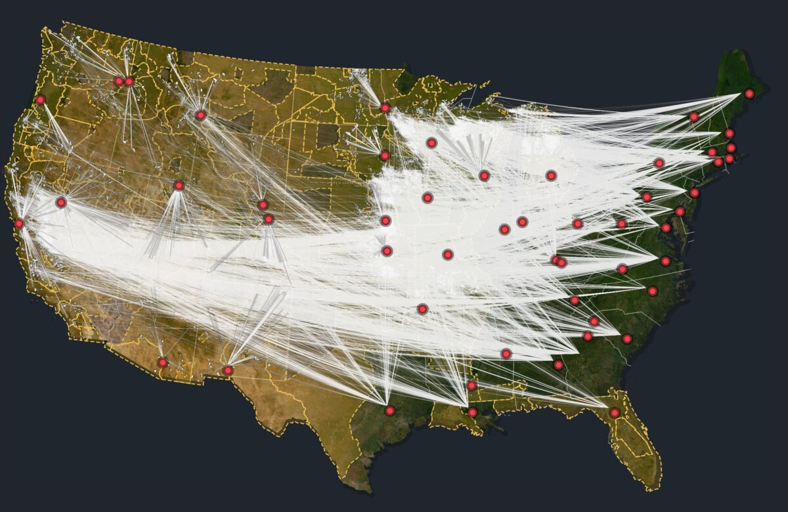
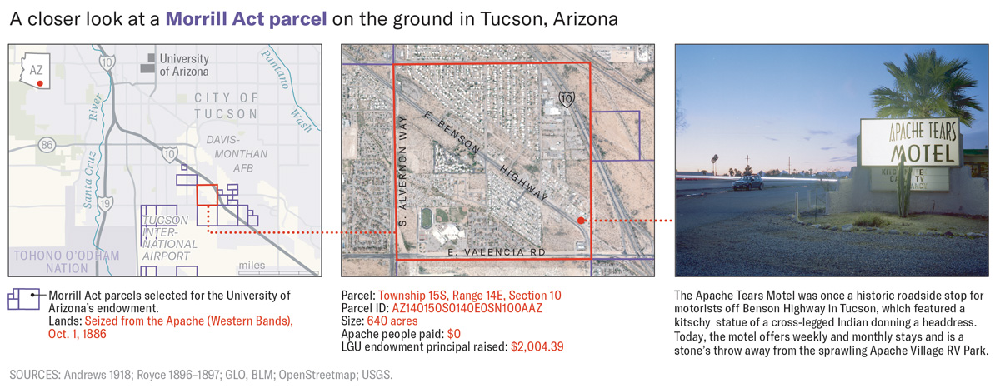

+++
author = "矢崎裕一"
title = "約8万区画の土地台帳を、縮尺を変えて見せる──High Country News「Land-Grab Universities」"
slug = "land-grab-universities"
date = "2026-11-04"
description = "High Country News は約8万区画の土地台帳を、全米の点の地図、割譲地や大学ごとの地図、区画のカードに分け、区画ごとに先住民への支払額と大学が得た推計額を並べました。"
categories = [
    "consume"
]
tags = [
    "データジャーナリズム",
    "Sigma Awards",
    "地図",
    "Margaret Pearce",
    "High Country News"
]
image = "images/national-parcels-map.jpg"
series = ["dataviz-journalism"]
series_weight = 2
seriesByline = "Robert Lee・Tristan Ahtone・Margaret Pearce"
seriesTitle = "8万区画を縮尺で分けて見せる──Land-Grab Universities"
+++

High Country News は、モリル法で大学の財源になった約8万区画の土地台帳を、縮尺の違う三つの見せ方に分けました。全米の点の地図、割譲地や大学ごとの地図、そして区画のカードです。区画ごとに、先住民に払われた額と、大学が得た額の推計を並べています。大学が得た額は売却の記録ではなく、州ごとの1エーカー平均を区画の面積に割り振った推計値です。

作品は2020年3月30日に公開された「Land-grab universities」です。本文は歴史家の Robert Lee（ロバート・リー）と、HCN の Tristan Ahtone（トリスタン・アトーン）が書きました。地図の作り手は2系統あります。本文と印刷版の地図は Margaret Pearce（マーガレット・ピアース）、対話型の Web 地図 landgrabu.org は Geoff McGhee（ジェフ・マギー）の設計と Cody Leff（コーディ・レフ）の開発です。Sigma Awards 2021 の受賞作（winner）です。以下は本文、方法論の記事、landgrabu.org、公開データに沿って、縮尺の大きい順に読みます。

<!--more-->

## 「寄付」と呼ばれてきた土地を、台帳にする

1862年7月2日、Abraham Lincoln はモリル法に署名しました。州に公有地を与え、その売却益で大学を支える法律です。本文は、この「土地の寄付」という語られ方を冒頭で否定します。

> Behind that myth lies a massive wealth transfer masquerading as a donation.

寄付という神話の裏に、寄付を装った大規模な富の移転がある、という一文です。続けて、なぜそれが見えなかったかを書きます。

> But with a footprint broken up into almost 80,000 parcels of land, scattered mostly across 24 Western states, its place in the violent history of North America's colonization has remained comfortably inaccessible.

約8万区画が西部24州に散らばっていたため、植民地化の歴史での位置が見えないままだった、という要旨です。散らばりそのものが「見えなさ」の原因だった、と読めます。

台帳づくりは、Lee の方法論の記事に7段階で書かれています。土地局の特許記録から区画を抜き出し、各州の付与面積の99%超を集めました。区画の中心点を Charles Royce の割譲地図に重ね、どの割譲（land cession）で取られた土地かを結びつけています。

データは GitHub で、Open Database License と CC BY-SA 3.0 で公開されています。筆者が Parcels.csv を集計すると79,461行で、支払額の合計は $397,247 でした。本文の「40万ドル未満」と合います。支払いが $0 の区画は29.8%で、「4分の1以上」とも合います。

## 全米の点の地図──8万区画を一枚に置く

Pearce の講演の告知（University of Minnesota Northrop、2022年）は、地図の設計をこう説明しています。

> Cartographer Margaret Pearce will share how the maps and graphs are designed to amplify the project at multiple scales ...

地図とグラフは、複数の縮尺で働くよう設計された、という要旨です。告知文なので、本人の言葉か主催者の要約かは区別できません。

いちばん大きな縮尺は全米の地図です。本文で最初の Pearce の地図は、79,461区画・約1,070万エーカーが52大学に与えられた、という見出しで始まります。

Map by Margaret Pearce／High Country News「Land-grab universities」より引用

区画は紫の小さな塗り、大学は赤い点です。背景のベージュは、条約・割譲・押収で合衆国が得た先住民の土地です。紫の区画は西部と中西部に集まり、赤い点の多くは東部にあります。

2020年4月6日に公開された Web 地図も、全体はまず点で見せます。アプリに埋め込まれた Mapbox のスタイルでは、背景は暗い青灰色です。区画の中心点はシアン（#8ef7fb）で、半径は0.5〜1ピクセルと小さく、ズーム9で消えます。代わりにズーム8から、区画の形が白い点線の輪郭で現れます。

点の地図は、8万の区画を一つずつ残したまま分布だけを見せる段階だと読めます。どの区画がどの大学のものかは、次の縮尺が担います。

## 割譲地と大学ごとの地図──遠くの土地を線で結ぶ

本文によると、西部の州は州内から区画を選びました。東部・南部、中西部の一部の州には scrip（土地の引換券）が渡され、西部の土地を選ぶのに使われました。

> In fact, the grants were as big or bigger than major cities, and were often located hundreds or even thousands of miles away from their beneficiaries.

付与地は大都市ほどの広さで、受益校から何百、何千マイルも離れていることが多かった、という要旨です。Pearce は大学ごとの地図で、この距離を見せました。

Map by Margaret Pearce／High Country News「Land-grab universities」より引用

凡例は「大学と、財源になった個々の区画を結ぶ線」です。University of California は州内の土地で2,395区画、線は州内に収まります。Cornell University は scrip で6,716区画を得て、土地は15州の63の割譲などに由来します。1914年ごろの元本は、UC が $740,146、Cornell が $5,739,657 です。

割譲地を単位にした地図もあります。1851年のダコタの割譲地の地図です。

Map by Margaret Pearce／High Country News「Land-grab universities」より引用

境界の中の区画は、受益した35大学ごとに色分けされ、ほかの割譲地の区画は灰色です。本文によると、この割譲の約83万エーカーが35大学の財源になりました。University of Minnesota には、ダコタへの支払い1ドルにつき $250 が入ったとあります。

Web 地図は、この線を全大学に広げました。区画から受益州の大学へ、deck.gl の ArcLayer で弧を引いています。弧の出発点はシアン系、終点は赤橙で、本数の多い大学ほど線は細くなります。サイトの注記も「This map connects Indigenous land (in blue) redistributed to universities (in red)」です。

High Country News（Web App Design: Geoff McGhee、Development: Cody Leff）／High Country News「Land-grab universities」より引用

割譲地の境界は金色の破線です。線は道でも川でもなく、区画と大学の「つながり」を表します。**この縮尺で初めて、土地と大学の距離そのものが見える**と読めます。

## 区画のカードと、推計という但し書き

いちばん小さな縮尺は1区画です。本文には、Kalen Goodluck（ケイレン・グッドラック）の写真の下に項目を決まった順で並べたカードが14枚（12区画）あります。写真は鉄道や墓地、スクラップ置き場など、いまその場所にあるものです。

最初のカードは、California の Sunol にある Niles Canyon Railway の区画です。

- PARCEL ID：CA210040S0010W0SN020AE½SWAL
- OWNERSHIP TRANSFER METHOD：Seized by unratified treaty, May 28, 1851
- GRANTED TO：State of Alabama
- FOR THE BENEFIT OF：Auburn University
- AMOUNT PAID FOR INDIGENOUS TITLE：$0
- AMOUNT RAISED FOR UNIVERSITY：$72.01

California の土地が、Alabama 州を経て Auburn 大学の財源になっています。scrip の仕組みが「GRANTED TO」と「FOR THE BENEFIT OF」の2行に出ています。金額は、二つの数字を文字のまま並べています。

Arizona の節には、地図・空中写真・写真の3枚をつないだ図があります。

Map by Margaret Pearce／High Country News「Land-grab universities」より引用

市の地図、1区画を赤枠で囲んだ空中写真、地上の写真と、一つの図の中で縮尺を下げています。区画は1886年に Apache から押収された640エーカーで、支払いは $0、大学の元本は $2,004.39 です。

ここで、大学側の数字の性質を確かめます。方法論の第7段階です。

> Using the principal raised and value of the unsold land for each state's grant, we calculated the average contribution to endowment per acre, then multiplied that average by the number of acres in a parcel to estimate each parcel's average contribution to an endowment.

州ごとに元本と売れ残り地の価値から1エーカー平均を出し、区画の面積を掛けた、という要旨です。「大学が得た額」は売却記録ではなく推計値です。先住民への支払額も、割譲1件の総額を面積で割り振っています。

筆者は CSV で、Sunol の同じ section の区画を比べました。Auburn 分は80エーカーで $72.01、隣の UC 分は39.84エーカーで $195.90 です。1エーカー当たり約 $0.90 と約 $4.92 です。州ごとの売り方の違いが、推計値にそのまま出ていると読めます。

Web 地図は、精度の列ごとに塗りを替えます。方法論では、面積の99%は1エーカー単位、1%は1平方マイル単位の精度です。スタイルでは Accuracy 列の Aliquot と Section に別の塗りのパターンを当てています。この二つが方法論の1エーカーと1平方マイルの精度に当たると読めます。

### 見せ方とデータの対応

| 縮尺と媒体（作り手） | データ | 見た目・素材への対応 |
|---|---|---|
| 全米の地図（本文・印刷版、Pearce） | 区画、割譲地、大学 | 区画は紫の塗り、大学は赤い点と名前、割譲地はベージュの面 |
| 全米の地図（Web、McGhee・Leff） | 区画の中心点 | シアンの点。ズーム8以上で白い点線の輪郭に替わる |
| 大学ごとの地図（本文、Pearce） | 区画と受益大学の対応 | 大学の赤い点から区画へ伸びる紫の線。区画数・面積・元本の数字を添える |
| 割譲地の地図（本文、Pearce） | 割譲地の区画と受益大学 | 割譲地の境界線の中で、区画の点を大学ごとに色分け |
| 区画と大学の弧（Web、McGhee・Leff） | 区画 → 受益州の大学 | 弧。出発点はシアン系、終点は赤橙。本数が多いほど細い |
| 割譲地の境界（Web、McGhee・Leff） | Royce の割譲区域 | 金色の破線と、セリフ体の斜体のラベル |
| 位置の精度（Web、McGhee・Leff） | Accuracy 列（Aliquot／Section） | 精度ごとに塗りのパターンを替える |
| 区画のカード（本文、写真は Goodluck） | CSV の1行 | 現地の写真の下に、ID、譲渡の方法、付与州、受益大学、2つの金額を文字で並べる |

## 第三者はこの作品をどう見たか

地図制作者のブログ Map of the Week は、2020年4月8日にこの作品を取り上げました。

> Here is a detailed view since the map above is hard to read at this size.

全米の地図はこの大きさでは読みにくいので拡大図を載せる、という一文です。土地が遠く離れた場所に及んでいた点も見どころに挙げています。全米の図だけでは足りず、拡大した縮尺が要ることを、読み手の側から示した評です。

Tiara Roxanne（ティアラ・ロクサーヌ）は2021年2月、先住民のデータ主権（IDS）の観点から論じました。

> By organizing this data utilizing differing digital markers (graph, table, map), the project contributors create a space for IDS.

グラフ・表・地図という異なる形で整理したことが、データ主権の場をつくった、という評価です。デジタル基盤に植民地主義が埋め込まれていることへの注意も添えています。

歴史家の Jon Parmenter（ジョン・パーメンター）は、*Native American and Indigenous Studies* 誌2021年春号のフォーラムを紹介しました。主題の一つに、特定の収奪と特定の大学の利益を結んで示した地図の手法の力を挙げています。

作品は George Polk Award（教育報道部門）と IRE Award も受けました。

## 使い道

この作品から可視化の仕事に持ち帰れることは、一つの台帳を縮尺ごとに分けて見せる方法です。

全体の分布は点で見せ、近づいたら形に替えます。8万の区画を、まとめずに残すためです。離れた二者の関係は線にします。表より、距離ごと伝わります。1件の記録はカードにして、数字を文字で並べます。棒にすると $0 は長さを持ちませんが、文字なら「$0」がそのまま読めます。

もう一つは、推計値を推計値として扱うことです。方法論は大学側の額を州平均の割り振りだと明記し、データも公開しました。確からしさを読者が確かめられる形にしておくことが、強い主張を支えます。

## 参考・出典

**一次情報**

- Robert Lee & Tristan Ahtone「Land-grab universities」High Country News、2020年3月30日. https://www.hcn.org/issues/52.4/indigenous-affairs-education-land-grab-universities
- Robert Lee「How we investigated the land-grant university system」High Country News、2020年3月30日. https://www.hcn.org/articles/indigenous-affairs-education-how-we-investigated-the-land-grant-university-system/
- Land-Grab Universities（対話型サイト。クレジット、データのライセンス）. https://www.landgrabu.org/
- landgrabu.org のアプリの JS（Mapbox のスタイルと deck.gl の arc-layer）. https://www.landgrabu.org/app-0797f4bb73a5a4989184.js
- HCNData/landgrabu-data、README. https://raw.githubusercontent.com/HCNData/landgrabu-data/master/README.md
- HCNData/landgrabu-data、Parcels.csv. https://raw.githubusercontent.com/HCNData/landgrabu-data/master/Morrill_Act_of_1862_Indigenous_Land_Parcels_Database/CSVs/Parcels.csv
- Kalen Goodluck, Tristan Ahtone & Robert Lee「The land-grant universities still profiting off Indigenous homelands」High Country News、2020年8月18日. https://www.hcn.org/articles/indigenous-affairs-the-land-grant-universities-still-profiting-off-indigenous-homelands
- Sigma Awards 2021 の作品ページ（応募書類の原文と日本語訳）. https://sigma-awards.data-visualization.jp/entries/2021-s-0032/
- High Country News「'Land-Grab Universities' wins big」. https://www.hcn.org/?p=121248
- University of Cambridge「Historian wins major journalism award for Indigenous land project」. https://www.cam.ac.uk/research/news/historian-wins-major-journalism-award-for-indigenous-land-project
- University of Cambridge「The great university land grab」. https://www.cam.ac.uk/stories/great-university-land-grab
- Northrop, University of Minnesota「Keeping Accountability at the Table: Mapping Land-Grab and What's Next」2022年10月20日. https://www.northrop.umn.edu/events/keeping-accountability-table-mapping-land-grab-and-next-2022

**第三者評価**

- Map of the Week「Land Grab Universities」2020年4月8日. https://mapoftheweek.blogspot.com/2020/04/land-grab-universities.html
- Tiara Roxanne「Indigenous Data Sovereignty and the Land Grab Universities Project」Heinrich-Böll-Stiftung, Gunda-Werner-Institut、2021年2月11日. https://www.gwi-boell.de/en/2021/02/11/indigenous-data-sovereignty-and-the-land-grab-universities-project
- Jon Parmenter「Assessing Cornell's Response to Revelations it was Funded by Taking Indigenous Land」History News Network、2022年8月11日. https://historynewsnetwork.org/article/183730
