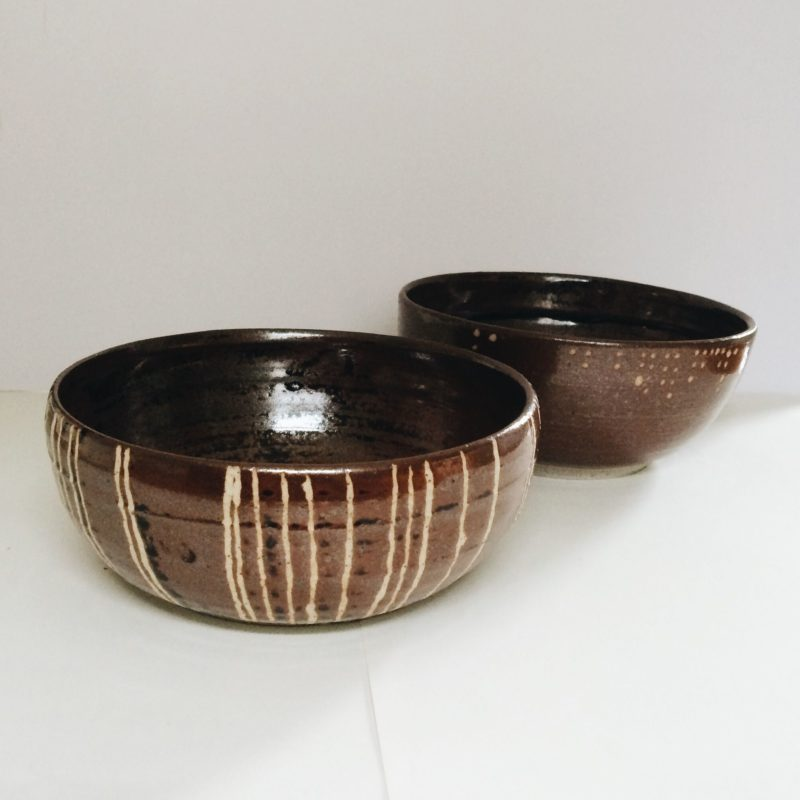
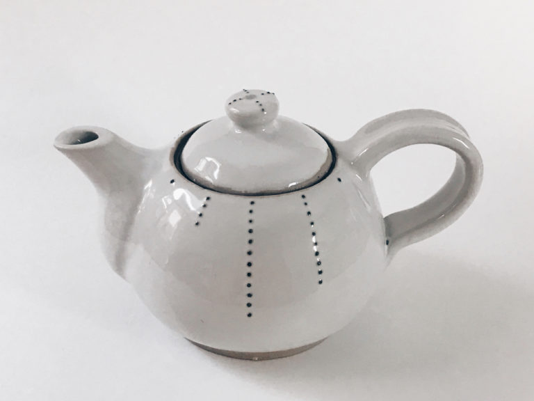
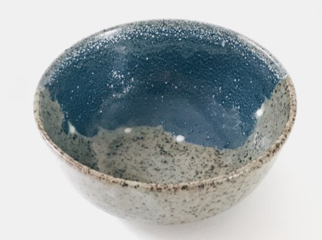
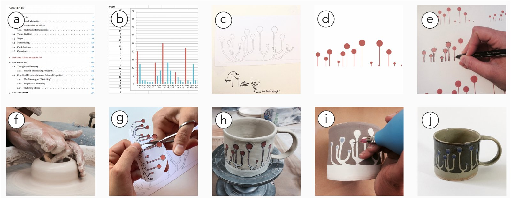

+++
author = "Yuichi Yazaki"
title = "Patterns Without a Legend, Painted on Everyday Tableware: Alice Thudt's Life in Clay"
slug = "life-in-clay"
date = "2026-11-05"
description = "Alice Thudt turned data from her own life and the lives of people close to her into patterns with no legend or axes, and painted them on tableware used every day. She writes that she chose each vessel's shape and function to suit the experience she wanted to evoke and the person who would receive it."
categories = [
    "consume"
]
tags = [
    "data physicalization"
]
image = "images/skype-call-bowls.jpg"
+++

Alice Thudt turned data from her own life and the lives of people close to her into patterns with no legend and no axes, and painted them on tableware used every day. The series is called *Life in Clay*. Her Skype call history with her parents went onto the cereal bowls she used each morning. The messages containing "love" that she and her partner exchanged went onto a teapot the two of them use. Thudt writes that she chose each vessel's shape and function to suit the experience she wanted to evoke and the person who would receive it.

At the time, Thudt was a PhD student in Computational Media Design at the University of Calgary. The work began as a pottery hobby and later became part of her doctoral research. She presented it in 2017 in the CHI workshop paper "Data Craft," and the same year it received an Honourable Mention at the Kantar Information is Beautiful Awards. Below, I read it vessel by vessel, following that paper, her doctoral dissertation, and the podcast Data Stories #112, on which she appeared.

<!--more-->

## A Pottery Hobby Meets Personal Data Research

Data Stories #112 was published on January 3, 2018, with Moritz Stefaner as the host. The quotes from the episode in this article come from the automatic transcript on the show's site (archive.datastori.es), so they may differ in small ways from the audio.

Thudt says she started pottery about two years before the recording. As her skills improved she was drawn to decoration, and that connected with personal data, the topic of her doctoral research. She made "maybe about 15" pieces and gave most of them to family and friends. The artist's official website states the aim of the work as giving personal data a presence as an object that you can touch, grow attached to, and use every day.

Her research presentation is the 2017 workshop paper "Data Craft: Integrating Data into Daily Practices and Shared Reflections." It is a five-page paper by Thudt, Uta Hinrichs, and Sheelagh Carpendale, submitted to a CHI 2017 workshop. It defines data craft as follows.

> We define data craft as a practice at the intersection of personal visualization and manual crafting to create physical and functional mementos

In other words, it is a practice that sits where personal visualization meets handcraft, and that makes mementos you can use.

The paper was incorporated into Chapter 9, "Data Craft" (pp.157–168), of her 2018 dissertation, *Visualizations for Personal Reflection and Expression*. Thudt also has a chapter in the book *Making with Data* (edited by Huron, Nagel, Oehlberg, and Willett; CRC Press): section 1.2, "Life in Clay" (pp.51–62, DOI 10.1201/9781003264903-2), in the Handcraft part. I have not read the text of that chapter.

## Her Parents' Calls, Painted on Morning Cereal Bowls

Thudt was a doctoral student in Canada while her parents lived in Germany, and they kept in touch mostly over Skype. On the show, the first work she mentioned was the pair of cereal bowls depicting this call history. dataphys.org dates the work to 2015.

Source: Alice Thudt / dataphys.org, "2015 – Life in Clay: Sharing Memories through Data Pottery"

According to the paper, both bowls lay out three years of calls, counted from when she left home, along a timeline.

> on one bowl, each call is depicted as a line; on the other bowl calls are shown as dots with one dot representing 5 minutes of call time.

On one bowl each call is a single line; on the other the call time is shown as dots, with one dot standing for 5 minutes. The dissertation says the same.

The description on dataphys.org disagrees with this. It says one line is "a day on which we Skyped" and one dot is "10 minutes of calls." This article follows the paper and dissertation, which the artist wrote herself.

The paper also gives the reason for choosing cereal bowls. They are used every morning, so she meets the data and its meaning every day. She gave one to her parents and kept one herself. The intention, she says, was to remind them to stay in touch. The kind of vessel decides when the data is seen, and giving one bowl to each side decides who sees it; that is how I read it.

## A Teapot for Two, a Bowl Like a Journey

The Love Teapot (2016) is a memento of her relationship with her partner. It depicts the text messages containing the word "love" that the two exchanged since they started dating. One dotted line is one year, and one dot is 10 messages.

Source: Alice Thudt / dataphys.org, "2015 – Life in Clay: Sharing Memories through Data Pottery"

The paper explains that there are many dots during their long-distance period, and fewer after they moved in together, since they could talk in person. She made it a teapot because it is a shared tool: the two can look back on how the relationship has changed while drinking tea together.

The Moray Coastal Trail Bowl commemorates a trail she hiked with a friend in Scotland, and it was a gift for that friend. The boundary between two glazes represents the coastline they walked, and the white dots on the boundary mark the places where they camped. Its shape resembles the bowl they used during the trip.

Source: Alice Thudt, Uta Hinrichs, Sheelagh Carpendale / "Data Craft: Integrating Data into Daily Practices and Shared Reflections" (2017), Figure 7

In the paper, Thudt describes how she decides on a vessel as follows.

> I decide on the associations and encounters I want to enable and take the personality of the pot's recipient into consideration. This influences the shape and function of the pot I make as well as how it visually reflects the data.

She decides which associations and encounters she wants to bring about and also considers the recipient's personality, and this shapes the vessel's form and function and how the data appears.

The table below includes the other vessels as well. The last three appear only on dataphys.org or on the show.

| Vessel | Data | Mapping to the visuals | Why this vessel | Source |
|---|---|---|---|---|
| Parents' Call Bowls (2015) | Skype calls with her parents (three years) | One call = one line; on the other bowl, one dot = 5 minutes of calls | Cereal bowls used every morning; one for her parents, one for herself | Paper, dataphys.org (year) |
| Love Teapot (2016) | Messages containing "love" | One dotted line = one year, one dot = 10 messages | A shared tool for drinking tea together | Paper, dataphys.org (year) |
| Moray Coastal Trail Bowl | A trail hiked with a friend | Glaze boundary = coastline, white dots = campsites | A shape like the bowl used on the trip | Paper |
| Productivity bowl (2016) | A partner's year of work | Outside = git commits, inside = emails sent per month | A birthday present | dataphys.org |
| Dissertation mug | The structure of a friend's dissertation | How the chapters divide, and the page count of each chapter | For a friend who loves tea, as a "trophy" for the work | Data Stories |
| Father's bicycle vessel | Three years of her father's cycling | A pattern that looks like turning wheels; about three kinds of data | A gift for her father | Data Stories |

## No Legend, and the Kiln Takes Over

None of the vessels comes with a legend. The paper says this.

> I do not include legends so the pots reveal their meaning only to insiders or through storytelling.

Without a legend, a vessel's meaning is clear only to people who know the background or have heard the story. On the show she says she puts neither axes nor numbers on it ("I don't put any axes or numbers on it.").

The dissertation also addresses this ambiguity from the standpoint of privacy.

> Keeping the data patterns consciously ambiguous allows me to maintain control over the aspects of a story I want to share.

By keeping the patterns deliberately ambiguous, she can decide which aspects of the story to show.

The dissertation's Figure 42 summarizes the production process in ten photographs. She chooses a data source, works out the mapping with digital tools and sketches, and creates the pattern and refines it by hand. Then she tries the form on the potter's wheel, transfers the pattern with a stencil, decorates, and finishes.

Source: Alice Thudt / doctoral dissertation *Visualizations for Personal Reflection and Expression* (University of Calgary, 2018), Figure 42

According to the show, she makes the basic shapes in Excel or Tableau, prints them at actual size to fit the vessel's dimensions, and transfers them.

In a high-temperature kiln the glaze flows, so fine detail is not possible. According to Thudt, her first trials used geometric patterns.

> It was always moving and organic in the end. So it makes sense to sometimes just go for the more organic patterns in the first place.

Since the results always came out moving and organic, she says, it makes sense to choose organic patterns from the start. Elsewhere she also says, "I would not want it to be more precise in some ways." This can be read as a record of a maker who chose how to draw on the premise that the material is imprecise.

Thudt does not expect anyone to read the vessels in detail.

> I think a lot of these turn out to be more symbolic than anything else.

Many of them, she says, work as symbols more than anything else. She also says she does not expect anyone to sit down and read out the details. **The purpose of the visualization appears to have shifted from getting people to read accurately to reminding them of a relationship or an event each time they use it; that is how I read it.**

## How Third Parties Saw the Vessels

On the same episode, Stefaner describes the patterns as lying "between decoration and chart."

> I think it works as just an organic decoration pattern, but you can clearly see, like, size differences or arrangement differences. So it's nicely in between decoration and readable chart, I think.

It works as an organic decoration, but differences in size and arrangement are clearly visible; it sits between decoration and a readable chart, he says.

He also pointed out an asymmetry in gifts. This came in response to Thudt saying that the making process is more of a reflection than the finished piece.

> for you, it serves as a meditation on a person and the topic. ... and the other person gets just, just like the end of that.

For the maker it is a long meditation on the person and the subject, while the recipient gets only the end result. Thudt herself, speaking of her father's bicycle vessel, says she does not know whether he can tell which data corresponds to which pattern.

At the Information is Beautiful Awards 2017, the work received an Honourable Mention in the People, Language & Identity category. I have not found the judges' comments. That a handcrafted piece of tableware was recognized at a data visualization award can be read as meaningful in itself.

On dataphys.org, the researchers' collection of examples, it was registered by Pierre Dragicevic and classified as "Passive physical visualization." Its tags include mementos, personal data, and self-logging, which places it as a work of mementos and self-tracking. The 2025 VISAP Pictorial "Balaton Borders" (Gyeviki, Minkó) cites Thudt and colleagues in a single sentence as a precedent for data craft in ceramics.

The preface to the Handcraft part of *Making with Data* is written by Carpendale and Lora Oehlberg. Carpendale was Thudt's advisor and co-authored the paper, so this article does not count it as a third-party assessment.

## Takeaways

What we can take from Life in Clay to our own visualization work is **deciding in advance, as part of the design, who will look at the chart and when**. Thudt decided each vessel's shape and function from the experience she wanted to evoke and the person who would receive it: the morning bowl, the teapot for two, the bowl like a journey. In every case, the choice of vessel can be read as having already decided when the data is seen and by whom.

For on-screen visualization too, we can ask who will see this chart, when, and where. The answer changes how much of a legend to add and how much detail to draw. By leaving out the legend, Thudt's vessels limited their audience to people who know the meaning. This can be read as an example of deciding whether to add or cut explanation according to the range of people she wanted to show it to.

Her handling of the material is also instructive. Because the glaze flows, Thudt chose organic patterns from the start. It is an example of deciding the level of detail to draw in advance, to fit the precision of the finished piece.

Thudt herself, however, limits how far this practice can be generalized.

> These reflections provide anecdotal evidence from a personal perspective.

The dissertation says that these reflections are anecdotal evidence from a personal perspective, and that whether they apply more broadly is a question for future work.

## References

**Primary sources**

- dataphys.org, "2015 – Life in Clay: Sharing Memories through Data Pottery" (includes quotes from the artist's text and a description of the work): https://dataphys.org/list/life-in-clay-sharing-memories-through-data-pottery/
- Alice Thudt, "Life in Clay" (the artist's official website): https://www.alicethudt.de/projects/life-in-clay
- Thudt, A., Hinrichs, U., Carpendale, S. (2017). Data Craft: Integrating Data into Daily Practices and Shared Reflections. CHI 2017 Workshop on Quantified Data & Social Relationships. PDF: https://research-repository.st-andrews.ac.uk/bitstream/handle/10023/10910/Thudt_DataCraft_CHI2017.pdf?sequence=1 / Bibliographic record: https://research-repository.st-andrews.ac.uk/handle/10023/10910?show=full
- Thudt, A. (2018). *Visualizations for Personal Reflection and Expression*. PhD dissertation, University of Calgary, Chapter 9 "Data Craft," Figure 42, 12.4. doi:10.11575/PRISM/31806 / https://doi.org/10.11575/PRISM/31806 / Record: http://hdl.handle.net/1880/106519
- Data Stories #112 "Data Pottery with Alice Thudt" (2018-01-03, interview with the artist): https://datastori.es/112-data-pottery-with-alice-thudt/ / Automatic transcript: https://archive.datastori.es/episode/112
- Information is Beautiful Awards, "Life in Clay" (the artist's entry text): https://www.informationisbeautifulawards.com/showcase/2393-life-in-clay
- Thudt, A. "Life in Clay." Huron, S., Nagel, T., Oehlberg, L., Willett, W. (eds.), *Making with Data*, CRC Press, 1.2, pp.51–62 (text not read). doi:10.1201/9781003264903-2 / https://doi.org/10.1201/9781003264903-2 / Table of contents: https://www.routledge.com/Making-with-Data-Physical-Design-and-Craft-in-a-Data-Driven-World/Huron-Nagel-Oehlberg-Willett/p/book/9781032182223 / https://makingwithdata.org/press

**Secondary sources**

- Moritz Stefaner's remarks (Data Stories #112, automatic transcript): https://archive.datastori.es/episode/112
- Information is Beautiful Awards 2017, "The Winners: People, Language & Identity": https://www.informationisbeautifulawards.com/news/262-the-winners-people-language-identity
- dataphys.org classification and tags (registered by Pierre Dragicevic): https://dataphys.org/list/life-in-clay-sharing-memories-through-data-pottery/
- Gyeviki & Minkó, "Balaton Borders: Data Ceramics for Ecological Reflection" (VISAP'25): https://arxiv.org/pdf/2509.02284
