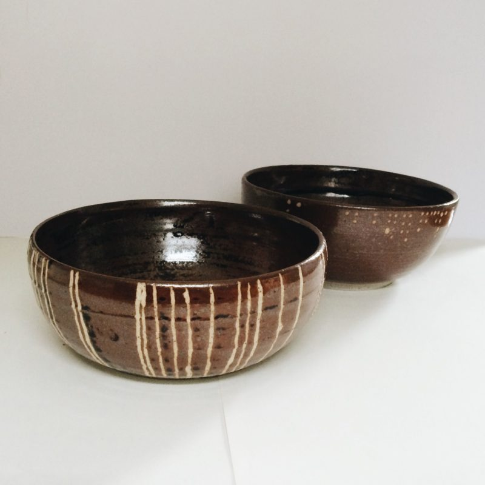
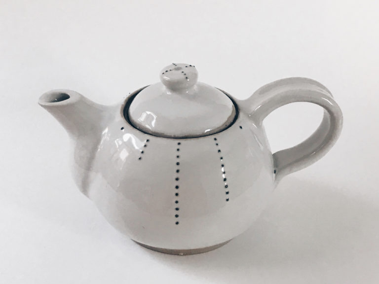
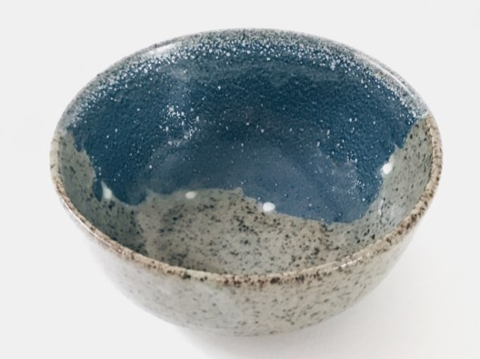
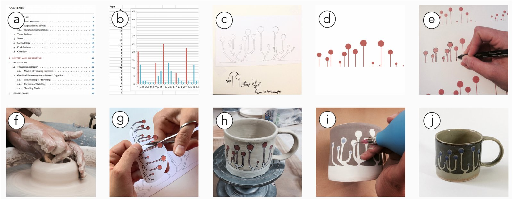

+++
author = "矢崎裕一"
title = "凡例のない模様を、毎日使う器に描く──Alice Thudt の『Life in Clay』"
slug = "life-in-clay"
date = "2026-11-05"
description = "Alice Thudt は、自分と身近な人の暮らしのデータを、凡例も軸もない模様にして、毎日使う食器に描きました。器の形と用途は、思い出させたい経験や受け取る人に合わせて決めたと書いています。"
categories = [
    "consume"
]
tags = [
    "データ物質化"
]
image = "images/skype-call-bowls.jpg"
series = ["data-physicalization"]
series_weight = 35
seriesByline = "Alice Thudt"
seriesTitle = "凡例のない模様を毎日の器に──Life in Clay"
+++

Alice Thudt（アリス・トゥート）は、自分と身近な人の暮らしのデータを、凡例も軸もない模様にして、毎日使う食器に描きました。シリーズの名前は『Life in Clay』です。両親との Skype の通話履歴は、毎朝使うシリアルボウルに描きました。恋人と交わした "love" を含むメッセージは、二人で使うティーポットに描きました。Thudt は、器の形と用途を、思い出させたい経験や受け取る人に合わせて決めたと書いています。

Thudt は制作当時、カルガリー大学の博士課程で Computational Media Design を専攻していました。作品は趣味の陶芸から始まり、のちに博士研究の一部になりました。2017年に CHI のワークショップ論文 "Data Craft" で発表し、同じ年の Kantar Information is Beautiful Awards で Honourable Mention を受けています。以下は、この論文と博士論文、作者が出演したポッドキャスト Data Stories #112 に沿って、器ごとに読みます。

<!--more-->

## 趣味の陶芸が、個人データの研究とつながる

Data Stories #112 は2018年1月3日公開の回で、聞き手は Moritz Stefaner（モーリッツ・ステファナー）です。この記事で引く番組の発言は、番組サイトの自動書き起こし（archive.datastori.es）からの引用で、音声とは細部が違う可能性があります。

Thudt は、陶芸を始めたのは収録の約2年前だと話しています。腕が上がるにつれて加飾に惹かれ、博士研究のテーマだった個人データと結びつきました。作った数は "maybe about 15" で、多くは家族や友人に贈りました。作者の公式サイトは、個人データに「触れて、愛着を持って、毎日使える」物としての存在を与えることを、作品の狙いに挙げています。

研究としての発表は、2017年のワークショップ論文 "Data Craft: Integrating Data into Daily Practices and Shared Reflections" です。著者は Thudt、Uta Hinrichs、Sheelagh Carpendale の3人で、CHI 2017 のワークショップに出した5ページの論文です。データ・クラフトをこう定義しています。

> We define data craft as a practice at the intersection of personal visualization and manual crafting to create physical and functional mementos

個人の可視化と手仕事が交わるところで、使える記念品を作る営み、という定義です。

この論文は、2018年の博士論文 *Visualizations for Personal Reflection and Expression* の第9章「Data Craft」（pp.157–168）に入りました。書籍『Making with Data』（Huron・Nagel・Oehlberg・Willett 編、CRC Press）にも、Thudt の章があります。Handcraft の部の 1.2「Life in Clay」（pp.51–62、DOI 10.1201/9781003264903-2）です。章の本文は、筆者は読めていません。

## 毎朝のシリアルボウルに、両親との通話を描く

Thudt はカナダで博士課程にいて、両親はドイツに住み、連絡はおもに Skype でした。番組で最初に挙げたのが、この通話履歴を描いた2つのシリアルボウルです。dataphys.org は2015年の作品としています。

Alice Thudt／dataphys.org「2015 – Life in Clay: Sharing Memories through Data Pottery」より引用

論文によれば、2つとも、家を離れてからの3年分の通話を時間軸に並べています。

> on one bowl, each call is depicted as a line; on the other bowl calls are shown as dots with one dot representing 5 minutes of call time.

一方は通話1回を線1本で、もう一方は通話時間を点で表し、点1つが5分、という記述です。博士論文も同じです。

dataphys.org の説明は、これと食い違います。線1本は「Skype した日1日」、点1つは「通話10分」と書いています。この記事は、作者が書いた論文と博士論文の記述に合わせます。

器にシリアルボウルを選んだ理由も、論文に書かれています。毎朝使う器なので、データとその意味に毎日出会える。1つは両親に贈り、1つは Thudt が手元に置きました。連絡を取り合うことを思い出させる意図だったといいます。器の種類が「いつ見るか」を、2つに分けて贈ったことが「誰が見るか」を決めている、と読めます。

## 二人で使うティーポット、旅に似せたボウル

Love Teapot（2016）は、恋人との関係の記念品です。交際を始めてから二人が交わした、"love" という語を含むテキストメッセージを描いています。点線1本が1年、点1つが10通です。

Alice Thudt／dataphys.org「2015 – Life in Clay: Sharing Memories through Data Pottery」より引用

遠距離の時期は点が多く、一緒に暮らしてからは直接話せるので減った、と論文は説明しています。ティーポットにしたのは、二人でお茶を飲みながら関係の移り変わりを振り返れる、共有の道具だからです。

Moray Coastal Trail Bowl は、友人とスコットランドで歩いたトレイルの記念で、友人への贈り物です。2種類の釉薬の境目が歩いた海岸線を、境目の上の白い点が野営した地点を表します。形は、旅のあいだ使ったボウルに似せました。

Alice Thudt, Uta Hinrichs, Sheelagh Carpendale／"Data Craft: Integrating Data into Daily Practices and Shared Reflections"（2017）Figure 7 より引用

Thudt は器の決め方を、論文でこう書いています。

> I decide on the associations and encounters I want to enable and take the personality of the pot's recipient into consideration. This influences the shape and function of the pot I make as well as how it visually reflects the data.

どんな連想と出会いを生みたいかを決め、受け取る人の人柄も考える。それが器の形と用途、データの見せ方を左右する、という説明です。

ほかの器も含めて表にします。下の3点は dataphys.org か番組にだけ出てきます。

| 器 | データ | 見た目への対応 | 器の選び方 | 出典 |
|---|---|---|---|---|
| Parents' Call Bowls（2015） | 両親との Skype 通話（3年分） | 通話1回＝線1本。もう一方は点1つ＝通話5分 | 毎朝使うシリアルボウル。両親と自分で1つずつ | 論文、dataphys.org（年） |
| Love Teapot（2016） | "love" を含むメッセージ | 点線1本＝1年、点1つ＝10通 | 二人でお茶を飲む共有の道具 | 論文、dataphys.org（年） |
| Moray Coastal Trail Bowl | 友人と歩いたトレイル | 釉薬の境目＝海岸線、白い点＝野営地 | 旅で使ったボウルに似た形 | 論文 |
| 生産性のボウル（2016） | パートナーの1年の仕事量 | 外側＝git のコミット、内側＝月ごとの送信メール数 | 誕生日の贈り物 | dataphys.org |
| 博士論文のマグ | 友人の博士論文の構成 | 章の分かれ方と、章ごとのページ数 | お茶好きの友人へ、仕事の「トロフィー」として | Data Stories |
| 父の自転車の器 | 父の3年分の自転車走行 | 回る車輪に見える模様。3種類ほどのデータ | 父への贈り物 | Data Stories |

## 凡例を付けず、窯にまかせる

どの器にも、凡例は付いていません。論文はこう書いています。

> I do not include legends so the pots reveal their meaning only to insiders or through storytelling.

凡例を付けないので、器の意味は、事情を知る人か、話を聞いた人にしか分からない、という記述です。番組では、軸も数字も付けないと話しています（"I don't put any axes or numbers on it."）。

博士論文は、このあいまいさをプライバシーの面からも書いています。

> Keeping the data patterns consciously ambiguous allows me to maintain control over the aspects of a story I want to share.

模様を意識してあいまいにしておけば、物語のどの面を見せるかを自分で決められる、という一文です。

制作の手順は、博士論文の Figure 42 に10枚の写真でまとめられています。データ源を選び、デジタルの道具とスケッチで対応を考え、模様を作って手で整える。ろくろで形を試し、ステンシルで模様を移し、加飾して仕上げます。

Alice Thudt／博士論文 *Visualizations for Personal Reflection and Expression*（カルガリー大学、2018）Figure 42 より引用

番組によれば、基本の図形は Excel か Tableau で作り、器の寸法に合わせて原寸で印刷して移します。

高温の窯では釉薬が流れるので、細かい表現はできません。Thudt によれば、最初の試作は幾何学的な模様でした。

> It was always moving and organic in the end. So it makes sense to sometimes just go for the more organic patterns in the first place.

焼き上がりはいつも動きのある有機的な形になったので、はじめから有機的な模様を選ぶ、という発言です。別の箇所では "I would not want it to be more precise in some ways." とも話しています。素材の不正確さを前提に、描き方を選んだ作り手の記録と読めます。

Thudt は、器を細かく読むことを想定していません。

> I think a lot of these turn out to be more symbolic than anything else.

多くは何よりも象徴として働く、という発言です。誰かが座って細部まで読み取るとは思っていない、とも話しています。**可視化の目的が、正確に読み取らせることから、使うたびに関係や出来事を思い出させることへ移っている、と読めます。**

## 第三者はこの器をどう見たか

Stefaner は同じ回で、模様を「装飾とチャートのあいだ」と評しています。

> I think it works as just an organic decoration pattern, but you can clearly see, like, size differences or arrangement differences. So it's nicely in between decoration and readable chart, I think.

有機的な装飾としても成り立つが、大きさや並びの違いははっきり見える。装飾と読めるチャートのあいだにある、という評です。

贈り物の非対称も指摘しました。作る過程のほうが完成品より振り返りになる、と Thudt が話したのを受けた発言です。

> for you, it serves as a meditation on a person and the topic. ... and the other person gets just, just like the end of that.

作り手には相手と題材についての長い思索になるが、受け取る人は最後の結果だけを手にする、という指摘です。Thudt も、父の自転車の器について、どのデータがどの模様か父に見分けられるか分からない、と話しています。

Information is Beautiful Awards 2017 では、People, Language & Identity 部門の Honourable Mention でした。審査講評は見つかっていません。データ可視化の賞の場で、手工芸の食器が評価されたことになる、と読めます。

研究者の事例集 dataphys.org では、Pierre Dragicevic が登録し、"Passive physical visualization" に分類しています。タグには mementos、personal data、self-logging などが並び、記念品と自己記録の作品として置かれています。2025年の VISAP の Pictorial "Balaton Borders"（Gyeviki、Minkó）は、陶器のデータ・クラフトの先行例として、Thudt らを一文で挙げています。

『Making with Data』の Handcraft の部の序文は、Carpendale と Lora Oehlberg が書いています。Carpendale は Thudt の指導教員で論文の共著者なので、この記事では第三者の評価に含めていません。

## 使い道

Life in Clay から可視化の仕事に持ち帰れるのは、**図を見る相手と時刻を、設計の一部として先に決めること**です。Thudt は器の形と用途を、思い出させたい経験と受け取る人から決めました。毎朝のボウル、二人のティーポット、旅に似たボウル。どれも、データを見る時刻と相手が、器を選んだ段階で決まっている、と読めます。

画面の可視化でも、この図は誰が、いつ、どこで目にするのかを問えます。答えによって、凡例をどこまで付けるか、どこまで細かく描くかが変わります。Thudt の器は凡例を付けないことで、意味を知る人を限りました。説明を足すか削るかを、見せたい相手の範囲で決めた例と読めます。

素材の扱いも参考になります。釉薬が流れるので、Thudt ははじめから有機的な模様を選びました。仕上がりの精度に合わせて、描く細かさを先に決めた例です。

ただし、Thudt 自身は、この実践から言えることの範囲を限っています。

> These reflections provide anecdotal evidence from a personal perspective.

博士論文は、これらの省察は個人の視点からの逸話的な証拠で、広く当てはまるかは今後の課題だ、と書いています。

## 参考・出典

**一次情報**

- dataphys.org「2015 – Life in Clay: Sharing Memories through Data Pottery」（作者の文の引用と作品解説を含む）：https://dataphys.org/list/life-in-clay-sharing-memories-through-data-pottery/
- Alice Thudt「Life in Clay」（作者の公式サイト）：https://www.alicethudt.de/projects/life-in-clay
- Thudt, A., Hinrichs, U., Carpendale, S. (2017). Data Craft: Integrating Data into Daily Practices and Shared Reflections. CHI 2017 Workshop on Quantified Data & Social Relationships. PDF：https://research-repository.st-andrews.ac.uk/bitstream/handle/10023/10910/Thudt_DataCraft_CHI2017.pdf?sequence=1 ／ 書誌記録：https://research-repository.st-andrews.ac.uk/handle/10023/10910?show=full
- Thudt, A. (2018). *Visualizations for Personal Reflection and Expression*. 博士論文、カルガリー大学、第9章「Data Craft」、Figure 42、12.4。doi:10.11575/PRISM/31806 ／ https://doi.org/10.11575/PRISM/31806 ／ 記録：http://hdl.handle.net/1880/106519
- Data Stories #112 "Data Pottery with Alice Thudt"（2018-01-03、作者へのインタビュー）：https://datastori.es/112-data-pottery-with-alice-thudt/ ／ 自動書き起こし：https://archive.datastori.es/episode/112
- Information is Beautiful Awards「Life in Clay」（作者による応募文）：https://www.informationisbeautifulawards.com/showcase/2393-life-in-clay
- Thudt, A. "Life in Clay." Huron, S., Nagel, T., Oehlberg, L., Willett, W. (eds.), *Making with Data*, CRC Press, 1.2, pp.51–62（本文は未読）。doi:10.1201/9781003264903-2 ／ https://doi.org/10.1201/9781003264903-2 ／ 目次：https://www.routledge.com/Making-with-Data-Physical-Design-and-Craft-in-a-Data-Driven-World/Huron-Nagel-Oehlberg-Willett/p/book/9781032182223 ／ https://makingwithdata.org/press

**第三者評価**

- Moritz Stefaner の発言（Data Stories #112、自動書き起こし）：https://archive.datastori.es/episode/112
- Information is Beautiful Awards 2017「The Winners: People, Language & Identity」：https://www.informationisbeautifulawards.com/news/262-the-winners-people-language-identity
- dataphys.org の分類とタグ（Pierre Dragicevic 登録）：https://dataphys.org/list/life-in-clay-sharing-memories-through-data-pottery/
- Gyeviki & Minkó, "Balaton Borders: Data Ceramics for Ecological Reflection"（VISAP'25）：https://arxiv.org/pdf/2509.02284
