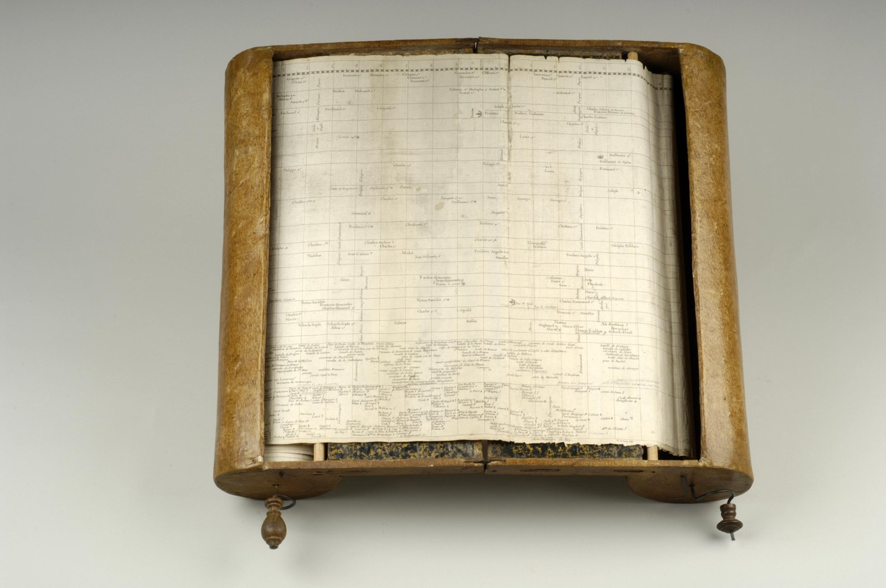
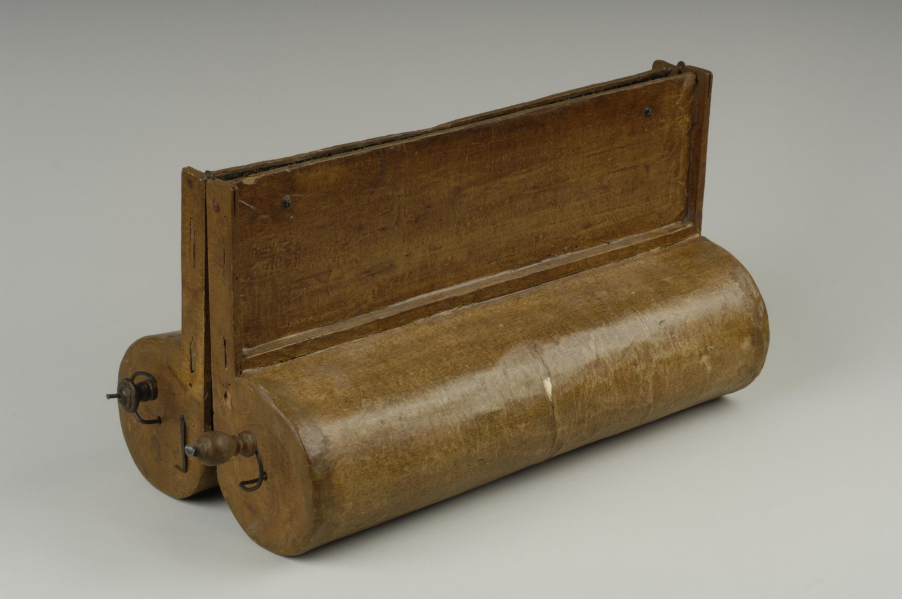

+++
author = "Yuichi Yazaki"
title = "Winding 6,500 Years at 0.1 Inch per Year: Barbeu-Dubourg's Machine chronologique (1753)"
slug = "machine-chronologique"
date = "2026-11-01"
description = "A timeline that lays out about 6,500 years, from the Creation to the 1750s, at an even 0.1 inch per year on a strip of paper about 16.5 m long, which rollers feed through roughly 140 years at a time."
categories = [
    "consume"
]
tags = [
    "data physicalization",
    "timeline",
    "Jacques Barbeu-Dubourg"
]
image = "images/machine-open.jpg"
+++

The Machine chronologique ("chronological machine") is a timeline that lays out about 6,500 years, from the Creation to the 1750s, on a single strip of paper at an even scale of 0.1 inch per year. The strip is about 16.5 m (54 feet) long. It is wound on two rollers and advanced by turning a handle. The reader sees only about 140 years at a time, the part spread on the stand. It was published in Paris in 1753 by the physician Jacques Barbeu-Dubourg.

This article follows a paper (1991) by Stephen Ferguson, Curator of Rare Books at Princeton University Library; the Denis Diderot entry "Chronologique (Machine)" in the *Encyclopédie*, which Ferguson reprints in an appendix; and writing by the design historian Stephen Boyd Davis. dataphys.org, which collects data physicalization works, lists this timeline with the note "Not a physical visualization." This article takes the same premise and reads it as an example of a paper visualization operated by a machine.

<!--more-->

## 1753: Making Chronology Look Like Geography

Barbeu-Dubourg (1709–1779) was a doctor of medicine of the University of Paris and a professor of pharmacy. He was also a friend of Benjamin Franklin. The approval for the timeline is dated May 2, 1752, and the royal privilege for publication May 28, 1753 (Ferguson p.192).

The timeline is a single strip made of 35 copperplate engravings pasted end to end. A 16-page booklet, *Chronographie, ou Description des tems*, came with it. The printed paper alone cost 12 livres; the version "with the machine" cost 15 or 18 livres (Ferguson p.195, p.204).

In the booklet, the author explains why he made it by comparing it with geography. The English translation below is Boyd Davis's.

> Geography has as its object the extent of the earth; Chronology has as its object the succession of time. May not duration be imitated and represented as effectively to the senses, as distinctly as space, and may not intervals of time be as easily counted in degrees?

In short, he asks whether lengths of time can be shown to the senses as clearly as space, and whether intervals of time can be counted off as easily as degrees.

The same booklet contrasts geography as "lively, convenient, attractive" with chronology as "dry, laborious, unprofitable" (Ferguson p.196). The author called his chart a "tableau mouvant & animé" (a moving, living picture).

The same year, in an entry in volume 3 of the *Encyclopédie*, Diderot introduced the chart as one that "saves time for those who know and effort for those who learn" (Ferguson p.219).

## 0.1 Inch per Year, 16.5 m for 6,500 Years

The backbone of the timeline is a single scale running along the length of the paper. According to Diderot, the scale consists of small equal divisions alternating white and black, with as many divisions as there are years from the Creation to the present. One division is one year, and it is 0.1 inch long (Ferguson p.192 n.4).

**Drawing the whole span at the same scale is what produces a length of about 16.5 m.** The figures agree across the sources. According to the *Journal de Trévoux*, the author counted 4,700 years from the Creation to the birth of Christ (Ferguson p.199 n.27). Adding 1753 gives about 6,450 years. Multiplied by 0.1 inch, that is about 645 inches, or about 16.4 m. This is close to the stated total length of "54 feet / 16.5 m." This calculation is mine, not the author's explanation.

Vertically, bands for countries and regions are stacked. In the early part the divisions are labeled "Patriarchs," "Descendants of Cain," and the like; after the Flood, bands for countries such as Egypt and China are added. The bottom row is for "événements mémorables" (memorable events). Diderot called lines perpendicular to the scale "lines of contemporaneity" and lines parallel to it "lines of duration."

> les perpendiculaires à l'échelle chronologique sont des lignes de contemporanéité ; les paralleles à l'échelle chronologique sont des lignes de durée.

That is, things placed on the same vertical line are at the same moment, and the length along a horizontal line is how long something lasted. The correspondence between data and appearance is summarized below.

| Data | Appearance / mechanism | Specifics |
|---|---|---|
| Year | Position along the length of the paper, at the same scale throughout | 0.1 inch per year; alternating white and black divisions |
| Decade boundaries | Dotted vertical lines across the full height of the paper | Every 10 years |
| Major eras | The scale is divided into three | Creation to the founding of Rome, to the birth of Christ, to the present |
| Contemporaneity | Placed on the same vertical line | "Lines of contemporaneity" |
| Duration (reign, lifetime) | Length of a line parallel to the time axis | Start and end read at the ends against the vertical lines |
| Place / category | Vertical bands | A band per country; "memorable events" in the bottom row |
| People and events | Names and short phrases engraved at the corresponding year | Kings, queens, assassins, sages, etc. |
| Year of beginning | A dotted line dropped from the initial of a name to the scale | Abolished in the 1838 edition |
| Occupation, character, moral judgment | Small symbols beside the name | About 80 types, about 83 symbols |
| Range visible at once | The part spread on the stand of the machine | At least 140 years |
| Moving through time | Winding between rollers with the handle | Winding left moves toward the present, right toward the past |

The symbols borrow from astrology, alchemy, pharmacy, Christianity, and other systems. An assassin is an upward-pointing dagger, a person assassinated a downward-pointing dagger, a physician a snake, and a poet a lyre.

The even scale had another effect. Ferguson writes that the number of events becomes density on the paper as it is.

> A glance at the beginning of the line shows long stretches of time with no recorded events; the end of the line (the 1700s) is dense with them.

The observation is that the start of the timeline has long empty stretches with no recorded events, while the end, the 1700s, is crowded with them.

## About 140 Years at a Time

The author put the 16.5 m of paper in a box. According to Diderot's description, the machine is made of two identical halves. Each has a stand on which the timeline is spread (board B, 16 pouces long and 5½ pouces wide), a thin roller to reduce friction, and a roller with a handle. The two ends of the timeline are pasted to the rollers with handles, and turning either one moves the paper from one side to the other.

Source: Rare Book Division, Department of Rare Books and Special Collections, Princeton University Library / dataphys.org

Diderot wrote that the range that can be spread on the stand is "au moins cent quarante ans" (at least 140 years). In the photograph in Ferguson's paper, 150 years, A.D. 360 to 510, are open. 140 years is 14 inches, about 35.6 cm, which fits within the length of board B (about 43 cm). This conversion is also my own calculation.

How to use it is described in the booklet's "Avertissement."

> Are you reading a book of history? Then to see at a glance world events covered by the book, just roll the Carte to the relevant years and there it is!

That is, if you are reading a history book, you can roll the chart to the relevant years and see the world events of the same period at a glance. The booklet goes on to say that you can roll back to Adam and advance to the present to follow the whole axis of time (Ferguson p.197–198).

When not in use, the two halves are folded together, closed, and fastened with clasps.

Source: Rare Book Division, Department of Rare Books and Special Collections, Princeton University Library / dataphys.org

Diderot writes that when closed, the timeline is "à couvert de toutes parts, & fort en sûreté" (covered on all sides and very safe). dataphys.org says it is "folded for transport," but I could not confirm in the primary sources that carrying it was the purpose.

## The Note "Not a Physical Visualization"

The dataphys.org entry was registered by Pierre Dragicevic. Its description begins with the following sentence, and the note follows.

> Before Joseph Priestley published his famous timelines, Frenchman Jacques Barbeu-Dubourg built a 16-meter long timeline showing 140 years of world history, which can be mechanically scrolled and folded for transport. Not a physical visualization but maybe the first "interactive" timeline representation in history.

It says that before Joseph Priestley, a 16 m timeline that could be scrolled mechanically was built; that it is not a physical visualization; but that it may be the first "interactive" timeline representation in history.

"Before Priestley" is correct. Barbeu-Dubourg's timeline dates from 1753, and Priestley's *Chart of Biography* from 1765 (Ferguson p.202 n.29). In a 1768 letter, the author himself wrote that Priestley's chart works on "almost the same principle."

On the other hand, "140 years of world history" is not the period the timeline covers. The timeline depicts the whole span from the Creation to the 1750s; 140 years is the range visible at one time when the machine is opened.

The note "Not a physical visualization" agrees with the distinction in the table. Year, duration, place, and a person's character each correspond to a position, line, text, or symbol on the paper. Data values are not turned into the shape or quantity of an object. All the machine does is the operation of choosing which part of the long paper to show. This series includes the work not as a piece that turns data into the shape of an object, but as **a device for operating a paper visualization by hand**.

## How Third Parties Saw This Timeline

Boyd Davis evaluates it as a forerunner of the evenly spaced time axis.

> It may be the first to use a constant numerical scale for an entire historical period … And it is interactive - slightly.

He says it may be the first to use a constant numerical scale for an entire historical period, and that it is, slightly, interactive. In a 2015 paper he compares it with Barbeau de la Bruyère's Mappemonde of 1750. In the Mappemonde, the number of years per division changes going back in time: 100, then 200, 250, and 500. Barbeu-Dubourg and Priestley, by contrast, "speak with one voice" in holding that an evenly spaced time axis is needed, he argues.

The art historian Astrit Schmidt-Burkhardt gives more weight to the machine side. Her essay has a section titled "CINEMATOGRAPHIC VISION MACHINE."

> The irreversible timeline on which all historical accounts had hitherto rested could at last be recast as a reversible conceptual model. … The idea of the interactive user was born.

Her conclusion is that the irreversible line of time on which historical accounts had rested could at last be recast as a reversible conceptual model, and that the idea of the interactive user was born. The same essay, however, gives the length of the paper as about 6.5 m and the number of symbols as 65, which do not agree with the figures of Ferguson and Boyd Davis.

Ferguson reads it as a product of Enlightenment thought.

> Obviously, the 'machine' or apparatus itself reinforces the ideological message of the time-line. Its significance lies not only in its content, but also in its physical form.

The machine itself reinforces the thinking behind the timeline; its significance lies not only in its content but in its physical form. He also writes that the practice of morally judging people with symbols connects to the tradition of allegory. Sales appear to have been poor, and Ferguson writes, "Apparently only a few machines were sold."

## Takeaways

What we can take from this timeline is a design that keeps the scale fixed and moves only the visible range. To fit the whole on one sheet, you would have to change the scale for older periods. Barbeu-Dubourg kept the scale and chose a form in which the lengthened paper is fed through rollers.

The second is not erasing the blank. Because the scale is even, the earlier periods with few records look empty and the 1700s look packed. The difference in density is itself information, I read. When data is skewed and you are tempted to compress the axis, it is worth first considering what the blank is saying.

The third is to think separately about how the data is mapped and how the mechanism is operated. In this work all the data is on the paper, and the machine only moves the range being viewed. When you make a work with physical objects, putting into words whether the object represents the data or lets people operate how the data is viewed keeps the design from wavering.

Finally, there is a mechanism for accepting readers' corrections. According to Diderot, the author offered a free copy to scholars who wrote in corrections or opinions and sent them back. The Princeton copy also has handwritten additions thought to be by the author himself, such as Franklin's kite experiment (1752) (Ferguson p.207). It can be read as showing that he did not intend to finish a long timeline alone but to correct it through readers' opinions.

## References

**Primary sources**

- Jacques Barbeu-Dubourg, *Chronographie, ou Description des tems*, Paris, 1753 (the booklet and the 35 sheets of the timeline). BnF Gallica: http://gallica.bnf.fr/ark:/12148/bpt6k1314025 (main text not checked; the content is taken from quotations in Ferguson and Boyd Davis)
- Denis Diderot, "Chronologique (Machine)," *Encyclopédie*, vol. 3, 1753. The French text and English translation are from Ferguson (1991), appendix, pp.218–226. English translation by the Collaborative Translation Project: http://hdl.handle.net/2027/spo.did2222.0001.081 (not checked)
- Letter from Barbeu-Dubourg to Franklin, May 8, 1768: https://founders.archives.gov/documents/Franklin/01-15-02-0067 (main text not checked; the English translation is from Ferguson pp.202–203)
- Stephen Ferguson, "The 1753 Carte chronographique of Jacques Barbeu-Dubourg," *Princeton University Library Chronicle* 52(2), 1991, pp.190–230: https://www.princeton.edu/~ferguson/PULC_1991_duBourg.pdf
- Princeton Alumni Weekly, "From Princeton's vault: A chronographic machine," 2011-04-06: https://paw.princeton.edu/article/princetons-vault-chronographic-machine
- dataphys.org, "1753 – Barbeu-Dubourg's Machine Chronologique" (registered by Pierre Dragicevic): https://dataphys.org/list/barbeu-dubourgs-machine-chronologique/

**Secondary sources**

- Stephen Boyd Davis, "The first modern timeline?," *Chronographics*, 2009: https://chronographics.blogspot.com/2009/08/first-modern-timeline.html
- Stephen Boyd Davis, "Chronographics at Princeton," 2009: https://stephenbd.blogspot.com/2009/08/chronographics-at-princeton.html
- Stephen Boyd Davis, "French copy of Barbeu-Dubourg now online," 2011: https://chronographics.blogspot.com/2011/09/french-copy-of-barbeu-dubourg-now.html
- Stephen Boyd Davis, "Beholder of All Ages: The History of the World in a French Mappemonde," *Textimage* n°7, 2015: https://researchonline.rca.ac.uk/1701/1/boyd-davis.pdf
- Astrit Schmidt-Burkhardt, "Learning in the Age of Enlightenment," George Maciunas Foundation (first published in *Bildwelten des Wissens* 7(1), 2009): https://georgemaciunas.com/?p=2803
- Wikipedia, "Jacques Barbeu-Dubourg" (consulted as a supplement for his biography): https://en.wikipedia.org/wiki/Jacques_Barbeu-Dubourg
