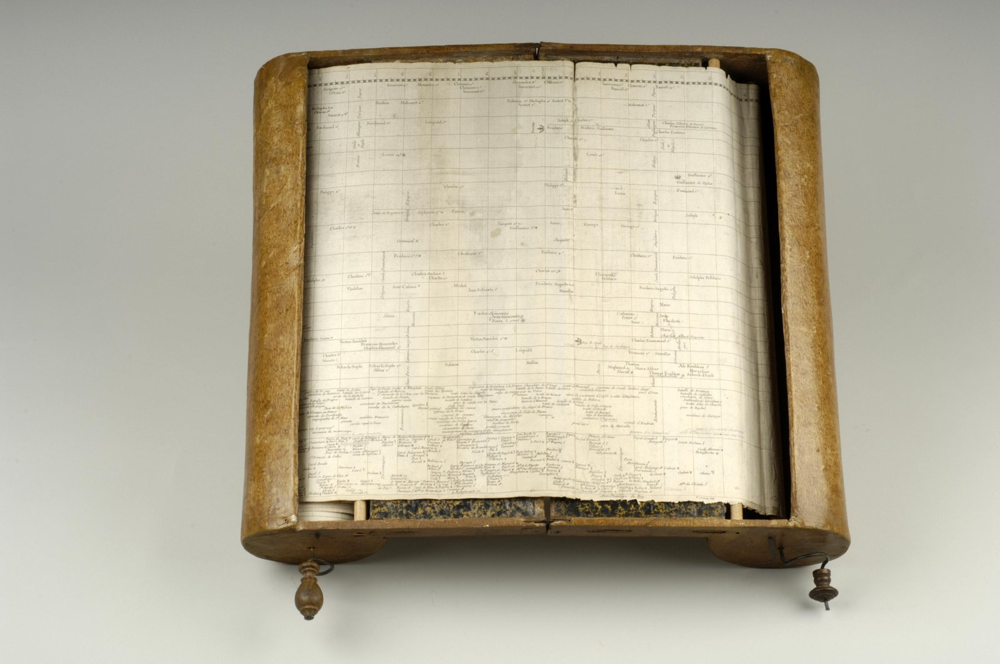
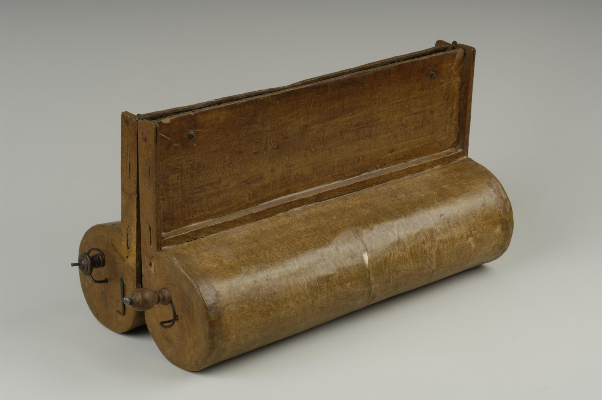

+++
author = "矢崎裕一"
title = "1年＝0.1インチで6,500年を巻き取る──Barbeu-Dubourg の Machine chronologique（1753）"
slug = "machine-chronologique"
date = "2026-11-01"
description = "天地創造から1750年代までの約6,500年を、1年＝0.1インチの等間隔で約16.5mの紙に並べ、ローラーで約140年分ずつ送って見る年表です。"
categories = [
    "consume"
]
tags = [
    "データ物質化",
    "年表",
    "ジャック・バルブー＝デュブール"
]
image = "images/machine-open.jpg"
series = ["data-physicalization"]
series_weight = 12
seriesByline = "Jacques Barbeu-Dubourg"
seriesTitle = "6,500年を同じ縮尺で巻き取る──Machine chronologique"
+++

Machine chronologique（年代学の機械）は、天地創造から1750年代までの約6,500年を、1年＝0.1インチの等間隔の目盛りで1本の紙に並べた年表です。紙の長さは約16.5m（54フィート）あります。紙は2本のローラーに巻かれ、ハンドルを回して送ります。読者が一度に見るのは、台の上に広げた約140年分です。1753年にパリで、医師の Jacques Barbeu-Dubourg（ジャック・バルブー＝デュブール）が出しました。

以下は、プリンストン大学図書館の稀覯書キュレーター Stephen Ferguson の論文（1991）、その付録にある Denis Diderot（ドゥニ・ディドロ）の『百科全書』の項目「Chronologique (Machine)」、デザイン史家 Stephen Boyd Davis の記事に沿います。データ物理化の作品を集めた dataphys.org は、この年表を「Not a physical visualization（物理的な可視化ではない）」と注記したうえで載せています。本記事もその前提で、紙の可視化を機械で操作した例として読みます。

<!--more-->

## 1753年、年代学を地理のように見せる

Barbeu-Dubourg（1709–1779）は、パリ大学の医学博士で、薬学の教授でした。Benjamin Franklin（ベンジャミン・フランクリン）の友人でもあります。年表の認可は1752年5月2日付、国王の出版特許は1753年5月28日付です（Ferguson p.192）。

年表は、銅版画35枚を端と端で貼りつないだ1本の紙です。16ページの解説冊子『Chronographie, ou Description des tems』が付き、値段は刷った紙だけなら12リーヴル、「機械つき」は15または18リーヴルでした（Ferguson p.195・p.204）。

作者は解説冊子で、作った理由を地理との比較で書いています。Boyd Davis の英訳です。

> Geography has as its object the extent of the earth; Chronology has as its object the succession of time. May not duration be imitated and represented as effectively to the senses, as distinctly as space, and may not intervals of time be as easily counted in degrees?

地理は大地の広がりを、年代学は時の連なりを扱う。時間の長さも、空間と同じくらいはっきり感覚に示せないか。時の間隔も、度で数えるように数えられないか、という問いです。

同じ冊子は、地理を「lively, convenient, attractive」、年代学を「dry, laborious, unprofitable」と対比しています（Ferguson p.196）。作者は自分の図を「tableau mouvant & animé（動く、生きた絵）」と呼びました。

同じ年、ディドロは『百科全書』第3巻の項目で、この図は「知っている人の時間を省き、学ぶ人の手間を省く」と紹介しました（Ferguson p.219）。

## 1年＝0.1インチ、6,500年で16.5m

年表の骨格は、紙の長さ方向に通した1本の目盛りです。ディドロによれば、目盛りは白と黒を交互にした小さな等しい区画で、区画の数は天地創造から現在までの年数と同じです。1区画が1年で、長さは0.1インチ（英寸）です（Ferguson p.192 注4）。

**全区間を同じ縮尺で描いた結果が、約16.5mという長さです。** 数字は資料どうしで合います。『Journal de Trévoux』によれば、作者は天地創造からキリスト誕生までを4,700年と数えました（Ferguson p.199 注27）。これに1753年を足すと約6,450年です。0.1インチを掛けると約645インチ、約16.4m になります。全長「54フィート／16.5m」とほぼ一致します。この計算は筆者が確かめたもので、作者の説明ではありません。

縦方向には、国や地域の帯を重ねます。初期は「族長」「カインの子孫」などの区分で、洪水の後はエジプト、中国などの国の帯が増えていきます。最下段は「événements mémorables（記憶すべき出来事）」の行です。ディドロは、目盛りに垂直な線を「同時代の線」、平行な線を「期間の線」と呼びました。

> les perpendiculaires à l'échelle chronologique sont des lignes de contemporanéité ; les paralleles à l'échelle chronologique sont des lignes de durée.

縦の線の上に並ぶものは同じ時点、横の線の長さは続いた期間、という意味です。データと見た目の対応をまとめると、次のようになります。

| データ | 見た目・仕掛け | 具体 |
|---|---|---|
| 年 | 紙の長さ方向の位置。全区間で同じ縮尺 | 1年＝0.1インチ。白黒交互の区画 |
| 10年ごとの区切り | 紙の高さいっぱいの点線の縦線 | 10年ごと |
| 大きな時代区分 | 目盛りを3つに分ける | 天地創造〜ローマ建国、〜キリスト誕生、〜現在 |
| 同時代 | 同じ縦線の上に並べる | 「同時代の線」 |
| 期間（在位・生涯） | 時間軸と平行な線の長さ | 始まりと終わりを縦線の端で読む |
| 場所・分類 | 縦方向の帯 | 国ごとの帯、最下段に「記憶すべき出来事」 |
| 人物と出来事 | 該当する年の位置に彫った名前と短い句 | 王・女王・暗殺者・賢人など |
| 始まりの年 | 名前の頭文字から目盛りへ下ろす点線 | 1838年版で廃止 |
| 職業・性格・道徳的評価 | 名前の横の小さな記号 | 約80の類型、約83の記号 |
| 一度に見える範囲 | 機械の台に広げた部分 | 少なくとも140年 |
| 時間の向きの移動 | ハンドルでローラー間を巻き取る | 左に巻くと現在へ、右に巻くと過去へ |

記号は、占星術・錬金術・薬学・キリスト教などの記号を借りたものです。暗殺者は上向きの短剣、暗殺された人は下向きの短剣、医師は蛇、詩人は竪琴です。

等間隔の目盛りには、もう一つの効果がありました。Ferguson は、出来事の多さがそのまま紙の上の密度になると書いています。

> A glance at the beginning of the line shows long stretches of time with no recorded events; the end of the line (the 1700s) is dense with them.

年表の初めには記録のない長い空白が続き、終わりの1700年代は出来事で詰まっている、という観察です。

## 一度に見るのは約140年

作者は16.5m の紙を箱に収めました。ディドロの記述によれば、機械は同じ形の半分2つでできています。それぞれに、年表を広げる台（板B、長さ16プス、幅5プス半）、摩擦を減らす細いローラー、ハンドル付きのローラーが付きます。年表の両端をハンドル付きのローラーに貼り、どちらかを回すと紙が一方から他方へ移ります。

Rare Book Division, Department of Rare Books and Special Collections, Princeton University Library／dataphys.org より引用

ディドロは、台の上に広げられる範囲を「au moins cent quarante ans（少なくとも140年）」と書きました。Ferguson の論文の写真では、A.D. 360〜510 の150年分が開いています。140年は14インチ、約35.6cm で、板Bの長さ（約43cm）に収まります。この換算も筆者の計算です。

使い方は、解説冊子の「Avertissement」に書かれています。

> Are you reading a book of history? Then to see at a glance world events covered by the book, just roll the Carte to the relevant years and there it is!

歴史の本を読んでいるなら、その年まで年表を巻けば、同じ時期の世界の出来事がひと目で見える、という説明です。冊子は続けて、アダムまで巻き戻して現在まで進めば、時間軸の全体をたどれるとも書いています（Ferguson p.197–198）。

使わないときは、2つの半分を折り重ねて閉じ、留め金で留めます。

Rare Book Division, Department of Rare Books and Special Collections, Princeton University Library／dataphys.org より引用

ディドロは、閉じると年表は「à couvert de toutes parts, & fort en sûreté（あらゆる方向から覆われ、とても安全）」になると書いています。dataphys.org は「folded for transport（運ぶために折りたためる）」と書いていますが、持ち運びの目的は一次情報では確かめられませんでした。

## 「物理的な可視化ではない」という注記

dataphys.org の項目は、Pierre Dragicevic が登録したものです。紹介文は次の一文で始まり、その後に注記が続きます。

> Before Joseph Priestley published his famous timelines, Frenchman Jacques Barbeu-Dubourg built a 16-meter long timeline showing 140 years of world history, which can be mechanically scrolled and folded for transport. Not a physical visualization but maybe the first "interactive" timeline representation in history.

Joseph Priestley（ジョゼフ・プリーストリー）より前に、機械でスクロールできる16m の年表を作った。物理的な可視化ではないが、最初の「インタラクティブ」な年表表現かもしれない、という紹介です。

「プリーストリーより前」は合っています。Barbeu-Dubourg の年表は1753年、プリーストリーの『Chart of Biography』は1765年です（Ferguson p.202 注29）。作者も1768年の手紙で、プリーストリーの図は「ほぼ同じ原理」だと書いています。

一方で「140 years of world history」は、年表が扱う期間ではありません。年表は天地創造から1750年代までの全体を描いていて、140年は機械を開いたときに一度に見える範囲です。

注記の「Not a physical visualization」は、表の中の区別と合っています。年・期間・場所・人物の性格は、どれも紙の上の位置・線・文字・記号に対応しています。データの値を物の形や量に変えているわけではありません。機械が受け持つのは、長い紙のどこを見せるかという操作だけです。この特集には、データを物体の形にした作品ではなく、**紙の可視化を手で操作する装置**として入れています。

## 第三者はこの年表をどう見たか

Boyd Davis は、等間隔の時間軸の先駆という点から評価しています。

> It may be the first to use a constant numerical scale for an entire historical period … And it is interactive - slightly.

歴史の全期間に一定の数値目盛りを使った最初の例かもしれない。そして、わずかにインタラクティブだ、という評です。2015年の論文では、1750年の Barbeau de la Bruyère の Mappemonde と比べています。Mappemonde は、過去にさかのぼるほど1区画の年数を100→200→250→500年と変えました。これに対して Barbeu-Dubourg とプリーストリーは、等間隔の時間軸が必要だという点で「speak with one voice」と論じています。

美術史家の Astrit Schmidt-Burkhardt（アストリット・シュミット＝ブルクハルト）は、機械の側を重く見ます。論考には「CINEMATOGRAPHIC VISION MACHINE」という節があります。

> The irreversible timeline on which all historical accounts had hitherto rested could at last be recast as a reversible conceptual model. … The idea of the interactive user was born.

それまで歴史記述が頼ってきた不可逆な時間の線が、ついに可逆な概念モデルに作り替えられた。インタラクティブな利用者という考えが生まれた、という結論です。ただし同じ論考は、紙の長さを約6.5m、記号を65種類と書いていて、Ferguson と Boyd Davis の数値と合いません。

Ferguson は、啓蒙思想の産物として読みます。

> Obviously, the 'machine' or apparatus itself reinforces the ideological message of the time-line. Its significance lies not only in its content, but also in its physical form.

機械そのものが年表の思想を強めている。意味は中身だけでなく、物としての形にもある、という指摘です。一方で、記号で人を道徳的に評価するやり方は、寓意の伝統につながるとも書いています。売れ行きはよくなかったとみられ、Ferguson は「Apparently only a few machines were sold」と書きました。

## 使い道

この年表から持ち帰れるのは、縮尺を固定したまま、見える範囲だけを動かす設計です。全体を一枚に収めるなら、古い時代の縮尺を変えることになります。Barbeu-Dubourg は縮尺を守り、長くなった紙をローラーで送る形にしました。

二つ目は、空白を消さないことです。等間隔にしたので、記録の少ない古い時代は空き、1700年代は詰まって見えます。密度の差がそのまま情報になる、と読めます。データが偏っているときに軸を詰めたくなったら、空白が何を語るかを先に考える価値があります。

三つ目は、データの対応と、操作の仕掛けを分けて考えることです。この作品では、データはすべて紙の上にあり、機械は見る範囲を動かすだけです。物を使った作品を作るときも、物がデータを表しているのか、データの見方を操作させているのかを、言葉にしておくと設計がぶれません。

最後に、読者の訂正を受け入れる仕組みです。ディドロによれば、作者は文人に、訂正や意見を書き込んで返してくれれば1部を無料で贈ると申し出ています。プリンストン版には、フランクリンの凧の実験（1752）など、作者本人のものと考えられる手書きの追加もあります（Ferguson p.207）。長い年表を一人で完成させず、読者の意見で直していくつもりだった、と読めます。

## 参考・出典

**一次情報**

- Jacques Barbeu-Dubourg, *Chronographie, ou Description des tems*, Paris, 1753（解説冊子と年表35枚）。BnF Gallica：http://gallica.bnf.fr/ark:/12148/bpt6k1314025 （本文は未確認。内容は Ferguson と Boyd Davis の引用による）
- Denis Diderot, "Chronologique (Machine)," *Encyclopédie*, vol. 3, 1753. 仏語全文と英訳は Ferguson (1991) 付録 pp.218–226 による。Collaborative Translation Project の英訳：http://hdl.handle.net/2027/spo.did2222.0001.081 （未確認）
- Barbeu-Dubourg からフランクリンへの手紙、1768年5月8日：https://founders.archives.gov/documents/Franklin/01-15-02-0067 （本文は未確認。英訳は Ferguson pp.202–203 による）
- Stephen Ferguson, "The 1753 Carte chronographique of Jacques Barbeu-Dubourg," *Princeton University Library Chronicle* 52(2), 1991, pp.190–230：https://www.princeton.edu/~ferguson/PULC_1991_duBourg.pdf
- Princeton Alumni Weekly, "From Princeton's vault: A chronographic machine," 2011-04-06：https://paw.princeton.edu/article/princetons-vault-chronographic-machine
- dataphys.org, "1753 – Barbeu-Dubourg's Machine Chronologique"（Pierre Dragicevic 登録）：https://dataphys.org/list/barbeu-dubourgs-machine-chronologique/

**第三者評価**

- Stephen Boyd Davis, "The first modern timeline?," *Chronographics*, 2009：https://chronographics.blogspot.com/2009/08/first-modern-timeline.html
- Stephen Boyd Davis, "Chronographics at Princeton," 2009：https://stephenbd.blogspot.com/2009/08/chronographics-at-princeton.html
- Stephen Boyd Davis, "French copy of Barbeu-Dubourg now online," 2011：https://chronographics.blogspot.com/2011/09/french-copy-of-barbeu-dubourg-now.html
- Stephen Boyd Davis, "Beholder of All Ages: The History of the World in a French Mappemonde," *Textimage* n°7, 2015：https://researchonline.rca.ac.uk/1701/1/boyd-davis.pdf
- Astrit Schmidt-Burkhardt, "Learning in the Age of Enlightenment," George Maciunas Foundation（初出 *Bildwelten des Wissens* 7(1), 2009）：https://georgemaciunas.com/?p=2803
- Wikipedia, "Jacques Barbeu-Dubourg"（経歴の補助として参照）：https://en.wikipedia.org/wiki/Jacques_Barbeu-Dubourg
