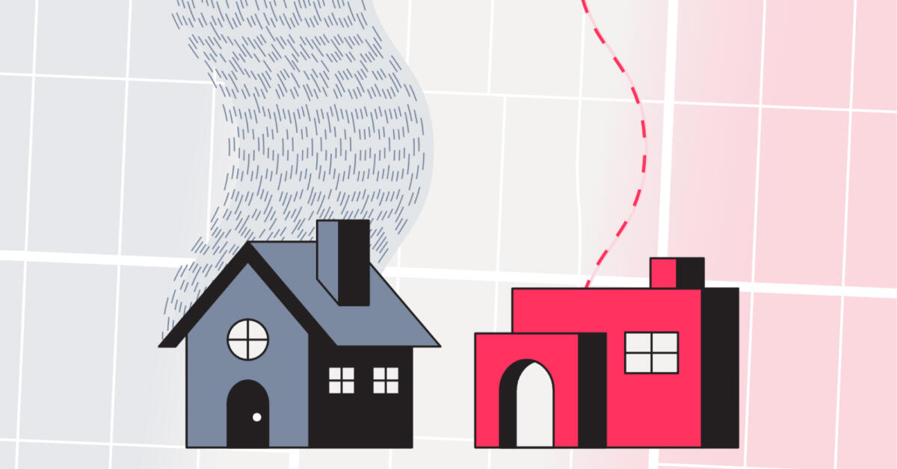
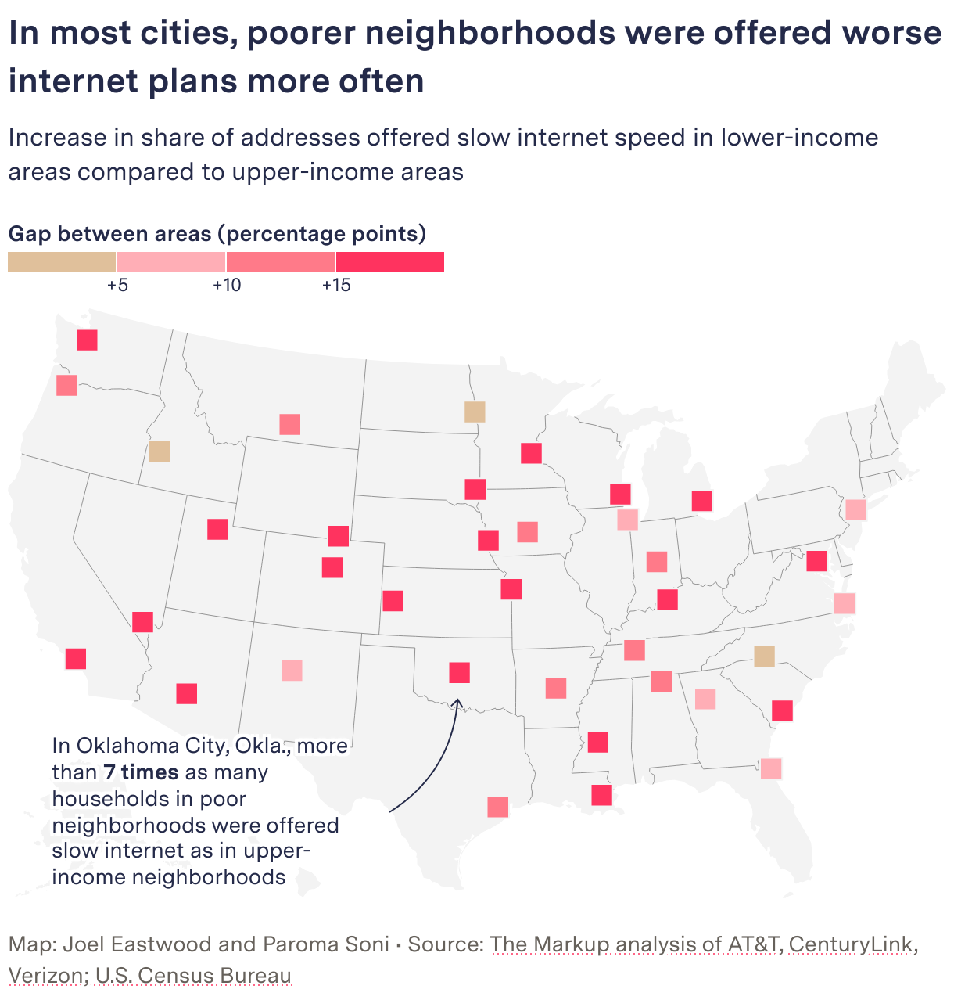
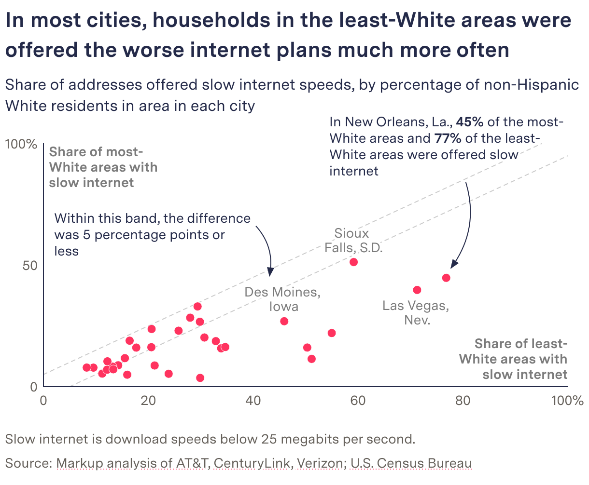
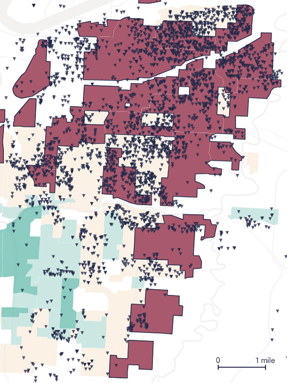
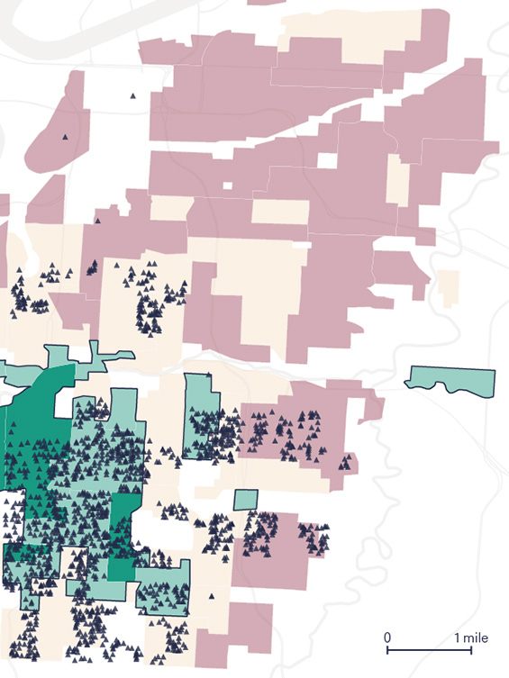

+++
author = "Yuichi Yazaki"
title = "How Many Mbps Were You Offered at the Same Price? The Markup's \"Still Loading\""
slug = "markup-still-loading"
date = "2026-11-04"
description = "The Markup collected, address by address, the internet speeds offered at the same price, then compared the share of addresses offered under 25 Mbps across income, share of white residents, and 1930s redlining grades."
categories = [
    "consume"
]
tags = [
    "data journalism",
    "Sigma Awards",
    "maps",
    "scatter plots"
]
image = "images/cover.jpg"
series = ["dataviz-journalism"]
series_weight = 4
seriesByline = "The Markup (Leon Yin, Aaron Sankin et al.)"
seriesTitle = "Counting Slow Addresses at the Same Price: Still Loading"
+++

The Markup collected, address by address, the internet speeds that four ISPs (AT&T, Verizon, EarthLink and CenturyLink) offered at the same price. It then compared "the share of addresses offered under 25 Mbps at the same price" across groups defined by income, share of white residents, and 1930s redlining grades. The data covers 848,618 offers in 38 US cities.

The main article, "Dollars to Megabits, You May Be Paying 400 Times As Much As Your Neighbor for Internet Service," was published on October 19, 2022, in partnership with AP. The same day, the methodology ("Show Your Work") and a guide for reporters ("Story Recipe") came out too. The package won a Sigma Awards 2023 Winner prize. Below, I read the main article, the methodology, and the code published on GitHub, following the order of the graphics.

<!--more-->

## When the price is flat, speed is what you compare

The starting point is how the pricing works. According to the methodology (Show Your Work), NDIA pointed out in a 2018 report, drawing on the ISPs' promotional materials, "tier flattening": charging the same base price for different speeds. The Markup checked this with offers at individual addresses. The methodology puts it this way.

> Our analysis differs from previous work by examining pricing in conjunction with speed and the demographics of areas that are offered the same price for worse service (below 25 Mbps)—we call these the 'worst deals.'

In short, the difference from earlier work is that it examines price together with speed and the demographic makeup of areas, and it calls the cases where the same price buys under 25 Mbps "worst deals."

The data source is the address lookup tool on each ISP's website. According to the methodology, the team followed a 2020 Princeton University study and queried the underlying APIs automatically. The period was April 15 to October 1, 2022, with 1,606,964 queries. Addresses were drawn at random, 10% per block group. The speeds are those the ISPs offered, not measured speeds.

Speeds were split into four bands, from under 25 Mbps (Slow, which falls short of the FCC's definition of broadband) to 200 Mbps and above (Blazing). Income and share of white residents were each divided into quartiles of block groups within each city. For historical grades, according to the methodology, addresses were overlaid on the HOLC (Home Owners' Loan Corporation) maps published by Mapping Inequality. Only the 22 cities for which maps exist are covered.

The "400 times" in the headline comes from converting prices to price per Mbps. According to the methodology, CenturyLink works out to $100/Mbps at 0.5 Mbps and $0.25/Mbps at 200 Mbps, a 400-fold difference. The main article also has a graphic that connects each ISP's cheapest and most expensive per-Mbps price with a line segment. However, the graphic's data and the methodology's text partly disagree. AT&T's cheapest price is $0.13 in the graphic and $0.18 in the text. CenturyLink's values match. The reason for the discrepancy cannot be confirmed.

## The opening pair of houses: you can't compare with your neighbor yourself

The main article opens with two houses in Kansas City. Two homes 0.4 miles apart were offered 300 Mbps and 5 Mbps by AT&T for the same $55 a month.

Source: Gabriel Hongsdusit and Joel Eastwood / The Markup, "Dollars to Megabits"

This is the article's key visual. The opening graphic is built with HTML and SVG and is read by scrolling down. To the fast house, 41 thin blue-gray wavy lines flow on a 12-second cycle. To the slow house, only one thick red wavy line flows slowly on a 50-second cycle. Speed is drawn through the number, thickness, and flow rate of the lines.

Next, the numbers appear with the two houses kept side by side. They come in the order of speed, distance, median household income and share of white residents, and monthly price, and finally a map of the 38 US cities.

| Item | Fast house | Slow house |
|---|---|---|
| Offered download speed | 300 Mbps | 5 Mbps |
| Median household income | $63,214 | $23,836 |
| White residents | 70% | 1% |
| Monthly price | $55 | $55 |

The two houses were not found by hand. The notebook on GitHub uses scikit-learn's BallTree to find, for each address, the nearest address that was offered 200 Mbps or more. Julia Angwin, the editor-in-chief, wrote in her newsletter:

> Very few people are likely to enter other addresses into the site to compare speeds that their neighbors are getting

That is, hardly anyone will type in other addresses to compare the speeds their neighbors get. Opening with two houses side by side can be read as a response to this problem: you can't compare with your neighbor yourself.

## One share, laid out under three ways of grouping

Most of the graphics after the opening use a single metric: the share of addresses offered under 25 Mbps at the same price. What changes is how the groups are divided and how many cities are shown.

| Graphic | Data | Visual encoding |
|---|---|---|
| Opening graphic | Speed, income, share of white residents, and monthly price for two addresses | Speed as number, thickness, color, and flow rate of lines. Houses in blue and dark red |
| Price per 1 Mbps | Cheapest and most expensive per-Mbps price for each ISP | Line segments. Circle at the cheapest end in blue-gray, at the most expensive end in red |
| Map by city | Gap between the shares in low-income and high-income areas | One same-sized square per city. Gap shown in four color steps |
| Las Vegas bars | Composition of the four speed bands within each income quartile | 100% stacked bars. Only Slow in red; the faster, the darker the blue-gray |
| Scatter plot by city | Share in the areas with the lowest share of white residents (x) and the highest (y) | Position of points. Dotted lines at ±5 points on both sides of the diagonal |
| Kansas City maps | Offers by address and HOLC grades | Dots for addresses over a background colored by grade. Two maps: slow addresses and the fastest addresses |

The same red (#FF335F) is used for slow speeds in every graphic. Even in stacked bars with many bands, red is the only warm color. This can be read as telling the reader that finding the red finds the worst deals.

The graphic split by income is the map by city. From the gap boundaries at +5, +10, and +15 points, the color deepens from beige to red.

Source: Joel Eastwood and Paroma Soni / The Markup, "Dollars to Megabits"

A note points to Oklahoma City, saying that the share in low-income areas (53.3%) is more than seven times that in high-income areas (7.1%). The graphic split by share of white residents is a scatter plot.

Source: The Markup / The Markup, "Dollars to Megabits"

The dotted lines on both sides of the diagonal carry the note "Within this band, the difference was 5 percentage points or less." The methodology's criterion is as follows.

> We consider a disparity to exist when the difference of the proportion of slow speeds between any of the comparisons is five percentage points or more.

That is, a disparity is deemed to exist when the share of slow speeds differs by five points or more between groups. No p-value test is used. **The dotted band on the scatter plot can be read as this criterion drawn directly onto the graphic.** The further a point lies to the lower right outside the band, the more the city disadvantages areas with fewer white residents. According to the methodology, worst deals were concentrated in low-income areas in 92% of cities, and in areas with fewer white residents in 66% of cities.

## Splitting the Kansas City map in two

The third way of grouping is the 1930s redlining grades. HOLC graded neighborhoods in four tiers: Best, Desirable, Declining, and Hazardous. According to the methodology, in all 22 cities, worst deals were concentrated in redlined areas.

The main article places AT&T's offers in Kansas City on a map, address by address. The left map is "Addresses offered slow speed," and the right is "Addresses offered blazing speed."

Source: Joel Eastwood (Source: Mapping Inequality) / The Markup, "Dollars to Megabits"

Source: Joel Eastwood (Source: Mapping Inequality) / The Markup, "Dollars to Megabits"

In the background, Best is green and Hazardous is a muted red. Slow addresses are drawn as downward triangles and the fastest addresses as upward triangles. On the slow-address map the Hazardous areas are shaded more darkly, and on the fastest-address map the Best and Desirable areas are. Because the two kinds of dots are split across two maps rather than overlaid on one, the places where the dots cluster appear to swap between left and right.

The note reads "68% of addresses in redlined areas were offered slow speeds." "redlined areas" is underlined in the same color as Hazardous, linking the legend to the text. In the methodology, Slow accounts for 68.5% in areas graded D and 4.2% in areas graded A. Reporter Aaron Sankin wrote on X:

> The 1939 notes explaining the decision to redline a Kansas City, Mo., neighborhood cited 'Negro encroachment from the north.' More than 80 years later, we didn't see AT&T offer a single connection there that the FCC would consider 'broadband.'

That is, the 1939 notes explaining the decision to redline the neighborhood cited "Negro encroachment from the north," and more than 80 years later, AT&T offered not a single connection there that would count as broadband.

## How third parties saw the investigation

The Sigma Awards 2023 judges singled out that the investigation put a double disadvantage into numbers.

> It showed the injustice didn't stop there: slow internet connections cost the same as fast ones, meaning communities are disadvantaged twice.

Because slow connections cost the same as fast ones, communities are disadvantaged twice, the judges say. The price per Mbps can be read as folding this doubleness into a single unit price.

The investigation took first place in the 2023 Philip Meyer Journalism Award (IRE/NICAR). The judges' points concern method and tools.

> The reporters adapted methods from an academic study to identify internet offers by address and then used Census data and historical maps to tell a powerful story about a critical social injustice. The judges applaud the team for their resourcefulness, robust validation process and, along with their partner Big Local News, commitment to sharing their bespoke mapping tool with the public.

In short, the reporters adapted methods from an academic study to identify offers by address and told the story with Census data and historical maps; the judges praise the resourcefulness, the validation process, and the public release of the bespoke mapping tool.

From the academic side, a limit in scope was pointed out. The ACM SIGCOMM 2023 paper by Udit Paul et al. treats this investigation as the closest prior work and writes:

> The Markup study does not include cable-based ISPs, which serve most of the US population.

That is, the study omits the cable-based ISPs that serve most of the US population. The paper compares plans in Mbps per dollar, the reverse of The Markup's unit. This can be read as The Markup choosing the price paid per unit as its axis, and the paper choosing the value received.

## What to take from it

First, let the system decide the unit of comparison. When the price is flat, price differences make no graphic. The Markup held the price fixed and counted speeds, then converted to a unit price. What you hold fixed and what you count determines the graphic's metric.

Second, keep the metric to one. Whether scatter plot, symbol map, stacked bar, or address map, the form changes but what is counted stays "the share of addresses offered under 25 Mbps." Red also always means slow speed. The reader only has to follow the difference in grouping.

Third, draw the criterion for judgment into the graphic. The ±5-point band on the scatter plot has the same width as the methodology's criterion. Because it is drawn as lines, readers can check for themselves which cities exceed the criterion.

Fourth, show first the comparison readers can't make themselves. The opening two houses were chosen by an algorithm that finds nearby addresses. Before the story of the whole, it places a single pair: 300 Mbps and 5 Mbps for the same $55.

Finally, publish the means of reproduction together. The Story Recipe released per-city CSVs and per-ISP Kepler.gl maps, and it led to nine local-outlet stories. According to the application materials, a Detroit city official said the city would use this data in deciding the order in which to lay its municipal fiber network.

## References

**Primary sources**

- Leon Yin, Aaron Sankin, "Dollars to Megabits, You May Be Paying 400 Times As Much As Your Neighbor for Internet Service," *The Markup*, 2022-10-19: https://themarkup.org/still-loading/2022/10/19/dollars-to-megabits-you-may-be-paying-400-times-as-much-as-your-neighbor-for-internet-service
- Methodology, Show Your Work, "How We Uncovered Disparities in Internet Deals," 2022-10-19: https://themarkup.org/show-your-work/2022/10/19/how-we-uncovered-disparities-in-internet-deals
- National Digital Inclusion Alliance (NDIA), report on tier flattening (PDF, July 2018; referenced from the methodology): https://www.digitalinclusion.org/wp-content/uploads/2018/07/NDIA-Tier-Flattening-July-2018.pdf
- David Major, Ross Teixeira, Jonathan Mayer, "No WAN's Land: Mapping U.S. Broadband Coverage with Millions of Address Queries to ISPs," ACM IMC 2020 (the study the methodology followed): doi:10.1145/3419394.3423652 https://doi.org/10.1145/3419394.3423652
- Story Recipe, 2022-10-19 (updated 2023-03-16): https://themarkup.org/story-recipes/2022/10/19/journalists-investigate-which-neighborhoods-in-your-city-are-offered-the-worst-internet-deals
- GitHub repository the-markup/investigation-isp: https://github.com/the-markup/investigation-isp (README: https://raw.githubusercontent.com/the-markup/investigation-isp/main/README.md , Notebook 5: https://github.com/the-markup/investigation-isp/blob/main/notebooks/5-find-closest-fiber-address.ipynb )
- Kepler.gl map (AT&T): https://markup-public-data.s3.amazonaws.com/isp/at%26t-kepler.gl.html
- Datawrapper (main article graphics): https://datawrapper.dwcdn.net/LK8HK/11/ / https://datawrapper.dwcdn.net/g6Lw9/7/ / https://datawrapper.dwcdn.net/yv3Vw/14/ / https://datawrapper.dwcdn.net/YXy1q/8/ / https://datawrapper.dwcdn.net/eFcrH/18/
- Datawrapper (methodology graphics): https://datawrapper.dwcdn.net/3AUkE/6/ / https://datawrapper.dwcdn.net/mKzuZ/3/ / https://datawrapper.dwcdn.net/4WZtw/6/ / https://datawrapper.dwcdn.net/m0AU9/6/ / https://datawrapper.dwcdn.net/DX6tS/11/ / https://datawrapper.dwcdn.net/mr1oj/9/ / https://datawrapper.dwcdn.net/n7R75/8/ / https://datawrapper.dwcdn.net/vZUIW/6/
- Julia Angwin, "Broadband Bias," *Hello World* (The Markup's newsletter), 2022-10-22: https://themarkup.org/newsletter/hello-world/broadband-bias
- Aaron Sankin's X thread (reposted by Thread Reader): https://threadreaderapp.com/thread/1582739500903456768.html
- Follow-up map "See the Neighborhoods Internet Providers Excluded from Fast Internet," 2023-05-11: https://themarkup.org/still-loading/2023/05/11/see-the-neighborhoods-internet-providers-excluded-from-fast-internet
- Reports of awards (Scripps Howard, NABJ): https://themarkup.org/inside-the-markup/2023/10/24/the-markup-wins-scripps-howard-innovation-award / https://themarkup.org/inside-the-markup/2023/08/15/the-markup-wins-nabj-salute-to-excellence-award
- Sigma Awards entry (work page on the listing site; the Japanese is machine-translated): https://sigma-awards.data-visualization.jp/entries/2023-s-0006/
- Sigma Awards official 2023 Winners: https://www.sigmaawards.org/tag/2023-winners/
- AP's co-published version (body text not checked): https://apnews.com/article/01a99247a08b355e89cc54595aecdafa

**Secondary sources**

- Sigma Awards 2023 judges' comments (original text on the entry page above): https://sigma-awards.data-visualization.jp/entries/2023-s-0006/
- IRE, "2023 Philip Meyer Journalism Award" winner announcement and judges' comments: https://www.ire.org/2023-meyer-winners/
- Udit Paul et al., "Decoding the Divide: Analyzing Disparities in Broadband Plans Offered by Major US ISPs," ACM SIGCOMM 2023: https://arxiv.org/abs/2302.14216 (PDF: https://arxiv.org/pdf/2302.14216 , doi:10.1145/3603269.3604831 https://doi.org/10.1145/3603269.3604831 )
