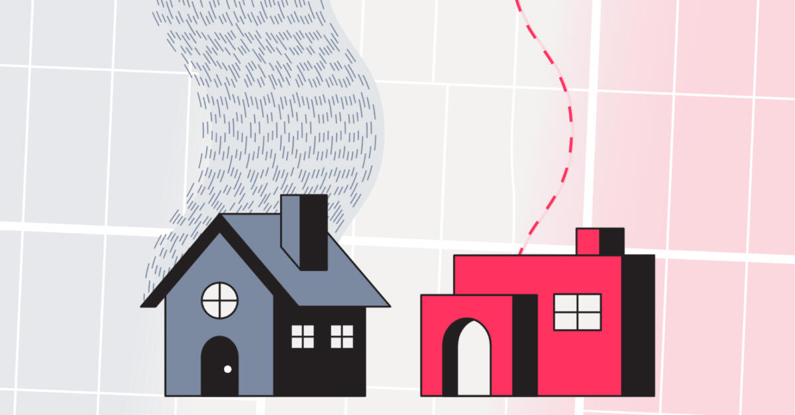
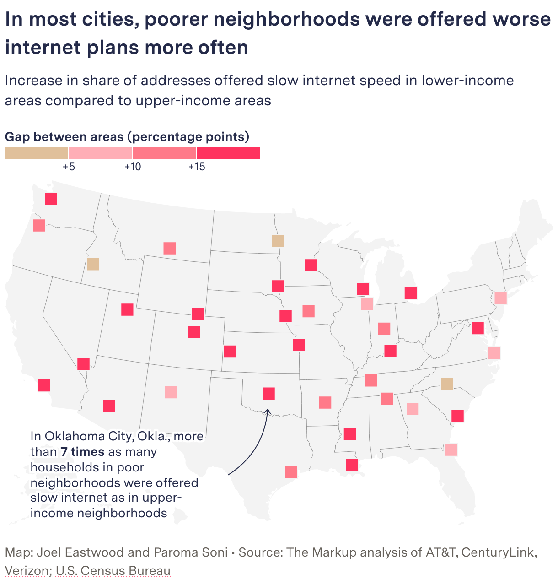
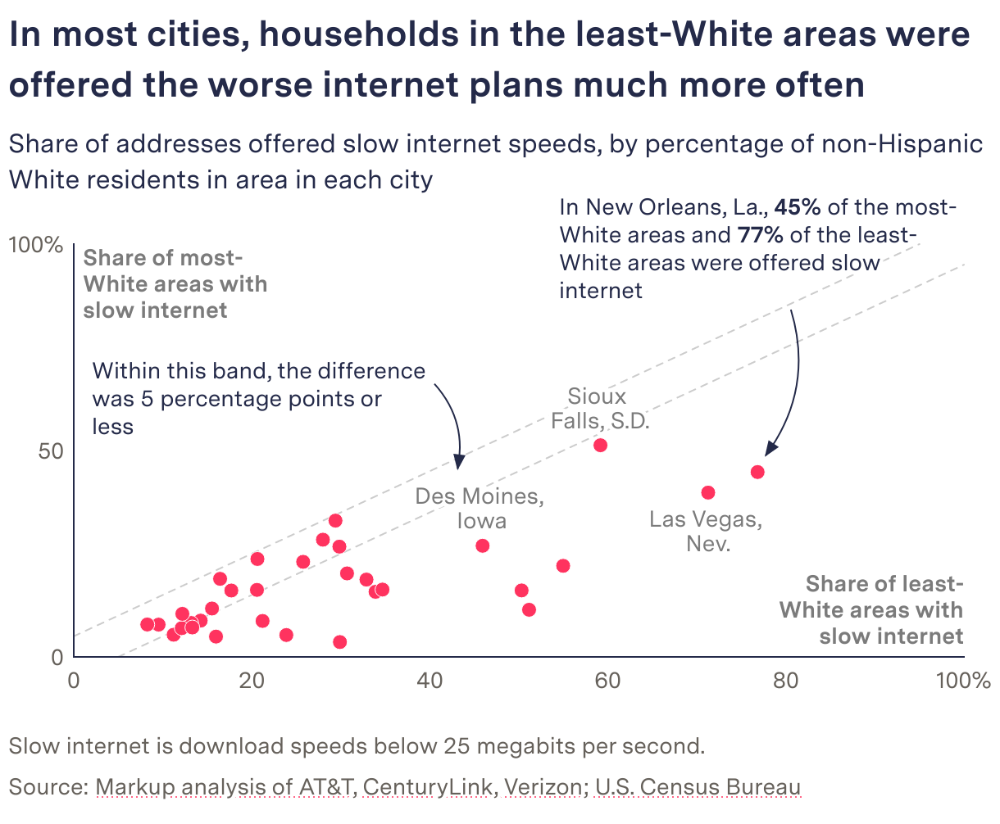
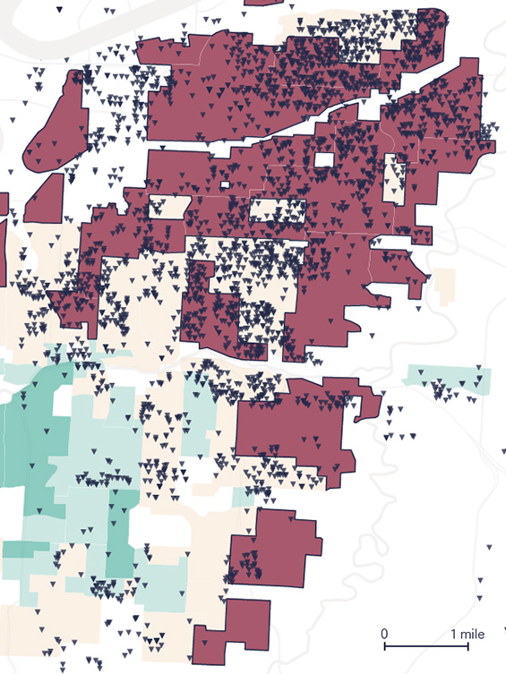
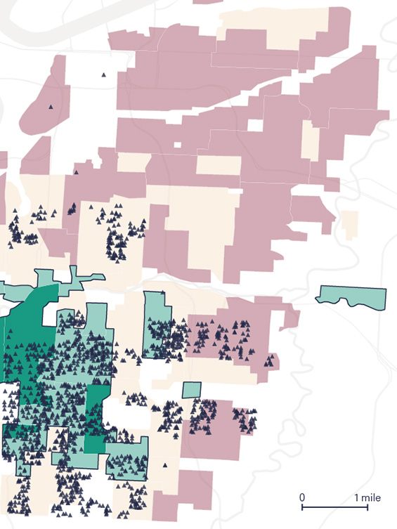

+++
author = "矢崎裕一"
title = "同じ料金で、何Mbpsを提示されたか──The Markup「Still Loading」"
slug = "markup-still-loading"
date = "2026-11-04"
description = "The Markup は、同じ料金で提示された回線速度を住所ごとに集め、25Mbps未満しか提示されなかった住所の割合を、所得・白人比率・1930年代の融資格付けのグループで比べました。"
categories = [
    "consume"
]
tags = [
    "データジャーナリズム",
    "Sigma Awards",
    "地図",
    "散布図"
]
image = "images/cover.jpg"
series = ["dataviz-journalism"]
series_weight = 4
seriesByline = "The Markup（Leon Yin・Aaron Sankin ほか）"
seriesTitle = "同じ料金で遅い住所を数える──Still Loading"
+++

The Markup は、AT&T、Verizon、EarthLink、CenturyLink の4社が、同じ料金で提示した回線速度を住所ごとに集めました。そのうえで「同じ料金で25Mbps未満しか提示されなかった住所の割合」を、所得、白人比率、1930年代の融資格付けのグループごとに比べています。対象は米国38都市の848,618件のオファーです。

主記事は2022年10月19日公開の "Dollars to Megabits, You May Be Paying 400 Times As Much As Your Neighbor for Internet Service" で、AP と共同で掲載されました。同じ日に、方法論の "Show Your Work" と記者向けの "Story Recipe" も出ています。この一式は Sigma Awards 2023 で Winner（受賞）になりました。以下は、主記事と方法論、GitHub で公開されたコードに沿って、図の順に読みます。

<!--more-->

## 料金が一律なら、比べるのは速度になる

出発点は料金の仕組みです。方法論（Show Your Work）によると、NDIA は2018年の報告で、速度が違っても同じ基本料金を取る "tier flattening" を、各社の販促資料から指摘していました。The Markup は、これを住所ごとのオファーで確かめました。方法論はこう書きます。

> Our analysis differs from previous work by examining pricing in conjunction with speed and the demographics of areas that are offered the same price for worse service (below 25 Mbps)—we call these the 'worst deals.'

価格を速度と地域の人口構成と組み合わせて調べた点が、先行研究と違う。同じ価格で25Mbps未満しか提示されない場合を「worst deals」と呼ぶ、という説明です。

データ源は、各社の Web サイトにある住所検索ツールです。方法論によると、手法は2020年のプリンストン大学の研究にならい、裏側の API へ自動で照会しました。期間は2022年4月15日〜10月1日、照会は1,606,964件です。住所はブロックグループごとに10%を無作為に抜き出しました。速度は ISP が提示した値で、実測ではありません。

速度は、25Mbps未満（Slow。FCC の broadband の定義に届かない）から200Mbps以上（Blazing）まで4つに区切りました。所得と白人比率は、都市ごとにブロックグループを4分位に分けています。歴史的な格付けは、方法論によると、Mapping Inequality が公開する HOLC（住宅所有者貸付公社）の地図に住所を重ねて付けました。地図がある22都市だけが対象です。

見出しの「400倍」は、料金を1Mbpsあたりの価格に直した数字です。方法論によると、CenturyLink は0.5Mbpsで$100/Mbps、200Mbpsで$0.25/Mbpsになり、差は400倍でした。主記事には、ISP ごとの単価を最安から最高まで線分で結んだ図もあります。ただし、図のデータと方法論の本文は一部が合いません。AT&T の最安は図で$0.13、本文で$0.18です。CenturyLink の値は一致します。食い違いの理由は確かめられません。

## 冒頭の2軒──自分では隣の家と比べられない

主記事は、カンザスシティの2軒の家から始まります。0.4マイル離れた2軒に、AT&T は同じ月額$55で、300Mbpsと5Mbpsを提示していました。

Gabriel Hongsdusit・Joel Eastwood／The Markup「Dollars to Megabits」より引用

これは記事のキービジュアルです。冒頭のグラフィックは HTML と SVG で組まれ、縦に読み進めます。速い家には、細い青灰色の波線が41本、12秒周期で流れます。遅い家には、太い赤い波線が1本だけで、50秒周期でゆっくり流れます。速度が、線の本数・太さ・流れる速さで描き分けられています。

続いて、2軒を左右に並べたまま数字が出てきます。速度、距離、世帯所得の中央値と白人比率、月額の順で、最後に38都市の米国地図が来ます。

| 項目 | 速い家 | 遅い家 |
|---|---|---|
| 提示された下り速度 | 300Mbps | 5Mbps |
| 世帯所得の中央値 | $63,214 | $23,836 |
| 白人の住民 | 70% | 1% |
| 月額 | $55 | $55 |

2軒は手で探したものではありません。GitHub のノートブックは、scikit-learn の BallTree で、各住所から最も近い「200Mbps以上を提示された住所」を探しています。編集長の Julia Angwin（ジュリア・アングウィン）は、ニュースレターでこう書きました。

> Very few people are likely to enter other addresses into the site to compare speeds that their neighbors are getting

近所の速度を比べるために、ほかの住所を入力する人はほとんどいない、という指摘です。冒頭で2軒を並べる構成は、この「自分では隣の家と比べられない」問題に応えている、と読めます。

## 一つの割合を、三つのグループ分けで並べる

冒頭のあとの図は、ほとんどが一つの指標を使っています。同じ料金で25Mbps未満を提示された住所の割合です。変わるのは、グループの分け方と都市の数です。

| 図 | データ | 見た目への対応 |
|---|---|---|
| 冒頭グラフィック | 2住所の速度・所得・白人比率・月額 | 速度を線の本数・太さ・色・速さで。家は青と暗い赤 |
| 1Mbpsあたり価格 | ISP ごとの単価の最安と最高 | 線分。最安側の円は青灰、最高側は赤 |
| 都市別の地図 | 低所得地区と高所得地区の割合の差 | 都市ごとの同じ大きさの正方形。差を色の4段階で |
| ラスベガスの棒 | 所得4分位ごとの速度4区分の構成比 | 100%積み上げ。Slow だけ赤、速いほど濃い青灰 |
| 都市別の散布図 | 白人比率の最も低い地区（x）と高い地区（y）の割合 | 点の位置。対角線の両側に±5ポイントの点線 |
| カンザスシティの地図 | 住所ごとのオファーと HOLC 格付け | 格付けで塗った背景に住所の点。遅い住所と最速の住所で2枚 |

遅い速度には、どの図でも同じ赤（#FF335F）が使われています。区分の多い積み上げ棒でも、暖色は赤だけです。赤を探せば worst deals が見つかる、と読めます。

所得で分けた図が、都市別の地図です。差が+5、+10、+15ポイントを境に、ベージュから赤へ色が濃くなります。

Joel Eastwood・Paroma Soni／The Markup「Dollars to Megabits」より引用

注記はオクラホマシティを指し、低所得地区の割合（53.3%）が高所得地区（7.1%）の7倍を超えると書いています。白人比率で分けた図は散布図です。

The Markup／The Markup「Dollars to Megabits」より引用

対角線の両側の点線には "Within this band, the difference was 5 percentage points or less" と注記があります。方法論の判定基準はこうです。

> We consider a disparity to exist when the difference of the proportion of slow speeds between any of the comparisons is five percentage points or more.

グループ間で遅い速度の割合が5ポイント以上違えば格差とみなす、という基準です。p値による検定は使っていません。**散布図の点線の帯は、この基準をそのまま図に描いたもの**と読めます。帯の外で右下にある点ほど、白人の少ない地区に不利な都市です。方法論によると、worst deals が低所得地区に偏った都市は92%、白人の少ない地区に偏った都市は66%でした。

## カンザスシティの地図を、2枚に分ける

三つ目の分け方が、1930年代の融資格付けです。HOLC は地区を Best、Desirable、Declining、Hazardous の4段階に格付けしました。方法論によると、22都市すべてで worst deals はレッドライニングの地区に偏っていました。

主記事は、カンザスシティの AT&T のオファーを住所ごとに地図に置いています。左は "Addresses offered slow speed"、右は "Addresses offered blazing speed" です。

Joel Eastwood（Source: Mapping Inequality）／The Markup「Dollars to Megabits」より引用

Joel Eastwood（Source: Mapping Inequality）／The Markup「Dollars to Megabits」より引用

背景は、Best が緑、Hazardous がくすんだ赤です。遅い住所は下向き、最速の住所は上向きの三角で描かれています。遅い住所の地図では Hazardous の地区が、最速の地図では Best と Desirable の地区が濃く塗られています。2種類の点を1枚に重ねず2枚に分けたので、点の集まる場所が左右で入れ替わって見えます。

注記は "68% of addresses in redlined areas were offered slow speeds" です。"redlined areas" には Hazardous と同じ色の下線が引かれ、凡例と本文の言葉がつながっています。方法論では、格付け D の地区の Slow は68.5%、A の地区は4.2%でした。記者の Aaron Sankin（アーロン・サンキン）は、X にこう書いています。

> The 1939 notes explaining the decision to redline a Kansas City, Mo., neighborhood cited 'Negro encroachment from the north.' More than 80 years later, we didn't see AT&T offer a single connection there that the FCC would consider 'broadband.'

1939年にその地区をレッドライニングした理由の記録には「北からの黒人の侵入」とあった。80年以上たっても、AT&T はそこで broadband にあたる接続を一つも提示していなかった、という内容です。

## 第三者はこの調査をどう見たか

Sigma Awards 2023 の審査員は、二重の不利益を数で示した点を挙げています。

> It showed the injustice didn't stop there: slow internet connections cost the same as fast ones, meaning communities are disadvantaged twice.

遅い接続が速い接続と同じ値段なので、地域は二重に不利になっている、という評です。1Mbpsあたりの価格は、この二重性を一つの単価に畳み込んだ数字だと読めます。

2023年の Philip Meyer Journalism Award（IRE/NICAR）では1位になりました。審査員の論点は、方法とツールです。

> The reporters adapted methods from an academic study to identify internet offers by address and then used Census data and historical maps to tell a powerful story about a critical social injustice. The judges applaud the team for their resourcefulness, robust validation process and, along with their partner Big Local News, commitment to sharing their bespoke mapping tool with the public.

学術研究の手法を転用して住所ごとのオファーを特定し、国勢調査と歴史地図で語った。工夫と検証の手順、独自の地図ツールの公開を評価する、という講評です。

学術側からは、範囲の限界が指摘されました。Udit Paul（ウディット・ポール）らの ACM SIGCOMM 2023 の論文は、この調査を最も近い先行研究としたうえで、こう書きます。

> The Markup study does not include cable-based ISPs, which serve most of the US population.

人口の大半にサービスを提供するケーブル系の ISP が含まれていない、という指摘です。この論文は、1ドルあたりの Mbps でプランを比べています。The Markup とは逆向きの単位です。The Markup は払わされる単価を、論文は得られる価値を軸に選んだ、と読めます。

## 使い道

一つ目は、比べる単位を制度の側から決めることです。料金が一律なら、価格の差は図になりません。The Markup は料金を固定して速度を数え、さらに単価に直しました。何を固定し何を数えるかで、図の指標が決まっています。

二つ目は、指標を一つに保つことです。散布図、記号地図、積み上げ棒、住所の地図と形は変わっても、数えているのは「25Mbps未満を提示された住所の割合」です。赤もいつも遅い速度を指します。読者はグループ分けの違いだけを追えます。

三つ目は、判定の基準を図に描き込むことです。散布図の±5ポイントの帯は、方法論の基準と同じ幅です。線として引けば、どの都市が基準を超えたかを読者が自分で確かめられます。

四つ目は、読者が自分ではできない比較を最初に見せることです。冒頭の2軒は、近い住所を探すアルゴリズムで選ばれました。全体の話の前に、同じ$55で300Mbpsと5Mbpsという一組を置いています。

最後に、再現の手段を一緒に出すことです。Story Recipe は都市別の CSV と ISP 別の Kepler.gl 地図を公開し、地元媒体の記事9本につながりました。応募書類によると、デトロイト市の担当者は、市営光ファイバー網を敷く順番の判断にこのデータを使うと述べています。

## 参考・出典

**一次情報**

- Leon Yin, Aaron Sankin, "Dollars to Megabits, You May Be Paying 400 Times As Much As Your Neighbor for Internet Service," *The Markup*, 2022-10-19：https://themarkup.org/still-loading/2022/10/19/dollars-to-megabits-you-may-be-paying-400-times-as-much-as-your-neighbor-for-internet-service
- 方法論 Show Your Work, "How We Uncovered Disparities in Internet Deals," 2022-10-19：https://themarkup.org/show-your-work/2022/10/19/how-we-uncovered-disparities-in-internet-deals
- National Digital Inclusion Alliance（NDIA）、tier flattening の報告（PDF、2018年7月。方法論から参照）：https://www.digitalinclusion.org/wp-content/uploads/2018/07/NDIA-Tier-Flattening-July-2018.pdf
- David Major, Ross Teixeira, Jonathan Mayer, "No WAN's Land: Mapping U.S. Broadband Coverage with Millions of Address Queries to ISPs," ACM IMC 2020（方法論が手本にした研究）：doi:10.1145/3419394.3423652 https://doi.org/10.1145/3419394.3423652
- Story Recipe, 2022-10-19（2023-03-16 更新）：https://themarkup.org/story-recipes/2022/10/19/journalists-investigate-which-neighborhoods-in-your-city-are-offered-the-worst-internet-deals
- GitHub リポジトリ the-markup/investigation-isp：https://github.com/the-markup/investigation-isp （README：https://raw.githubusercontent.com/the-markup/investigation-isp/main/README.md 、ノートブック5：https://github.com/the-markup/investigation-isp/blob/main/notebooks/5-find-closest-fiber-address.ipynb ）
- Kepler.gl 地図（AT&T）：https://markup-public-data.s3.amazonaws.com/isp/at%26t-kepler.gl.html
- Datawrapper（主記事の図）：https://datawrapper.dwcdn.net/LK8HK/11/ ／ https://datawrapper.dwcdn.net/g6Lw9/7/ ／ https://datawrapper.dwcdn.net/yv3Vw/14/ ／ https://datawrapper.dwcdn.net/YXy1q/8/ ／ https://datawrapper.dwcdn.net/eFcrH/18/
- Datawrapper（方法論の図）：https://datawrapper.dwcdn.net/3AUkE/6/ ／ https://datawrapper.dwcdn.net/mKzuZ/3/ ／ https://datawrapper.dwcdn.net/4WZtw/6/ ／ https://datawrapper.dwcdn.net/m0AU9/6/ ／ https://datawrapper.dwcdn.net/DX6tS/11/ ／ https://datawrapper.dwcdn.net/mr1oj/9/ ／ https://datawrapper.dwcdn.net/n7R75/8/ ／ https://datawrapper.dwcdn.net/vZUIW/6/
- Julia Angwin, "Broadband Bias," *Hello World*（The Markup のニュースレター）, 2022-10-22：https://themarkup.org/newsletter/hello-world/broadband-bias
- Aaron Sankin の X スレッド（Thread Reader による転載）：https://threadreaderapp.com/thread/1582739500903456768.html
- 続編の地図 "See the Neighborhoods Internet Providers Excluded from Fast Internet," 2023-05-11：https://themarkup.org/still-loading/2023/05/11/see-the-neighborhoods-internet-providers-excluded-from-fast-internet
- 受賞の報告（Scripps Howard、NABJ）：https://themarkup.org/inside-the-markup/2023/10/24/the-markup-wins-scripps-howard-innovation-award ／ https://themarkup.org/inside-the-markup/2023/08/15/the-markup-wins-nabj-salute-to-excellence-award
- Sigma Awards 応募書類（一覧サイトの作品ページ。日本語は機械翻訳）：https://sigma-awards.data-visualization.jp/entries/2023-s-0006/
- Sigma Awards 公式 2023 Winners：https://www.sigmaawards.org/tag/2023-winners/
- AP の共同掲載版（本文は未確認）：https://apnews.com/article/01a99247a08b355e89cc54595aecdafa

**第三者評価**

- Sigma Awards 2023 審査コメント（上の応募書類ページに原文）：https://sigma-awards.data-visualization.jp/entries/2023-s-0006/
- IRE, "2023 Philip Meyer Journalism Award" 受賞発表と審査コメント：https://www.ire.org/2023-meyer-winners/
- Udit Paul et al., "Decoding the Divide: Analyzing Disparities in Broadband Plans Offered by Major US ISPs," ACM SIGCOMM 2023：https://arxiv.org/abs/2302.14216 （PDF：https://arxiv.org/pdf/2302.14216 、doi:10.1145/3603269.3604831 https://doi.org/10.1145/3603269.3604831 ）
