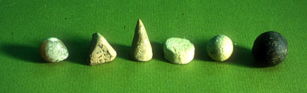
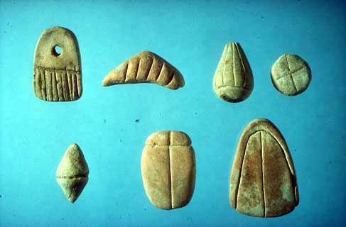
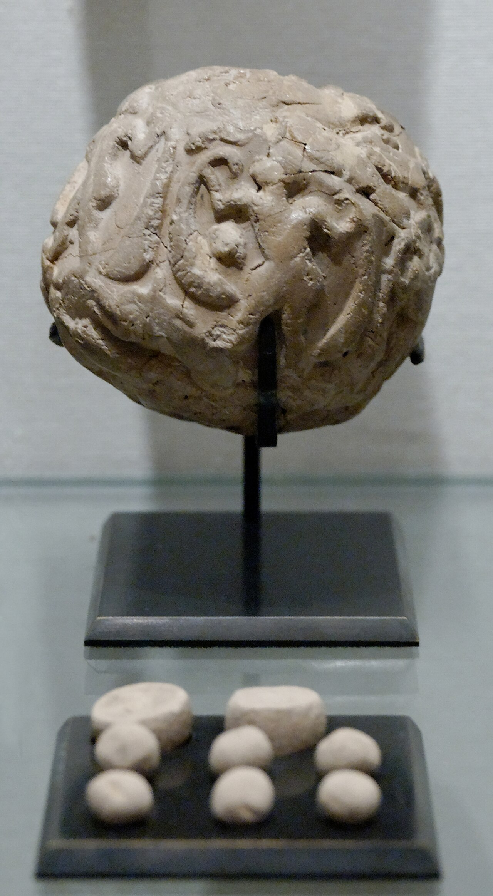
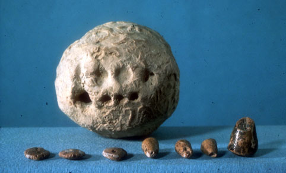
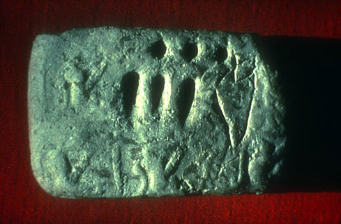

+++
author = "Yuichi Yazaki"
title = "Shape for the Item, Count for the Quantity: Mesopotamian Clay Tokens, as Schmandt-Besserat Reads Them"
slug = "mesopotamian-clay-tokens"
date = "2026-11-01"
description = "In Schmandt-Besserat's decipherment, clay tokens recorded items by shape and quantities by count. She argues they were used for calculation, and sees the marks pressed onto envelopes as the beginning of writing."
categories = [
    "consume"
]
tags = [
    "data physicalization",
    "clay tokens",
    "Denise Schmandt-Besserat"
]
image = "images/envelope-louvre-sb1932.jpg"
+++

In the decipherment by the researcher Denise Schmandt-Besserat, clay tokens are records that expressed the item by shape and the quantity by count. In her reading, one cone stands for one small unit of grain, and two ovoids stand for two jars of oil. She explains that the tokens were used for calculation and could be organized by lining them up in columns and the like, and she sees the marks pressed onto the surface of envelopes as the beginning of writing.

Clay tokens is a general name for small clay counters excavated from prehistoric sites in West Asia. The collection dataphys.org lists them as "5500 BC – Mesopotamian Clay Tokens," but Schmandt-Besserat dates their appearance to around 7500 BC and gives their range as Syria to Iran. Her decipherment has also drawn criticism from archaeology. Below, I read it alongside her writing hosted at the University of Texas at Austin and the Louvre's records.

<!--more-->

## Cones for Grain, Ovoids for Oil: The Convention of Shape and Count

Schmandt-Besserat's main works are the two-volume *Before Writing* (1992) and *How Writing Came About* (1996). In a 2017 conversation, she says she came across small cones and similar objects in the storerooms of Middle Eastern museums, and saw the shapes of the tokens everywhere in the published volumes of the archaic texts from Uruk. In her decipherment, the basic mechanism is this.

> The fundamental principle of the token system was the substitution of a small clay counter for each unit of goods to be counted.

In other words, one small clay counter stood in for each unit of the goods being counted.

Source: University Museum, University of Pennsylvania / Denise Schmandt-Besserat, "Tokens: their Significance for the Origin of Counting and Writing"

The photo shows tokens from Tepe Gawra in present-day Iraq, dated to around 4000 BC. According to the figure's caption, the cone, sphere, and flat disc are the small, medium, and large units of grain, and the tetrahedron is a unit of labor (with a question mark: "one man-day?").

Quantity was expressed one-to-one.

> Two jars of oil were shown by two ovoids and three jars of oil were marked by three ovoid tokens.

Two jars of oil are two ovoids, and three jars are three ovoids. Oil is counted only with ovoids. Size also carried meaning: she writes that many shapes were made in two sizes, about 1 cm and about 3 cm in diameter, to express a difference in amount.

The table below summarizes how data corresponds to the properties of the object, drawn from her writing. The ancient side left no legend; everything here is her decipherment.

| Data | Property of the object | Example (Schmandt-Besserat's explanation) |
|---|---|---|
| Item | Shape | Cone, sphere = grain; ovoid = jar of oil; cylinder, lenticular disc = livestock; tetrahedron = labor |
| Quantity | Count (one-to-one) | 3 ovoids = 3 jars of oil |
| Large vs. small unit | Size | Many shapes come in two sizes, about 1 cm and about 3 cm |
| Quality, subcategory | Incised lines, dots | Discs with different numbers of parallel lines = quality of textiles |
| One debt | Container, string | Sealed inside a hollow envelope; pierced and tied with string |
| Contents of the envelope | Impressions on the surface | Cone → wedge-shaped mark; sphere → circular mark |
| Classification, totals | Arrangement (columns, above/below) | Said to have been divided into columns by item, income and expenditure, and donor and recipient |
| Calculation | Moving, removing | The four arithmetic operations |

Her own texts also waver. One page treats the flat disc as the largest unit of grain, while "From Accounting to Writing" writes "a disc for sheep." The table is not a settled dictionary; it is a reading assembled by a researcher.

## From 12 Types to 350, with Incised Lines Distinguishing Quality

According to Schmandt-Besserat, the roughly 12 shapes of around 7500 BC grew to roughly 350 by around 3500 BC. She explains that this was to count the goods made in the workshops of the cities. In the urban period of 3500–3100 BC, complex tokens appeared with lines and dots incised on the surface, and the lines and dots added information about quality.

Source: Musée du Louvre, Département des Antiquités Orientales / Denise Schmandt-Besserat, "Tokens and Writing: the Cognitive Development"

The photo shows complex tokens from Susa in Iran, dated to around 3300 BC. The caption reads the top row, from the right, as sheep, jar of oil, metal ingot, and garment, and the bottom row, from the right, as garment, unknown, and beehive. The "?" attached to the one unknown piece shows the nature of the work of decipherment.

On their use, she is explicit.

> There is no evidence that tokens were used for trade. Instead they were central to administration.

The claim is that there is no evidence of use in trade, and that the tokens were central to administration. Her theory is that they were used to manage a redistributive economy, in which the community's surplus was collected and handed out again at festivals and the like.

Put in the vocabulary of visualization, this can be read as follows: shape corresponds to category, count to a quantity obtained by repeating the unit symbol and counting, size to the level of the unit, and incised lines to a subcategory.

## They Could Be Moved by Hand to Calculate and Arranged in Columns

Tokens were tactile records.

> Data processing with tokens was tactile. The counters were meant to be grasped and manipulated with the fingers. Addition, subtraction, multiplication and division of quantities of commodities were done by moving or removing counters by hand.

They were meant to be picked up and moved with the fingers, and the four arithmetic operations were done by moving or removing counters by hand. On how they were arranged, her 2013 paper "Tokens and Writing: the Cognitive Development" contains the following.

> With tokens, the Near Eastern accountants could organize the budget for a festival in columns according to – Types of goods – Entries and expenditures – Donors or recipients

> Goods symbolized by tokens could be lined up according to their relative value – Large units above – Small units below

The statement is that a festival budget could be set out in columns by item, income and expenditure, and donor and recipient, and that units of higher value could be placed above and smaller units below.

**The word used is "could."** It is not a record that they were excavated lined up in columns. The footnote at this passage cites research in linguistics and the history of mathematics on counting and measurement (Justus, Høyrup). In the writing of hers that I read, in the Louvre's records, and in the review discussed later, I found no description of any excavated example arranged in columns.

The dataphys.org entry quotes her 1999 text and summarizes it this way.

> Clay tokens suggest that physical objects were used to externalize information, support visual thinking and enhance cognition way before paper and writing were invented.

This places the tokens as an example of objects externalizing information and aiding thought, long before paper and writing. The entry is tagged rearrangeable.

Even if we cannot confirm that they were lined up in columns, they can be read as a record that could be rearranged. Because one piece corresponds to one item of goods, the grouping can be changed just by moving the pieces. The rows and columns of a table can be read as one way of using that freedom.

## Marks Pressed onto the Envelope Become Writing

Around 3300 BC, hollow clay spheres appear, the so-called envelopes. According to Schmandt-Besserat, tokens representing the amounts not yet delivered were placed inside and kept until payment.

Source: Photo by Marie-Lan Nguyen, Musée du Louvre (Sb 1932) / Wikimedia Commons (photo: CC BY 2.5)

Sb 1932 at the Louvre is an envelope from Susa, Proto-Urban period (around 3500–2900 BC), 5.1 cm in diameter. Its surface bears several cylinder-seal impressions. The museum's record describes "six deliberately drawn vertical lines" in the design and adds a question mark: "numbers?"

In Schmandt-Besserat's explanation, once the envelope was closed the contents could not be seen, so the users, whom she calls accountants, pressed the tokens onto the damp surface before sealing to indicate what was inside. A cone becomes a wedge-shaped mark, and a sphere becomes a circular mark.

Source: Musée du Louvre, Département des Antiquités Orientales / Denise Schmandt-Besserat, "Tokens: their Significance for the Origin of Counting and Writing"

The figure of another envelope from Susa carries captions explaining that the lenticular discs each stand for a "flock" (10 animals?), the large cone for a very large unit of grain, and the small cone for a small unit. By her account, within about a century envelopes were replaced by clay tablets bearing only the impressions.

> Reducing the three–dimensional tokens to two–dimensional signs proved revolutionary: It was the invention of writing.

The claim is that replacing three-dimensional tokens with two-dimensional signs was the invention of writing. The envelope can be read as one of the earliest examples in which the surface shown outside and the substance held inside were separated.

One-to-one counting does not suit large quantities. On tablets of around 3100 BC, the wedge-shaped mark that had been the unit of grain became the numeral "1," and the circular mark became "10."

Source: T. Cuyler Young Jr. and Royal Ontario Museum / Denise Schmandt-Besserat, "Tokens and Writing: the Cognitive Development"

On the tablet from Godin Tepe in Iran, three circles (10×3) and three wedges (1×3) are followed by the sign for "jar of oil," expressing 33 jars of oil. Schmandt-Besserat sees this as a change in which numbers were detached from items and became usable for anything.

## How Did Third Parties See This Theory?

The harshest is the review of *Before Writing* that the archaeologist Paul Zimansky wrote in 1993 in the *Journal of Field Archaeology*.

> For the first time the author has put most of her cards on the table… and made it possible to review the substance and validity of her work. The result is devastating.

The assessment is that the author had for the first time laid out her hand, making it possible to examine her claims, and that the result was devastating. Zimansky points to the vagueness of the token classification and to the problem with a method that relies on shapes being "similar" to connect tokens with written signs, and he also points out errors in the catalog. He also counts that, of the 50 complex tokens linked to written signs, 18 have only a single example. Against her claim that all the main tokens of the urban period were found in envelopes, he counters that the shapes of particular complex tokens have hardly ever come from envelopes. The table's "correspondence of shape and item" is a reading that has received this kind of criticism.

Research on data physicalization put this theory at the starting point of the field. The CHI 2015 paper "Opportunities and Challenges for Data Physicalization" by Yvonne Jansen and colleagues opens with this.

> More than 7000 years ago, the Sumerians used clay tokens to represent quantitative data well before inventing written language

The sentence says that more than 7,000 years ago the Sumerians used clay tokens to represent quantitative data, well before inventing written language. The source is *How Writing Came About*, but "the Sumerians" and "7000 years ago" are broad phrasings that do not match the region and dates she gives.

The 2017 conversation in the journal *Exchanges* raises another point. The anthropologist Bill Maurer set the tokens beside Bitcoin and said that both are in essence accounting systems. This can be summarized as a view that reads them as tools of bookkeeping and social guarantee rather than as representations for viewing. Schmandt-Besserat herself says that some researchers think numbers were abstract from the start, so interpretations are divided.

## Takeaways

The first is to check who wrote the legend. The correspondence between shapes and items was not left by the ancient users; it is a reading assembled by twentieth-century researchers. The account that places the tokens at the origin of the lineage of data physicalization also stands on top of it. When citing old sources, it is better to cite where the correspondence table comes from, together with the criticism of it.

The second is the design of matching one piece to one item of goods. Because one piece is one unit, the pieces can be regrouped just by moving them, whether by item, by income and expenditure, or by size. The arrangement in columns and above/below is not a confirmed fact, but we can read from it that making each unit a separate object makes rearrangement free.

The third is the limit of one-to-one counting. Thirty-three jars of oil are 33 ovoids with tokens, and with a clay tablet are three circles, three wedges, and the sign for the item. Expressing by repeating the unit conveys small numbers intuitively, but becomes unwieldy as the quantity grows. In physicalization where the count itself becomes the number of objects, you need to decide in advance up to what scale you will count.

## References

**Primary sources**

- dataphys.org, "5500 BC – Mesopotamian Clay Tokens" (added by Pierre Dragicevic): https://dataphys.org/list/mesopotamian-clay-tokens/
- Denise Schmandt-Besserat, "Tokens and Writing: the Cognitive Development," *Symbols at 'Ain Ghazal*, ex oriente, Berlin, 2013, pp.56–62: https://sites.utexas.edu/dsb/tokens/tokens-and-writing-the-cognitive-development/ (PDF: https://sites.utexas.edu/dsb/wp-content/uploads/sites/3043/2014/01/TokensWriting_the_Cognitive_Development.pdf )
- Denise Schmandt-Besserat, "Tokens and Writing: The Cognitive Development," 'Ain Ghazal Excavation Reports 3, Chapter 2.3, 2018: https://sites.utexas.edu/dsb/?p=578 (Texas ScholarWorks: https://hdl.handle.net/2152/79833 )
- Denise Schmandt-Besserat, "Tokens: their Significance for the Origin of Counting and Writing": https://sites.utexas.edu/dsb/tokens/tokens/
- Denise Schmandt-Besserat, "From Accounting to Writing": https://sites.utexas.edu/dsb/tokens/from-accounting-to-writing/
- Denise Schmandt-Besserat, "Tokens: The Cognitive Significance," 1999 (the link target from dataphys.org; the original could not be retrieved and is unverified): http://www.laits.utexas.edu/ghazal/Chap1/dsb/chapter1.html
- Musée du Louvre, Sb 1932 "Bulle avec empreinte et jetons": https://collections.louvre.fr/ark:/53355/cl010175963
- Wikimedia Commons, "Accountancy clay envelope Louvre Sb1932.jpg" (photo by Marie-Lan Nguyen, CC BY 2.5): https://commons.wikimedia.org/wiki/File:Accountancy_clay_envelope_Louvre_Sb1932.jpg

**Secondary sources**

- Paul Zimansky, Review of *Before Writing*, Vols. I–II, *Journal of Field Archaeology* 20(4), 1993, pp.513–517: https://urkesh.org/attach/Zimansky1993.pdf (JSTOR: https://www.jstor.org/stable/530080 )
- Yvonne Jansen, Pierre Dragicevic, Petra Isenberg, Jason Alexander, Abhijit Karnik, Johan Kildal, Sriram Subramanian, Kasper Hornbæk, "Opportunities and Challenges for Data Physicalization," CHI 2015: https://doi.org/10.1145/2702123.2702180 (author version: https://ndownloader.figshare.com/files/41160233 )
- Wilding, D., Rowan, C., Maurer, B., Schmandt-Besserat, D., "Tokens, Writing and (Ac)counting: A Conversation with Denise Schmandt-Besserat and Bill Maurer," *Exchanges* 5(1), 2017: https://doi.org/10.31273/eirj.v5i1.196 (https://exchanges.warwick.ac.uk/index.php/exchanges/article/view/196 )
