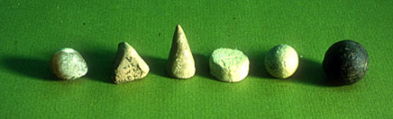
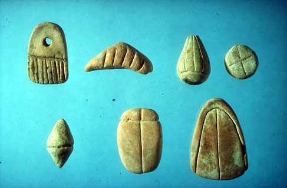
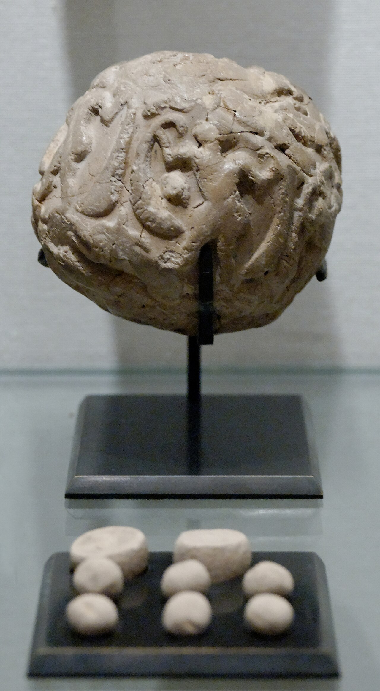
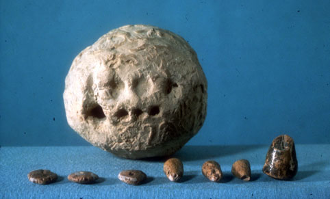
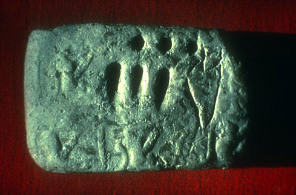

+++
author = "矢崎裕一"
title = "形で品目を、個数で数量を記す──メソポタミアの粘土トークン"
slug = "mesopotamian-clay-tokens"
date = "2026-11-01"
description = "粘土トークンは、形で品目を、個数で数量を表した記録です。研究者シュマント＝ベッセラは、並べ替えて計算に使われ、封筒に押した跡が文字の始まりになったとみています。"
categories = [
    "consume"
]
tags = [
    "データ物質化",
    "粘土トークン",
    "Denise Schmandt-Besserat"
]
image = "images/envelope-louvre-sb1932.jpg"
series = ["data-physicalization"]
series_weight = 11
seriesByline = "古代西アジアの会計係"
seriesTitle = "形で品目、個数で数量を記す──粘土トークン"
+++

粘土トークンは、形で品目を、個数で数量を表した記録です。円錐1個は穀物の小さな単位を1つ、卵形2個は油の壺を2つ表します。研究者の Denise Schmandt-Besserat（デニス・シュマント＝ベッセラ）は、トークンが並べ替えて計算や分類に使われたと説明し、封筒の表面に押した跡が文字の始まりになったとみています。

粘土トークンは一人の作者の作品ではなく、西アジアの先史時代の遺跡から出た、小さな粘土の計数具の総称です。事例集 dataphys.org には「5500 BC – Mesopotamian Clay Tokens」として載っていますが、シュマント＝ベッセラは出現を紀元前7500年ごろ、範囲をシリアからイランとしています。形と品目の対応は彼女の解読で、考古学からの批判もあります。以下は、テキサス大学オースティン校にある彼女の文章と、ルーヴル美術館の記録に沿って読みます。

<!--more-->

## 円錐は穀物、卵形は油──形と個数の約束

シュマント＝ベッセラの主著は『Before Writing』全2巻（1992）と『How Writing Came About』（1996）です。2017年の対談では、中東の博物館の収蔵庫で小さな円錐などに行き当たり、ウルクの古拙文書の刊行本に、トークンの形を至るところに見たと語っています。彼女の解読では、仕組みの根本はこうです。

> The fundamental principle of the token system was the substitution of a small clay counter for each unit of goods to be counted.

数える品物の1単位ごとに、小さな粘土の計数具を1個置き換える、という説明です。

University Museum, University of Pennsylvania 所蔵／Denise Schmandt-Besserat「Tokens: their Significance for the Origin of Counting and Writing」より引用

写真は、現在のイラクにあるテペ・ガウラから出た、前4000年ごろのトークンです。図の説明では、円錐・球・平たい円盤が穀物の小・中・大の単位、四面体が労働の単位（「一人一日か？」と疑問符つき）です。

数量は一対一で表しました。

> Two jars of oil were shown by two ovoids and three jars of oil were marked by three ovoid tokens.

油の壺2つは卵形2個、3つは卵形3個で示した、という一文です。油は卵形でしか数えません。大きさにも意味があり、多くの形は直径約1 cmと約3 cmの2種類で作られ、量の違いを表した、と彼女は書いています。

彼女の文章から、データと物の性質の対応をまとめます。古代の側が残した凡例はなく、すべて彼女の解読です。

| データ | 物の性質 | 例（シュマント＝ベッセラの説明） |
|---|---|---|
| 品目 | 形 | 円錐・球＝穀物、卵形＝油の壺、円筒・レンズ形円盤＝家畜、四面体＝労働 |
| 数量 | 個数（一対一） | 卵形3個＝油の壺3つ |
| 単位の大小 | 大きさ | 多くの形に約1 cmと約3 cmの2種類 |
| 質・下位分類 | 刻線・点 | 平行線の本数が違う円盤＝織物の品質 |
| 一件の債務 | 容器・紐 | 中空の封筒に入れる、穴をあけて紐で留める |
| 封筒の中身 | 表面の押し跡 | 円錐→楔形の印、球→円形の印 |
| 分類・集計 | 配置（列・上下） | 品目、収支、納める側と受け取る側の列に分けられた、とする |
| 計算 | 移動・除去 | 四則の計算 |

彼女の文章のあいだにも揺れがあります。平たい円盤を穀物の最大単位とするページがある一方、「From Accounting to Writing」は「a disc for sheep」（円盤＝羊）と書いています。表は確定した辞書ではなく、研究者が組み立てた読みです。

## 12種から350種へ、刻線が質を書き分ける

シュマント＝ベッセラによると、前7500年ごろに約12種だった形は、前3500年ごろには約350種になりました。都市の工房が作る品物を数えるためだった、と彼女は説明します。前3500〜3100年の都市期には、表面に線や点を刻んだ複合トークン（complex tokens）が現れ、線や点が質の情報を加えました。

Musée du Louvre, Département des Antiquités Orientales 所蔵／Denise Schmandt-Besserat「Tokens and Writing: the Cognitive Development」より引用

写真はイランのスーサから出た、前3300年ごろの複合トークンです。図の説明は、上段を右から羊、油の壺、金属の鋳塊、衣服、下段を右から衣服、不明、蜂の巣と読みます。不明の1点に「?」が付いているところに、解読という作業の性格が出ています。

用途について、彼女ははっきり書いています。

> There is no evidence that tokens were used for trade. Instead they were central to administration.

交易に使われた証拠はなく、行政の中心にあった、という主張です。共同体の余剰を集め、祭礼などに配り直す再分配経済の管理に使われた、というのが彼女の説です。

可視化の言葉に置き換えると、形はカテゴリ、個数は単位の記号を繰り返して数える量、大きさは単位の段階、刻線はサブカテゴリにあたる、と読めます。350種への増加は、カテゴリが増えるたびに凡例を足していった歴史とも読めます。

## 手で動かして計算し、列に並べることもできた

トークンは触れる記録でした。

> Data processing with tokens was tactile. The counters were meant to be grasped and manipulated with the fingers. Addition, subtraction, multiplication and division of quantities of commodities were done by moving or removing counters by hand.

指でつまんで動かすためのもので、四則の計算は計数具を手で動かしたり取り除いたりして行った、という説明です。並べ方については、2013年の論文「Tokens and Writing: the Cognitive Development」に次の記述があります。

> With tokens, the Near Eastern accountants could organize the budget for a festival in columns according to – Types of goods – Entries and expenditures – Donors or recipients

> Goods symbolized by tokens could be lined up according to their relative value – Large units above – Small units below

祭礼の予算を、品目、収支、納める側と受け取る側の列に分けて組めた。価値の大きい単位を上、小さい単位を下に並べられた、という記述です。

**使われている言葉は「could」、つまり「そうできた」です。** 列に並んだ状態で出土した、という記録ではありません。この箇所の脚注が挙げるのは、数え方や計量に関する言語学・数学史の研究（Justus、Høyrup）です。今回読んだ彼女の文章、ルーヴルの記録、後で触れる書評のどれにも、列状の出土例の記述は見当たりませんでした。

dataphys.org の項目は、1999年の彼女の文章を引いたうえで、こうまとめています。

> Clay tokens suggest that physical objects were used to externalize information, support visual thinking and enhance cognition way before paper and writing were invented.

紙や文字より前に、物が情報を外に出し、考えることを助けた例だ、という位置づけです。項目のタグには rearrangeable（並べ替えられる）が付いています。

列に並べたかは確かめられなくても、並べ替えられる記録だったことは物の性質から言えます。一つの品物に一つの小片が対応しているので、置き場所を変えるだけでまとめ方を変えられます。表の行と列は、その自由さの使い方の一つとして想定されている、と読めます。

## 封筒の表面に押した跡が、文字になる

前3300年ごろ、中空の粘土の球、いわゆる封筒（envelope）が現れます。シュマント＝ベッセラによると、納められていない分を表すトークンを入れ、支払われるまで保管しました。

Marie-Lan Nguyen 撮影・ルーヴル美術館所蔵（Sb 1932）／Wikimedia Commons より引用（写真は CC BY 2.5）

ルーヴル美術館の Sb 1932 は、スーサ出土、原都市期（前3500〜2900年ごろ）、直径5.1 cmの封筒です。表面には円筒印章の跡が複数あります。館の記録は、図柄の中の「意図的に引かれた6本の縦線」について「数字か？」と疑問符つきで書いています。

封筒は閉じると中が見えません。そこで会計係は、封じる前に、中に入れるトークンを湿った表面に押しつけました。円錐は楔形の印に、球は円形の印になります。

Musée du Louvre, Département des Antiquités Orientales 所蔵／Denise Schmandt-Besserat「Tokens: their Significance for the Origin of Counting and Writing」より引用

スーサの別の封筒の図には、レンズ形の円盤はそれぞれ「群れ」（10頭か？）、大きな円錐は穀物のとても大きな単位、小さな円錐は小さな単位、という説明が付いています。表面の跡と中のトークンを見比べられる例です。1世紀ほどのうちに、封筒は押し跡だけの粘土板に置き換わります。

> Reducing the three–dimensional tokens to two–dimensional signs proved revolutionary: It was the invention of writing.

立体のトークンを平面の記号に置き換えたことが、文字の発明だった、という主張です。封筒は、外に見せる面と、中に入れた実体が分かれた最初期の例として読めます。

一対一の数え方は大きな量に向きません。前3100年ごろの粘土板では、穀物の単位だった楔形の印が「1」、円形の印が「10」の数詞になりました。

T. Cuyler Young Jr.・Royal Ontario Museum／Denise Schmandt-Besserat「Tokens and Writing: the Cognitive Development」より引用

イランのゴディン・テペの粘土板では、円形3つ（10×3）と楔形3つ（1×3）に「油の壺」の記号が続き、油の壺33個を表します。数は品目から離れ、何にでも使えるようになりました。

## 第三者はこの説をどう見たか

いちばん厳しいのは、考古学者 Paul Zimansky（ポール・ジマンスキー）が1993年に *Journal of Field Archaeology* に書いた『Before Writing』の書評です。

> For the first time the author has put most of her cards on the table… and made it possible to review the substance and validity of her work. The result is devastating.

著者が初めて手の内を明かし、主張を検証できるようにした。結果は壊滅的だ、という評価です。Zimansky は、トークンの分類があいまいなこと、形が「似ている」ことに頼って文字記号と結びつける方法に問題があることを挙げ、カタログの誤りも指摘しました。文字記号に結びつけられた複合トークン50種のうち、18種は1例しかないとも数えています。都市期の主なトークンはすべて封筒から見つかる、という彼女の主張には、特定の複合トークンの形はほとんど封筒から出ていない、と反論しています。表の「形と品目の対応」は、こうした批判を受けている読みです。

データ物理化の研究は、この説を分野の出発点に置きました。Yvonne Jansen（イヴォンヌ・ヤンセン）らの CHI 2015 の論文「Opportunities and Challenges for Data Physicalization」は、冒頭でこう書きます。

> More than 7000 years ago, the Sumerians used clay tokens to represent quantitative data well before inventing written language

7000年以上前、シュメール人は書き言葉より前に、粘土トークンで量のデータを表した、という一文です。出典は『How Writing Came About』ですが、「シュメール人」「7000年前」は彼女の示す地域・年代と一致しない、概説的な言い方です。

2017年の *Exchanges* 誌の対談では、別の論点も出ています。人類学者の Bill Maurer（ビル・モーラー）は、トークンを Bitcoin と並べ、どちらも本質は会計の仕組みだと述べました。見るための表現より、記帳と社会的な保証の道具として読む視点です。シュマント＝ベッセラ自身は、数が当初から抽象的だったとみる研究者もいて、解釈が分かれていると語っています。

## 使い道

一つ目は、凡例を誰が書いたかを確かめることです。形と品目の対応は、古代の会計係が残したものではなく、20世紀の研究者が組み立てた読みです。データ物理化の系譜の起点に置く話も、その上に立っています。古い資料を引くときは、対応表の出どころと、それへの批判を一緒に引くのがよいと言えます。

二つ目は、一つの品物に一つの小片を対応させる設計です。1個が1単位なので、置き場所を変えるだけで、品目別にも、収支別にも、大小順にもまとめ直せます。列や上下の配置は確かめられた事実ではありませんが、単位を一つずつ物にすると並べ替えが自由になることは読み取れます。付箋やブロックでデータを並べる作業にも、同じ性質があります。

三つ目は、一対一の数え方の限界です。油の壺33個を、トークンなら卵形33個で、粘土板なら円3つと楔3つと品目の記号で表します。単位を繰り返す表し方は少ない数を直感的に伝えますが、量が増えると扱いにくくなります。個数をそのまま物の数にする物理化では、どの規模まで数えるかを先に決めておく必要があります。

## 参考・出典

**一次情報**

- dataphys.org, "5500 BC – Mesopotamian Clay Tokens"（Pierre Dragicevic 追加）：https://dataphys.org/list/mesopotamian-clay-tokens/
- Denise Schmandt-Besserat, "Tokens and Writing: the Cognitive Development," *Symbols at 'Ain Ghazal*, ex oriente, Berlin, 2013, pp.56–62：https://sites.utexas.edu/dsb/tokens/tokens-and-writing-the-cognitive-development/ （PDF：https://sites.utexas.edu/dsb/wp-content/uploads/sites/3043/2014/01/TokensWriting_the_Cognitive_Development.pdf ）
- Denise Schmandt-Besserat, "Tokens and Writing: The Cognitive Development," 'Ain Ghazal Excavation Reports 3, 2.3章, 2018：https://sites.utexas.edu/dsb/?p=578 （Texas ScholarWorks：https://hdl.handle.net/2152/79833 ）
- Denise Schmandt-Besserat, "Tokens: their Significance for the Origin of Counting and Writing"：https://sites.utexas.edu/dsb/tokens/tokens/
- Denise Schmandt-Besserat, "From Accounting to Writing"：https://sites.utexas.edu/dsb/tokens/from-accounting-to-writing/
- Denise Schmandt-Besserat, "Tokens: The Cognitive Significance," 1999（dataphys.org のリンク先。原文は取得できず未確認）：http://www.laits.utexas.edu/ghazal/Chap1/dsb/chapter1.html
- Musée du Louvre, Sb 1932 "Bulle avec empreinte et jetons"：https://collections.louvre.fr/ark:/53355/cl010175963
- Wikimedia Commons, "Accountancy clay envelope Louvre Sb1932.jpg"（Marie-Lan Nguyen 撮影、CC BY 2.5）：https://commons.wikimedia.org/wiki/File:Accountancy_clay_envelope_Louvre_Sb1932.jpg

**第三者評価**

- Paul Zimansky, Review of *Before Writing*, Vols. I–II, *Journal of Field Archaeology* 20(4), 1993, pp.513–517：https://urkesh.org/attach/Zimansky1993.pdf （JSTOR：https://www.jstor.org/stable/530080 ）
- Yvonne Jansen, Pierre Dragicevic, Petra Isenberg, Jason Alexander, Abhijit Karnik, Johan Kildal, Sriram Subramanian, Kasper Hornbæk, "Opportunities and Challenges for Data Physicalization," CHI 2015：https://doi.org/10.1145/2702123.2702180 （著者版：https://ndownloader.figshare.com/files/41160233 ）
- Wilding, D., Rowan, C., Maurer, B., Schmandt-Besserat, D., "Tokens, Writing and (Ac)counting: A Conversation with Denise Schmandt-Besserat and Bill Maurer," *Exchanges* 5(1), 2017：https://doi.org/10.31273/eirj.v5i1.196 （https://exchanges.warwick.ac.uk/index.php/exchanges/article/view/196 ）
