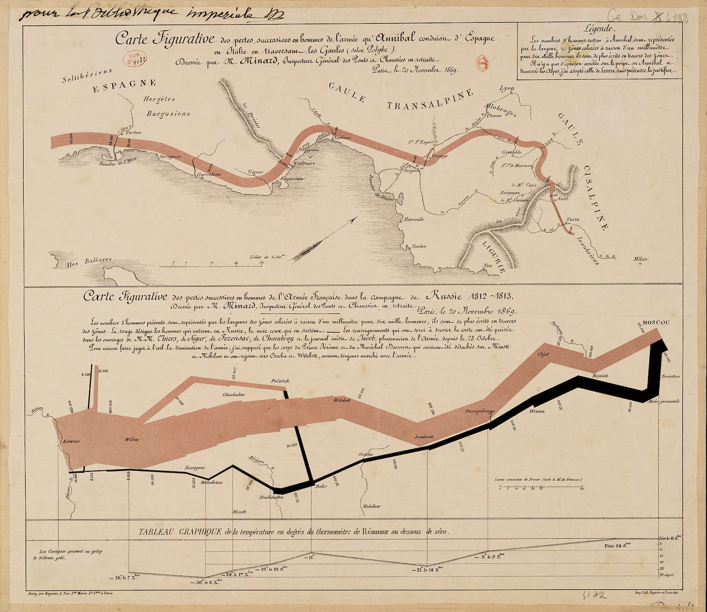
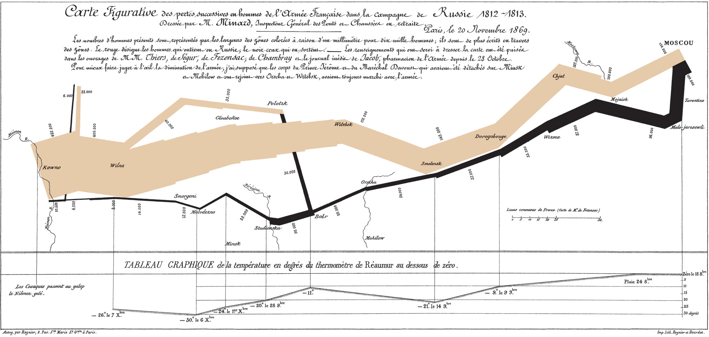
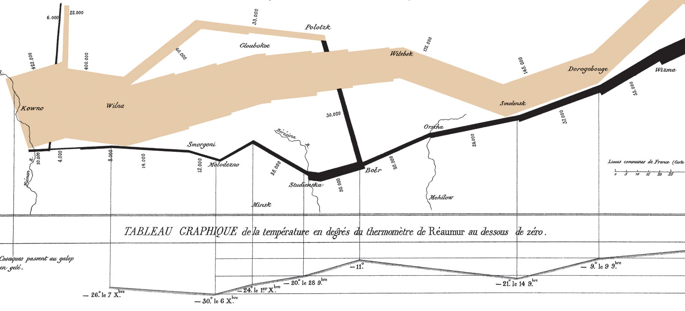

+++
author = "Yuichi Yazaki"
title = "10,000 Men per Millimeter: Minard's 1869 Chart Drawing Napoleon's and Hannibal's Armies by the Same Rule"
slug = "minard-napoleon-march-to-moscow"
date = "2025-10-06"
description = "In 1869, Minard set the width of his bands at 1 mm per 10,000 men, drawing the advance in red and the retreat in black. He showed an army of 422,000 shrinking to 10,000 beside the retreat temperatures, printed on one sheet with his Hannibal chart."
categories = [
    "consume"
]
tags = [
    "Minard",
    "Tufte",
    "Marey",
    "flow map",
    "Sankey diagram",
    "map"
]
image = "images/cover.png"
+++

In 1869, Charles Joseph Minard fixed the width of his bands at "1 mm per 10,000 men" and drew the advance in red and the retreat in black. The chart shows how an army of 422,000 men came back to the border as 10,000, together with the temperatures during the retreat. Minard printed it on the same sheet of paper as a chart of Hannibal's army, drawn by the same rule.

The title of the chart is "Carte figurative des pertes successives en hommes de l'Armée Française dans la campagne de Russie 1812–1813" (a figurative map of the successive losses of men of the French Army in the Russian campaign of 1812–1813). What follows relies on the legend and figures written into the chart, the impression held by the Bibliothèque nationale de France (BnF), and the introduction Étienne-Jules Marey wrote in 1878.

<!--more-->

## One sheet printed in Paris on 20 November 1869

Below the title is the line "Paris, le 20 Novembre 1869". The signature is that of the Ponts et Chaussées (the Corps of Bridges and Roads): "Inspecteur Général … en retraite" (Inspector General, retired). The chart was printed as a lithograph.

Minard was born in Dijon in 1781 and, according to National Geographic, was 88 when he made this chart. According to the biography on Wikipedia, he was a civil engineer who worked on ports, dams, canals, and bridges. Railways were one of his lecture topics, but he was not a "railway engineer." He became an Inspector General in 1846, retired in 1851 at the age of 70, and only then began making statistical maps in earnest. He produced 51 thematic maps and statistical graphics.

In the BnF impression, this chart is the lower half of a single sheet. The upper half holds a chart of Hannibal's army, showing its progress from Spain across Gaul into Italy.

Source: Charles Joseph Minard, 1869. Collection of the Bibliothèque nationale de France (BnF) (Gallica btv1b52504201x) / via Wikimedia Commons. Public domain

At the top edge of the sheet is a handwritten note: "pour la Bibliothèque impériale" (for the Imperial Library). The two charts carry the same date and fit within the same frame. Ten months later, in September 1870, in the middle of the Franco-Prussian War, Minard left Paris, and he died in Bordeaux on 24 October.

## Band width: 1 mm for 10,000 men

The legend of the Napoleon chart is written below the title. Its first two sentences give the visual rule.

> Les nombres d'hommes présents sont représentés par les largeurs des zones colorées à raison d'un millimètre pour dix mille hommes ; ils sont de plus écrits en travers des zones. Le rouge désigne les hommes qui entrent en Russie, le noir ceux qui en sortent.

In other words: the number of men present at a given point is shown by the width of the colored band, with 1 mm standing for 10,000 men. The number is also written across the band. Red marks the men entering Russia, black those leaving it.

Source: Charles Joseph Minard, 1869 / via Wikimedia Commons (File:Minard.png). Public domain

In this reproduction the advance band looks light brown, but the legend says "rouge" (red). Wikipedia also notes "The red [now brown]." In the BnF impression it looks like a dull red.

Here are the numbers written on the bands, taken in the order of the advance: 422,000 at the Niemen near Kowno, 400,000 at Wilna, 175,000 at Witebsk, 145,000 at Smolensk, 127,100 at Chjat, and 100,000 at Mojaisk and Moscow. The black retreat band falls from 100,000 to 55,000, then to 24,000.

The correspondence between data and appearance is as follows.

| Data | Appearance | Concrete example on the chart |
|---|---|---|
| Number of men at that point | Band width (1 mm = 10,000 men) | 422,000 men at the Niemen; calculated width 42 mm |
| The same number of men | Figures written along the band | "422.000," "100.000," and so on |
| Advancing or returning | Band color (red = entering, black = leaving) | In the reproduction, the red looks light brown |
| Route | Position the band takes on the map | Place names such as Kowno, Wilna, Smolensk, MOSCOU |
| Distance | Scale bar | 0–50 French lieues communes |
| Detached units and their rejoining | Branching of the bands and addition of widths | At Bobr, 20,000 + 30,000 = 50,000 |
| Temperature during the retreat | Height of the line in the lower panel | 0 to −30 degrees Réaumur |
| Date | Text attached to each temperature point | "le 6 Xbre" (6 December), and so on |
| Link between map and temperature | Thin vertical guide lines | From the temperature points to places on the retreat route |

**When a branched band rejoins, the widths add up.** The 30,000 band that comes down south from near Polotzk joins the main force's 20,000 at Bobr to make 50,000. At the end, the 4,000 band is joined by 6,000 returning from the north, making 10,000 at the Niemen.

Source: Charles Joseph Minard, 1869 (detail) / via Wikimedia Commons (File:Minard.png). Public domain

The last figure on the chart is exactly 10,000, about 2.4% of the 422,000. Because the widths are drawn so that they can be added, the units that split off along the way can be read with the same yardstick. Wikipedia writes that band diagrams of this kind were later called Sankey diagrams.

## The temperature panel, and what Minard assumed

The title of the lower panel is "TABLEAU GRAPHIQUE de la température en degrés du thermomètre de Réaumur au dessous de zéro" (a graphic table of the temperature in degrees of the Réaumur thermometer below zero). A scale from 5 to 30 degrees runs along the right edge.

The values written in run from 0 degrees on "le 18 8bre" (18 October) at the right edge, through −21 degrees on 14 November and −30 degrees on 6 December, to −26 degrees on 7 December at the left edge. The lowest value, −30 degrees, is −37.5 °C (1 degree Réaumur = 1.25 °C).

The dates run from right to left. The horizontal position of each point is matched to a place on the retreat route above, and thin vertical lines connect the two. As a result, the horizontal axis is not evenly spaced in time. The dates can be read as text added to an axis of place.

Temperature is drawn only for the black retreat band. The advance has no temperature. By the numbers on the bands, 322,000 of the 422,000 men were already gone before reaching Moscow. The chart holds only head counts and temperatures; it gives no cause of death.

Just before Moscow, the red band narrows suddenly, from 127,100 at Chjat to 100,000 at Mojaisk.

The second half of the legend lists the sources (the works of Thiers, Ségur, Fezensac, and Chambray, and the unpublished diary of Jacob, an army pharmacist) and the simplification Minard added himself.

> Pour mieux faire juger à l'œil la diminution de l'armée, j'ai supposé que les corps du Prince Jérôme et du Maréchal Davoust qui avaient été détachés sur Minsk et Mobilow et ont rejoint vers Orscha et Witebsk, avaient toujours marché avec l'armée.

In other words: to let the eye better judge the shrinking of the army, he assumed that the corps of Prince Jérôme and Marshal Davout, which had been detached toward Minsk and Mobilow and rejoined near Orscha and Witebsk, had marched with the army all along. The starting figure of 422,000 also includes this assumption; it is the number "in Minard's chart."

## On the same sheet as the Hannibal chart

The upper half is a chart of the losses of the army Hannibal led from Spain across Gaul into Italy, drawn after Polybius (Polybe). Here is a transcription of the legend at the upper right.

> Les nombres d'hommes restant à Annibal sont représentés par la largeur des zones colorées à raison d'un millimètre pour dix mille hommes, ils sont de plus écrits en travers des zones. Il n'y a pas d'opinion arrêtée sur le point où Annibal a traversé les Alpes, j'ai adopté celle de Larosa sans prétendre la justifier.

In other words: the number of men remaining to Hannibal is shown by band width, with 1 mm for 10,000 men, and the numbers are written across the bands. There is no settled opinion on where Hannibal crossed the Alps, and he adopted Larosa's view without claiming to justify it. The Crouch Rare Books catalogue explains that Larosa means Larauza.

The band is widest in Spain at the left, and after the Alps it becomes a thin line heading for Turin. Because the width rule is the same, comparing the upper and lower bands lets one set the size and shrinkage of the two armies against the same yardstick.

In 1878, Marey introduced this chart in *La méthode graphique dans les sciences expérimentales*. Only the Napoleon chart appears there, as Figure 37, and Hannibal's army gets a single phrase saying that it was drawn "ailleurs" (elsewhere). The widely circulated File:Minard.png on Commons is also a version with only the Napoleon chart. The pair on one sheet, it can be read, has been cut down to its lower half every time it has been introduced.

Richard Taws, at the opening of his article in *Grey Room* no. 83 (2021), writes that this chart was on the same page as the Hannibal chart. He also mentions that Minard left Paris ten months later, fearing the Prussian army. He then points out that while Tufte's verdict has been repeated, the chart has hardly been discussed in relation to contemporary visual representations outside the lineage of statistical maps.

## How others saw the chart

Among contemporary books, Marey introduced it in 1878. In his introduction of Figure 37, he puts the visual rule directly into words.

> Cette figure, construite au moyen de documents statistiques patiemment recueillis à différentes sources, traduit l'amoindrissement graduel de l'armée par le rétrécissement incessant d'une zone dont la largeur exprime le nombre des soldats de Napoléon.

This explains that the chart, built from statistical documents patiently collected from various sources, expresses the gradual diminution of the army through the ceaseless narrowing of a band whose width gives the number of Napoleon's soldiers. Marey also wrote, however, "Il n'est pas revenu un soldat sur cent" (not even one soldier in a hundred came back). By the chart's figures it is about 2.4%, so this sentence does not agree with the chart.

The standard modern praise comes from Edward Tufte. On page 40 of *The Visual Display of Quantitative Information* (1983), he wrote:

> It may well be the best statistical graphic ever drawn.

It is a verdict that this may be the best of all statistical graphics ever drawn.

Stephen Kosslyn raised doubts from the burden on the reader. Jorge Camões quoted Kosslyn's words in a 2008 blog post.

> This display has never captivated me for the simple reason that given human processing limitations – I needed several minutes to figure it out. (…) But if you want the facts and want them in a clear, easily understood way, this display is not the solution.

The criticism: human processing has limits, and it took him several minutes to work it out; if you want the facts clearly and easily, this chart is not the answer.

Camões himself questions the choice of what to draw in.

> Minard adds detail to explicitly link deaths to cold temperatures during retreat, but around 75% of men died on the way to Moscow and he doesn't tell us why.

His point: Minard added detail linking deaths during the retreat to cold, yet about 75% died on the way to Moscow, and the chart does not say why.

In a 2021 article, Robert Kosara names what was not drawn. Making the chart work required heavy simplification, and the more famous it became, the more the Russian army and militia who fought the French, and the harm to civilians, have dropped out of sight.

## What to take away

What a visualization practitioner can take from this chart is **to write the maker's decisions into the chart itself**. There are four concrete points.

- Fix one visual feature to carry quantity. Minard shows the number of men by width alone and uses color for direction. For a flow chart, first check whether widths can be added when flows merge.
- Write both the width and the number. The width shows the decline, and the number supports reading off values.
- Write the simplifications in the legend. Minard wrote into the chart that he had grouped army corps and that he had settled on a single theory for the Alpine crossing.
- Draw what you want to compare by the same rule, and put it on the same sheet. When you cut a chart out for use, consider whether to carry along its pair and its legend too.

Camões took issue with Minard drawing temperature only for the retreat. Kosara pointed out that the Russian side and the harm to civilians are not drawn. From the two critiques, it can be read that the choice of where to draw detail and what to leave undrawn becomes, as it stands, the chart's claim.

## References

**Primary sources**

- Charles Joseph Minard, *Carte figurative des pertes successives en hommes de l'armée qu'Annibal conduisit d'Espagne en Italie en traversant les Gaules (selon Polybe)* / *Carte figurative des pertes successives en hommes de l'Armée Française dans la campagne de Russie 1812–1813*, Paris, 20 November 1869, lithograph. Impression held by the Bibliothèque nationale de France (BnF) (Gallica btv1b52504201x): [Wikimedia Commons](https://commons.wikimedia.org/wiki/File:Carte_figurative_des_pertes_successives_en_hommes_de_l'armée_française_dans_la_Campagne_de_Russie_1812-13.jpg)
- Same, Napoleon chart only (with the French legend and an English translation): [Wikimedia Commons, File:Minard.png](https://commons.wikimedia.org/wiki/File:Minard.png)
- Étienne-Jules Marey, *La méthode graphique dans les sciences expérimentales*, Paris: G. Masson, 1878, pp. 72–73. [Internet Archive](https://archive.org/details/b21919070)

**Secondary sources**

- Edward R. Tufte, *The Visual Display of Quantitative Information*, Graphics Press, 1983, p. 40.
- Jorge Camões, "Minard, Tufte, Kosslyn and Godin (and Napoleon)," 2008. [excelcharts.com](https://excelcharts.com/minard-tufte-kosslyn-godin-napoleon/)
- Robert Kosara, "eagereyesTV: Minard's famous 'Napoleon's March' chart – what it shows, what it doesn't," *eagereyes*, 2021. [eagereyes.org](https://eagereyes.org/blog/2021/eagereyestv-minards-famous-napoleons-march-chart-what-it-shows-what-it-doesnt)
- Richard Taws, "Death from Above in Minard's Napoleon Map," *Grey Room*, no. 83, 2021, pp. 82–111. [doi:10.1162/grey_a_00321](https://doi.org/10.1162/grey_a_00321) / [Grey Room](https://greyroom.org/issues/83/136/death-from-above-in-minards-napoleon-map)
- Betsy Mason, "The Underappreciated Man Behind the 'Best Graphic Ever Produced'," *National Geographic*, 2017. [nationalgeographic.com](https://www.nationalgeographic.com/culture/article/charles-minard-cartography-infographics-history)
- "Charles Joseph Minard," Wikipedia (biography; based on Chevallier 1871 and Rendgen 2018). [en.wikipedia.org](https://en.wikipedia.org/wiki/Charles_Joseph_Minard)
- Crouch Rare Books, "From states to statistics" (catalogue; format and the explanation of Larauza). [crouchrarebooks.com](https://crouchrarebooks.com/browse/from-states-to-statistics-2/)
- HistoryofInformation.com (Jeremy Norman), entry on Minard's Russian campaign chart (conversion of degrees Réaumur and lieues). [historyofinformation.com](https://historyofinformation.com/detail.php?id=2787)
