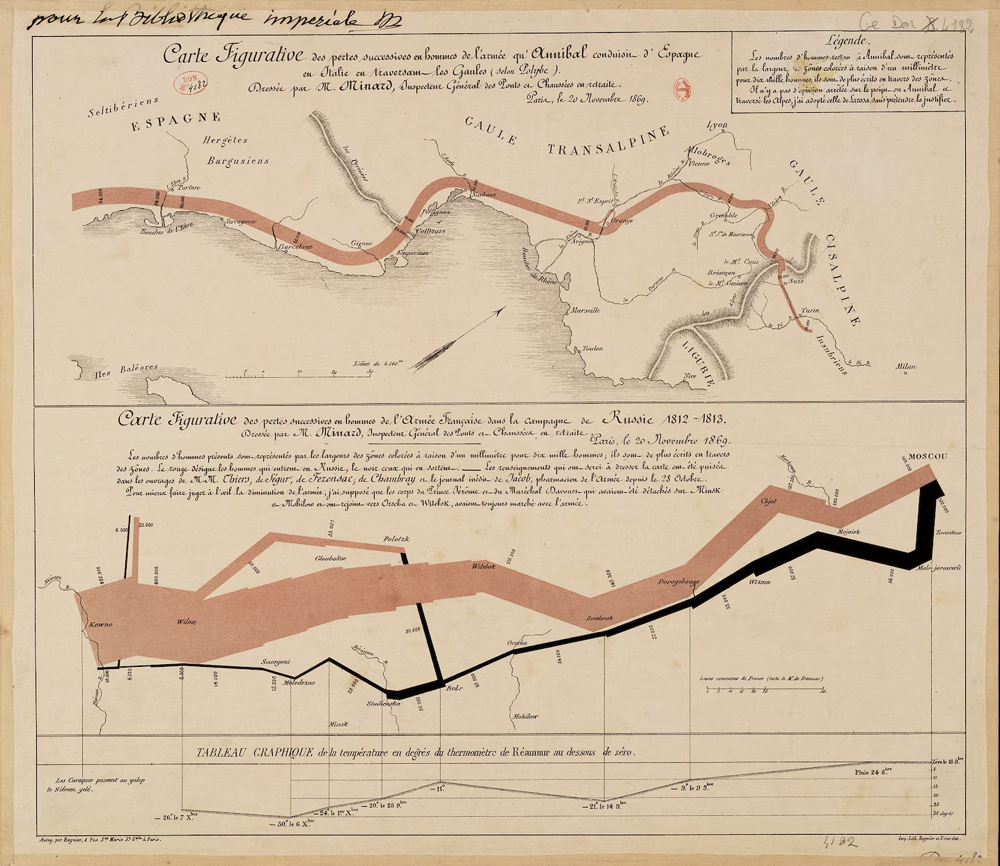
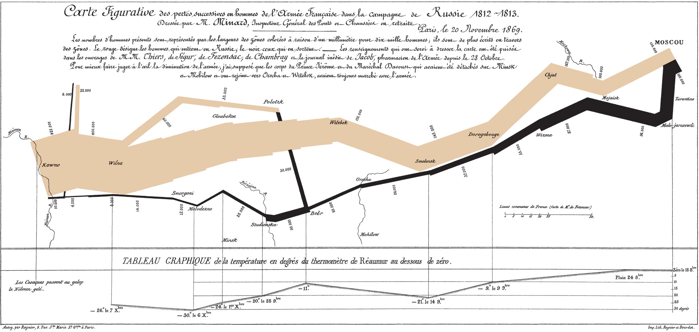
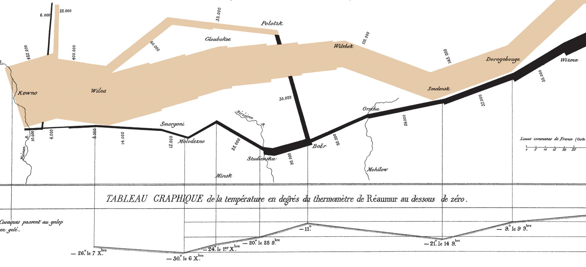

+++
author = "矢崎裕一"
title = "1mmで1万人──ミナールがナポレオン軍とハンニバル軍を同じ決まりで描いた1869年の図"
slug = "minard-napoleon-march-to-moscow"
date = "2025-10-06"
description = "1869年、ミナールは帯の幅1mmを1万人とし、進軍を赤、退却を黒で描きました。42万2,000人が1万人になるまでを退却中の気温と並べ、ハンニバル軍の図と同じ紙に刷っています。"
categories = [
    "consume"
]
tags = [
    "Minard",
    "Tufte",
    "Marey",
    "フローマップ",
    "サンキー・ダイアグラム",
    "地図"
]
image = "images/cover.png"
series = ["dataviz-classics"]
series_weight = 5
seriesByline = "Charles Joseph Minard"
seriesTitle = "1mmで1万人──ミナールのロシア遠征図とハンニバル図"
+++

1869年、Charles Joseph Minard（シャルル・ジョゼフ・ミナール）は、帯の幅を「1mmで1万人」と決め、進軍を赤、退却を黒で描きました。図は、42万2,000人の軍が国境に戻ったとき1万人になっていた経過を、退却中の気温と一緒に示しています。ミナールはこの図を、同じ決まりで描いたハンニバル軍の図と同じ一枚の紙に刷りました。

図の題は "Carte figurative des pertes successives en hommes de l'Armée Française dans la campagne de Russie 1812–1813"（1812–1813年のロシア遠征で、フランス軍が次々に失った兵を表した図）です。以下は、図に書き込まれた凡例と数字、フランス国立図書館（BnF）所蔵の刷り、Étienne-Jules Marey（エティエンヌ＝ジュール・マレー）が1878年に書いた紹介に沿います。

<!--more-->

## 1869年11月20日、パリで刷られた一枚

表題の下に「Paris, le 20 Novembre 1869」とあります。署名は、土木局（Ponts et Chaussées）の「Inspecteur Général … en retraite」（退職した監察総監）。図はリトグラフで刷られています。

ミナールは1781年にディジョンで生まれ、National Geographic によると、この図を作ったとき88歳でした。Wikipedia の経歴では、港湾、ダム、運河、橋の工事を手がけた土木技師です。鉄道は講義の題目の一つで、「鉄道技師」ではありません。1846年に監察総監になり、1851年に70歳で退いてから、統計地図を本格的に作りました。主題地図・統計図は51点あります。

BnF の刷りを見ると、この図は一枚の紙の下半分です。上半分には、ハンニバル軍がスペインからガリアを越えてイタリアへ進んだ経過の図があります。

Charles Joseph Minard, 1869。フランス国立図書館（BnF）所蔵（Gallica btv1b52504201x）／Wikimedia Commons より引用。パブリックドメイン

紙の上端には「pour la Bibliothèque impériale」（帝室図書館へ）と手書きがあります。二つの図は同じ日付で、同じ枠に収まっています。10か月後の1870年9月、ミナールは普仏戦争のさなかにパリを離れ、10月24日にボルドーで亡くなりました。

## 帯の幅を、1mmで1万人に

ナポレオン図の凡例は、表題の下に書かれています。最初の2文が、見た目の決まりです。

> Les nombres d'hommes présents sont représentés par les largeurs des zones colorées à raison d'un millimètre pour dix mille hommes ; ils sont de plus écrits en travers des zones. Le rouge désigne les hommes qui entrent en Russie, le noir ceux qui en sortent.

その時点の兵の数は、色を塗った帯の幅で表し、1mmが1万人にあたる。数は帯を横切る向きにも書き込む。赤はロシアへ入る兵、黒はロシアから出る兵を表す、という意味です。

Charles Joseph Minard, 1869／Wikimedia Commons（File:Minard.png）より引用。パブリックドメイン

この複製では進軍の帯が薄茶に見えますが、凡例は「rouge（赤）」です。Wikipedia も「The red [now brown]」と注記しています。BnF の刷りでは、くすんだ赤に見えます。

帯に書かれた数字を、進軍の順に拾います。Kowno 近くのニーメン川で422,000、Wilna で400,000、Witebsk で175,000、Smolensk で145,000、Chjat で127,100、Mojaisk とモスクワで100,000です。退却の黒い帯は、100,000から55,000、24,000と減っていきます。

データと見た目の対応は、次のとおりです。

| データ | 見た目 | 図の上での具体例 |
|---|---|---|
| その時点の兵の数 | 帯の幅（1mm＝1万人） | ニーメン川で422,000人、計算では幅42mm |
| 同じ兵の数 | 帯に沿って書いた数字 | 「422.000」「100.000」など |
| 進むか戻るか | 帯の色（赤＝入る、黒＝出る） | 複製では赤が薄茶に見える |
| 経路 | 帯が地図の上で通る位置 | Kowno、Wilna、Smolensk、MOSCOU などの地名 |
| 距離 | 縮尺バー | フランスの lieue commune で0〜50 |
| 分かれた部隊と合流 | 帯の枝分かれと、幅の足し算 | Bobr で20,000＋30,000＝50,000 |
| 退却中の気温 | 下段の折れ線の高さ | レオミュール度で0〜−30度 |
| 日付 | 気温の各点に添えた文字 | 「le 6 Xbre」（12月6日）など |
| 地図と気温の対応 | 縦の細い補助線 | 気温の点から退却路の地点へ |

**分かれた帯は、合流すると幅が足し算になります。** Polotzk の近くから南へ下りてきた30,000の帯は、Bobr で本隊の20,000と合わさって50,000になります。最後は、4,000の帯に北から戻った6,000が加わり、ニーメン川で10,000です。

Charles Joseph Minard, 1869（部分）／Wikimedia Commons（File:Minard.png）より引用。パブリックドメイン

図の最後の数は、ちょうど10,000です。42万2,000人の約2.4%にあたります。幅を足し算できるように描いたので、途中で分かれた部隊も同じ物差しで読める、と読めます。Wikipedia は、こうした帯の図がのちにサンキー・ダイアグラムと呼ばれるようになったと書いています。

## 下段の気温と、ミナールが仮定したこと

下段の表題は「TABLEAU GRAPHIQUE de la température en degrés du thermomètre de Réaumur au dessous de zéro」。レオミュール温度計の零下の度数を示すグラフです。右端に5〜30度の目盛りがあります。

値は、右端の「le 18 8bre」（10月18日）の0度から、11月14日の−21度、12月6日の−30度、左端の12月7日の−26度まで書き込まれています。最低の−30度は、摂氏では−37.5度です（1レオミュール度＝1.25℃）。

日付は右から左へ進みます。各点の横の位置は上の退却路の地点に合わせてあり、縦の細い線が両者を結んでいます。そのため、横方向は時間の等間隔ではありません。日付は、場所の軸に書き添えた文字だと読めます。

気温を描いたのは、黒い退却の帯だけです。進軍の区間には気温がありません。帯の数字で見ると、422,000人のうち322,000人は、モスクワに着く前にいなくなっています。図にあるのは人数と気温だけで、死因は書かれていません。

モスクワの手前、Chjat の127,100から Mojaisk の100,000へ、赤い帯は急に細くなります。

凡例の後半には、資料（Thiers、Ségur、Fezensac、Chambray の著作と、軍の薬剤師 Jacob の未刊の日記）と、ミナールが自分で加えた単純化が書かれています。

> Pour mieux faire juger à l'œil la diminution de l'armée, j'ai supposé que les corps du Prince Jérôme et du Maréchal Davoust qui avaient été détachés sur Minsk et Mobilow et ont rejoint vers Orscha et Witebsk, avaient toujours marché avec l'armée.

軍の減り方を目でよりよく判断できるよう、Minsk と Mobilow へ分かれ、Orscha と Witebsk の近くで合流したジェローム公とダヴー元帥の軍団は、本隊とずっと一緒に進んだと仮定した、という意味です。出発時の422,000も、この仮定を含んだ「ミナールの図での数」です。

## ハンニバル軍の図と同じ紙に

上半分は、ハンニバルがスペインからガリアを越えてイタリアへ率いた軍の損失を、ポリュビオス（Polybe）に拠って描いた図です。右上の凡例を書き起こします。

> Les nombres d'hommes restant à Annibal sont représentés par la largeur des zones colorées à raison d'un millimètre pour dix mille hommes, ils sont de plus écrits en travers des zones. Il n'y a pas d'opinion arrêtée sur le point où Annibal a traversé les Alpes, j'ai adopté celle de Larosa sans prétendre la justifier.

ハンニバルに残った兵の数は帯の幅で表し、1mmが1万人。数は帯を横切って書き込む。アルプスをどこで越えたかについて定まった説はなく、Larosa の説を、正しいと主張せずに採った、という意味です。Crouch Rare Books の目録は、Larosa を Larauza のことだと説明しています。

帯は左のスペインで最も太く、アルプスを越えたあとは細い線になって Turin へ向かいます。幅の決まりが同じなので、上下の帯を見比べれば、二つの軍の規模と減り方を同じ物差しで比べられる、と読めます。

1878年、Marey は『La méthode graphique dans les sciences expérimentales』でこの図を紹介しました。図37として載ったのはナポレオン図だけで、ハンニバル軍は「ailleurs（別のところで）」描いている、と一文で触れられるだけです。広く出回っている Commons の File:Minard.png も、ナポレオン図だけの版です。一枚の紙の上の対は、紹介されるたびに下半分だけが切り出されてきた、と読めます。

Richard Taws（リチャード・トーズ）は、*Grey Room* 83号（2021）の論文の冒頭で、この図がハンニバル図と同じ頁にあったことを書いています。ミナールが10か月後、プロイセン軍を恐れてパリを離れたことにも触れています。そのうえで、Tufte の評がくり返されてきた一方、この図は統計地図の系譜以外の同時代の視覚表現との関係では、ほとんど論じられてこなかったと指摘しています。

## 第三者はこの図をどう見たか

同時代の書物では、1878年に Marey が紹介しています。図37の紹介で、見た目の決まりをそのまま言葉にしています。

> Cette figure, construite au moyen de documents statistiques patiemment recueillis à différentes sources, traduit l'amoindrissement graduel de l'armée par le rétrécissement incessant d'une zone dont la largeur exprime le nombre des soldats de Napoléon.

軍が少しずつ減ることを、幅が兵の数を表す帯の絶え間ない細りで表している、という説明です。一方で Marey は「百人に一人も戻らなかった」（Il n'est pas revenu un soldat sur cent）とも書きました。図の数字では約2.4%なので、この一文は図と合いません。

現代の賛辞の定番は Edward Tufte（エドワード・タフティ）です。『The Visual Display of Quantitative Information』（1983）の40ページで、こう書きました。

> It may well be the best statistical graphic ever drawn.

描かれた統計グラフの中で最良のものかもしれない、という評価です。

読み手の負担から疑問を出したのが、Stephen Kosslyn（スティーヴン・コスリン）です。Jorge Camões（ジョルジェ・カモンイス）が2008年のブログ記事で、Kosslyn の言葉を引いています。

> This display has never captivated me for the simple reason that given human processing limitations – I needed several minutes to figure it out. (…) But if you want the facts and want them in a clear, easily understood way, this display is not the solution.

人の処理能力には限りがあり、読み解くのに数分かかった。事実を、はっきり、たやすく知りたいなら、この図は答えにならない、という批判です。

Camões 自身は、描き込みの選び方を問題にしています。

> Minard adds detail to explicitly link deaths to cold temperatures during retreat, but around 75% of men died on the way to Moscow and he doesn't tell us why.

ミナールは退却中の死を寒さと結びつける描き込みを加えた。しかし約75%はモスクワへ向かう途中で死んでいて、その理由は図に書かれていない、という指摘です。

Robert Kosara（ロバート・コサラ）は2021年の記事で、描かれなかった側を挙げます。図を成り立たせるには大きな単純化が要った。図が有名になったぶん、フランス軍と戦ったロシア軍と民兵、民間人の被害が見えなくなっている、という指摘です。

## 使い道

この図から可視化の仕事に持ち帰れることは、**作り手の決めごとを、図の中に書いておくこと**です。具体的には四つあります。

- 量を表す見た目を一つに固定する。兵の数は幅だけで表し、色は向きに使っています。流れの図では、合流で幅を足し算できるかを最初に確かめます。
- 幅と数字を両方書く。幅で減り方を見せ、数字で読み取りを支えます。
- 単純化したことを凡例に書く。軍団をまとめたこと、アルプス越えの地点を一つの説に決めたことを、ミナールは図の中に書きました。
- 比べたいものは同じ決まりで描き、同じ紙に置く。図を切り出して使うときは、その対と凡例も一緒に伝えるかを考えます。

Camões は、ミナールが気温を退却の区間だけに描いたことを問題にしました。Kosara は、ロシア側と民間人の被害が描かれていないことを挙げました。二人の指摘からは、どこに描き込み、何を描かないかの選び方が、そのまま図の主張になると読めます。

## 参考・出典

**一次情報**

- Charles Joseph Minard, *Carte figurative des pertes successives en hommes de l'armée qu'Annibal conduisit d'Espagne en Italie en traversant les Gaules (selon Polybe)* ／ *Carte figurative des pertes successives en hommes de l'Armée Française dans la campagne de Russie 1812–1813*, Paris, 1869年11月20日, リトグラフ。フランス国立図書館（BnF）所蔵の刷り（Gallica btv1b52504201x）：[Wikimedia Commons](https://commons.wikimedia.org/wiki/File:Carte_figurative_des_pertes_successives_en_hommes_de_l'armée_française_dans_la_Campagne_de_Russie_1812-13.jpg)
- 同、ナポレオン図のみの版（凡例の仏文と英訳つき）：[Wikimedia Commons, File:Minard.png](https://commons.wikimedia.org/wiki/File:Minard.png)
- Étienne-Jules Marey, *La méthode graphique dans les sciences expérimentales*, Paris: G. Masson, 1878, pp. 72–73. [Internet Archive](https://archive.org/details/b21919070)

**第三者評価**

- Edward R. Tufte, *The Visual Display of Quantitative Information*, Graphics Press, 1983, p. 40.
- Jorge Camões, "Minard, Tufte, Kosslyn and Godin (and Napoleon)," 2008. [excelcharts.com](https://excelcharts.com/minard-tufte-kosslyn-godin-napoleon/)
- Robert Kosara, "eagereyesTV: Minard's famous 'Napoleon's March' chart – what it shows, what it doesn't," *eagereyes*, 2021. [eagereyes.org](https://eagereyes.org/blog/2021/eagereyestv-minards-famous-napoleons-march-chart-what-it-shows-what-it-doesnt)
- Richard Taws, "Death from Above in Minard's Napoleon Map," *Grey Room*, no. 83, 2021, pp. 82–111. [doi:10.1162/grey_a_00321](https://doi.org/10.1162/grey_a_00321) / [Grey Room](https://greyroom.org/issues/83/136/death-from-above-in-minards-napoleon-map)
- Betsy Mason, "The Underappreciated Man Behind the 'Best Graphic Ever Produced'," *National Geographic*, 2017. [nationalgeographic.com](https://www.nationalgeographic.com/culture/article/charles-minard-cartography-infographics-history)
- "Charles Joseph Minard," Wikipedia（経歴。Chevallier 1871 と Rendgen 2018 による）. [en.wikipedia.org](https://en.wikipedia.org/wiki/Charles_Joseph_Minard)
- Crouch Rare Books, "From states to statistics"（目録。判型、Larauza の説明）. [crouchrarebooks.com](https://crouchrarebooks.com/browse/from-states-to-statistics-2/)
- HistoryofInformation.com（Jeremy Norman）、ミナールのロシア遠征図の項（レオミュール度と lieue の換算）. [historyofinformation.com](https://historyofinformation.com/detail.php?id=2787)
