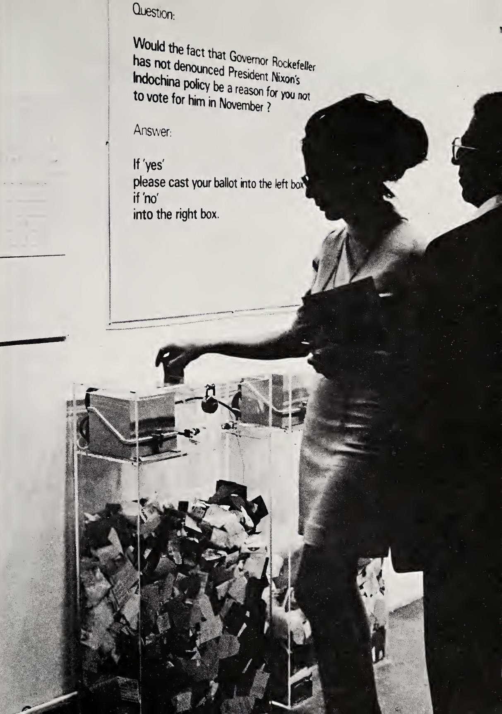
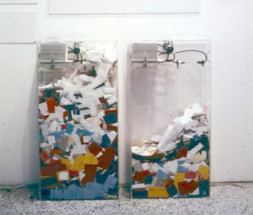
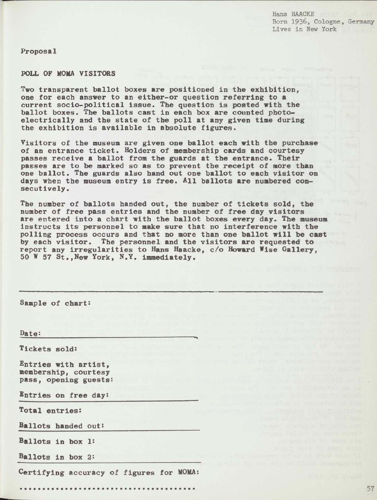
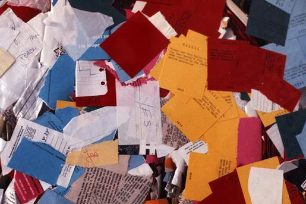

+++
author = "Yuichi Yazaki"
title = "Showing Yes and No Twice, in Paper and in Numbers: Hans Haacke's MoMA Poll (1970)"
slug = "moma-poll"
date = "2026-11-01"
description = "In 1970, Haacke showed visitors' votes at a museum in two ways: the volume of paper piling up in transparent boxes, and photoelectric counters (YES 25,566 / NO 11,563)."
categories = [
    "consume"
]
tags = [
    "data physicalization",
]
image = "images/cover.jpg"
series = ["data-physicalization"]
series_weight = 13
seriesByline = "Hans Haacke"
seriesTitle = "Yes and No in Paper Piles and Numbers: MoMA Poll"
+++

Hans Haacke's *MoMA Poll* showed visitors' votes in two ways at once. One was the volume of paper piling up in transparent ballot boxes, where you could compare the heights of the left and right heaps. The other was the number on a photoelectric counter attached to each box. On the last day of the exhibition, the counters read YES 25,566 and NO 11,563. The accumulating volume conveys the lean of the vote, and the number keeps the exact value. This double way of showing data can be read as a pattern that still works for physical visualization.

The work was shown in 1970 in the exhibition "Information" at the Museum of Modern Art (MoMA) in New York. What follows relies mainly on Haacke's proposal on p.57 of the exhibition catalogue *Information* (1970), and on pp.9–11 of *Framing and Being Framed: 7 Works 1970–75* (1975), where Haacke himself documented the work. I also use the later Tate Papers (2009) and Artforum (2004), and where they disagree I note it source by source.

<!--more-->

## A question handed in on the eve of the opening

The curator of "Information" was Kynaston L. McShine. The catalogue's title page gives the dates as July 2 to September 20, 1970, but Haacke's 1975 text says "From June 20 through September 20, 1970." The Museo Reina Sofía's commentary also says July 2 to September 20, so this article follows the catalogue.

Asked to take part, Haacke proposed that visitors vote on a two-choice question about a current social and political issue.

> "The proposal was accepted, but I did not hand in the question until the evening before the opening of the exhibition."（Haacke 1975, p.9）

In other words, the proposal was accepted, but the question was not handed over until the night before the opening.

About two months before the opening, the U.S. military had bombed and invaded Cambodia, and at Kent State University the National Guard had shot and killed four protesting students. The president of MoMA's board was David Rockefeller. His brother Nelson Rockefeller was the sitting governor of New York, running for re-election, and also a MoMA trustee.

The ballot boxes stood in the first room of the exhibition, with the question posted above them. The installation photograph in the 1975 book lets us read the text.

> "Question: Would the fact that Governor Rockefeller has not denounced President Nixon's Indochina policy be a reason for you not to vote for him in November?
> Answer: If 'yes' please cast your ballot into the left box, if 'no' into the right box."

The sign asks: does the Governor's failure to denounce Nixon's Indochina policy give you a reason not to vote for him in November? If yes, the left box; if no, the right box.

© 1975 Hans Haacke / Source: *Framing and Being Framed: 7 Works 1970–75* (1975), p.11

The wording differs by source. dataphys.org and Wikipedia quote "...be a reason for your not voting for him in November?" In David Rockefeller's memoirs, as quoted in Tate Papers (2009), it reads "had not denounced." This article uses the wording of the 1975 book, which is legible in the photograph.

According to Haacke, the day after the opening, an emissary of David came to the museum and demanded the work's removal. Haacke reports this as hearsay, "Word has it" (Tate 2009) and "I was later told" (Artforum 2004). The museum's director, John Hightower, did not comply, and the work stayed until the end of the exhibition.

## The left box, the right box, and the numbers

The catalogue proposal describes the mechanism this way.

> "Two transparent ballot boxes are positioned in the exhibition, one for each answer to an either-or question referring to a current socio-political issue. The question is posted with the ballot boxes. The ballots cast in each box are counted photo-electrically and the state of the poll at any given time during the exhibition is available in absolute figures."（McShine ed. 1970, p.57）

It places a transparent box for each answer, counts the votes photoelectrically, and makes the state of the poll at any moment available in absolute figures. The 1975 book also says that each box had a photoelectric counting device.

What matters is that the proposal specified **both the volume of paper and the absolute figures** from the start. The height of the heaps shows which side has more, and the counters keep the exact count. Two roles are layered onto one apparatus.

Hans Haacke (the source credits the photograph to Irmgard Emmelhainz's e-flux article) / Source: dataphys.org

In the photograph, of the two identically shaped boxes, the left holds more paper. If the left is YES, as the sign says, this difference in heaps points the same way as the final tally (roughly 2.2 to 1).

The correspondence between data and physical properties is as follows.

| Data | Physical property | Concrete form | Source where confirmed |
|---|---|---|---|
| Answer (YES / NO) | Position (left / right) | YES is the left box, NO is the right box | Sign in the photograph, 1975 book p.11 |
| Votes per answer (the lean) | Volume (height of paper piled in the transparent box) | Compare the heaps' heights across identical boxes | Installation photograph (1975 book p.11) |
| Votes per answer (exact value) | Number (photoelectric counter) | Counts each time a slip drops. Final tally YES 25,566 / NO 11,563 | Catalogue p.57, 1975 book p.9 |
| Visitor category | Color of the ballot | Plan to vary the color for full-price visitors, members, holders of invitation tickets, and free Monday visitors. Actual colors unknown | 1975 book p.9 |
| Day-by-day change, breakdown by category | Table (a tally sheet posted beside the boxes) | Plan for staff to write in the number of visitors and each box's votes every evening | Catalogue p.57, 1975 book p.9 |

Note that YES meant "this is a reason not to vote for him." The left heap therefore represents opposition to Rockefeller. The position mapping is simple, but what a heap meant was determined by the wording of the question, as I read it.

Calling this a "bar chart" comes from dataphys.org's description of it as a "participatory physical bar chart." Haacke himself calls it a "poll" and the containers "ballot boxes."

## How far the planned colors and tables actually worked

Haacke's design had two more layers besides volume and numbers.

One was the color of the ballots. According to the 1975 book, the plan was to vary the color of the slips for full-price visitors, members, holders of invitation tickets, and visitors on free Mondays. However, the 1970 catalogue proposal contains no mention of color coding; it says the ballots would be serially numbered.

The other was the tally table. Every evening, staff were to write the number of visitors per category and each box's votes into a table beside the boxes. The sample in the catalogue has columns for tickets sold, ballots handed out, and ballots in box 1 and box 2, plus a column for "certification of accuracy of figures by MoMA."

© 1970 The Museum of Modern Art / Source: Kynaston L. McShine (ed.), *Information* (1970), p.57

In practice, things did not go as planned.

> "In effect, ballots were not handed out regularly or according to the color code as directed. Consequently some visitors cast improvised ballots of torn paper."（Haacke 1975, p.9）

Ballots were not handed out as directed, nor according to the color code, and some visitors cast ballots of torn paper.

© Hans Haacke/VG Bild-Kunst / Source: Tate Papers no.12 "Lessons Learned"

The layer of colors marking categories did not function, and once handmade scraps were mixed in, the link between volume of paper and number of votes loosened too. In participatory physical visualization, whether the designed correspondence is realized depends on how it is run on site, as I read it. I could not confirm how far the tally table was updated during the exhibition.

## 37,129 votes, and the percentages that disagree

Here are the figures recorded by the automatic counters on the last day, September 20, copied from the 1975 book, p.9.

| Item | Value |
|---|---|
| YES | 25,566 (68.7%) |
| NO | 11,563 (31.3%) |
| Total votes | 37,129 |
| MoMA visitors in the same period (including people who did not see Information) | 299,057 |
| Turnout | 12.4% |

Checking the arithmetic, the total of 37,129 and the turnout of 12.4% are consistent. Recomputing the ratio, though, gives YES 68.9% and NO 31.1%, which is 0.2 points off Haacke's figures.

Later accounts vary further. Artforum (2004) summarizes it as "69% of the votes were against Rockefeller," and Tate Papers (2009) writes this.

> "68.7 per cent dropped their ballots into the 'No' box, indicating their opposition to Nelson Rockefeller; and 37.3 per cent voted in his favour."

It says 68.7% put their ballots in the "No" box, showing opposition to Rockefeller, and 37.3% voted in his favour.

Under the 1975 record and the direction of the question, the box meaning opposition is the YES box. Also, 68.7 plus 37.3 makes 106. I read 37.3% as a misprint of 31.3%, and "No" as a slip for "Yes." The same text also calls 299,057 the number of visitors to the Information exhibition, which differs from the 1975 figure for MoMA as a whole.

Haacke described the nature of the results in 2004 as follows.

> "The results cannot claim to meet professional standards. However, they probably reflect the sentiments of the world of contemporary art in 1970. My piece gave these sentiments visibility in one of the most prominent institutions of modern art."

The gist: the results do not meet professional standards, but probably reflect the sentiments of the contemporary art world in 1970, and the piece made them visible in a prominent museum.

## How third parties saw the work

The sociologists Howard S. Becker and John Walton contributed an essay to *Framing and Being Framed*.

> "It is clear enough in the case of the polls that Haacke has not followed standard procedures of questionnaire construction, sampling or analysis."（p.147）

This is a criticism that Haacke's polls follow standard procedure in none of questionnaire construction, sampling, or analysis. At the same time, the two authors write that the flaws are not serious enough to cast major doubt on the conclusions, and that laying out every circumstance of the survey is faithful to scientific practice. The criticism targets "the polls" as a whole, mainly the later visitor surveys, and is not about the MoMA Poll alone, as I read it.

Jack Burnham, a critic and longtime friend of Haacke, called the work "Haacke's Rockefeller Poll."

> "He noted that the poll served as a safety-valve for the political tempers of a surprisingly large number of museum visitors."（p.135）

This is Haacke's own view that the vote served as a "safety valve" for the political feelings of a surprisingly large number of visitors. Burnham also relays the view that the museum did not make an issue of it, for reasons of public relations.

The "List of Physical Visualizations" at dataphys.org, compiled by researchers of data physicalization, lists the work as "1970 – MoMA Poll: Participatory Bar Chart" and describes it as a "participatory physical bar chart." It does not touch on institutional critique, and I read it as treating the work as an early example of a visualization type.

The reading in this article is close to dataphys.org's, but its entry does not mention the counters' numbers.

## Takeaways

The first takeaway is to layer volume and numbers in one apparatus.

The heap of paper is a volume representation that shows the lean without counting, and the counter's number works as a record that keeps the exact value, as I read it (I could not confirm how the numbers were displayed). The heap loosens once scraps get mixed in. In physical visualization, it helps to prepare separately the volume that is shown from a distance and the number that is kept on record.

The second is that the question's wording decides the meaning of the axis. In Haacke's text in Tate Papers (2009), the box showing opposition is written as "No." That conflicts with the direction of the question and looks like a slip. I read it as the question's wording having made the meaning of the boxes easy to mix up. Writing what a heap represents on the sign as well should reduce misreadings.

The third is operation. Neither the color coding nor the tally table could exist unless staff acted every day. In participatory works, the encoding has to be designed to include the on-site procedures.

## References

**Primary sources**

- Kynaston L. McShine (ed.), *Information*, exh. cat., The Museum of Modern Art, New York, 1970. p.57 is Haacke's proposal "POLL OF MOMA VISITORS". [PDF (Monoskop)](https://monoskop.org/images/e/ec/McShine_Kynaston_L_ed_Information_1970.pdf) / [Overview page](https://monoskop.org/log/?p=17532)
- Hans Haacke, "MOMA-Poll", in *Framing and Being Framed: 7 Works 1970–75*, Halifax: Press of the Nova Scotia College of Art and Design / New York University Press, 1975, pp.9–11. [PDF (Monoskop)](https://www.monoskop.org/images/d/d4/Hans_Haacke_Framing_and_Being_Framed_7_Works_1970-75_1975.pdf)
- Hans Haacke, "Lessons Learned", *Tate Papers*, no.12, Autumn 2009. [Tate](https://www.tate.org.uk/research/tate-papers/12/lessons-learned)
- Tim Griffin, "Historical Survey: An Interview with Hans Haacke", *Artforum*, vol.43, no.1, September 2004. [Artforum](https://www.artforum.com/features/historical-survey-an-interview-with-hans-haacke-169405)
- David Rockefeller, *Memoirs*, New York, 2002, pp.452–3 (as quoted in Haacke, Tate Papers 2009). [Tate](https://www.tate.org.uk/research/tate-papers/12/lessons-learned)

**Secondary sources**

- Howard S. Becker & John Walton, "Social Science and the Work of Hans Haacke", in *Framing and Being Framed*, 1975, p.145 ff. [PDF (Monoskop)](https://www.monoskop.org/images/d/d4/Hans_Haacke_Framing_and_Being_Framed_7_Works_1970-75_1975.pdf)
- Jack Burnham, "Steps in the Formulation of Real-Time Political Art", in *Framing and Being Framed*, 1975, p.127 ff. [PDF (Monoskop)](https://www.monoskop.org/images/d/d4/Hans_Haacke_Framing_and_Being_Framed_7_Works_1970-75_1975.pdf)
- dataphys.org, "1970 – MoMA Poll: Participatory Bar Chart" (registered by Pierre Dragicevic). [dataphys.org](https://dataphys.org/list/moma-poll-haackes-participatory-bar-chart/)
- Museo Reina Sofía, Repensar Guernica, "'Proposal: Poll of MoMA Visitors'". [Reina Sofía](https://guernica.museoreinasofia.es/en/node/16081)
- Wikipedia, "Hans Haacke". [Wikipedia](https://en.wikipedia.org/wiki/Hans_Haacke)
- Monoskop, "Information (1970 exhibition)". [Monoskop](https://www.monoskop.org/Information_(1970_exhibition))
