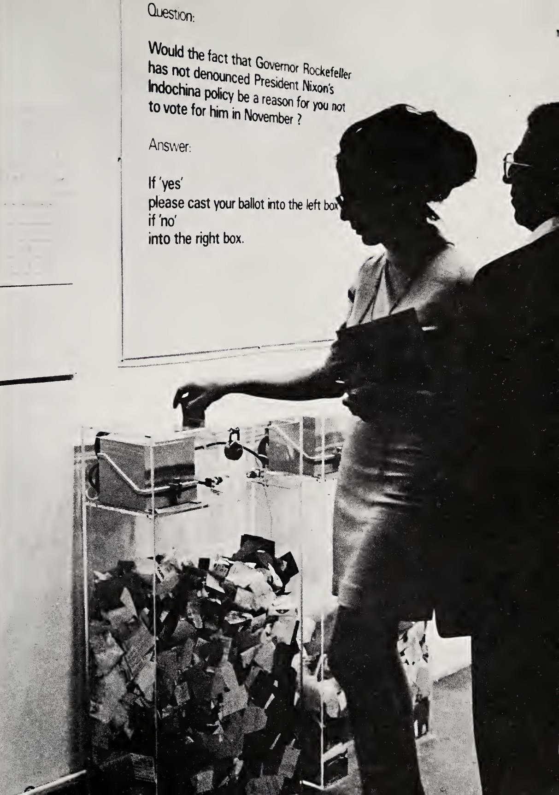
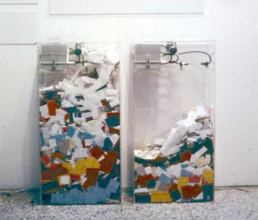
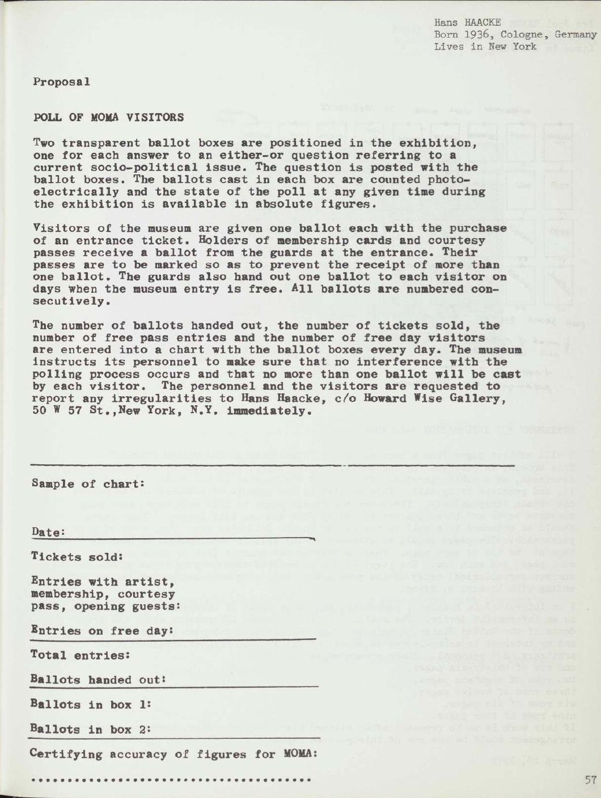
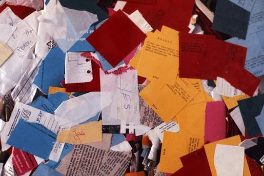

+++
author = "矢崎裕一"
title = "紙の山と数字で、賛否を二重に見せる──Hans Haacke『MoMA Poll』（1970）"
slug = "moma-poll"
date = "2026-11-01"
description = "1970年、ハーケは美術館の来場者の賛否を、透明な箱にたまる紙の量と、光電式カウンターの数字（YES 25,566／NO 11,563）の二重で示しました。"
categories = [
    "consume"
]
tags = [
    "データ物質化",
]
image = "images/cover.jpg"
series = ["data-physicalization"]
series_weight = 13
seriesByline = "Hans Haacke"
seriesTitle = "紙の山と数字で賛否を示す──MoMA Poll"
+++

Hans Haacke（ハンス・ハーケ）の『MoMA Poll』は、来場者の賛否を二重に示した作品です。一つは、透明な投票箱にたまる紙の量で、左右の山の高さを見比べられます。もう一つは、各箱に付けた光電式カウンターの数字です。会期の最終日、カウンターは YES 25,566、NO 11,563 を記録していました。積み上がる量で傾きを伝え、数字で正確な値を残す。この二重の表し方は、物理的な可視化にいまも使える型だと読めます。

作品は 1970年、ニューヨーク近代美術館（MoMA）の展覧会「Information」に出品されました。以下は主に、展覧会カタログ『Information』（1970）p.57 のハーケの提案文と、ハーケ自身が作品を記録した『Framing and Being Framed: 7 Works 1970–75』（1975）pp.9–11 に沿います。後年の Tate Papers（2009）と Artforum（2004）も使い、食い違う箇所は資料ごとに分けて書きます。

<!--more-->

## 開幕前夜に渡された質問

「Information」展のキュレーターは Kynaston L. McShine（キナストン・マクシャイン）です。会期はカタログの扉では 1970年7月2日〜9月20日ですが、ハーケの1975年の文章は "From June 20 through September 20, 1970" と書いています。Museo Reina Sofía の解説も7月2日〜9月20日なので、本記事はカタログの表記を採ります。

出展を依頼されたハーケは、時事的な社会・政治問題についての二択の質問に、来場者が投票する案を出しました。

> "The proposal was accepted, but I did not hand in the question until the evening before the opening of the exhibition."（Haacke 1975, p.9）

案は通ったが、質問は開幕前夜まで渡さなかった、という一文です。

開幕の約2か月前、米軍がカンボジアを爆撃・侵攻し、ケント州立大学では抗議する学生4人が州兵に射殺されていました。MoMA の理事長は David Rockefeller（デイヴィッド・ロックフェラー）でした。兄の Nelson Rockefeller（ネルソン・ロックフェラー）は再選をめざす現職のニューヨーク州知事で、MoMA の理事でもありました。

投票箱は展覧会の最初の部屋に置かれ、その上に質問が掲げられました。1975年の本の展示写真で、文面が読めます。

> "Question: Would the fact that Governor Rockefeller has not denounced President Nixon's Indochina policy be a reason for you not to vote for him in November?
> Answer: If 'yes' please cast your ballot into the left box, if 'no' into the right box."

知事がニクソンのインドシナ政策を非難していないことは、11月に彼に投票しない理由になるか。YES なら左、NO なら右の箱へ、という掲示です。

© 1975 Hans Haacke／*Framing and Being Framed: 7 Works 1970–75*（1975）p.11 より引用

文面は資料によって違います。dataphys.org と Wikipedia は "...be a reason for your not voting for him in November?" と引いています。Tate Papers（2009）に引かれたデイヴィッド・ロックフェラーの回想録では、"had not denounced" となっています。本記事では、写真で読める1975年の本の文面を使います。

ハーケによれば、開幕の翌日、デイヴィッドの使いが美術館に来て撤去を求めました。ハーケはこれを "Word has it"（Tate 2009）、"I was later told"（Artforum 2004）と、伝え聞いたこととして書いています。館長の John Hightower（ジョン・ハイタワー）は従わず、作品は会期の終わりまで残りました。

## 左の箱、右の箱、そして数字

カタログの提案文は、仕組みをこう書いています。

> "Two transparent ballot boxes are positioned in the exhibition, one for each answer to an either-or question referring to a current socio-political issue. The question is posted with the ballot boxes. The ballots cast in each box are counted photo-electrically and the state of the poll at any given time during the exhibition is available in absolute figures."（McShine ed. 1970, p.57）

答えごとに透明な箱を置き、票を光電式に数えて、どの時点でも状況を絶対数で示す、という内容です。1975年の本も、各箱に光電式の計数装置が付いていたと書いています。

大事なのは、提案文が最初から **紙の量と絶対数の両方** を書いていることです。紙の山の高さで多い少ないが見え、カウンターが正確な数を残す。二つの役割を一つの装置に重ねています。

Hans Haacke（掲載元は写真の出所を Irmgard Emmelhainz の e-flux 記事としています）／dataphys.org より引用

写真では、同じ形の二つの箱のうち、左のほうが紙が多くたまっています。掲示どおり左が YES なら、この山の差は、最終的な数字の傾き（約2.2対1）と同じ向きです。

データと物理的な性質の対応は次のとおりです。

| データ | 物理的な性質 | 具体 | 確認できた資料 |
|---|---|---|---|
| 回答（YES／NO） | 位置（左右） | YES は左の箱、NO は右の箱 | 1975年の本 p.11 の掲示写真 |
| 回答ごとの票数（傾き） | 量（透明な箱にたまった紙の高さ） | 同じ形の箱で、山の高さを見比べる | 展示写真（1975年の本 p.11） |
| 回答ごとの票数（正確な値） | 数字（光電式カウンター） | 紙が落ちるたびに数える。終了時 YES 25,566／NO 11,563 | カタログ p.57、1975年の本 p.9 |
| 来場者の区分 | 投票用紙の色 | 全額入場者・会員・招待券・無料の月曜日で色を変える計画。実際の色は不明 | 1975年の本 p.9 |
| 日ごとの推移・区分ごとの内訳 | 表（箱の横に貼る集計表） | 毎晩、職員が来場者数と各箱の票数を書き込む計画 | カタログ p.57、1975年の本 p.9 |

注意したいのは、YES が「投票しない理由になる」という意味だったことです。左の山は、ロックフェラーへの反対を表します。位置の対応は単純でも、山が何を意味するかは質問の言い回しで決まっていたと読めます。

「棒グラフ」という呼び方は、dataphys.org の "participatory physical bar chart" という位置づけによるものです。ハーケ自身は "poll"（世論調査）、"ballot boxes"（投票箱）と呼んでいます。

## 計画にあった色と表は、どこまで動いたか

ハーケの設計には、量と数字のほかにもう二つの層がありました。

一つは用紙の色です。1975年の本によれば、全額入場者、会員、招待券の所持者、無料の月曜日の来場者で、用紙の色を変える計画でした。ただし1970年のカタログの提案文に色分けの記述はなく、「用紙に通し番号をふる」とあります。

もう一つは集計表です。毎晩、職員が区分ごとの来場者数と各箱の票数を、箱の横の表に書き込む計画でした。カタログの見本には、販売した入場券、配った用紙、箱1・箱2の用紙などの欄と、「MoMA による数字の正確さの証明」の欄があります。

© 1970 The Museum of Modern Art／Kynaston L. McShine 編『Information』（1970）p.57 より引用

運用は、計画どおりには進みませんでした。

> "In effect, ballots were not handed out regularly or according to the color code as directed. Consequently some visitors cast improvised ballots of torn paper."（Haacke 1975, p.9）

用紙は決められたとおりにも色分けどおりにも配られず、破いた紙で票を投じた来場者もいた、という記述です。

© Hans Haacke/VG Bild-Kunst／Tate Papers no.12 "Lessons Learned" より引用

色で区分を表す層は働かず、手作りの紙片が混じれば、紙の量と票数の対応もゆるくなります。参加型の物理的な可視化では、設計した対応が実現するかは現場の運用しだいだと読めます。集計表が会期中にどこまで更新されたかは、確かめられませんでした。

## 37,129票と、食い違う得票率

会期最終日の9月20日、自動カウンターが記録した数字を、1975年の本 p.9 から写します。

| 項目 | 値 |
|---|---|
| YES | 25,566（68.7%） |
| NO | 11,563（31.3%） |
| 投票総数 | 37,129 |
| 同期間の MoMA 来場者（Information 展を見なかった人も含む） | 299,057 |
| 投票率 | 12.4% |

検算すると、合計の 37,129 と投票率 12.4% は合います。ただし比率を計算し直すと YES 68.9%、NO 31.1% で、ハーケの表記とは0.2ポイントずれます。

後年の書き方はさらに変わります。Artforum（2004）では「投票の69%がロックフェラーに反対だった」と要約し、Tate Papers（2009）ではこう書いています。

> "68.7 per cent dropped their ballots into the 'No' box, indicating their opposition to Nelson Rockefeller; and 37.3 per cent voted in his favour."

68.7%が「No」の箱に入れてロックフェラーへの反対を示し、37.3%が支持した、という文です。

1975年の記録と質問の向きでは、反対の意味になるのは YES の箱です。また 68.7 と 37.3 を足すと 106 になります。37.3% は 31.3% の誤記で、「No」も「Yes」の書き違いだと読めます。同じ文章は 299,057人を「Information 展の来場者数」とも書いており、1975年の「MoMA 全体の来場者」と違います。

ハーケは結果の性格について、2004年にこう話しています。

> "The results cannot claim to meet professional standards. However, they probably reflect the sentiments of the world of contemporary art in 1970. My piece gave these sentiments visibility in one of the most prominent institutions of modern art."

結果は専門的な調査の水準を満たさないが、1970年の現代美術界の感情をおそらく映しており、作品はそれを有名な美術館で見えるようにした、という趣旨です。

## 第三者はこの作品をどう見たか

社会学者の Howard S. Becker（ハワード・S・ベッカー）と John Walton（ジョン・ウォルトン）は、『Framing and Being Framed』に論考を寄せました。

> "It is clear enough in the case of the polls that Haacke has not followed standard procedures of questionnaire construction, sampling or analysis."（p.147）

ハーケの調査は、質問票の作り方、標本、分析のいずれでも標準的な手続きに従っていない、という批判です。一方で二人は、欠点は結論を大きく疑わせるほどではなく、調査の状況をすべて示した点は科学の作法に忠実だとも書きます。この批判は "the polls" 全体、主に後の来場者調査を対象にしていて、MoMA Poll だけを論じたものではないと読めます。

ハーケの長年の友人で批評家の Jack Burnham（ジャック・バーナム）は、この作品を "Haacke's Rockefeller Poll" と呼びました。

> "He noted that the poll served as a safety-valve for the political tempers of a surprisingly large number of museum visitors."（p.135）

投票は驚くほど多くの来場者の政治的な感情の「安全弁」になった、というハーケの見方です。美術館は広報上の判断から問題にしなかった、という見方も伝えています。

データ物理化の研究者がまとめる dataphys.org の "List of Physical Visualizations" は、この作品を "1970 – MoMA Poll: Participatory Bar Chart" として載せ、"participatory physical bar chart" と説明しています。制度批判には触れず、可視化の型の早い例として扱っていると読めます。

本記事の読みは dataphys.org に近いものですが、その紹介はカウンターの数字に触れていません。

## 使い道

持ち帰れることの一つ目は、量と数字を一つの装置に重ねることです。

紙の山は数を数えなくても傾きが分かる量の表現で、カウンターの数字は正確な値を残す記録として働くと読めます（数字がどう表示されていたかは確かめられませんでした）。紙の山は、紙片が混じればゆるみます。物理的な可視化では、遠くから見せる量と、記録に残す数字を、別々に用意しておくと役に立ちます。

二つ目は、軸の意味を質問文が決めることです。Tate Papers（2009）のハーケの文では、反対を示す箱が「No」と書かれています。質問の向きと食い違い、書き違いに見えます。質問文の言い回しが箱の意味を取り違えやすくした、と読めます。山が何を表すかを掲示にも書いておけば、読み違いを減らせるはずです。

三つ目は、運用です。色分けも集計表も、職員が毎日動いて初めて成り立つ層でした。参加型の作品では、現場の手順まで含めてエンコーディングを設計する必要があります。

## 参考・出典

**一次情報**

- Kynaston L. McShine (ed.), *Information*, exh. cat., The Museum of Modern Art, New York, 1970. p.57 がハーケの提案 "POLL OF MOMA VISITORS"。[PDF（Monoskop）](https://monoskop.org/images/e/ec/McShine_Kynaston_L_ed_Information_1970.pdf) / [紹介ページ](https://monoskop.org/log/?p=17532)
- Hans Haacke, "MOMA-Poll", in *Framing and Being Framed: 7 Works 1970–75*, Halifax: Press of the Nova Scotia College of Art and Design / New York University Press, 1975, pp.9–11. [PDF（Monoskop）](https://www.monoskop.org/images/d/d4/Hans_Haacke_Framing_and_Being_Framed_7_Works_1970-75_1975.pdf)
- Hans Haacke, "Lessons Learned", *Tate Papers*, no.12, Autumn 2009. [Tate](https://www.tate.org.uk/research/tate-papers/12/lessons-learned)
- Tim Griffin, "Historical Survey: An Interview with Hans Haacke", *Artforum*, vol.43, no.1, September 2004. [Artforum](https://www.artforum.com/features/historical-survey-an-interview-with-hans-haacke-169405)
- David Rockefeller, *Memoirs*, New York, 2002, pp.452–3（Haacke, Tate Papers 2009 での引用による）。[Tate](https://www.tate.org.uk/research/tate-papers/12/lessons-learned)

**第三者評価**

- Howard S. Becker & John Walton, "Social Science and the Work of Hans Haacke", in *Framing and Being Framed*, 1975, p.145〜. [PDF（Monoskop）](https://www.monoskop.org/images/d/d4/Hans_Haacke_Framing_and_Being_Framed_7_Works_1970-75_1975.pdf)
- Jack Burnham, "Steps in the Formulation of Real-Time Political Art", in *Framing and Being Framed*, 1975, p.127〜. [PDF（Monoskop）](https://www.monoskop.org/images/d/d4/Hans_Haacke_Framing_and_Being_Framed_7_Works_1970-75_1975.pdf)
- dataphys.org, "1970 – MoMA Poll: Participatory Bar Chart"（Pierre Dragicevic 登録）. [dataphys.org](https://dataphys.org/list/moma-poll-haackes-participatory-bar-chart/)
- Museo Reina Sofía, Repensar Guernica, "'Proposal: Poll of MoMA Visitors'". [Reina Sofía](https://guernica.museoreinasofia.es/en/node/16081)
- Wikipedia, "Hans Haacke". [Wikipedia](https://en.wikipedia.org/wiki/Hans_Haacke)
- Monoskop, "Information (1970 exhibition)". [Monoskop](https://www.monoskop.org/Information_(1970_exhibition))
