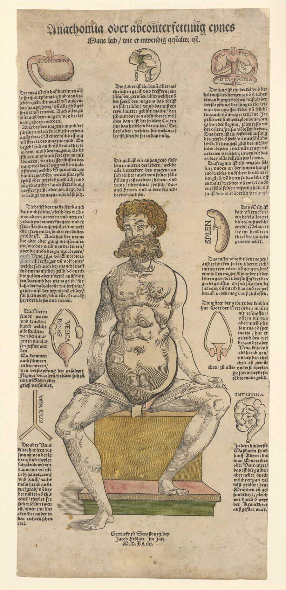
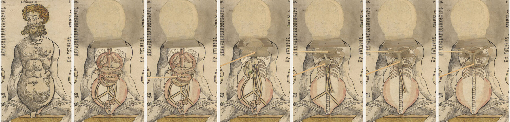
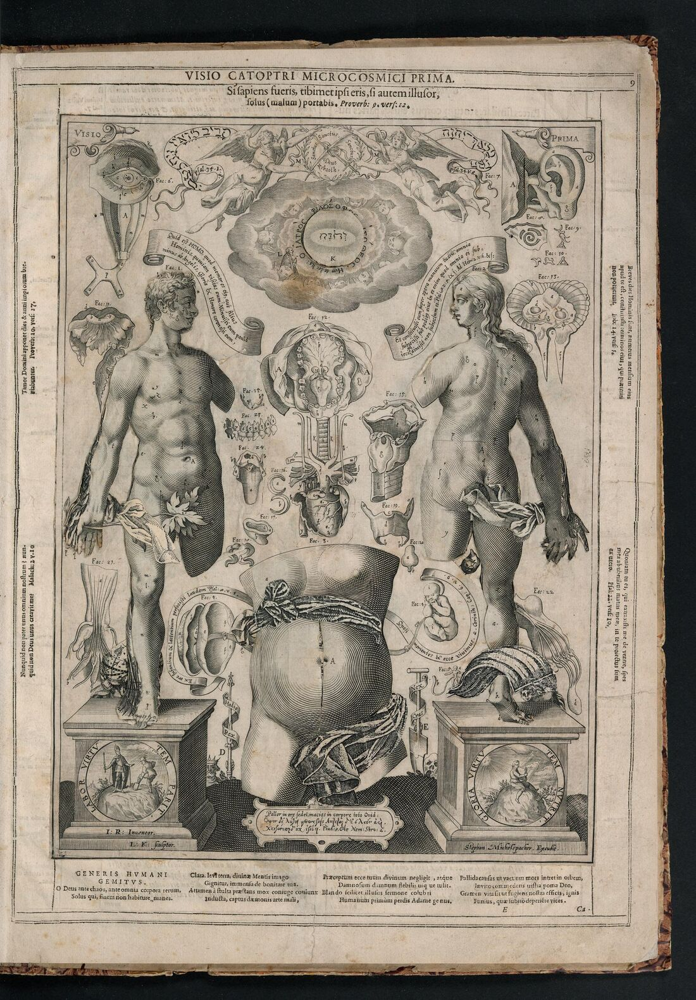

+++
author = "Yuichi Yazaki"
title = "Easter Tables Become Turning Disks, Layers of the Body Become Lifting Paper: Movable Books of the Medieval and Early Modern Eras"
slug = "movable-books-volvelle-flap"
date = "2026-11-03"
description = "In the 13th century, Matthew Paris turned a table for finding the date of Easter into a rotating disk. From 1538, single-sheet anatomical prints showed the layers of the body, from skin to spine, through stacked paper flaps that the reader lifts."
categories = [
    "consume"
]
tags = [
    "data physicalization",
    "volvelle",
    "Matthew Paris",
    "anatomical flap sheet"
]
image = "images/anathomia-1544-male-layers.jpg"
series = ["data-physicalization"]
series_weight = 3
seriesByline = "Matthew Paris, Heinrich Vogtherr et al."
seriesTitle = "Tables on Turning Disks, Bodies in Lifting Flaps: Movable Books"
+++

The 13th-century English monk Matthew Paris turned a circular table for finding the date of Easter into a disk that rotates on a metal pin at its center. Single-sheet anatomical prints made in Strasbourg and Augsburg from 1538 showed the layers of the body, from skin to spine, through stacked paper flaps that the reader lifts one by one. The turning mechanism is called a volvelle, and the lifting mechanism a flap.

The entry point is the item "1200 – Pop-Up and Movable Books" on dataphys.org, the timeline of data physicalization. This article follows it back to the records of the holding libraries: manuscript MS 26 at the Parker Library, Corpus Christi College, Cambridge, and an anatomical sheet of 1544 held by the Wellcome Collection. In the second half, we also look at Johann Remmelin's anatomy book of 1619, as an example of the lifting mechanism entering the bound book.

<!--more-->

## In the Front Matter of the *Chronica Majora*, a Table Turns

Matthew Paris (c. 1200–59) was a Benedictine monk of St Albans Abbey and a chronicler. The Parker Library's description introduces him as follows.

> "Matthew was also a talented artist who was both scribe and illustrator of his own chronicles."

That is, he was a man who handled both the copying and the illustrations of his own chronicles. His major work, the *Chronica Majora*, is a manuscript in two volumes: volume I is Parker Library MS 26, and volume II is MS 16. It was made c. 1240–55. MS 26 covers the period from the Creation to 1188.

The turning table is in the front matter of this MS 26. The front matter holds, among other things, an itinerary map from London to Jerusalem (seven pages), a royal genealogy, a diagram of the winds, and a calendar. M. R. James's catalogue lists f. v recto as a "Circular Paschal table", that is, a circular Easter table, and describes the mechanism like this.

> "On f. vr the circular Paschal table is made to revolve: head of metal pin in C."

The circular Easter table is made to revolve, and the head of a metal pin sits at its center. The catalogue also says that another table or diagram that was once pasted at the bottom of the page is now lost.

On the back, f. v verso, there is a table that does not turn. The catalogue gives it the title "Table of Concurrentes etc. from 1116 to 1620". Concurrentes are numbers used to determine the day of the week for each year. A static table lists 505 years, from 1116 to 1620. The front side has a turning disk, and the back side has a static table.

The date of Easter is found by a calculation called computus. Gianfranco Crupi explains that this calculation rests on the 19-year cycle of the Moon across solar years. As for the number of concentric rings in the disk and what is written on each ring, I could not confirm them from textual primary sources. The material of the disk is not confirmed either.

The image of f. vr can be seen on Parker Library on the Web (CC BY-NC 4.0).

## 1538: Stacking the Body on a Single Sheet

Anatomical illustrations with lifting flaps began not in books but as single sheets. Andrea Carlino calls this kind of print an anatomical fugitive sheet, and catalogued them in *Paper Bodies* (1999), which covers 1538 to 1687. The first edition dates from 1538. Heinrich Vogtherr in Strasbourg and Jost de Negker in Augsburg issued their sheets in the same year. Between 1538 and 1545, at least twenty editions appeared.

The one we look at here is the 1544 edition held by the Wellcome Collection, *Anathomia oder abconterfettung eynes Mans leib, wie er inwendig gestaltet ist.* It is paired with a sheet showing a woman. It was printed by Jacob Frölich of Strasbourg. It is a woodcut measuring 55 × 25 cm, and the Wellcome copy is hand-colored.

Source: Wellcome Collection (Public Domain Mark) / Wellcome Collection, *Anathomia oder abconterfettung eynes Mans leib…* (1544)

According to Carlino, when Vogtherr left Strasbourg in 1544, he seems to have left the woodblocks of the sheet with Frölich. Frölich printed from those blocks in the same year and added color. Carlino writes that the color softened the "austerity" of the image.

According to the Wellcome record, flaps are pasted over the chest and abdomen of the seated male and female figures: six on the man and nine on the woman. Each time a flap is lifted, the anatomical structure appears one layer deeper. Carlino describes how this genre is built. The whole torso lifts as a single flap. The internal organs are printed on separate paper, cut out, and pasted in layers. **The last layer is the back of the rib cage and the spinal cord.**

Source: Wellcome Collection (Public Domain Mark) / Wellcome Collection, *Anathomia oder abconterfettung eynes Mans leib…* (1544); the torso area is cropped from images 1–7 and placed side by side

The figure above arranges Wellcome's images 1 to 7 of the male figure from left to right. Along the way, the same layer appears twice. In the second image, PULMO (lung), COR (heart), DIAFRAGMA (diaphragm), STOMACHUS (stomach) and SPLEN (spleen) are printed over the organs. At the far right, the ribs and spine appear.

According to Carlino, in Vogtherr's edition the name of each organ is printed on top of it, mainly in Latin. Some organs are printed once more in the surrounding text, where they come with a German name and a short explanation. The male and female figures were printed from the same blocks, and only the head and the flaps for the chest and the genitals were swapped. Carlino reads this as a way of keeping costs down.

In 1539, Vogtherr also issued, from the same blocks, a small booklet of easy anatomy in German. From this, Carlino concludes that the readers were neither specialists nor scholars.

## From a Single Sheet to a Book of About 120 Flaps

The lifting mechanism eventually entered the book. Carlino writes that Andreas Vesalius used this technique in the *Epitome* (1543) and the *Fabrica*, which included figures for the reader to cut out and paste together.

The work that lies beyond them is Johann Remmelin's *Catoptrum microcosmicum* (Mirror of the Microcosm). It was published in Augsburg in 1619. It is a folio 47 cm high, and its anatomical figures are three, on pp. 9, 15 and 21. The plates were engraved on copper by Lucas Kilian after Remmelin's own drawings. The flaps on the three figures number about 120, according to the bibliographic record of the Getty Research Institute copy.

Source: Getty Research Institute (shown as NOT_IN_COPYRIGHT on the Internet Archive) / Internet Archive, *Catoptrum microcosmicum* (1619)

The figure above is the first figure on p. 9, "Visio prima", and it bears the signature "L. K. sculptor" at lower left. McGill University Library explains the order of the layers as "surface → blood vessels → muscles → nerves → spine". The organs of the ears, eyes and torso are divided into separate small figures. In Visio prima, the last layer of the female torso in the center shows a fetus in the womb.

The year of publication is disputed. McGill calls the 1619 edition the "first authorized edition", while Columbia University gives 1613 for the first Latin edition. Columbia writes that it was a bestseller of its day, aimed at "curious laypeople rather than medical students or physicians". The book was translated into German, Dutch, English and French.

## What Was Mapped to Which Movement

The table below sums up how the data corresponds to the properties of paper.

| Source | Data (what it represents) | Mapping to a physical property | Sources |
|---|---|---|---|
| Paris's Easter table (MS 26, f. vr) | The calculation for finding the date of Easter, based on the 19-year lunar cycle | A circular table made into a disk that turns on a metal pin at its center | James's catalogue, Crupi 2019 |
| Same (f. vv) | Concurrentes for determining the day of the week (1116–1620) | Laid out as a static table on the back | James's catalogue |
| 1544 single sheet | The order of the organs of the chest and abdomen, from front to back | The order in which the paper is stacked. Six flaps on the man, nine on the woman. The last layer is the back of the rib cage and the spinal cord | Wellcome, Carlino 1999 |
| Same | Names of organs | Printed over each organ in Latin. German names and explanations in the text | Carlino 1999 |
| Same | Difference between male and female | The same blocks are used, and only the head and the flaps for the chest and the genitals are swapped | Carlino 1999 |
| Remmelin 1619 | Layers of the body | Stacked in the order surface → blood vessels → muscles → nerves → spine. About 120 flaps across three figures | McGill 2019, Getty bibliographic record |

With a static circular table, the reader had to rotate the manuscript to read the numbers. The ArchBook site summarizes this point from the research of Daniel K. Connolly as follows.

> "required the reader to reorient the manuscript in order to read the numbers. Matthew Paris's innovation allowed readers to turn the disk and align it with their bodies"

In other words, Paris's innovation let the reader turn the disk and align it with their own body.

Looking at the table, the turning mechanism can be read as a calculator that looks up the correspondence between periodic quantities by rotation angle, and the lifting mechanism as a hierarchical display that shows spatial order through overlap. In the language of visualization, the former can be read as a circular layout with a means for the reader to manipulate its alignment, and the latter as the paper version of drill-down (a display that opens detail step by step).

Note that the body text of the dataphys entry contains points that do not agree with the holding libraries' records.

- The title is given as "Chronica Majorca", but the correct form is Chronica Majora (maiora).
- The axis of rotation is given as a string or rivet, but the MS 26 catalogue says it is a metal pin.
- It says movable books began to be used for entertainment and for children in the 19th century, but ArchBook cites a volvelle for a fortune-telling lottery game from 1546.

## How Third Parties Saw These Mechanisms

The first is Crupi, who focuses on the reader's hand. In his paper "Volvelles of knowledge" (2019), he writes of Paris's disk as follows.

> "transformed the reader's manual gesture into an intellectual experience of knowledge, thus enabling them to become not merely the interpreter of the text but also its architect, whose intervention enables the algorithm that generates meaning."

This is an assessment that the reader's hand movement became an experience of knowledge, and that the reader became not merely an interpreter of the text but a designer who sets in motion the procedure that produces meaning. Crupi also places the volvelle and the flap as the two devices most widely used in the scientific books of the 16th and 17th centuries.

The second is Carlino, who focuses on how the procedure of dissection was transferred to paper.

> "This technique of illustration provided a virtual three-dimensional representation … In short, it translated on to paper the whole concept of anatomical dissection, mimicking the progressive unveiling of the body, from skin to guts."

This is an assessment that the technique gave a virtual three-dimensional representation, and carried over onto paper the whole idea of dissection, in which the body is opened step by step from skin to innards. Carlino also touches on the commercial side, writing that the success of the single sheets was "immeasurably greater" than that of any anatomical treatise.

The third is Connolly, cited in the previous section. His view is that Paris's disk solved the trouble of rotating the manuscript. ArchBook introduces this disk as "the first known volvelle", and Crupi calls it "one of the earliest".

Valeria Finucci, who curated the Duke University exhibition, says of such books in Duke Today:

> "They allow for a material reading of their medical content."

In other words, they make it possible to read medical content as a physical object.

## Uses

From these two mechanisms, three things can be read as worth taking back to visualization work.

The first is to choose a way of moving that fits the shape of the data. Paris's table was a calculation on a periodic calendar, and the mechanism was rotation. The anatomical sheet was an order from front to back, and the mechanism was stacked paper that lifts. When deciding on interaction on a screen too, checking first whether the data is periodic or hierarchical narrows the kinds of operation, so it can be read.

The second is to make the number and order of layers the number and order of operations. The 1544 male figure has six flaps stacked, and the last layer is said to be the back of the rib cage and the spinal cord. The number and order of lifts can be read as corresponding to the order of depth in the body. When designing a drill-down, make it predictable to the reader how many times they must open to reach the deepest level. The paper anatomical sheet can be read as an example of this.

The third is to place names and explanations separately. Over the organs, mainly Latin names were printed, and for some organs the text gave a German name and a short explanation. Keep the annotations inside the figure short, and leave the explanation to the surrounding text. This can be read as the same idea as how annotations are divided in charts today.

Both mechanisms show nothing unless the reader moves their hands. In works of data physicalization, deciding what to make the reader's hands do is itself part of the encoding. The movable books of the medieval and early modern eras can be read as showing exactly that.

## References

**Primary sources**

- dataphys.org, "1200 – Pop-Up and Movable Books" (Added by Pierre Dragicevic, sent by Benjamin Bach). https://dataphys.org/list/pop-up-and-movable-books/
- Parker Library, Corpus Christi College, Cambridge, MS 26 (Matthew Paris, *Chronica maiora* I), IIIF manifest (description and license). https://dms-data.stanford.edu/data/manifests/Parker/rf352tc5448/manifest.json
- Parker Library on the Web, MS 26. https://parker.stanford.edu/parker/catalog/rf352tc5448
- M. R. James's description of the contents of MS 26 (via Biblissima IIIF Collections). https://iiif.biblissima.fr/collections/manifest/82acae38b80a68174ccdf8d7ca902548f7c32f36
- Wellcome Collection, *Anathomia oder abconterfettung eynes Mans leib, wie er inwendig gestaltet ist.*, Strassburg: Jacob Frölich, 1544. https://wellcomecollection.org/works/w2mgwvb3 / IIIF https://iiif.wellcomecollection.org/presentation/v2/b33552964
- Wellcome Collection, Anatomical fugitive sheets, c. 1540. https://wellcomecollection.org/works/anmb7n8h
- Andrea Carlino, *Paper Bodies*, Catalogue (Cat. 1 = Vogtherr 1538). https://doi.org/10.1017/S0025727300073129
- Johann Remmelin, *Catoptrum microcosmicum*, Augsburg, 1619 (Getty Research Institute). https://archive.org/details/gri_33125015238948
- Same (McGill University Library, Osler Library). https://archive.org/details/McGillLibrary-osl_elf_cum-deo-johannis-remmelini_elfWZ250R388c1619-19996
- Same, German edition of 1661, *Kleiner welt Spiegel* (Columbia University Libraries). https://archive.org/details/ldpd_11497246_000
- Ruoshan Gu & Mary Hague-Yearl, "A Mirror into the Microcosm: Digitizing Johann Remmelin's 1619 Flap Anatomy," McGill Library Matters, 2019-12-17. https://news.library.mcgill.ca/a-mirror-into-the-microcosm-digitizing-johann-remmelins-1619-flap-anatomy-catoptrum-microcosmicum/
- Columbia University Irving Medical Center, "A Medical Pop-Up Book From the 17th Century." https://www.cuimc.columbia.edu/news/medical-pop-book-17th-century
- Duke University Libraries, "Animated Anatomies" (2011). https://exhibits.library.duke.edu/exhibits/show/anatomy/intro / list of exhibited items https://exhibits.library.duke.edu/exhibits/show/anatomy/intro/bib

**Secondary sources**

- Gianfranco Crupi, "Volvelles of knowledge," *JLIS.it* 10(2), 2019. doi:10.4403/jlis.it-12534. https://iris.uniroma1.it/handle/11573/1269189
- Andrea Carlino, *Paper Bodies: A Catalogue of Anatomical Fugitive Sheets 1538–1687*, Medical History Supplement 19, 1999, ch. 2 "Anatomical Fugitive Sheets." https://doi.org/10.1017/S0025727300073099
- Gravelle, Mustapha, Leroux, "Volvelles," ArchBook (2012, revised 2022; includes a summary of Daniel K. Connolly, *Art Bulletin* 1999). https://drc.usask.ca/projects/archbook/volvelles.php
- Duke Today, 2011-04-07 (remarks by Valeria Finucci). https://today.duke.edu/2011/04/flapbook.html
- Laughing Squid (E.D.W. Lynch), "Animated Anatomies, An Exhibition of Antique Medical Pop-Up Books," 2011-05-18. https://laughingsquid.com/animated-anatomies-an-exhibition-of-antique-medical-pop-up-books/
- Wikipedia, "Chronica Majora." https://en.wikipedia.org/wiki/Chronica_Majora / "Matthew Paris." https://en.wikipedia.org/wiki/Matthew_Paris
