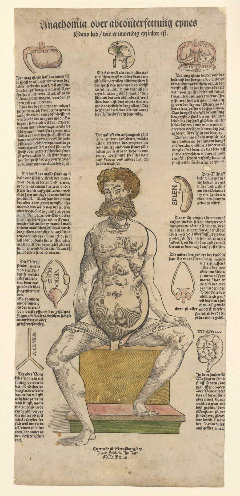
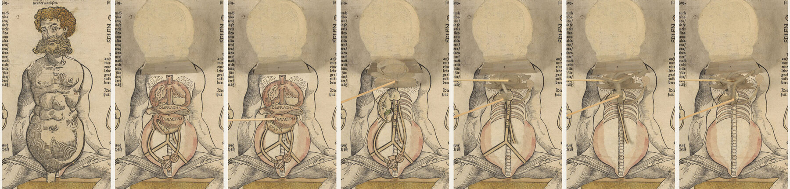
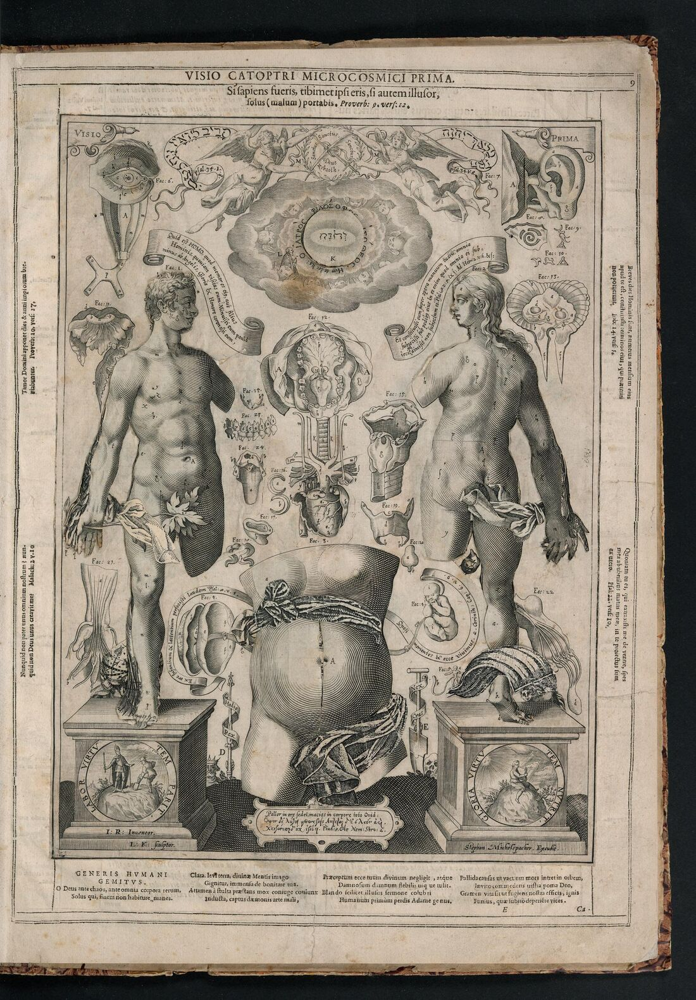

+++
author = "矢崎裕一"
title = "復活祭の表は回る円盤に、身体の層はめくる紙に──中世・近世の動く本"
slug = "movable-books-volvelle-flap"
date = "2026-11-03"
description = "13世紀のマシュー・パリスは、復活祭の日付を求める表を、回る円盤にしました。1538年からの一枚刷りの解剖図は、皮膚から背骨までの層を、重ねた紙をめくって見せました。"
categories = [
    "consume"
]
tags = [
    "データ物質化",
    "ボルベル",
    "マシュー・パリス",
    "解剖図"
]
image = "images/anathomia-1544-male-layers.jpg"
series = ["data-physicalization"]
series_weight = 3
seriesByline = "Matthew Paris・Heinrich Vogtherr ほか"
seriesTitle = "表を円盤で回し、身体を紙でめくる──中世・近世の動く本"
+++

13世紀のイングランドの修道士 Matthew Paris（マシュー・パリス）は、復活祭の日付を求める円形の表を、中心の金属ピンで回る円盤にしました。1538年からストラスブールやアウクスブルクで刷られた一枚刷りの解剖図は、皮膚から背骨までの身体の層を、重ねて貼った紙をめくって順に見せました。回す仕掛けをボルベル（volvelle）、めくる仕掛けをフラップ（flap）と呼びます。

入口は、データ物理化の年表 dataphys.org の項目「1200 – Pop-Up and Movable Books」です。本文はそこから所蔵館の記録までたどり、ケンブリッジ大学コーパス・クリスティ・カレッジ、パーカー図書館の写本 MS 26 と、ウェルカム・コレクションが所蔵する1544年の一枚刷り解剖図に沿います。後半では、めくる仕掛けが本に入った例として、1619年のヨハン・レメリンの解剖学書も見ます。

<!--more-->

## 『大年代記』の前付けで、表が回る

Matthew Paris（c. 1200–59）は、セント・オールバンズ修道院のベネディクト会修道士で、年代記作者です。パーカー図書館の記述は、彼を次のように紹介しています。

> "Matthew was also a talented artist who was both scribe and illustrator of his own chronicles."

自分の年代記を、筆写も挿絵も自分で手がけた人だ、という紹介です。主著『Chronica maiora（大年代記）』は2巻の写本で、第1巻がパーカー図書館の MS 26、第2巻が MS 16 です。制作は c. 1240–55年。MS 26 は天地創造から1188年までを収めています。

回る表は、この MS 26 の前付けにあります。前付けには、ロンドンからエルサレムまでの旅程図（7ページ）、王の系譜、風の図、暦などが並びます。M. R. James による目録は、f. v recto を「Circular Paschal table」、つまり円形の復活祭表と記し、仕掛けをこう書いています。

> "On f. vr the circular Paschal table is made to revolve: head of metal pin in C."

円形の復活祭表は回るように作られ、中心に金属ピンの頭がある、という記述です。ページ下部に貼ってあった別の表か図は、失われているとも書いています。

裏の f. v verso には、回らない表が置かれています。目録の題は「Table of Concurrentes etc. from 1116 to 1620」です。concurrentes は、年ごとの曜日を決めるのに使う数です。1116年から1620年まで、505年分が静止した表に並びます。表の面に回る円盤、裏の面に静止した表という配置です。

復活祭の日付は、computus（コンプトゥス）と呼ばれる計算で求めます。Gianfranco Crupi（ジャンフランコ・クルピ）は、この計算が19太陽年の月の周期にもとづくと説明しています。なお、円盤の同心円の数や、各リングに何が書かれているかは、文字の一次情報では確かめられませんでした。円盤の素材も、確かめられていません。

f. vr の画像は、Parker Library on the Web で見られます（CC BY-NC 4.0）。

## 1538年、身体を一枚の紙に重ねる

めくる仕掛けの解剖図は、本ではなく一枚刷りから始まりました。Andrea Carlino（アンドレア・カルリーノ）は、この種の刷り物を anatomical fugitive sheets と呼び、1538〜1687年の目録『Paper Bodies』（1999）にまとめています。最初の版は1538年です。ストラスブールの Heinrich Vogtherr（ハインリヒ・フォークトヘル）と、アウクスブルクの Jost de Negker（ヨスト・デ・ネッカー）が、同じ年に出しました。1538〜1545年の間に、少なくとも20の版が出ています。

ここで見るのは、ウェルカム・コレクションが所蔵する1544年の版『Anathomia oder abconterfettung eynes Mans leib, wie er inwendig gestaltet ist.』です。女性像の一枚と対になっています。ストラスブールの Jacob Frölich（ヤーコプ・フレーリヒ）が刷りました。木版で、大きさは55 × 25 cm、所蔵の1部は手彩色です。

Wellcome Collection 所蔵（Public Domain Mark）／Wellcome Collection『Anathomia oder abconterfettung eynes Mans leib…』（1544）より引用

Carlino によれば、フォークトヘルは1544年にストラスブールを離れるとき、一枚刷りの版木をフレーリヒに預けたとみられます。フレーリヒは同じ年にその版木で刷り、色を付けました。Carlino は、色がこの図の「austerity（簡素さ）」を和らげたと書いています。

ウェルカムの記述によれば、座った男女像の胸と腹の上にフラップを貼ってあり、男性像に6枚、女性像に9枚です。めくるたびに、解剖の構造が一層ずつ現れます。Carlino は、このジャンルの作りをこう説明します。胴体全体が一枚としてめくれる。内臓は別の紙に刷って切り抜き、貼り重ねる。**最後の層は、胸郭の背面と脊髄です。**

Wellcome Collection 所蔵（Public Domain Mark）／Wellcome Collection『Anathomia oder abconterfettung eynes Mans leib…』（1544）の画像1〜7から胴体部分を切り出して並べ、引用

上の図は、ウェルカムが撮った男性像の画像1〜7を、左から並べたものです。途中、同じ層が2枚ずつ写っています。2枚目では、器官の上に PULMO（肺）、COR（心臓）、DIAFRAGMA（横隔膜）、STOMACHUS（胃）、SPLEN（脾臓）と刷られています。右端では、肋骨と背骨が現れます。

Carlino によれば、フォークトヘルの版では各器官の上に、主にラテン語で名前が刷られています。一部の器官は周りの本文の中にもう一度刷られ、そこにはドイツ語の名前と短い説明が付きます。男女の像は同じ版木から刷られ、差し替えたのは頭の部分と、胸部・生殖器のフラップだけでした。Carlino はこれを、費用を抑える工夫と読んでいます。

フォークトヘルは1539年、同じ版木で、ドイツ語の易しい解剖の小冊子も出しています。Carlino はここから、読者は専門家でも学者でもない層だったとみています。

## 一枚刷りから、約120枚のフラップの本へ

めくる仕掛けは、やがて本に入ります。Carlino は、ヴェサリウス（Andreas Vesalius）が『Epitome』（1543）と『Fabrica』でこの技法を使い、読者が切り抜いて貼り合わせる図を載せたと書いています。

その先にあるのが、Johann Remmelin（ヨハン・レメリン）の『Catoptrum microcosmicum（小宇宙の鏡）』です。1619年にアウクスブルクで刊行されました。二つ折り判で高さ47 cm、解剖図は p. 9、15、21 の3図です。図版はレメリン自身の素描をもとに、Lucas Kilian（ルーカス・キリアン）が銅版に彫りました。3図に付いたフラップは、ゲッティ研究所本の書誌で約120枚あります。

Getty Research Institute 所蔵（Internet Archive 上の表示は NOT_IN_COPYRIGHT）／Internet Archive『Catoptrum microcosmicum』（1619）より引用

上の図は p. 9 の第1図「Visio prima」で、左下に「L. K. sculptor」の署名があります。マギル大学図書館は、層の順番を「表層 → 血管 → 筋肉 → 神経 → 脊椎」と説明します。耳・目・胴体の器官は別の小図に分けてあります。Visio prima では、中央の女性の胴体の最後の層に、子宮の中の胎児が現れます。

刊行年は、マギルが1619年版を「最初の公認版」とし、コロンビア大学はラテン語の初版を1613年としていて、食い違います。コロンビアは「医学生や医師よりも好奇心のある一般人向け」の、当時のベストセラーだったと書きます。本はドイツ語、オランダ語、英語、フランス語に訳されました。

## 何を、どの動きに対応させたか

データと紙の性質の対応を、表にまとめます。

| 資料 | データ（何を表すか） | 物理的な性質への対応 | 出典 |
|---|---|---|---|
| パリスの復活祭表（MS 26, f. vr） | 復活祭の日付を求める計算。19太陽年の月の周期にもとづく | 円形の表を、中心の金属ピンで回る円盤にする | James の目録、Crupi 2019 |
| 同（f. vv） | 曜日を決める concurrentes（1116〜1620年） | 裏面に静止した表として並べる | James の目録 |
| 1544年の一枚刷り | 胸と腹の器官の、表から奥への順序 | 紙の重なりの順番。男性像6枚、女性像9枚。最後の層が胸郭の背面と脊髄 | Wellcome、Carlino 1999 |
| 同 | 器官の名前 | 器官の上にラテン語で刷る。本文ではドイツ語名と説明 | Carlino 1999 |
| 同 | 男女の違い | 同じ版木を使い、頭と胸部・生殖器のフラップだけ差し替える | Carlino 1999 |
| レメリン 1619 | 身体の層 | 表層 → 血管 → 筋肉 → 神経 → 脊椎の順に重ねる。3図で約120枚 | McGill 2019、Getty の書誌 |

静止した円形の表では、数字の対応を読むために、写本を回す必要がありました。この点は Daniel K. Connolly（ダニエル・K・コノリー）の研究を、ArchBook が次のように要約しています。

> "required the reader to reorient the manuscript in order to read the numbers. Matthew Paris's innovation allowed readers to turn the disk and align it with their bodies"

パリスの工夫で、読者は円盤を回して自分の体の向きに合わせられるようになった、という要約です。

表を並べると、回す仕掛けは周期をもつ量どうしの対応を回転角で引く計算機で、めくる仕掛けは空間の順序を重なりで見せる階層表示だ、と読めます。可視化の言葉にすれば、前者は円形レイアウトに読み手が整列を操作できる仕組みを足したもの、後者はドリルダウン（詳細を段階的に開く表示）の紙の版にあたる、と読めます。

なお、dataphys の項目本文には、所蔵館の記録と合わない点があります。

- 書名が「Chronica Majorca」となっていますが、正しくは Chronica Majora（maiora）です。
- 回転の軸を string or rivet としていますが、MS 26 の目録では金属ピンです。
- 動く本が娯楽や子ども向けに使われ始めたのは19世紀としていますが、ArchBook は1546年の占いのくじ遊びのボルベルを挙げています。

## 第三者はこの仕掛けをどう見たか

1つ目は、読者の手に注目する Crupi です。論文「Volvelles of knowledge」（2019）で、パリスの円盤についてこう書いています。

> "transformed the reader's manual gesture into an intellectual experience of knowledge, thus enabling them to become not merely the interpreter of the text but also its architect, whose intervention enables the algorithm that generates meaning."

読者の手の動きを知の経験に変え、読者を本文の解釈者ではなく、意味を生む手順を動かす設計者にした、という評価です。Crupi はまた、ボルベルとフラップを、16〜17世紀の科学書で最もよく使われた二つの装置と位置づけています。

2つ目は、解剖の手順を紙に移したことに注目する Carlino です。

> "This technique of illustration provided a virtual three-dimensional representation … In short, it translated on to paper the whole concept of anatomical dissection, mimicking the progressive unveiling of the body, from skin to guts."

この図法は仮想の立体表現で、皮膚から内臓へと身体を順に開いていく解剖の考え方を、そのまま紙に移した、という評価です。Carlino は商業面にも触れ、一枚刷りの成功は、どの解剖学の論文よりも「immeasurably greater（比べものにならないほど大きい）」と書きます。

3つ目は、前節で引いた Connolly です。写本を回す手間を、パリスの円盤が解いたという見方です。ArchBook はこの円盤を「最初に知られたボルベル」と紹介し、Crupi は「最初期の一人」としています。

デューク大学の展覧会を企画した Valeria Finucci は、こうした本について、Duke Today でこう話しています。

> "They allow for a material reading of their medical content."

医学の内容を、物として読めるようにする、という言葉です。

## 使い道

二つの仕掛けから、可視化の仕事に持ち帰れることが三つあると読めます。

一つ目は、データの形に合う動かし方を選ぶことです。パリスの表は周期をもつ暦の計算で、仕掛けは回転でした。解剖図は表から奥への順序で、仕掛けは重ねてめくる紙でした。画面のインタラクションを決めるときも、データが周期なのか、階層なのかを先に確かめると、操作の種類が絞れると読めます。

二つ目は、層の数と順番を、そのまま操作の回数と順番にすることです。1544年の男性像は6枚のフラップを重ねてあり、最後の層は胸郭の背面と脊髄とされます。めくる回数と順番が、身体の奥行きの順番に対応している、と読めます。ドリルダウンを設計するとき、何回開けば一番奥に着くかを、読者に予想できる形にしておく。紙の解剖図は、その例として読めます。

三つ目は、名前と説明を分けて置くことです。器官の上には主にラテン語の名前を刷り、一部の器官は本文にドイツ語名と短い説明を付けていました。図の中の注記は短くし、説明は周りの文章に任せる。いまのチャートの注記の分け方と同じ考え方だと読めます。

どちらの仕掛けも、読者が手を動かさなければ中身が見えません。データ物理化の作品では、読者の手に何をさせるかを決めること自体が、エンコーディングの一部になる。中世・近世の動く本は、そう示していると読めます。

## 参考・出典

**一次情報**

- dataphys.org, "1200 – Pop-Up and Movable Books"（Added by Pierre Dragicevic, sent by Benjamin Bach）. https://dataphys.org/list/pop-up-and-movable-books/
- Parker Library, Corpus Christi College, Cambridge, MS 26（Matthew Paris, *Chronica maiora* I）IIIF マニフェスト（記述・ライセンス）. https://dms-data.stanford.edu/data/manifests/Parker/rf352tc5448/manifest.json
- Parker Library on the Web, MS 26. https://parker.stanford.edu/parker/catalog/rf352tc5448
- M. R. James による MS 26 の内容記述（Biblissima IIIF Collections 経由）. https://iiif.biblissima.fr/collections/manifest/82acae38b80a68174ccdf8d7ca902548f7c32f36
- Wellcome Collection, *Anathomia oder abconterfettung eynes Mans leib, wie er inwendig gestaltet ist.*, Strassburg: Jacob Frölich, 1544. https://wellcomecollection.org/works/w2mgwvb3 ／ IIIF https://iiif.wellcomecollection.org/presentation/v2/b33552964
- Wellcome Collection, Anatomical fugitive sheets, c. 1540. https://wellcomecollection.org/works/anmb7n8h
- Andrea Carlino, *Paper Bodies*, Catalogue（Cat. 1 = Vogtherr 1538）. https://doi.org/10.1017/S0025727300073129
- Johann Remmelin, *Catoptrum microcosmicum*, Augsburg, 1619（Getty Research Institute）. https://archive.org/details/gri_33125015238948
- 同（McGill University Library, Osler Library）. https://archive.org/details/McGillLibrary-osl_elf_cum-deo-johannis-remmelini_elfWZ250R388c1619-19996
- 同 1661年ドイツ語版 *Kleiner welt Spiegel*（Columbia University Libraries）. https://archive.org/details/ldpd_11497246_000
- Ruoshan Gu & Mary Hague-Yearl, "A Mirror into the Microcosm: Digitizing Johann Remmelin's 1619 Flap Anatomy," McGill Library Matters, 2019-12-17. https://news.library.mcgill.ca/a-mirror-into-the-microcosm-digitizing-johann-remmelins-1619-flap-anatomy-catoptrum-microcosmicum/
- Columbia University Irving Medical Center, "A Medical Pop-Up Book From the 17th Century." https://www.cuimc.columbia.edu/news/medical-pop-book-17th-century
- Duke University Libraries, "Animated Anatomies"（2011）. https://exhibits.library.duke.edu/exhibits/show/anatomy/intro ／ 出品目録 https://exhibits.library.duke.edu/exhibits/show/anatomy/intro/bib

**第三者評価**

- Gianfranco Crupi, "Volvelles of knowledge," *JLIS.it* 10(2), 2019. doi:10.4403/jlis.it-12534. https://iris.uniroma1.it/handle/11573/1269189
- Andrea Carlino, *Paper Bodies: A Catalogue of Anatomical Fugitive Sheets 1538–1687*, Medical History Supplement 19, 1999, ch. 2 "Anatomical Fugitive Sheets." https://doi.org/10.1017/S0025727300073099
- Gravelle, Mustapha, Leroux, "Volvelles," ArchBook（2012、2022年改訂。Daniel K. Connolly, *Art Bulletin* 1999 の要約を含む）. https://drc.usask.ca/projects/archbook/volvelles.php
- Duke Today, 2011-04-07（Valeria Finucci の発言）. https://today.duke.edu/2011/04/flapbook.html
- Laughing Squid（E.D.W. Lynch）, "Animated Anatomies, An Exhibition of Antique Medical Pop-Up Books," 2011-05-18. https://laughingsquid.com/animated-anatomies-an-exhibition-of-antique-medical-pop-up-books/
- Wikipedia, "Chronica Majora." https://en.wikipedia.org/wiki/Chronica_Majora ／ "Matthew Paris." https://en.wikipedia.org/wiki/Matthew_Paris
