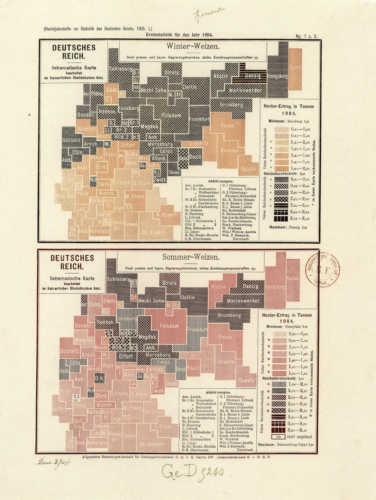
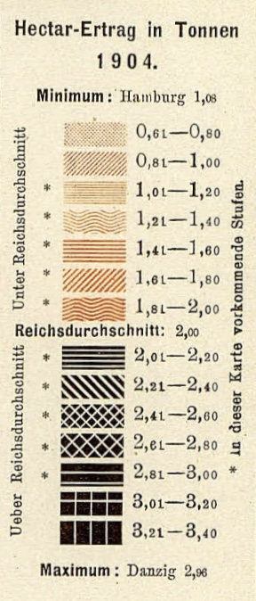
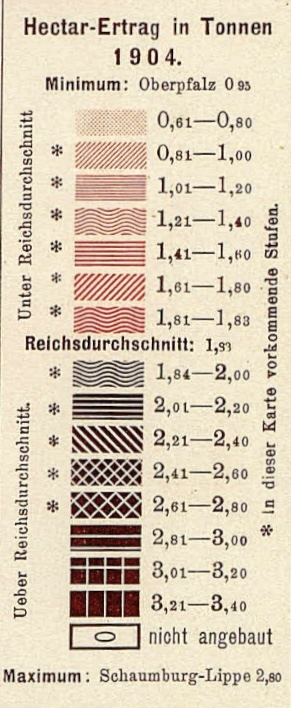
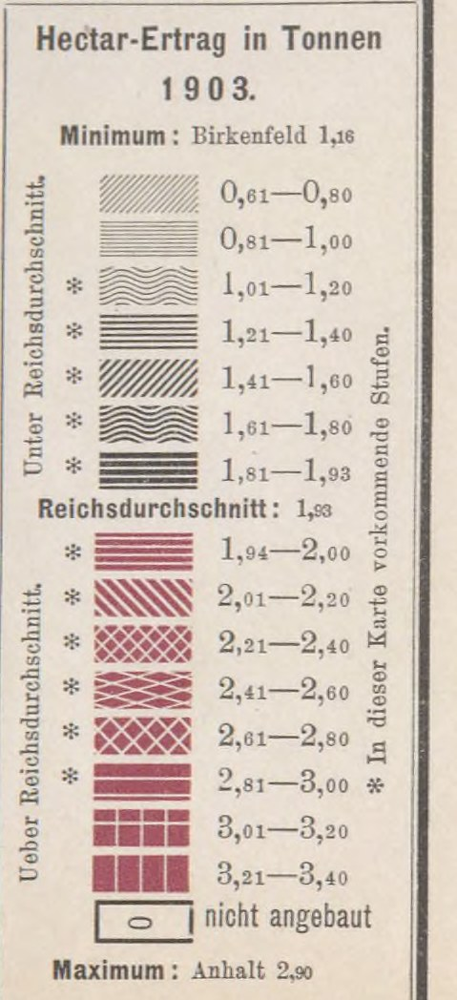
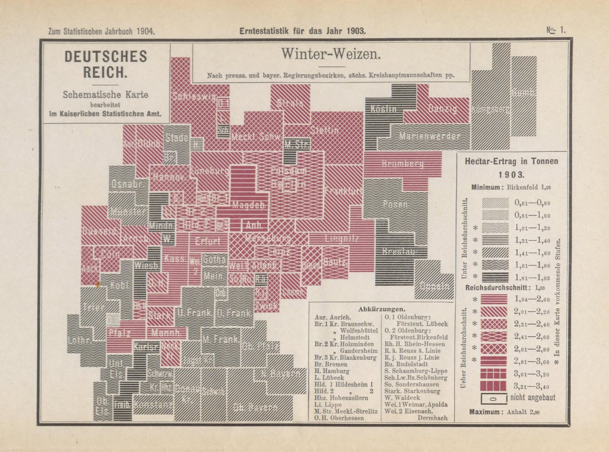
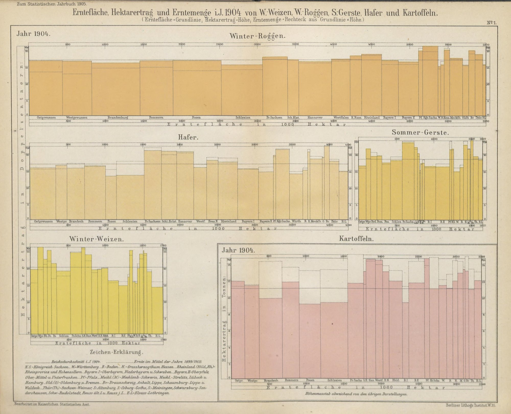

+++
author = "Yuichi Yazaki"
title = "Switching Inks at the Imperial Average: The German Imperial Statistical Office's Wheat-Yield Map (1905)"
slug = "multi-color"
date = "2025-10-02"
description = "A map of 1904 wheat yields in the 1905 Vierteljahrshefte zur Statistik des Deutschen Reichs switches ink color at the imperial average, and tells the classes above and below it apart by pattern type and line density."
categories = [
    "technology"
]
tags = [
    "Imperial Statistical Office of Germany",
    "maps",
    "choropleth map",
    "schematic map",
    "class intervals",
    "color"
]
image = "images/cover-schematic-chropleth.jpeg"
+++

The 1905 *Vierteljahrshefte zur Statistik des Deutschen Reichs* (Quarterly Journal of the Statistics of the German Reich) carries a map of wheat yields for the 1904 harvest. It was made by the Imperial Statistical Office (Kaiserliches Statistisches Amt). The map switches the color of its ink at the imperial average, and within each side, above and below the average, it tells the classes apart by pattern type and line density.

The figure is a single sheet with two maps, one above the other: winter wheat (Winter-Weizen) on top and spring wheat (Sommer-Weizen) below. Below, I read the printed text and legend as the primary source, and set the map beside a figure in the same style from the previous year and another figure showing the same year's harvest.

<!--more-->

## 1905: A Plate for the Harvest Statistics

At the top of the figure, this is printed.

> (Vierteljahrshefte zur Statistik des Deutschen Reichs, 1905. I.)
> Erntestatistik für das Jahr 1904.
> No. 1 u. 2.

It means: Part I of the 1905 *Vierteljahrshefte*, harvest statistics for the year 1904, plates No. 1 and No. 2. 1904 is the year of the harvest, and the publication is from 1905. The Office's *Statistisches Jahrbuch für das Deutsche Reich* (Statistical Yearbook for the German Reich), 1905 edition, also gives Part I of the 1905 *Vierteljahrshefte* as the source of its 1904 harvest tables.

The harvest statistics rest on a resolution of the Bundesrat of 19 January 1899, and the results from 1900 onward appear in Part I of the following year's *Vierteljahrshefte*. The Office was the Reich's central statistical authority, established in 1872.

The title of the figure is "DEUTSCHES REICH. Schematische Karte bearbeitet im Kaiserlichen Statistischen Amt." Schematische Karte means "schematic map": instead of drawing the real boundaries of the administrative districts, it lays them out as rectangular blocks. Abbreviations such as Danzig and Posen appear in white inside the blocks. Whether the area of a block is proportional to the real area is not stated. The unit of aggregation is, as the subtitle "Nach preuss. und bayer. Regierungsbezirken, sächs. Kreishauptmannschaften pp." says, Prussian and Bavarian Regierungsbezirke (governmental districts), Saxon Kreishauptmannschaften, and so on. No individual's name appears on the figure.

My account of the 1904 figure is based on a scan of the single sheet bearing a holdings stamp of the Bibliothèque nationale de France (BnF). I could not verify the holdings record, so I do not show the image and present the contents of the legend in tables instead.

## Switching Inks at the Imperial Average

The title of the legend is "Hectar-Ertrag in Tonnen 1904." It shows the yield per hectare in tons. The scale runs from 0.61 to 3.40 in steps of 0.2 tons.

**The legend is split in two by the line of the imperial average (Reichsdurchschnitt).** The vertical label on the upper side reads "Unter Reichsdurchschnitt" (below the imperial average), and the one on the lower side reads "Ueber Reichsdurchschnitt" (at or above the imperial average). The winter wheat map states "Reichsdurchschnitt: 2,00" and prints the below-average classes in orange tones and the at-or-above-average classes in black.

The correspondence between data and appearance is as follows.

| Data | Mapped to | Value in the winter wheat map |
|---|---|---|
| Position of the administrative district | Placement and abbreviation of the rectangular block | Real boundaries are not drawn |
| Yield per hectare | Classes in steps of 0.2 tons | 14 classes, 0.61 to 3.40 |
| Above or below the imperial average | Switch of ink color | Average 2.00. Below is orange, at or above is black |
| Rank within the same side | Pattern type, and line weight and density | Dots, diagonal lines, horizontal lines, wavy lines, grids, blocks |
| Classes that appear on the map | "*" mark to the left of the legend | 10 of the 14 classes |
| Smallest and largest districts | District names and values above and below the legend | Hamburg 1.08 / Danzig 2.96 |

Reading the winter wheat legend from the top gives the following.

| Class (t/ha) | Color | Pattern | Appears on the map |
|---|---|---|---|
| 0.61–0.80 | Pale orange | Dots | — |
| 0.81–1.00 | Pale orange | Fine diagonal lines | — |
| 1.01–1.20 | Pale orange | Fine horizontal lines | * |
| 1.21–1.40 | Pale orange | Fine wavy lines | * |
| 1.41–1.60 | Deep orange | Heavier horizontal lines | * |
| 1.61–1.80 | Deep orange | Heavier diagonal lines | * |
| 1.81–2.00 | Deep orange | Heavier wavy lines | * |
| (Imperial average 2.00) | | | |
| 2.01–2.20 | Black | Horizontal lines | * |
| 2.21–2.40 | Black | Thick diagonal lines | * |
| 2.41–2.60 | Black | Coarse diagonal grid | * |
| 2.61–2.80 | Black | Fine diagonal grid | * |
| 2.81–3.00 | Black | Thick horizontal band | * |
| 3.01–3.20 | Black | Blocks separated by white lines | — |
| 3.21–3.40 | Black | Larger black blocks | — |

There are two layers, "below the average" and "at or above the average," with no middle layer.

In the spring wheat map the average is "1,93". The below-average classes are printed in red tones, and the at-or-above-average classes in a dark color close to black. In the scan the dark color looks like a dark brown, redder than black. The scale is the same as for winter wheat, but only the class 1.81–2.00 is split at the average, into 1.81–1.83 and 1.84–2.00. This can be read as a design in which the average of that year and that crop is inserted as a boundary into a fixed ruler with 0.2-ton steps.

## Dividing Patterns Above and Below the Average

Color is responsible for whether a value is above or below the average. The rank within the same side is the job of pattern type and line density.

The below-average side has four pale orange classes and three deep orange classes, and it reuses the same kinds of pattern: diagonal lines, horizontal lines, wavy lines. Pattern type in itself has no order of large and small. It can be read that the order is conveyed mainly by the depth of color and by being above or below the average, and that the pattern takes on distinguishing the classes within the same depth. The at-or-above-average side is arranged in order of increasing black area, from lines to grids and from grids to blocks. Here the blackness of the pattern itself can be read as expressing the order of quantity.

The legend also carries a summary of the distribution. To the right of the "*" mark on the left there is an explanation in vertical text.

> * In dieser Karte vorkommende Stufen.

It means: the classes that occur in this map. Above and below the legend are written the names and values of the smallest and largest districts.

| Figure | Classes in legend | Classes on the map | Smallest | Largest |
|---|---|---|---|---|
| Winter wheat (No. 1) | 14 | 10 | Hamburg 1.08 | Danzig 2.96 |
| Spring wheat (No. 2) | 15 + "not cultivated" | 11 | Oberpfalz 0.95 | Schaumburg-Lippe 2.80 |

0.61 and 3.40 are the two ends of the scale, not the actual minimum and maximum. The spring wheat legend also has a white box marked "0", "nicht angebaut" (not cultivated). The smallest value agrees with the yearbook's table: on p. 27 of the 1905 edition, the 1904 wheat yield of Hamburg is 10.8 dz/ha, that is, 1.08 t/ha.

Source: Kaiserliches Statistisches Amt, *Statistisches Jahrbuch für das Deutsche Reich*, 1904 edition, plate No. 1, legend / Mannheim University Library, "Statistische Jahrbücher" (Public Domain Mark 1.0)

This is the legend of a figure in the same style that depicts the harvest of the previous year, 1903. The structure is the same: vertical labels above and below, the "*" on the left, and the smallest and largest districts above and below. The way color is used is different.

## Placing It Beside the Previous Year's Map

This style is not a one-off. The preface of the 1904 yearbook describes the plates at the back of the volume as follows.

> Die graphischen Beilagen zeigen in 8 schematischen Karten für die einzelnen Verwaltungsbezirke den Ernteertrag im Jahre 1903 für Winter- und Sommerweizen, Winter- und Sommerroggen, Gerste, Hafer, Kartoffeln und Klee (Heu).

It means: eight schematic maps show the 1903 harvest for each administrative district. The crops are winter and spring wheat, winter and spring rye, barley, oats, potatoes, and clover (hay).

Source: Kaiserliches Statistisches Amt, *Statistisches Jahrbuch für das Deutsche Reich*, 1904 edition, plate No. 1 "Winter-Weizen" / Mannheim University Library, "Statistische Jahrbücher" (Public Domain Mark 1.0). The original is in landscape orientation and has been rotated by 90 degrees.

Compare the winter wheat maps of 1903 and 1904.

| | 1903 harvest (yearbook 1904) | 1904 harvest (Vierteljahrshefte 1905, I) |
|---|---|---|
| Below average | Gray-to-black patterns | Orange patterns |
| At or above average | Crimson patterns | Black patterns |
| Imperial average | 1.93 (class split into 1.81–1.93 / 1.94–2.00) | 2.00 |
| Smallest / largest | Birkenfeld 1.16 / Anhalt 2.90 | Hamburg 1.08 / Danzig 2.96 |

In the eight maps of 1903, the below-average classes are printed in gray to black, and the at-or-above-average classes in one color per crop: crimson for winter wheat, salmon for spring wheat, blue for potatoes, green for clover. In the 1903 edition, "color = at or above the average", and in the 1904 edition, "black = at or above the average", so the role of color can be read as reversed from year to year.

I have not found any source that explains the use of patterns by printing constraints. The same Office printed the previous year's eight maps in a different color for each crop, and plate No. 1 at the back of the 1905 yearbook is also multicolor.

Source: Kaiserliches Statistisches Amt, *Statistisches Jahrbuch für das Deutsche Reich*, 1905 edition, plate No. 1 / Mannheim University Library, "Statistische Jahrbücher" (Public Domain Mark 1.0)

This figure depicts the same 1904 harvest. Its encoding is written in the subtitle.

> (Erntefläche = Grundlinie; Hektarertrag = Höhe; Erntemenge = Rechteck aus Grundlinie × Höhe.)

It means: harvested area corresponds to the width, yield per hectare to the height, and harvest quantity to the area of width times height. The same Office shows the same year's yields by "above or below the average, and class" in the map, and by "width times height" in this figure. One can read in it the idea of drawing separately the yield as a rate and the harvest as a total.

## Through Third-Party Frameworks

I could not find any third-party text that discusses this figure itself. I use three sources that place the method in context.

The first is the number of classes. The English Wikipedia article "Choropleth map," citing Monmonier (1977), Brewer (1994) and others, says the following.

> for shades of gray, tests have shown that when value alone is used (e.g., light to dark, whether gray or any single hue), it is difficult to practically use more than seven classes. … If differences in hue and/or saturation are incorporated, that limit increases significantly to as many as 10-12 classes.

In short: with lightness alone it is hard to go beyond seven classes, and adding hue or saturation raises that to 10–12. The same article calls a color scheme that splits two series around a center such as the average "divergent". The 14 to 15 classes of the 1904 figure exceed this guideline, and the construction that splits color at the average can be read as the same idea as today's divergent color schemes. The article also says that the oldest choropleth map is Dupin's map of 1826, and that color came into wide use after 1850. The 1904 figure is not an early example of the choropleth.

The second is how patterns work. Axis Maps' "Cartography Guide: Visual Variables," based on the visual variables of Jacques Bertin, says the following.

> Shape is the only one of Bertin's variables that he thought is never selective, along with orientation when used for area representation (e.g., polygons symbolized by differently angled stripe patterns).

That is, when stripe patterns of different angles are used on areas, orientation, like shape, cannot be picked out at a glance. The same guide also says that size and value have an order that can be seen at a glance, and hue does not. The differences between diagonal and horizontal lines and between straight and wavy lines in the 1904 figure have no order, and the patterns can be read as serving to tell classes apart by checking against the legend.

The third is Germany of the same period. The English Wikipedia article "Cartogram" gives as the oldest known continuous cartograms a pair of maps by Hermann Haack and Hugo Weichel. They depict the results of the 1898 Reichstag election, in preparation for the 1903 election. The schematic map of the Statistical Office is not described as making area proportional to quantity. Even so, it can be read that, in Germany around the same time, attempts to show statistics by simplifying geographic form were happening side by side.

## How to Use This

What we can take away is a design that assigns separate jobs to color and pattern.

- Split above and below a baseline by color. Use two color families, and write the baseline value into the legend.
- Insert the baseline into a fixed ruler. Keep the class widths common across figures, and when the baseline falls in the middle of a class, split that class, as in the spring wheat map.
- Use pattern for telling classes apart. Give the order of quantity to depth or to the black area, and use the pattern as a clue for checking against the legend.
- Write a summary of the distribution in the legend. Mark the classes that actually occur, and add the names and values of the smallest and largest districts.
- In a series, fix the roles of the colors. When the roles are reversed, as between 1903 and 1904, readers have to check the legend every time.

If we were making this today, we could consider reducing the number of classes in line with the guideline above (for the basics, see the article on the [choropleth map](/choropleth-map/)). Even so, the 1905 legend, which separates the roles of color and pattern, can be read as a model for designing a legend.

## References

**Primary sources**

- This figure: Kaiserliches Statistisches Amt, „Schematische Karte" No. 1 Winter-Weizen / No. 2 Sommer-Weizen, *Vierteljahrshefte zur Statistik des Deutschen Reichs*, 1905, I. (Erntestatistik für das Jahr 1904). Confirmed from a single-sheet scan bearing a BnF holdings stamp. Holdings record not verified
- *Statistisches Jahrbuch für das Deutsche Reich*, 1904, preface p. III: [PDF](https://digi.bib.uni-mannheim.de/fileadmin/statjahrb/514401303_1904/pdf/514401303_0004.pdf)
- Same, 1904 edition, plate "Erntestatistik für das Jahr 1903" No. 1 Winter-Weizen: [PDF](https://digi.bib.uni-mannheim.de/fileadmin/statjahrb/514401303_1904/pdf/514401303_0338.pdf), No. 2 Sommer-Weizen: [PDF](https://digi.bib.uni-mannheim.de/fileadmin/statjahrb/514401303_1904/pdf/514401303_0339.pdf), No. 7 Kartoffeln: [PDF](https://digi.bib.uni-mannheim.de/fileadmin/statjahrb/514401303_1904/pdf/514401303_0344.pdf), No. 8 Klee (Heu): [PDF](https://digi.bib.uni-mannheim.de/fileadmin/statjahrb/514401303_1904/pdf/514401303_0345.pdf)
- *Statistisches Jahrbuch für das Deutsche Reich*, 1905, preface p. III: [PDF](https://digi.bib.uni-mannheim.de/fileadmin/statjahrb/514401303_1905/pdf/514401303_0004.pdf)
- Same, 1905 edition, list of sources p. XII: [PDF](https://digi.bib.uni-mannheim.de/fileadmin/statjahrb/514401303_1905/pdf/514401303_0013.pdf), p. XIV (where the harvest statistics are published): [PDF](https://digi.bib.uni-mannheim.de/fileadmin/statjahrb/514401303_1905/pdf/514401303_0015.pdf)
- Same, 1905 edition, p. 26 (harvest table for 1904): [PDF](https://digi.bib.uni-mannheim.de/fileadmin/statjahrb/514401303_1905/pdf/514401303_0051.pdf), p. 27 (yield per hectare): [PDF](https://digi.bib.uni-mannheim.de/fileadmin/statjahrb/514401303_1905/pdf/514401303_0052.pdf)
- Same, 1905 edition, plate No. 1 "Erntefläche, Hektarertrag und Erntemenge i.J. 1904": [PDF](https://digi.bib.uni-mannheim.de/fileadmin/statjahrb/514401303_1905/pdf/514401303_0392.pdf)
- Mannheim University Library, "Statistische Jahrbücher" (Public Domain Mark 1.0): [Digital edition](https://digi.bib.uni-mannheim.de/statistische-jahrbuecher/) / [Terms of use](https://bib.uni-mannheim.de/en/teaching-and-research/research-data-center-fdz/data-hosted-by-the-fdz/german-statistical-yearbooks)
- Bibliographic record of *Vierteljahrshefte zur Statistik des Deutschen Reichs*: [Internet Archive](https://archive.org/details/bub_gb_o3wzAQAAMAAJ)

**Secondary sources**

- Wikipedia, "Choropleth map": [en.wikipedia.org](https://en.wikipedia.org/wiki/Choropleth_map)
- Axis Maps, "Cartography Guide: Visual Variables": [axismaps.com](https://www.axismaps.com/guide/visual-variables)
- Wikipedia, "Cartogram": [en.wikipedia.org](https://en.wikipedia.org/wiki/Cartogram)
- Wikipedia (German), "Kaiserliches Statistisches Amt": [de.wikipedia.org](https://de.wikipedia.org/wiki/Kaiserliches_Statistisches_Amt)
