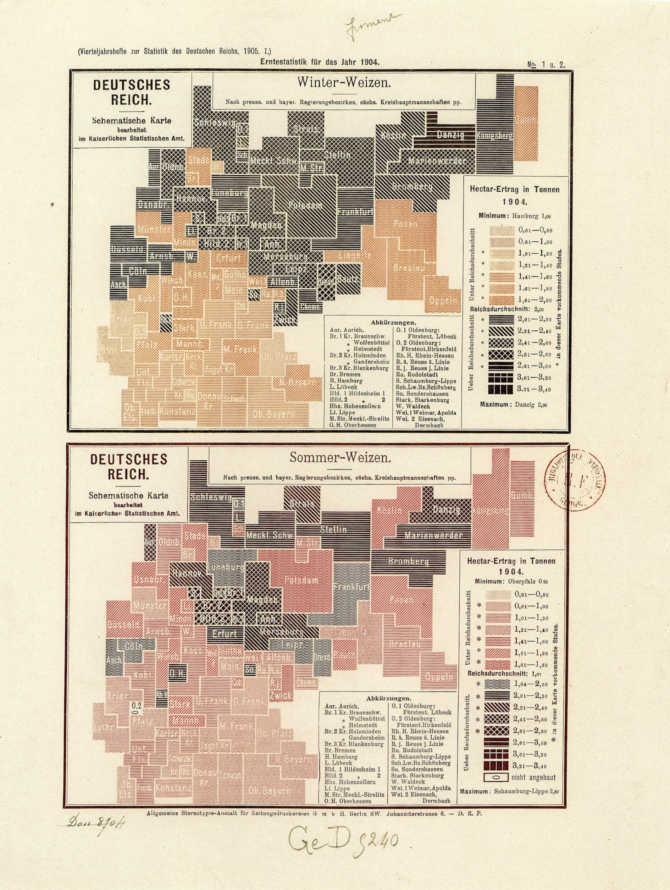
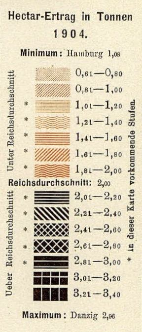
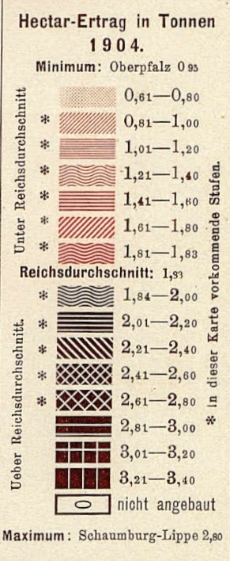
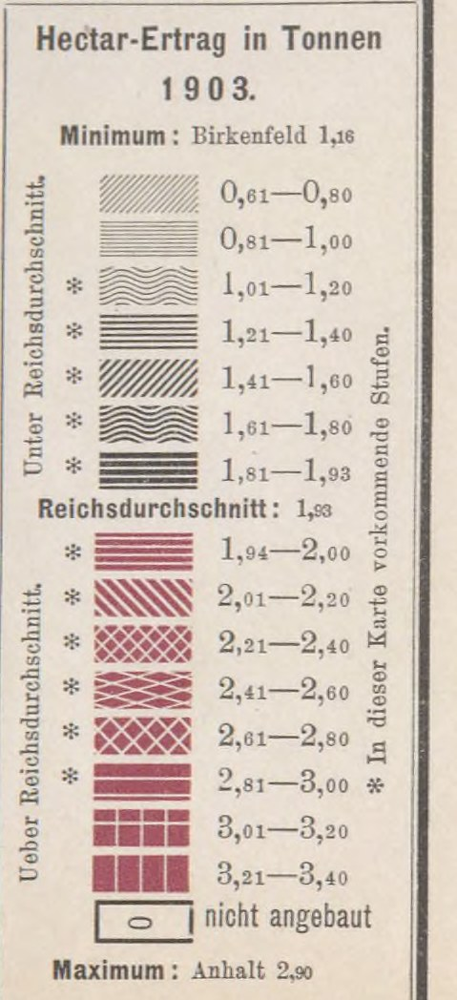
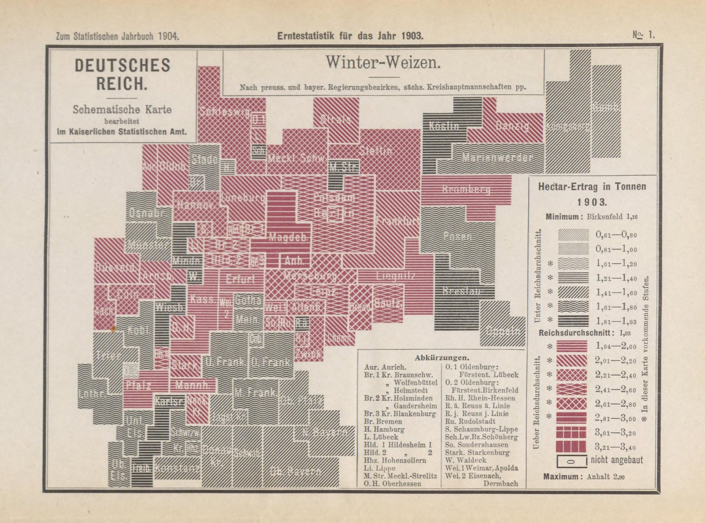
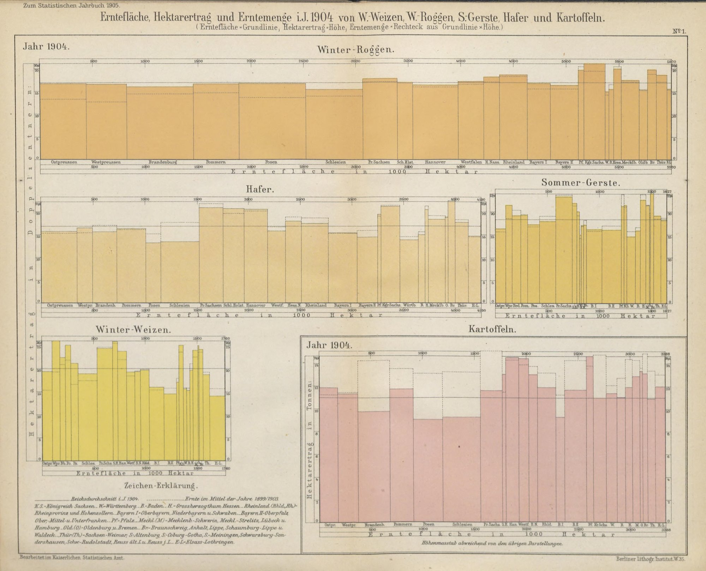

+++
author = "矢崎裕一"
title = "帝国平均でインクを切り替える──ドイツ帝国統計局の小麦収量図（1905）"
slug = "multi-color"
date = "2025-10-02"
description = "1905年刊の『ドイツ帝国統計四季報』に載った1904年の小麦収量図は、帝国平均を境にインクの色を切り替え、上と下の階級を模様の種類と線の密度で描き分けています。"
categories = [
    "technology"
]
tags = [
    "ドイツ帝国統計局",
    "地図",
    "コロプレスマップ",
    "図式地図",
    "階級区分",
    "色"
]
image = "images/cover-schematic-chropleth.jpeg"
series = ["dataviz-classics"]
series_weight = 9
seriesByline = "ドイツ帝国統計局"
seriesTitle = "平均でインクを切り替える──1904年収穫の小麦収量図"
+++

1905年刊の『Vierteljahrshefte zur Statistik des Deutschen Reichs』（ドイツ帝国統計四季報）に、1904年の収穫を描いた小麦収量の地図が載っています。作ったのはドイツ帝国統計局（Kaiserliches Statistisches Amt）です。地図は帝国平均を境にインクの色を切り替え、平均の上と下それぞれの階級を、模様の種類と線の密度で描き分けています。

図は1枚の紙に上下2図で、上が冬小麦（Winter-Weizen）、下が春小麦（Sommer-Weizen、春播き小麦）です。以下は、図に印刷された文字と凡例を一次情報として読み、前年の同じ様式の図と、同じ年の収穫を描いた別の図を並べます。

<!--more-->

## 1905年、収穫統計の付図として

図の上部には、こう印刷されています。

> (Vierteljahrshefte zur Statistik des Deutschen Reichs, 1905. I.)
> Erntestatistik für das Jahr 1904.
> No. 1 u. 2.

四季報の1905年第I分冊、1904年の収穫統計、図版 No. 1 と No. 2、という意味です。1904年は収穫の年で、刊行は1905年です。統計局の『Statistisches Jahrbuch für das Deutsche Reich』（統計年鑑）1905年版も、1904年の収穫表の出典を四季報1905年第I分冊としています。

収穫統計は1899年1月19日の連邦参議院の決議にもとづき、1900年以降の結果は翌年の四季報第I分冊に載ります。統計局は1872年に置かれた帝国の統計の中央官庁です。

図の題は「DEUTSCHES REICH. Schematische Karte bearbeitet im Kaiserlichen Statistischen Amt.」です。Schematische Karte は「図式地図」の意味で、行政区を実際の境界線ではなく、長方形のブロックで並べています。ブロックには Danzig、Posen といった略称が白抜きで入ります。ブロックの面積が実際の面積に比例するかは、書かれていません。集計の単位は、副題「Nach preuss. und bayer. Regierungsbezirken, sächs. Kreishauptmannschaften pp.」のとおり、プロイセンとバイエルンの県などです。図に個人の名前はありません。

1904年の図についての記述は、フランス国立図書館（BnF）の所蔵印がある1枚もののスキャンを読んだものです。所蔵記録までは確かめられなかったため、画像は載せず、凡例の中身を表で示します。

## 帝国平均で、インクを切り替える

凡例の題は「Hectar-Ertrag in Tonnen 1904.」で、1ヘクタールあたりの収量をトンで示します。目盛りは0.61から3.40まで、0.2トン刻みです。

**凡例は、帝国平均（Reichsdurchschnitt）の線で二つに割られています。**上側の縦書きのラベルは「Unter Reichsdurchschnitt」（平均未満）、下側は「Ueber Reichsdurchschnitt」（平均以上）です。冬小麦の図は「Reichsdurchschnitt: 2,00」で、平均未満を橙系、平均以上を黒で刷っています。

データと見た目の対応は、次のとおりです。

| データ | 見た目への対応 | 冬小麦の図での値 |
|---|---|---|
| 行政区の位置 | 長方形ブロックの配置と略称 | 実際の境界線は描かない |
| 1ヘクタールあたり収量 | 0.2トン刻みの階級 | 0.61〜3.40 の14階級 |
| 帝国平均より上か下か | インクの色の切り替え | 平均 2.00。未満は橙、以上は黒 |
| 同じ側の中での順位 | 模様の種類と、線の太さ・密度 | 点描・斜線・横線・波線・格子・ブロック |
| 地図に出てくる階級 | 凡例の左の「*」印 | 14階級のうち10階級 |
| 最小・最大の地域 | 凡例の上下に地域名と値 | Hamburg 1.08／Danzig 2.96 |

冬小麦の凡例を、上から読み取ると次のようになります。

| 階級（t/ha） | 色 | 模様 | 地図に出現 |
|---|---|---|---|
| 0.61–0.80 | 淡い橙 | 点描 | — |
| 0.81–1.00 | 淡い橙 | 細い斜線 | — |
| 1.01–1.20 | 淡い橙 | 細い横線 | * |
| 1.21–1.40 | 淡い橙 | 細い波線 | * |
| 1.41–1.60 | 濃い橙 | 太めの横線 | * |
| 1.61–1.80 | 濃い橙 | 太めの斜線 | * |
| 1.81–2.00 | 濃い橙 | 太めの波線 | * |
| （帝国平均 2.00） | | | |
| 2.01–2.20 | 黒 | 横線 | * |
| 2.21–2.40 | 黒 | 太い斜線 | * |
| 2.41–2.60 | 黒 | 目の粗い斜め格子 | * |
| 2.61–2.80 | 黒 | 目の細かい斜め格子 | * |
| 2.81–3.00 | 黒 | 太い横帯 | * |
| 3.01–3.20 | 黒 | 白線で区切ったブロック | — |
| 3.21–3.40 | 黒 | より大きい黒ブロック | — |

層は「平均未満」と「平均以上」の二つで、中間の層はありません。

春小麦の図は、平均が「1,93」です。平均未満を赤系で、平均以上を黒に近い暗い色で刷っています。暗い色は、スキャンでは黒より赤みの強い暗褐色に見えます。目盛りは冬小麦と同じですが、1.81–2.00 の階級だけを平均で割り、1.81–1.83 と 1.84–2.00 にしています。0.2トン刻みの固定の物差しに、その年・その作物の平均を境界として差し込む作りだと読めます。

## 平均の上と下で、模様を刻む

色が受け持つのは、平均の上か下かです。同じ側の中の順位は、模様の種類と線の密度が受け持ちます。

平均未満の側は、淡い橙の4階級と濃い橙の3階級で、斜線・横線・波線という同じ種類の模様をくり返し使っています。模様の種類そのものは大小の順を持ちません。順序は主に色の濃さと平均の上下で読ませ、同じ濃さの中の区別を模様が担っている、と読めます。平均以上の側は、線から格子、格子からブロックへと、黒の面積が増える順に並んでいます。こちらは模様の黒さそのものが量の順を表す、と読めます。

凡例は、分布の要約も持っています。左の「*」印には、右に縦書きで説明があります。

> * In dieser Karte vorkommende Stufen.

この地図に現れる階級、という意味です。凡例の上下には、最小と最大の地域名と値が書かれています。

| 図 | 凡例の階級 | 地図に出る階級 | 最小 | 最大 |
|---|---|---|---|---|
| 冬小麦（No. 1） | 14 | 10 | Hamburg 1.08 | Danzig 2.96 |
| 春小麦（No. 2） | 15＋「栽培なし」 | 11 | Oberpfalz 0.95 | Schaumburg-Lippe 2.80 |

0.61 と 3.40 は目盛りの両端で、実際の最小・最大ではありません。春小麦の凡例には「0」と書いた白枠の「nicht angebaut」（栽培なし）もあります。最小の値は年鑑の表とも合います。1905年版 p. 27 では、Hamburg の小麦の1904年の収量が 10.8 dz/ha、つまり 1.08 t/ha です。

Kaiserliches Statistisches Amt『Statistisches Jahrbuch für das Deutsche Reich』1904年版 図版 No. 1 の凡例／マンハイム大学図書館「Statistische Jahrbücher」より引用（Public Domain Mark 1.0）

これは前年、1903年の収穫を描いた同じ様式の凡例です。縦書きの上下のラベル、左の「*」、上下の最小・最大という組み立ては同じです。色の使い方は違います。

## 前の年の図と並べる

この様式は、1枚だけのものではありません。統計年鑑1904年版の序文は、巻末の付図をこう説明しています。

> Die graphischen Beilagen zeigen in 8 schematischen Karten für die einzelnen Verwaltungsbezirke den Ernteertrag im Jahre 1903 für Winter- und Sommerweizen, Winter- und Sommerroggen, Gerste, Hafer, Kartoffeln und Klee (Heu).

8枚の図式地図で、行政区ごとに1903年の収穫を示す。作物は冬・春の小麦とライ麦、大麦、燕麦、馬鈴薯、クローバー、という内容です。

Kaiserliches Statistisches Amt『Statistisches Jahrbuch für das Deutsche Reich』1904年版 図版 No. 1「Winter-Weizen」／マンハイム大学図書館「Statistische Jahrbücher」より引用（Public Domain Mark 1.0）。原本は横向きのため90度回転

1903年と1904年の冬小麦の図を比べます。

| | 1903年の収穫（年鑑1904年版） | 1904年の収穫（四季報1905年 I） |
|---|---|---|
| 平均未満 | 灰〜黒の模様 | 橙の模様 |
| 平均以上 | 深紅の模様 | 黒の模様 |
| 帝国平均 | 1.93（1.81–1.93／1.94–2.00 に分割） | 2.00 |
| 最小／最大 | Birkenfeld 1.16／Anhalt 2.90 | Hamburg 1.08／Danzig 2.96 |

1903年の8枚は、平均未満を灰〜黒で、平均以上を作物ごとに1色ずつ刷っています。冬小麦は深紅、春小麦はサーモン、馬鈴薯は青、クローバーは緑です。1903年版では「色＝平均以上」、1904年版では「黒＝平均以上」と、色の役割が年によって逆になっていると読めます。

模様を使った理由を、印刷の制約で説明する資料は見つかっていません。同じ局は前年の8枚を作物ごとに違う色で刷り分けていますし、1905年版の年鑑の巻末図版 No. 1 も多色です。

Kaiserliches Statistisches Amt『Statistisches Jahrbuch für das Deutsche Reich』1905年版 図版 No. 1／マンハイム大学図書館「Statistische Jahrbücher」より引用（Public Domain Mark 1.0）

この図は、同じ1904年の収穫を描いています。副題に符号化が書いてあります。

> (Erntefläche = Grundlinie; Hektarertrag = Höhe; Erntemenge = Rechteck aus Grundlinie × Höhe.)

作付面積を幅に、1ヘクタールあたり収量を高さに、収穫量を幅×高さの面積に対応させる、という意味です。同じ局が同じ年の収量を、地図では「平均の上下と階級」で、この図では「幅×高さ」で見せています。率としての収量と、総量としての収穫量を分けて描く考え方が見える、と読めます。

## 第三者の枠組みで見る

この図そのものを論じた第三者の文章は、見つかりませんでした。手法を位置づける資料を三つ使います。

一つ目は、階級の数です。英語版 Wikipedia の「Choropleth map」は、Monmonier（1977）や Brewer（1994）などを引いて、こう書いています。

> for shades of gray, tests have shown that when value alone is used (e.g., light to dark, whether gray or any single hue), it is difficult to practically use more than seven classes. … If differences in hue and/or saturation are incorporated, that limit increases significantly to as many as 10-12 classes.

明暗だけなら7階級を超えるのは難しく、色相や彩度を加えれば10〜12階級まで増やせる、という内容です。同じ項目は、平均などを中心に二つの系列に分ける配色を divergent と呼びます。1904年の図の14〜15階級はこの目安を超え、平均で色を割る組み立ては、いまの分岐配色と同じ発想にあたる、と読めます。また最古のコロプレスマップは1826年の Dupin の地図で、1850年以降に色が広く使われた、とあります。1904年の図は、コロプレスの初期の例ではありません。

二つ目は、模様の効き方です。Axis Maps の「Cartography Guide: Visual Variables」は、Jacques Bertin（ジャック・ベルタン）の視覚変数にもとづいて、こう書いています。

> Shape is the only one of Bertin's variables that he thought is never selective, along with orientation when used for area representation (e.g., polygons symbolized by differently angled stripe patterns).

面に角度の違う縞模様を使うと、向きは形と同じく、すぐには選び分けられない、という内容です。同じガイドは、大きさと明度には一目でわかる順序があり、色相にはない、とも書きます。1904年の図の斜線と横線、直線と波線の違いは順序を持たず、模様は凡例と照らし合わせるための見分けの役をしている、と読めます。

三つ目は、同じ頃のドイツです。英語版 Wikipedia の「Cartogram」は、知られる最古の連続型カルトグラムを、Hermann Haack と Hugo Weichel の一対の地図としています。1903年の選挙に向けて、1898年の帝国議会選挙の結果を描いたものです。統計局の図式地図は、面積を量に比例させたとは書かれていません。それでも同じ頃のドイツで、地理の形を簡略にして統計を見せる試みが並んでいた、と読めます。

## 使い道

持ち帰れるのは、色と模様に別々の仕事を割り当てる設計です。

- 基準の上か下かを、色で分ける。色は2系統にし、基準の値を凡例に書き込みます。
- 固定の物差しに、基準を差し込む。階級の幅は図をまたいで共通にし、基準が階級の途中に来たら、春小麦の図のようにその階級を割ります。
- 模様は、見分けに使う。量の順は濃さや黒の面積に持たせ、模様は凡例と照らし合わせる手がかりにします。
- 凡例に、分布の要約を書く。実際に出てくる階級に印を付け、最小と最大の地域名と値を添えます。
- シリーズでは配色の役割を固定する。1903年と1904年のように役割が逆になると、読む人は毎回凡例を確かめることになります。

いま作るなら、先の目安に合わせて階級を減らすことも考えられます（基本は[コロプレス・マップ](/choropleth-map/)の記事）。それでも、色と模様の役割を分けた1905年の凡例は、凡例を設計するときの見本として読めます。

## 参考・出典

**一次情報**

- 本図：Kaiserliches Statistisches Amt, „Schematische Karte“ No. 1 Winter-Weizen／No. 2 Sommer-Weizen, *Vierteljahrshefte zur Statistik des Deutschen Reichs*, 1905, I.（Erntestatistik für das Jahr 1904）。BnF の所蔵印のある1枚もののスキャンで確認。所蔵記録は未確認
- *Statistisches Jahrbuch für das Deutsche Reich*, 1904, 序文 p. III：[PDF](https://digi.bib.uni-mannheim.de/fileadmin/statjahrb/514401303_1904/pdf/514401303_0004.pdf)
- 同 1904年版 図版「Erntestatistik für das Jahr 1903」No. 1 Winter-Weizen：[PDF](https://digi.bib.uni-mannheim.de/fileadmin/statjahrb/514401303_1904/pdf/514401303_0338.pdf)、No. 2 Sommer-Weizen：[PDF](https://digi.bib.uni-mannheim.de/fileadmin/statjahrb/514401303_1904/pdf/514401303_0339.pdf)、No. 7 Kartoffeln：[PDF](https://digi.bib.uni-mannheim.de/fileadmin/statjahrb/514401303_1904/pdf/514401303_0344.pdf)、No. 8 Klee (Heu)：[PDF](https://digi.bib.uni-mannheim.de/fileadmin/statjahrb/514401303_1904/pdf/514401303_0345.pdf)
- *Statistisches Jahrbuch für das Deutsche Reich*, 1905, 序文 p. III：[PDF](https://digi.bib.uni-mannheim.de/fileadmin/statjahrb/514401303_1905/pdf/514401303_0004.pdf)
- 同 1905年版 出典一覧 p. XII：[PDF](https://digi.bib.uni-mannheim.de/fileadmin/statjahrb/514401303_1905/pdf/514401303_0013.pdf)、p. XIV（収穫統計の掲載先）：[PDF](https://digi.bib.uni-mannheim.de/fileadmin/statjahrb/514401303_1905/pdf/514401303_0015.pdf)
- 同 1905年版 p. 26（1904年の収穫表）：[PDF](https://digi.bib.uni-mannheim.de/fileadmin/statjahrb/514401303_1905/pdf/514401303_0051.pdf)、p. 27（1ヘクタールあたり収量）：[PDF](https://digi.bib.uni-mannheim.de/fileadmin/statjahrb/514401303_1905/pdf/514401303_0052.pdf)
- 同 1905年版 図版 No. 1「Erntefläche, Hektarertrag und Erntemenge i.J. 1904」：[PDF](https://digi.bib.uni-mannheim.de/fileadmin/statjahrb/514401303_1905/pdf/514401303_0392.pdf)
- マンハイム大学図書館「Statistische Jahrbücher」（Public Domain Mark 1.0）：[デジタル版](https://digi.bib.uni-mannheim.de/statistische-jahrbuecher/)／[利用条件](https://bib.uni-mannheim.de/en/teaching-and-research/research-data-center-fdz/data-hosted-by-the-fdz/german-statistical-yearbooks)
- *Vierteljahrshefte zur Statistik des Deutschen Reichs* の書誌：[Internet Archive](https://archive.org/details/bub_gb_o3wzAQAAMAAJ)

**第三者評価**

- Wikipedia, "Choropleth map"：[en.wikipedia.org](https://en.wikipedia.org/wiki/Choropleth_map)
- Axis Maps, "Cartography Guide: Visual Variables"：[axismaps.com](https://www.axismaps.com/guide/visual-variables)
- Wikipedia, "Cartogram"：[en.wikipedia.org](https://en.wikipedia.org/wiki/Cartogram)
- Wikipedia（独）, "Kaiserliches Statistisches Amt"：[de.wikipedia.org](https://de.wikipedia.org/wiki/Kaiserliches_Statistisches_Amt)
