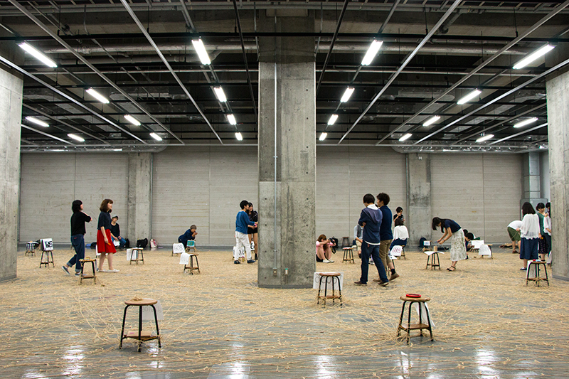
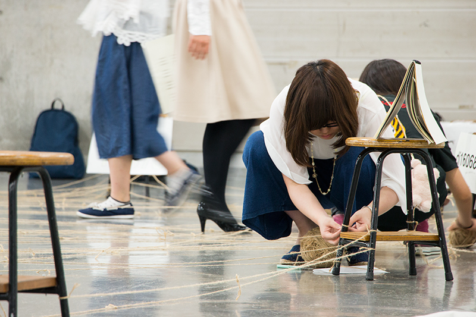
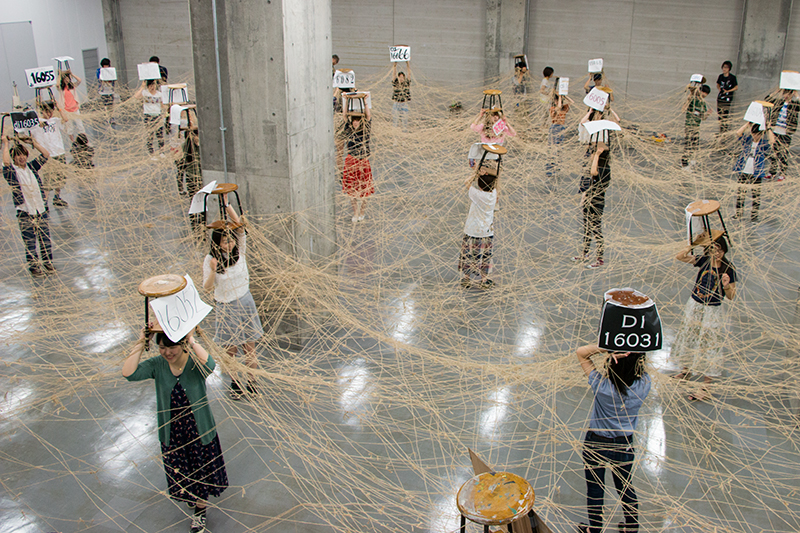
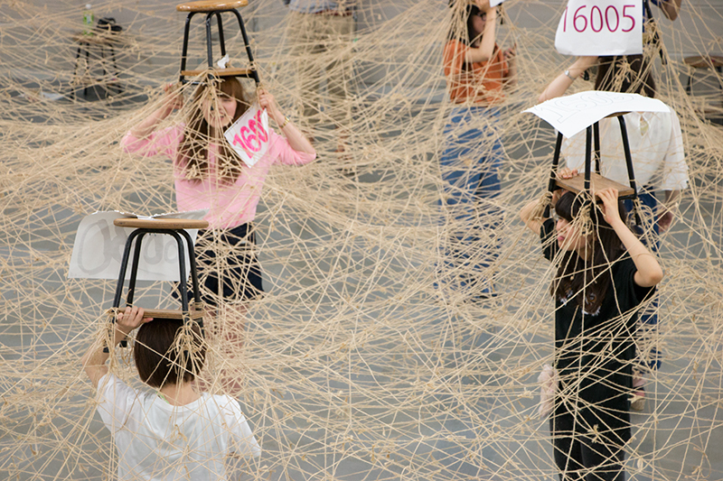
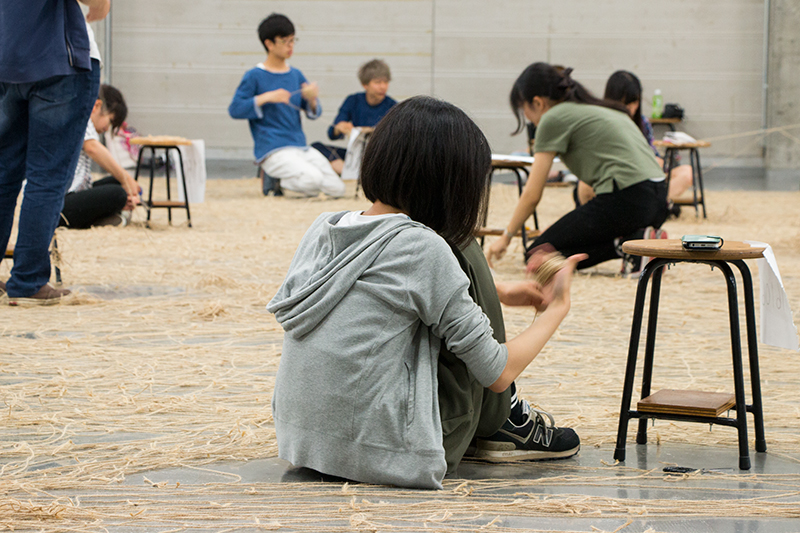

+++
author = "Yuichi Yazaki"
title = "Turning 50 Students' Photo Loans into a Hemp-Cord Network Graph: The Final Session of Musashino Art University's \"Information Processing I\""
slug = "musabi-link-strings"
date = "2026-11-07"
description = "In 2016, the final session of \"Jōhō Shori I\" (Information Processing I) in the Department of Design Informatics, Musashino Art University, turned 50 first-year students' photo loans (36 links each) into a hemp-cord network graph on the floor, then lifted it on nankin stools for about five minutes."
categories = [
    "consume"
]
tags = [
    "data physicalization",
    "network",
    "design education"
]
image = "images/strings-lifted-overhead.jpg"
series = ["data-physicalization"]
series_weight = 36
seriesByline = "Musashino Art University, Department of Design Informatics"
seriesTitle = "Photo Loans as a Hemp-Cord Network Graph: Musabi's Information Processing I"
+++

In the final session of "Jōhō Shori I" (Information Processing I), a course for first-year students in the Department of Design Informatics, Faculty of Art and Design, Musashino Art University, 50 students turned their photo loans into a network graph made of hemp cord (asahimo). The loans had been set up as links between web pages the students built, 36 links per student. Each link was replaced by one length of hemp cord and laid out on the floor of the basement exhibition room of Building 9. Once the cords were laid, the students lifted them into the air on nankin stools (the stools used in class). The cords stayed in the air for only about five minutes. This is the class as the department's website reported it in 2016.

The source is a department website notice, "【授業潜入】熱すぎる情報処理Iの授業最終回" ("Jugyō Sennyū: Atsusugiru Jōhō Shori I no Jugyō Saishūkai," Undercover in Class: The Too-Hot Final Session of Information Processing I), dated June 17, 2016. It is unsigned and consists of five photographs and a short text. The article never uses the term "network graph"; it says only that the links of "the borrowing and lending relationships of 50 people" were replaced with hemp cord. The facts in the main text largely follow this one source. The course's place in the curriculum is supplemented by the department's course description and by a department article of July 4, 2017. What can be read from the photographs is set apart as reading.

<!--more-->

## The Final Session of a Weekly Class Running Since April

According to the 2016 article, the department's first-years (called "Dejō," short for the Department of Design Informatics) had just started the assignment for "Dezain Jōhōgaku Kiso Enshū I" (Fundamentals Seminar in Design Informatics I). The article goes on:

> 「その一方で、4月から週1回で続いてきた「情報処理I」が今週でフィナーレを迎えます。その最後の実習はこれ。」

> "Meanwhile, 'Information Processing I,' which has run once a week since April, reaches its finale this week. Here is its final exercise."

What kind of course "Information Processing I" is, is described in the department's article of July 4, 2017.

> 「「情報処理I」は、デ情の一年生が21世紀のデザイナーに必要不可欠な基礎知識を身に着ける必修授業です。内容は多岐にわたっており、デザイン用ソフトの使い方から、ウェブサイトの制作、画像加工、ネットワークの仕組みの理解まで様々。」

> "'Information Processing I' is a required course in which Dejō first-years acquire the basic knowledge indispensable to a 21st-century designer. The content is wide-ranging, from how to use design software to building websites, image processing, and understanding how networks work."

The department website's course description closes the course this way: 「これらをテコに、世の中から「かたち」を見つけ、その「意味」の関係をウェブとして表す、いかにもデザイン情報学的な授業です。」 ("Using these as leverage, it is a thoroughly design-informatics class that finds 'forms' in the world and expresses the relations among their 'meanings' as a web.") **The hemp-cord exercise was placed at the very end of that course.**

The conditions of the exercise that can be read from the 2016 article are as follows.

| Item | What the 2016 article says |
|---|---|
| Course | Information Processing I (weekly since April) |
| Session | Final session (the article is dated June 17, 2016) |
| Place | The floor of the basement exhibition room, Building 9 |
| Participants | "Only 50 people" |
| Materials | Hemp cord, nankin stools |

## 12 Pages, 3 Borrowed Photos Each: 36 Links per Person

The article says the cords on the floor 「ぶちまけて遊んでいるように見えます」 ("look as if someone had just scattered them for fun"), and then explains that each cord carries meaning.

> 「先週までの課題で、みんなは自分の写真1枚と、他の人から借りてきた写真3枚を組み合わせたウェブページを、12ページ作っています。写真を借りてきた人のページに対してリンクを張ると、ひとりにつき36本のリンクができます。そのリンクを麻紐に置き換えると、たった50人の貸借り関係が、このようにカオスなことに。」

> "In last week's assignment, everyone made 12 web pages, each combining one of their own photos with three photos borrowed from other people. If you link to the page of each person whose photo you borrowed, that makes 36 links per person. Replace those links with hemp cord, and the borrowing and lending relationships of just 50 people become this chaotic."

Source: Musashino Art University, Department of Design Informatics website, "[【授業潜入】熱すぎる情報処理Iの授業最終回](https://dinfo.musabi.ac.jp/news/%E3%80%90%E6%8E%88%E6%A5%AD%E6%BD%9C%E5%85%A5%E3%80%91%E7%86%B1%E3%81%99%E3%81%8E%E3%82%8B%E6%83%85%E5%A0%B1%E5%87%A6%E7%90%86i%E3%81%AE%E6%8E%88%E6%A5%AD%E6%9C%80%E7%B5%82%E5%9B%9E/)" ("Jugyō Sennyū: Atsusugiru Jōhō Shori I no Jugyō Saishūkai," Undercover in Class: The Too-Hot Final Session of Information Processing I), June 17, 2016

The article gives no formula. Reading from its numbers, 12 pages with three borrowed photos each gives 12 × 3 = 36. The rule can be read as one line from each borrowed photo to its owner. Counting from the side that draws the line (the borrower), 50 students × 36 links comes to 1,800 cords. This is a figure calculated from the rule, not the actual number of cords on the floor; the article does not give a total.

In the photographs, the cords appear to be tied to the crosspieces of the stools' legs, and each stool carries a numbered tag. This can be read as one stool per student. If so, a node of this graph is one stool, that is, one student, and one student's 12 pages are merged into a single node.

In network-graph terms, the correspondence between data and objects is as follows.

| Graph element | On the floor | Original data | Basis |
|---|---|---|---|
| Node | One stool with a numbered tag | One student (the 12 pages merged) | Reading from the photographs |
| Edge | One hemp cord | One link from page to page = one photo loan | The article |
| Direction of an edge | ― | From the borrower to the lender ("link to the page of the person whose photo was borrowed") | The article. It does not say whether the cords were distinguished by direction |
| Number of edges drawn from one node | Number of cords drawn from one stool | 36 per person (12 pages × 3 borrowed photos) | The count is from the article; the breakdown is calculated from the article's numbers |
| Number of nodes | Number of stools | 50 students | The headcount is from the article; the number of stools is read from the photographs |
| Number of edges | Total number of cords | 1,800 (calculated counting from the drawing side; not the actual number of cords) | Calculated from the article's numbers |
| Layout | Positions of the stools on the floor | ― | Not stated in the article |

The other end of each cord should be tied to the stool of the person who lent the photo. Each stool therefore collects not only the ends of the 36 cords it draws itself but also the ends from the loans of its owner's own photos. The number of ends tied to a stool would then exceed 36. In graph terms, the 36 outgoing edges are joined by incoming edges.

## Laid in an Hour and a Half, Lifted for Only Five Minutes

The department states the aim of the exercise as follows.

> 「電子的情報的な存在にすぎないリンクを、物質に置き換えてみるととんでもないことになる、ということをカラダでわかってみよう、ということなんですが、とにかくやってる方は大変。麻紐に足をとられて転倒者が続出します。」

> "The aim is to understand with the body that links, which are merely electronic information, turn into something outrageous when replaced with matter. But for those doing it, it is simply hard work. People keep tripping over the cords and falling."

Source: Musashino Art University, Department of Design Informatics website, "[【授業潜入】熱すぎる情報処理Iの授業最終回](https://dinfo.musabi.ac.jp/news/%E3%80%90%E6%8E%88%E6%A5%AD%E6%BD%9C%E5%85%A5%E3%80%91%E7%86%B1%E3%81%99%E3%81%8E%E3%82%8B%E6%83%85%E5%A0%B1%E5%87%A6%E7%90%86i%E3%81%AE%E6%8E%88%E6%A5%AD%E6%9C%80%E7%B5%82%E5%9B%9E/)" ("Jugyō Sennyū: Atsusugiru Jōhō Shori I no Jugyō Saishūkai," Undercover in Class: The Too-Hot Final Session of Information Processing I), June 17, 2016

Once the cords are laid, they are lifted into the air. The article calls this 「お馴染みの場面」 ("the familiar scene").

Source: Musashino Art University, Department of Design Informatics website, "[【授業潜入】熱すぎる情報処理Iの授業最終回](https://dinfo.musabi.ac.jp/news/%E3%80%90%E6%8E%88%E6%A5%AD%E6%BD%9C%E5%85%A5%E3%80%91%E7%86%B1%E3%81%99%E3%81%8E%E3%82%8B%E6%83%85%E5%A0%B1%E5%87%A6%E7%90%86i%E3%81%AE%E6%8E%88%E6%A5%AD%E6%9C%80%E7%B5%82%E5%9B%9E/)" ("Jugyō Sennyū: Atsusugiru Jōhō Shori I no Jugyō Saishūkai," Undercover in Class: The Too-Hot Final Session of Information Processing I), June 17, 2016

> 「だいたい1時間半でこの状態まで到達します。みんなが持ち上げている南京椅子は結構重いので、こうやって紐が空中にある時間は、わずか5分間だけです。最後は腕がプルプルしてきます。」

> "It takes about an hour and a half to reach this state. The nankin stools everyone is holding up are quite heavy, so the time the cords stay in the air like this is only five minutes. By the end, your arms are trembling."

Source: Musashino Art University, Department of Design Informatics website, "[【授業潜入】熱すぎる情報処理Iの授業最終回](https://dinfo.musabi.ac.jp/news/%E3%80%90%E6%8E%88%E6%A5%AD%E6%BD%9C%E5%85%A5%E3%80%91%E7%86%B1%E3%81%99%E3%81%8E%E3%82%8B%E6%83%85%E5%A0%B1%E5%87%A6%E7%90%86i%E3%81%AE%E6%8E%88%E6%A5%AD%E6%9C%80%E7%B5%82%E5%9B%9E/)" ("Jugyō Sennyū: Atsusugiru Jōhō Shori I no Jugyō Saishūkai," Undercover in Class: The Too-Hot Final Session of Information Processing I), June 17, 2016

In the photographs, students hold the stools above their heads one by one, with cords stretched between stool and stool. This can be read as the graph that had been spread flat on the floor being lifted, as it was, into the air. Because the students themselves hold the stools that correspond to nodes, the position of each node can be read as set by where its student stands. Because the lifting tool is a heavy stool, the shape could be held for only **five minutes**.

## Back to 100 Balls of Cord in 40 Minutes

The cords are not disposable.

> 「紐がツギハギだらけでみっともないですか？　実はこれにはわけがあって、この麻紐は終了後すべて回収され、来年の授業で再使用されるんです。」

> "Do the cords look patched and shabby? There is actually a reason: all the hemp cord is collected after the session and reused in next year's class."

Source: Musashino Art University, Department of Design Informatics website, "[【授業潜入】熱すぎる情報処理Iの授業最終回](https://dinfo.musabi.ac.jp/news/%E3%80%90%E6%8E%88%E6%A5%AD%E6%BD%9C%E5%85%A5%E3%80%91%E7%86%B1%E3%81%99%E3%81%8E%E3%82%8B%E6%83%85%E5%A0%B1%E5%87%A6%E7%90%86i%E3%81%AE%E6%8E%88%E6%A5%AD%E6%9C%80%E7%B5%82%E5%9B%9E/)" ("Jugyō Sennyū: Atsusugiru Jōhō Shori I no Jugyō Saishūkai," Undercover in Class: The Too-Hot Final Session of Information Processing I), June 17, 2016

> 「毎年使い続けているので、すっかり結び目だらけになってしまいました。でもこの再利用が簡単にできるのが、麻紐のいいところでもあります。」

> "Because we keep using it every year, it has become full of knots. But being so easy to reuse is also one of the good things about hemp cord."

The article ends on the speed of the cleanup.

> 「あの超カオス状態に見えたのが、100個ぐらいの糸玉に戻っていくのに要する時間はわずか40分ほど。実はこっちの方が驚異的だと思います。」

> "What looked like that ultra-chaotic state goes back into about 100 balls of cord in only about 40 minutes. I actually think this is the more astonishing part."

Putting the times and quantities that appear in the article side by side gives the following.

| Stage | Time | Quantity |
|---|---|---|
| Laying on the floor | About an hour and a half | 36 per person, 50 people |
| Lifting into the air | Only 5 minutes | ― |
| Winding back into balls | About 40 minutes | About 100 balls of cord |

**Winding the cord back takes less time than laying it.** The writer calls this part "more astonishing" (「驚異的」).

## The "Mystery of Dejō," Asked About for About 13 Years

The article says people who have seen the exercise in the university guide or the department brochure have kept asking what is going on.

> 「大学案内や学科パンフレットで目にしたことがあるかもしれません。「あれって何やってんですか？」何度も何度も聞かれ続け、今年でもう13年ぐらいになります。今や「デ情の謎」のトップクラスは確実。」

> "You may have seen it in the university guide or the department brochure. 'What on earth are they doing?' We have been asked this again and again, and this year it has been about 13 years. It is now certainly among the top 'mysteries of Dejō.'"

Since "about 13 years" is counted from 2016, the start can be read as the early 2000s. I found no source that states the year it began.

The July 4, 2017 article carries a photograph of the cord exercise while introducing a different assignment, the color cube. There the exercise is called 「その最後を締めくくる麻紐を使った怪しい儀式」 ("the suspicious ritual with hemp cord that closes it out"). Only the 2016 article gives the number of students and cords.

The course description's closing sentence differs by source.

| Source | End of the course description |
|---|---|
| Department website course description | 「これらをテコに、世の中から「かたち」を見つけ、その「意味」の関係をウェブとして表す、いかにもデザイン情報学的な授業です。」 ("Using these as leverage, it is a thoroughly design-informatics class that finds 'forms' in the world and expresses the relations among their 'meanings' as a web.") |
| Department brochure, academic year 2021 | 「これらをテコに、世の中の「かたち」と「意味」の関係を見つけ、魅力的なグラフィックスに仕上げる、いかにもデザイン情報学的な授業です。」 ("Using these as leverage, it is a thoroughly design-informatics class that finds the relations between the world's 'forms' and 'meanings' and finishes them as attractive graphics.") |

I could not confirm from the sources how long the exercise continued. I also found no book or article outside the department that introduces or evaluates it. The facts in this article rest on the department's own article and photographs.

## Takeaways

Compared with a network graph drawn on a screen, there are four judgments a visualization practitioner can take away.

First, even a simple rule produces a tangled graph. The rule was 50 nodes and 36 edges from each. Laid on the floor, it still ended in what the department itself calls "chaos." What happens on screen in a [force-directed diagram](/en/force-directed-diagram/), where edges pile up into a "hairball," can be read as happening here at full scale.

Second, what you choose as the node. The original data had links from page to page. Calculating from the article's numbers, there are 50 × 12 = 600 pages. On the floor, they can be read as having been merged per person and shown as a graph of 50 nodes. The same loans become a different graph if you change the unit of the node.

Third, who decides the layout. In a force-directed diagram, the positions of nodes are decided by calculation. In the floor graph, students hold the stools that correspond to nodes, and where they stand can be read as the node positions. The article does not say where the stools were placed. If you want to avoid overlapping edges, you can instead show the same loans as an [adjacency matrix](/en/adiacency-matrix/), a 50-row by 50-column table.

Fourth, showing quantity through effort and time. The department's aim was to "understand with the body" that turning links into objects makes "something outrageous." An hour and a half to lay the cords, five minutes of holding them up, 40 minutes to clean up. The quantity of edges that a screen can draw at once is shown here as working time and the weight of a stool, as I read it.

As an example of expressing numbers with cord, this series has the [quipu](/en/quipu/). Outside the series, [Data Strings](/en/data-strings/), which connects visitors' answers with string, is a close example. In using the count of physical objects to express quantity, it can also be set beside the [IBM Cosmograph](/en/ibm-cosmograph/), where the number of paper strips set the thickness of a band. In having the participants themselves become the data points, it can be read alongside [Rimini Protokoll's "100% City"](/en/rimini-protokoll-100-percent-city/) and [Davenport's "paperless frequency polygon"](/en/davenport-physical-distributions/).

## References

**Primary sources**

- Musashino Art University, Faculty of Art and Design, Department of Design Informatics. "【授業潜入】熱すぎる情報処理Iの授業最終回" ("Jugyō Sennyū: Atsusugiru Jōhō Shori I no Jugyō Saishūkai," Undercover in Class: The Too-Hot Final Session of Information Processing I). 2016-06-17. [Article](https://dinfo.musabi.ac.jp/news/%E3%80%90%E6%8E%88%E6%A5%AD%E6%BD%9C%E5%85%A5%E3%80%91%E7%86%B1%E3%81%99%E3%81%8E%E3%82%8B%E6%83%85%E5%A0%B1%E5%87%A6%E7%90%86i%E3%81%AE%E6%8E%88%E6%A5%AD%E6%9C%80%E7%B5%82%E5%9B%9E/)
- Musashino Art University, Faculty of Art and Design, Department of Design Informatics. "【授業潜入】情報処理I　〜立ちはだかる壁、カラーキューブ〜" ("Jugyō Sennyū: Jōhō Shori I — Tachihadakaru Kabe, Karā Kyūbu," Undercover in Class: Information Processing I — The Wall in the Way, the Color Cube). 2017-07-04. [Article](https://dinfo.musabi.ac.jp/news/%e3%80%90%e6%8e%88%e6%a5%ad%e6%bd%9c%e5%85%a5%e3%80%91%e6%83%85%e5%a0%b1%e5%87%a6%e7%90%86i%e3%80%80%e3%80%9c%e7%ab%8b%e3%81%a1%e3%81%af%e3%81%a0%e3%81%8b%e3%82%8b%e5%a3%81%e3%80%81%e3%82%ab%e3%83%a9/)
- Musashino Art University, Faculty of Art and Design, Department of Design Informatics. "Jōhō Shori I" (Information Processing I; curriculum, course description). [Page](https://dinfo.musabi.ac.jp/curriculum/information1/)
- Musashino Art University, Faculty of Art and Design, Department of Design Informatics. Brochure, academic year 2021 (PDF). [PDF](https://dinfo.musabi.ac.jp/oc21/documents/DI_2021_web.pdf)

**Secondary sources**

- I found no book, article, or exhibition outside the department that introduces or evaluates this exercise.
