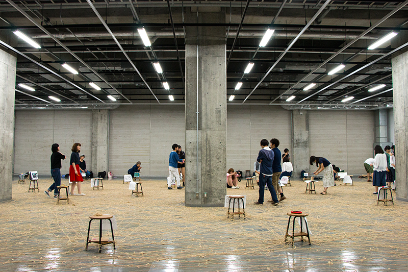
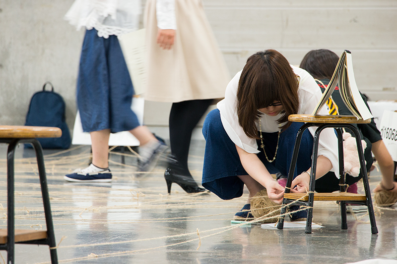
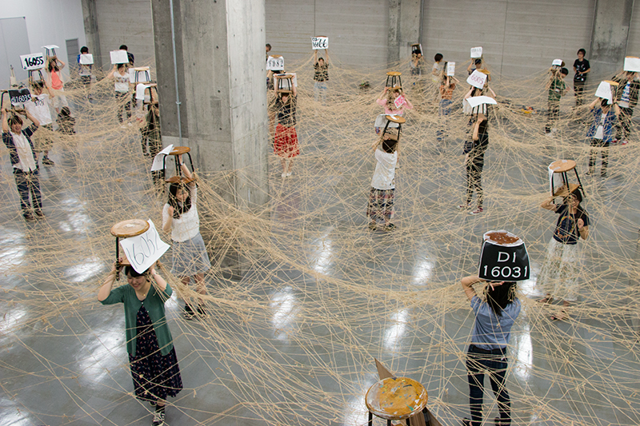
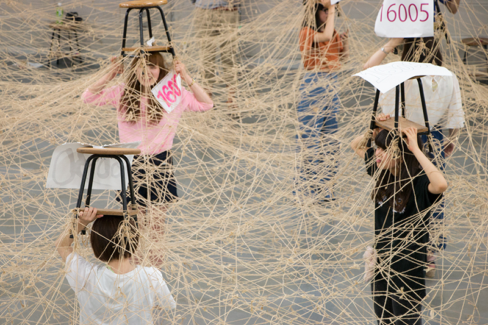
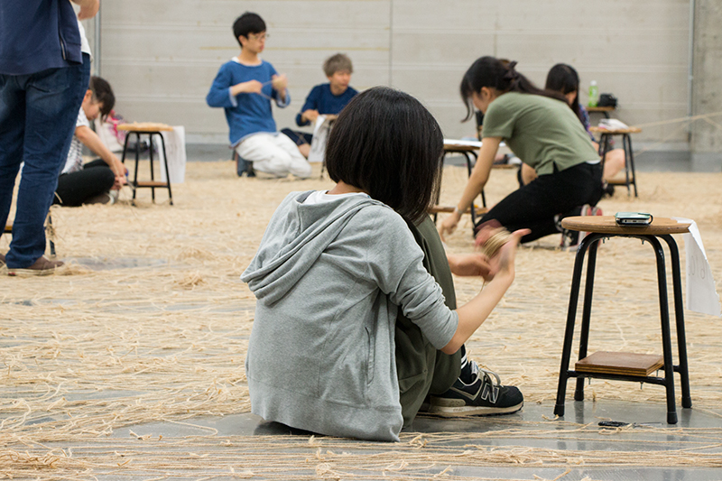

+++
author = "矢崎裕一"
title = "50人の写真の貸し借りを、麻紐のネットワーク・グラフにする──武蔵野美術大学「情報処理I」の最終回"
slug = "musabi-link-strings"
date = "2026-11-07"
description = "2016年、武蔵野美術大学デザイン情報学科の1年生の「情報処理I」の最終回では、50人の写真の貸し借り（1人36本のリンク）を麻紐のネットワーク・グラフにして床に張り、南京椅子で約5分持ち上げました。"
categories = [
    "consume"
]
tags = [
    "データ物質化",
    "ネットワーク",
    "デザイン教育"
]
image = "images/strings-lifted-overhead.jpg"
series = ["data-physicalization"]
series_weight = 99
seriesByline = "武蔵野美術大学 デザイン情報学科"
seriesTitle = "貸し借りを麻紐のネットワーク・グラフに──ムサビ「情報処理I」"
+++

武蔵野美術大学 造形学部 デザイン情報学科の1年生の授業「情報処理I」の最終回では、50人の写真の貸し借りを、麻紐（あさひも）のネットワーク・グラフにしました。貸し借りは、学生が作ったウェブページどうしのリンクとして張られていて、1人36本です。そのリンク1本を麻紐1本に置き換え、9号館地下展示室の床に張りました。張り終えると、南京椅子で紐を空中に持ち上げます。紐が空中にあったのは、約5分だけでした。学科のウェブサイトが2016年に伝えた授業の様子です。

出典は、学科のウェブサイトのお知らせ「【授業潜入】熱すぎる情報処理Iの授業最終回」（2016年6月17日）です。記名はなく、写真5点と短い文章からなる記事です。記事は「ネットワーク・グラフ」という語を使わず、「50人の貸借り関係」のリンクを麻紐に置き換えた、と書いています。本文の事実は、ほぼこの1本に沿います。授業の位置づけは、学科の科目紹介と、2017年7月4日の学科の記事で補います。写真から読めることは、読みとして分けて書きます。

<!--more-->

## 4月から週1回の授業の、最終回

2016年の記事によると、このときデ情（デザイン情報学科）の1年生は、「デザイン情報学基礎演習I」の課題が始まったところでした。記事は続けて、こう書きます。

> 「その一方で、4月から週1回で続いてきた「情報処理I」が今週でフィナーレを迎えます。その最後の実習はこれ。」

「情報処理I」がどんな授業かは、2017年7月4日の学科の記事が書いています。

> 「「情報処理I」は、デ情の一年生が21世紀のデザイナーに必要不可欠な基礎知識を身に着ける必修授業です。内容は多岐にわたっており、デザイン用ソフトの使い方から、ウェブサイトの制作、画像加工、ネットワークの仕組みの理解まで様々。」

学科サイトの科目紹介は、授業をこう締めくくります。「これらをテコに、世の中から「かたち」を見つけ、その「意味」の関係をウェブとして表す、いかにもデザイン情報学的な授業です。」**麻紐の実習は、その授業の最後に置かれていました。**

2016年の記事から読める実習の条件は、次のとおりです。

| 項目 | 2016年の記事の記述 |
|---|---|
| 授業 | 情報処理I（4月から週1回） |
| 回 | 最終回（記事の日付は2016年6月17日） |
| 場所 | 9号館地下展示室の床 |
| 人数 | 「たった50人」 |
| 材料 | 麻紐、南京椅子 |

## 12ページ、借りた写真3枚ずつで、1人36本

記事は、床の麻紐を「ぶちまけて遊んでいるように見えます」と書いたうえで、1本1本に意味がある、と続けます。

> 「先週までの課題で、みんなは自分の写真1枚と、他の人から借りてきた写真3枚を組み合わせたウェブページを、12ページ作っています。写真を借りてきた人のページに対してリンクを張ると、ひとりにつき36本のリンクができます。そのリンクを麻紐に置き換えると、たった50人の貸借り関係が、このようにカオスなことに。」

武蔵野美術大学 造形学部 デザイン情報学科／学科ウェブサイト「[【授業潜入】熱すぎる情報処理Iの授業最終回](https://dinfo.musabi.ac.jp/news/%E3%80%90%E6%8E%88%E6%A5%AD%E6%BD%9C%E5%85%A5%E3%80%91%E7%86%B1%E3%81%99%E3%81%8E%E3%82%8B%E6%83%85%E5%A0%B1%E5%87%A6%E7%90%86i%E3%81%AE%E6%8E%88%E6%A5%AD%E6%9C%80%E7%B5%82%E5%9B%9E/)」（2016年6月17日）より引用

記事に計算式はありません。記事の数字から読むと、12ページに借りた写真が3枚ずつで、12×3＝36です。借りた写真1枚につき、その持ち主へ線が1本、という規則だと読めます。線を張る側（借りた側）から1本ずつ数えると、50人×36本で1,800本になります。これは規則から計算した数で、床に張った紐の実際の本数ではありません。総数は記事には書かれていません。

写真を見ると、麻紐は椅子の脚の横木に結ばれているように見えます。椅子には番号の札が付いています。1脚が学生1人に当たると読めます。そうだとすると、このグラフのノード（点）は椅子1脚、つまり学生1人で、1人の12ページは1つの点にまとめられていると読めます。

グラフの用語で、データと物の対応を並べると、次のとおりです。

| グラフの要素 | 床の上 | 元のデータ | 根拠 |
|---|---|---|---|
| ノード（点） | 番号の札を付けた椅子1脚 | 学生1人（12ページをまとめたもの） | 写真からの読み |
| エッジ（線） | 麻紐1本 | ページからページへのリンク1本＝写真の貸し借り1件 | 記事 |
| エッジの向き | ― | 借りた側から、貸した側へ（「写真を借りてきた人のページに対してリンクを張る」） | 記事。紐で向きを区別したかは書かれていない |
| 1ノードから張る線の数 | 1脚から張る紐の本数 | 1人36本（12ページ×借りた写真3枚） | 本数は記事、内訳は記事の数字からの計算 |
| ノードの数 | 椅子の数 | 50人 | 人数は記事。椅子の数は写真からの読み |
| エッジの数 | 紐の総数 | 1,800本（張る側から数えた計算値。実物の本数ではない） | 記事の数字からの計算 |
| 配置 | 床の上の椅子の位置 | ― | 記事に書かれていない |

紐の反対の端は、写真を貸した人の椅子に結ばれるはずです。1脚には、自分が張る36本の端に加えて、自分の写真を貸した分の端も集まります。結ばれる端は36より多くなると読めます。グラフの用語でいえば、出ていく線36本に、入ってくる線が加わる形です。

## 1時間半で張り、5分だけ持ち上げる

学科は、この実習のねらいをこう書いています。

> 「電子的情報的な存在にすぎないリンクを、物質に置き換えてみるととんでもないことになる、ということをカラダでわかってみよう、ということなんですが、とにかくやってる方は大変。麻紐に足をとられて転倒者が続出します。」

武蔵野美術大学 造形学部 デザイン情報学科／学科ウェブサイト「[【授業潜入】熱すぎる情報処理Iの授業最終回](https://dinfo.musabi.ac.jp/news/%E3%80%90%E6%8E%88%E6%A5%AD%E6%BD%9C%E5%85%A5%E3%80%91%E7%86%B1%E3%81%99%E3%81%8E%E3%82%8B%E6%83%85%E5%A0%B1%E5%87%A6%E7%90%86i%E3%81%AE%E6%8E%88%E6%A5%AD%E6%9C%80%E7%B5%82%E5%9B%9E/)」（2016年6月17日）より引用

張り終わったら、紐を空中に持ち上げます。記事は、その場面を「お馴染みの場面」と呼んでいます。

武蔵野美術大学 造形学部 デザイン情報学科／学科ウェブサイト「[【授業潜入】熱すぎる情報処理Iの授業最終回](https://dinfo.musabi.ac.jp/news/%E3%80%90%E6%8E%88%E6%A5%AD%E6%BD%9C%E5%85%A5%E3%80%91%E7%86%B1%E3%81%99%E3%81%8E%E3%82%8B%E6%83%85%E5%A0%B1%E5%87%A6%E7%90%86i%E3%81%AE%E6%8E%88%E6%A5%AD%E6%9C%80%E7%B5%82%E5%9B%9E/)」（2016年6月17日）より引用

> 「だいたい1時間半でこの状態まで到達します。みんなが持ち上げている南京椅子は結構重いので、こうやって紐が空中にある時間は、わずか5分間だけです。最後は腕がプルプルしてきます。」

武蔵野美術大学 造形学部 デザイン情報学科／学科ウェブサイト「[【授業潜入】熱すぎる情報処理Iの授業最終回](https://dinfo.musabi.ac.jp/news/%E3%80%90%E6%8E%88%E6%A5%AD%E6%BD%9C%E5%85%A5%E3%80%91%E7%86%B1%E3%81%99%E3%81%8E%E3%82%8B%E6%83%85%E5%A0%B1%E5%87%A6%E7%90%86i%E3%81%AE%E6%8E%88%E6%A5%AD%E6%9C%80%E7%B5%82%E5%9B%9E/)」（2016年6月17日）より引用

写真では、学生が椅子を1脚ずつ頭の上に掲げ、椅子と椅子のあいだに紐が渡っています。床の上で平面に広がっていたグラフが、そのまま空中に持ち上がった場面と読めます。ノードにあたる椅子を学生自身が持っているので、点の位置は、学生の立つ場所で決まっていると読めます。持ち上げる道具が重い椅子なので、この形を見せていられるのは**わずか5分**でした。

## 40分で、100個の糸玉に戻る

紐は使い捨てではありません。

> 「紐がツギハギだらけでみっともないですか？　実はこれにはわけがあって、この麻紐は終了後すべて回収され、来年の授業で再使用されるんです。」

武蔵野美術大学 造形学部 デザイン情報学科／学科ウェブサイト「[【授業潜入】熱すぎる情報処理Iの授業最終回](https://dinfo.musabi.ac.jp/news/%E3%80%90%E6%8E%88%E6%A5%AD%E6%BD%9C%E5%85%A5%E3%80%91%E7%86%B1%E3%81%99%E3%81%8E%E3%82%8B%E6%83%85%E5%A0%B1%E5%87%A6%E7%90%86i%E3%81%AE%E6%8E%88%E6%A5%AD%E6%9C%80%E7%B5%82%E5%9B%9E/)」（2016年6月17日）より引用

> 「毎年使い続けているので、すっかり結び目だらけになってしまいました。でもこの再利用が簡単にできるのが、麻紐のいいところでもあります。」

記事は、片付けの速さで結ばれます。

> 「あの超カオス状態に見えたのが、100個ぐらいの糸玉に戻っていくのに要する時間はわずか40分ほど。実はこっちの方が驚異的だと思います。」

記事に出てくる時間と量を並べると、次のようになります。

| 段階 | 時間 | 量 |
|---|---|---|
| 床に張る | だいたい1時間半 | 1人36本、50人分 |
| 空中に持ち上げる | わずか5分間 | ― |
| 糸玉に戻す | 40分ほど | 100個ぐらいの糸玉 |

**糸玉に戻すほうが、張るより短い。** 書き手自身が、こちらのほうが「驚異的」だと書いています。

## 聞かれ続けて13年ぐらいの「デ情の謎」

記事は、大学案内や学科パンフレットで目にした人が「何をしているのか」と聞き続けてきた、と書いています。

> 「大学案内や学科パンフレットで目にしたことがあるかもしれません。「あれって何やってんですか？」何度も何度も聞かれ続け、今年でもう13年ぐらいになります。今や「デ情の謎」のトップクラスは確実。」

2016年で「13年ぐらい」なので、始まりは2000年代の前半と読めます。始まった年を書いた資料は、見つかりませんでした。

2017年7月4日の記事は、カラーキューブという別の課題を紹介する中で、紐の実習の写真を載せています。そこでは「その最後を締めくくる麻紐を使った怪しい儀式」と呼ばれています。人数や本数が書かれているのは、2016年の記事だけです。

科目紹介の文は、資料によって末尾が違います。

| 資料 | 科目紹介の末尾 |
|---|---|
| 学科サイトの科目紹介 | 「これらをテコに、世の中から「かたち」を見つけ、その「意味」の関係をウェブとして表す、いかにもデザイン情報学的な授業です。」 |
| 2021年度の学科パンフレット | 「これらをテコに、世の中の「かたち」と「意味」の関係を見つけ、魅力的なグラフィックスに仕上げる、いかにもデザイン情報学的な授業です。」 |

この実習がいつまで続いたかは、資料からは確かめられませんでした。また、学科の外の書籍や記事で、この実習を紹介・評価したものは見つかりませんでした。この記事の事実は、学科自身の記事と写真に拠っています。

## 使い道

画面で描くネットワーク・グラフと比べると、可視化の仕事に持ち帰れる判断が四つあります。

一つ目は、規則が単純でも、グラフは絡まるということです。点は50、1つの点から出る線は36本という規則でした。それでも床に張ると、学科自身が「カオス」と呼ぶ状態になりました。画面の[フォース・ダイレクテッド・ダイアグラム](/force-directed-diagram/)で、線が重なって「毛玉」になるのと同じことが、実物大で起きていると読めます。

二つ目は、何をノードにするかです。元のデータの線は、ページからページへ張られていました。記事の数字から計算すると、ページは50人×12ページで600あります。床の上では、それを人ごとにまとめ、50の点のグラフとして見せたと読めます。同じ貸し借りでも、ノードの単位を変えれば別のグラフになります。

三つ目は、配置を誰が決めるかです。フォース・ダイレクテッド・ダイアグラムでは、点の位置を計算で決めます。床のグラフでは、点にあたる椅子を学生が持ち、その立つ場所が点の位置になっていると読めます。椅子をどこに置いたかは、記事には書かれていません。線の重なりを避けたいなら、同じ貸し借りを[隣接行列](/adiacency-matrix/)にして、50行×50列の表で見せる手もあります。

四つ目は、量を手間と時間で示すことです。学科のねらいは、リンクを物に置き換えると「とんでもないこと」になると「カラダでわかってみよう」というものでした。張るのに1時間半、持ち上げていられるのは5分、片付けに40分。画面では一度に描ける線の量が、作業の時間と椅子の重さとして示されたと読めます。

縄で数を表す例として、この特集には[キープ](/quipu/)があります。特集の外では、糸で来場者の回答をつなぐ[データ・ストリングス](/data-strings/)が近い例です。物の本数で量を表す点では、紙片の本数で帯の太さを決めた[IBM のコスモグラフ](/ibm-cosmograph/)とも並べられます。参加者自身がデータの点になる点では、[Rimini Protokoll『100% City』](/rimini-protokoll-100-percent-city/)や[Davenport の「紙を使わない度数多角形」](/davenport-physical-distributions/)と並べて読めます。

## 参考・出典

**一次情報**

- 武蔵野美術大学 造形学部 デザイン情報学科「【授業潜入】熱すぎる情報処理Iの授業最終回」2016-06-17. [記事](https://dinfo.musabi.ac.jp/news/%E3%80%90%E6%8E%88%E6%A5%AD%E6%BD%9C%E5%85%A5%E3%80%91%E7%86%B1%E3%81%99%E3%81%8E%E3%82%8B%E6%83%85%E5%A0%B1%E5%87%A6%E7%90%86i%E3%81%AE%E6%8E%88%E6%A5%AD%E6%9C%80%E7%B5%82%E5%9B%9E/)
- 武蔵野美術大学 造形学部 デザイン情報学科「【授業潜入】情報処理I　〜立ちはだかる壁、カラーキューブ〜」2017-07-04. [記事](https://dinfo.musabi.ac.jp/news/%e3%80%90%e6%8e%88%e6%a5%ad%e6%bd%9c%e5%85%a5%e3%80%91%e6%83%85%e5%a0%b1%e5%87%a6%e7%90%86i%e3%80%80%e3%80%9c%e7%ab%8b%e3%81%a1%e3%81%af%e3%81%a0%e3%81%8b%e3%82%8b%e5%a3%81%e3%80%81%e3%82%ab%e3%83%a9/)
- 武蔵野美術大学 造形学部 デザイン情報学科「情報処理I」（カリキュラム、科目紹介）. [ページ](https://dinfo.musabi.ac.jp/curriculum/information1/)
- 武蔵野美術大学 造形学部 デザイン情報学科 パンフレット 2021年度（PDF）. [PDF](https://dinfo.musabi.ac.jp/oc21/documents/DI_2021_web.pdf)

**第三者評価**

- この実習を紹介・評価した、学科の外の書籍・記事・展示は見つかりませんでした。
