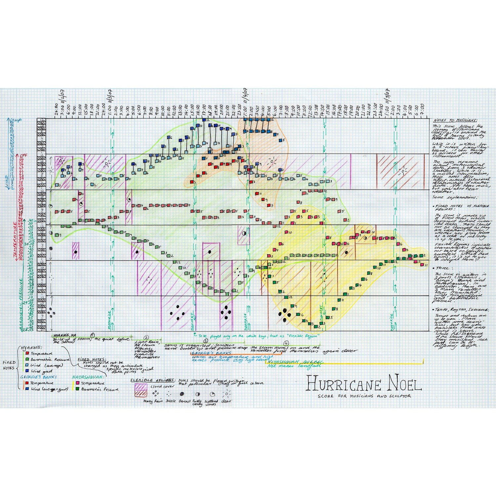
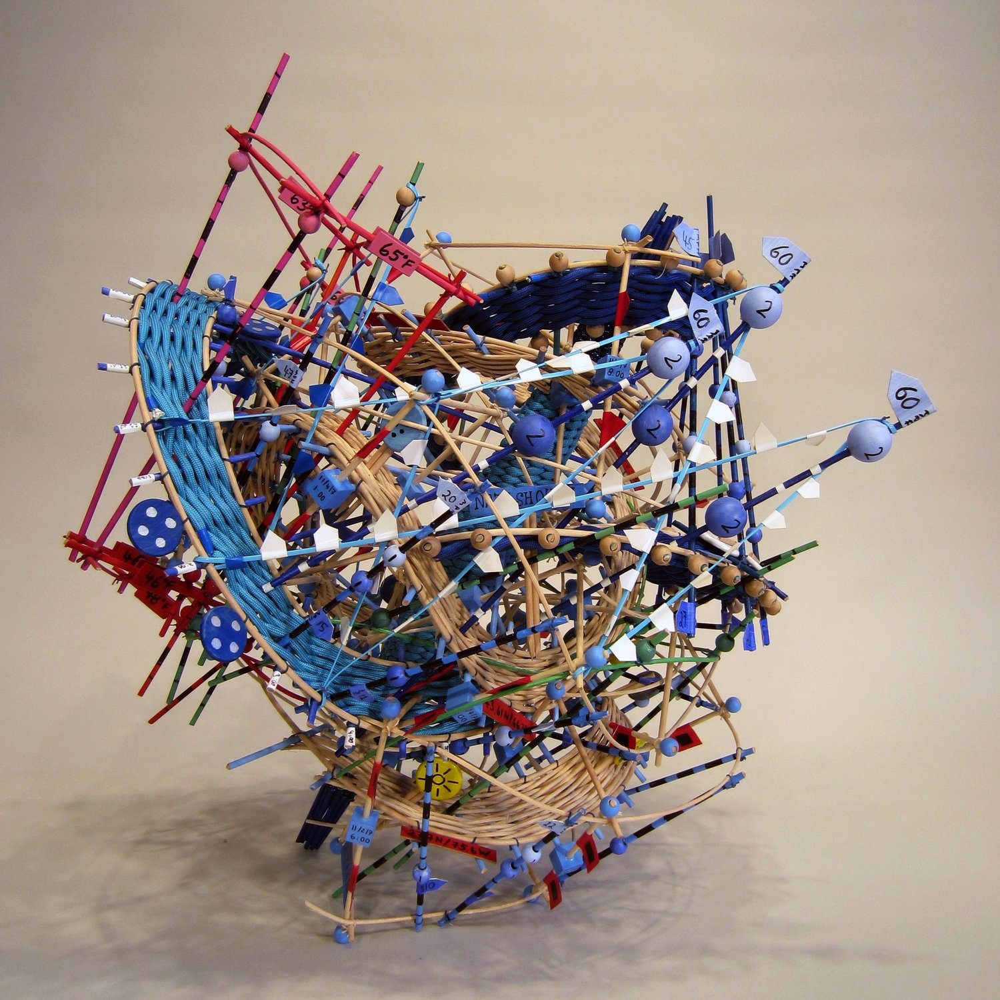
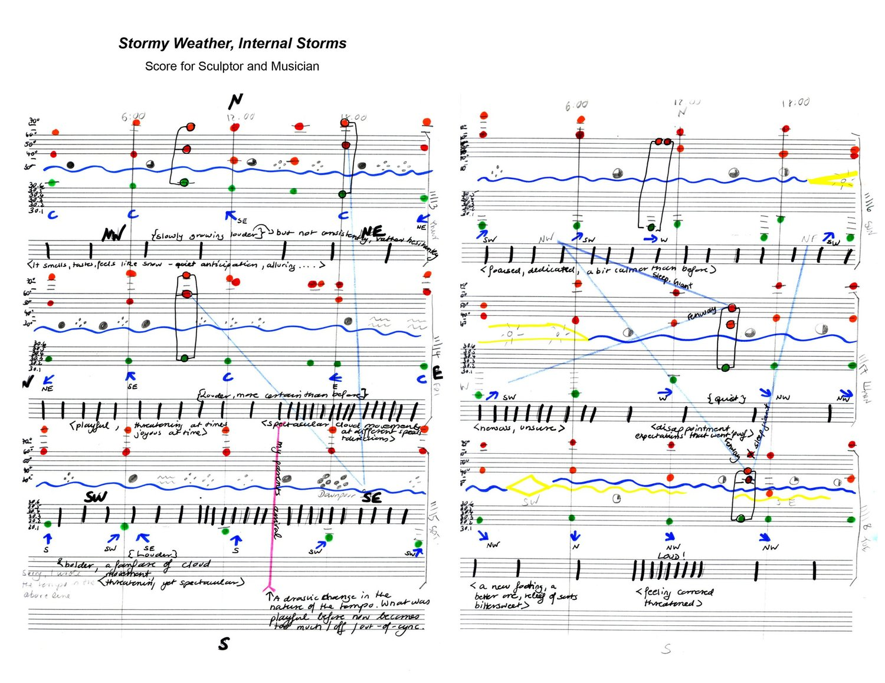
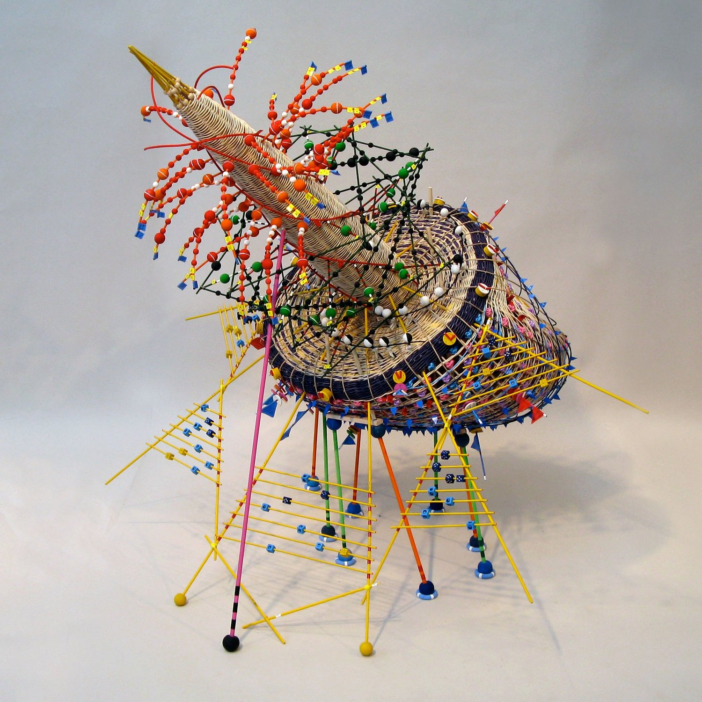

+++
author = "Yuichi Yazaki"
title = "Transcribing a Storm's Numbers into a Score, Then Weaving a Basket from It: Nathalie Miebach's Weather Data Sculptures"
slug = "nathalie-miebach-weather-sculptures"
date = "2026-11-06"
description = "Nathalie Miebach makes sculptures that map weather data such as temperature, pressure, and wind speed onto the colors and positions of basket-weaving materials, and has musicians perform musical scores that transcribe the same data."
categories = [
    "consume"
]
tags = [
    "data physicalization",
    "sonification",
    "weather data"
]
image = "images/hurricane-noel-iii.jpg"
+++

Nathalie Miebach makes sculptures that map weather data such as temperature, pressure, and wind speed onto the colors and positions of basket-weaving materials, and has musicians perform musical scores that transcribe the same data. She assigns the time of day and a temperature range to the basket's vertical members, then weaves tide, water temperature, air temperature, and the moon phase into that grid. For her sculpture about Hurricane Noel in 2007, CSMonitor (2010) writes that temperature is red, pressure is green, and wind speed is blue, "and so on."

What follows draws on Miebach's TED talk "Art made of storms" (TEDGlobal 2011), the work descriptions and performance records on her own website, and a 2010 interview and newspaper article. The order of the process follows her talk: first the data is transcribed into a score, then that score serves as the blueprint for assembling the sculpture.

<!--more-->

## In 2000, Learning Basket Weaving and Astronomy at the Same Time

It began in 2000. Miebach took a local basket-weaving class and an astronomy course at Harvard University at the same time. Instead of a written final paper for the astronomy course, she handed in a basket representing the Hertzsprung-Russell diagram, the Christian Science Monitor (2010) reports.

She moved to weather in 2006, during a residency at the Fine Arts Work Center in Cape Cod. Zach Smith, a climate educator at the Wright Center for Science Education, proposed a climate change project to her. She says she learned how to collect data while trying out the center's instruments on the beach (ArtSake, 2010).

She describes how she collects data in her TED talk (recorded July 11, 2011, about 4 minutes). With instruments of the kind you can buy at a hardware store, she gathers information about a specific place. She checks it against satellite images and data from weather stations and offshore buoys, and gathers the numbers on a clipboard. From there, she starts with only two or three variables. The video of the talk can be watched on [the TED page](https://www.ted.com/talks/nathalie_miebach_art_made_of_storms).

## Assigning Time and Temperature to the Basket's Grid

Miebach calls the basket a "medium of translation." A basket is made of vertical and horizontal members. In her talk she explains that if you assign values to them, the change of data points over time takes shape as it is.

She assigns the time of day to the vertical members, so that one full turn is 24 hours. She assigns a temperature range to the same members. Into that grid she weaves high-tide readings, water temperature, air temperature, and the moon phase. On why she uses natural reed as her material, she says:

> "I use natural reed, because natural reed has a lot of tension in it that I cannot fully control. That means that it is the numbers that control the form, not me."

The reed has a tension she cannot fully control, so it is the numbers, not she herself, that decide the form: that is her explanation.

The correspondence between colors and variables is not described in the talk. The talk says only that "each colored bead or thread is one weather element." There are two sources that spell out a specific correspondence, and both concern the work "Hurricane Noel," about Hurricane Noel in November 2007.

- The Christian Science Monitor (2010-04-09, Kendra Nordin) writes, of the sculpture "Hurricane Noel," that in the vertical direction temperature is red, pressure is green, and wind speed is blue, "and so on."
- The two-dimensional score "Hurricane Noel" (2009) on her website gives, in a handwritten legend, the temperature at the Hyannis station as red, pressure as green, average wind speed as light blue, and gusts as dark blue.

In the score's legend, red indicates only the temperature at Hyannis. I could not confirm the color schemes of her other works.

| Data | What it is mapped to | Source |
|---|---|---|
| Time of day (24 hours) | The basket's vertical members; one turn is one day | TED talk |
| Temperature range | The same vertical members | TED talk |
| High tide, water temperature, air temperature, moon phase | Members woven into the grid | TED talk |
| Temperature, pressure, wind speed | Color of the reed in the vertical direction (red, green, blue) | CSMonitor 2010 |
| Rises and falls of readings | Distortions of the colored reed, that is, the shape of the sculpture | CSMonitor 2010 |
| Time periods of the storm's cycle | Spokes radiating from the central cone | CSMonitor 2010 |
| Type of weather element | Range of pitch in the score (one octave per element) | CSMonitor 2010 |
| Temperature values | Pitch in the score (one pitch per temperature) | CSMonitor 2010 |

The data came from stations in Hyannis and in Natashquan, Quebec, and from a buoy in the Gulf of Maine (CSMonitor).

## Transcribing into a Score, Then Assembling from It as a Blueprint

This work is sometimes introduced as "a sculpture that also becomes a score," and the TED description likewise says the sculpture "becomes a score for string quartet." In her own talk the order is the reverse: she says she first transcribes the weather data into a score.

> "Meanwhile, I use these scores as blueprints to translate into sculptural forms like this, … so it can actually be read as a musical score."

She uses that score as a blueprint and turns it into a sculpture, she explains. The sculpture contains the score's grid inside it, so it can also be read as a score.

Other sources give the same order. ArtSake (2010-03-10) describes the project as translating data "first into a musical score, then into a sculpture." In her artist statement (published by the Schick Art Gallery at Skidmore College), she says she transcribes the numbers onto score paper in pictorial form. The musicians interpret it as a piece of music, and Miebach interprets it as a sculpture. The score's title also reads "Score for Musicians and Sculptor."

Source: Nathalie Miebach, "Hurricane Noel" (2009), from [nathaliemiebach.com, Musical Scores 2D](https://nathaliemiebach.com/work/new-portfolio-item)

The horizontal axis of this score is marked with times from November 2 to 5, 2007. The legend separates "Fixed Notes" from "Flexible Regions." The distinction is that the notes representing observed values are not to be changed, while regions such as cloud cover may be interpreted by the performers.

Source: Nathalie Miebach, "Hurricane Noel III" (2015), from [nathaliemiebach.com, Musical Scores 3D](https://nathaliemiebach.com/work/new-portfolio-item-t7xd7)

Her website calls such sculptures "3D musical score."

| Work | Year | Description on her website |
|---|---|---|
| Hurricane Noel | 2010 | Passage through the Gulf of Maine, November 6-8, 2007 |
| Hurricane Noel III | 2015 | Passage through New England, November 2-5, 2007. Two stations and one ocean buoy |
| Sun Gnomon for Stormy Night | 2009 | A three-dimensional score based on the two-dimensional score "Stormy Weather, Internal Storm" |

Source: Nathalie Miebach, "Stormy Weather, Internal Storm" (2012), from [nathaliemiebach.com, Musical Scores 2D](https://nathaliemiebach.com/work/new-portfolio-item)

Source: Nathalie Miebach, "Sun Gnomon for Stormy Night – Nov 13-19, 2008" (2009), from [nathaliemiebach.com, Musical Scores 3D](https://nathaliemiebach.com/work/new-portfolio-item-t7xd7)

The years and periods differ among the sources.

| Point | What each source says |
|---|---|
| Period of Hurricane Noel | The two-dimensional score and "III" give November 2-5. The 2010 sculpture, and "Musical Buoy in Search Towards a New Shore" (a work with a different title) in The Marginalian (2011), give November 6-8 |
| Year of Hurricane Noel | The Chipstone Foundation says "Noel, 2006." Her website gives 2009 for the score and 2010 and 2015 for the sculptures |

Since the storm took place in November 2007, 2006 appears to be an error.

## How Much to Leave to the Performers

Miebach tells ArtSake that she started making scores because the language of sculpture no longer expressed how she read her data. In her talk she also says that a score lets her translate in detail without losing information.

She also explains in ArtSake what she fixes and what she leaves to the performers.

> "When I give musicians the score, I tell them what it's about, what portions of the score are flexible and those that aren't. Then I pretty much withdraw …"

| Item | Who decides | Source |
|---|---|---|
| The notes themselves | Determined by the numbers the artist collected | ArtSake 2010 |
| Tempo and rhythm | The artist uses them to add nuance to the translation | ArtSake 2010 |
| Rhythm, tempo, number of instruments | Largely left to the performers | ArtSake 2010 |
| The form of the piece (in the case of Axis Ensemble) | The performers made it a 15-minute piece. The only condition was "being faithful to the numbers" | CSMonitor 2010 |

On March 14, 2010, Axis Ensemble performed "Hurricane Noel" at the Lilypad in Cambridge. The lineup was piano, violin, accordion, clarinet, cello, and double bass (CSMonitor). Miebach tells ArtSake that after watching the rehearsal she spent two hours in her studio staring at her own sculpture.

Her website gives two purposes for the collaboration: to convey a layer of emotion that the sculpture has difficulty reaching, and to learn about the patterns and stories in the data that the musicians find.

This effort has continued since 2009 as "The Weather Score Project," which, according to her website, comprises 20 commissioned works and more than 15 concerts.

The instrumentation also differs by source. The TED description says "string quartet," but what appears in the talk is the trio "1913 Trio." Who performed the Hurricane Noel music at the start of the talk is not stated in the talk or on the TED page.

## How Third Parties Saw the Work

Here are three views, each with a different point. The first is the work profile "Sculpting The Floods" in Issues in Science and Technology (Winter 2026).

> "Rather than visualizing data for clarity or communication, Miebach's goal is to provide a different way of experiencing data—to make the complexities of natural systems physically and emotionally perceptible."

The view is that the work is not a visualization for clarity or communication, but a way to let people sense the complexity of nature with body and emotion.

The artist herself stresses accuracy, in words quoted by Colossal (2016).

> "Nothing is put on there for purely aesthetic reasons."

That is, nothing is attached merely for looks. In the same article she also says she wants people to be able to read the weather from the sculpture. The third party's positioning and the artist's emphasis can be read as differing.

The second is the Christian Science Monitor (2010) interview article.

> "But behind the joyful chaos is a precise order, one of surprising complexity and magnitude."

Behind the toy-like appearance lies a precise order, the review says. In the same article Miebach herself says the playful elements are there to draw viewers in, and that on closer look they realize everything is numbers.

The third is a catalog from the visualization research side. The "List of Physical Visualizations," edited by Pierre Dragicevic and Yvonne Jansen on dataphys.org, lists Miebach's basket-weaving sculptures as an entry for 2006 and classifies them as "Passive physical visualization." Jansen et al.'s evaluation experiments are covered in [another article](/en/evaluating-physical-visualizations/).

## Takeaways

There are four judgments that can be carried over to visualization work.

The first is to narrow down the variables before putting them onto a material. From a bundle of numbers, Miebach first selects only two or three variables. When the amount a material can carry is limited, the act of selecting can itself be read as design.

The second is to make an intermediate notation the blueprint. Miebach first transcribed the data into a score and made that the source of both the sculpture and the performance. Deriving **a form to look at and a form to listen to separately from one notation** can be read as keeping the two pointed at the same data.

The third is to separate, within the notation, the parts that are fixed from the parts that are left to others. The Hurricane Noel score separates "Flexible Regions" in its legend and instructs the performers not to change the notes for observed values (Fixed Notes).

The fourth is to write the legend into the work itself. Hurricane Noel III carries number tags such as "65°F," and the score has a color legend and the names of the stations. In her talk, Miebach said that in an art museum it becomes a sculpture, in a science museum a three-dimensional visualization, and in a concert hall a score. That it can be read wherever it is placed can be read as owing to the legend being inside the work.

As examples of passing the same data to sound or form, it can be read alongside [Chemo Singing Bowl](/en/chemo-singing-bowl/) and [The Tempestry Project](/en/tempestry-project/).

## References

**Primary sources**

- Nathalie Miebach, "Art made of storms," TEDGlobal 2011 (recorded 2011-07-11, published 2011-10-21). [Talk page](https://www.ted.com/talks/nathalie_miebach_art_made_of_storms) / [Transcript](https://www.ted.com/talks/nathalie_miebach_art_made_of_storms/transcript)
- Nathalie Miebach, The Weather Score Project (performance records). [nathaliemiebach.com](https://nathaliemiebach.com/work/changing-weather)
- Nathalie Miebach, Musical Scores 2D. [nathaliemiebach.com](https://nathaliemiebach.com/work/new-portfolio-item)
- Nathalie Miebach, Musical Scores 3D. [nathaliemiebach.com](https://nathaliemiebach.com/work/new-portfolio-item-t7xd7)
- Nathalie Miebach, Storms, Gales and Blizzards. [nathaliemiebach.com](https://nathaliemiebach.com/work/storms-gales-and-blizzards)
- Nathalie Miebach, The Sandy Rides. [nathaliemiebach.com](https://nathaliemiebach.com/work/the-sandy-rides)
- Nathalie Miebach, Weather Sound Drawings. [nathaliemiebach.com](https://nathaliemiebach.com/work/weather-sound-drawings)
- Nathalie Miebach, Artist Statement, Schick Art Gallery, Skidmore College. [Statement](https://www.skidmore.edu/schick/artists/miebach-statement.php)
- "Nathalie Miebach: weaving science, sculpture, and music," ArtSake (Mass Cultural Council), 2010-03-10. [Interview](https://artsake.massculturalcouncil.org/nathalie-miebach-weaving-science-sculpture-and-music/)
- Nathalie Miebach, Bruce D. Campbell, Francesca Samsel, "Nathalie Miebach: Sculpted Data Infused With Craftsmanship," *IEEE Computer Graphics and Applications* 42(1): 7–16, 2022 (bibliographic record only checked). [doi:10.1109/MCG.2021.3132092](https://doi.org/10.1109/MCG.2021.3132092) / [dblp](https://dblp.org/rec/journals/cga/MiebachCS22.html)

**Secondary sources**

- Kendra Nordin, "Climate change as art," *Christian Science Monitor*, 2010-04-09. [Article](https://csmonitor.com/Technology/2010/0409/Climate-change-as-art)
- "Sculpting The Floods," *Issues in Science and Technology*, Winter 2026. [PDF](https://issues.org/wp-content/uploads/2026/02/76-83-Sculpting-The-Floods-Art-Winter-2026.pdf)
- Pierre Dragicevic, Yvonne Jansen (eds.), "Nathalie Miebach's Woven Sculptures," List of Physical Visualizations. [dataphys.org](https://dataphys.org/list/nathalie-miebachs-woven-sculptures/)
- Maria Popova, *The Marginalian*, 2011-07-12. [Article](https://www.themarginalian.org/2011/07/12/nathalie-miebach-musical-weather-data-sculptures/)
- *Colossal*, 2016-03. [Article](https://www.thisiscolossal.com/2016/03/nathalie-miebach-weather-sculptures/)
- Chipstone Foundation, work description for the exhibition "The New Materiality." [Exhibition page](https://chipstone.org/html/SpecialProjects/Material/Pages/030Material.html)
