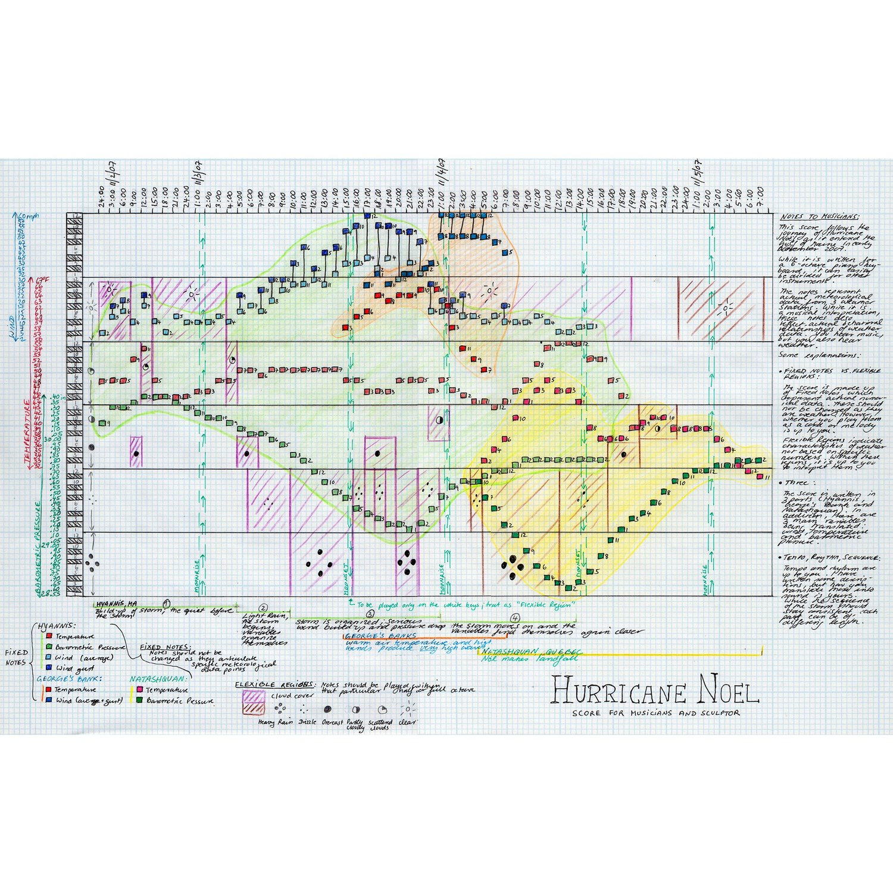
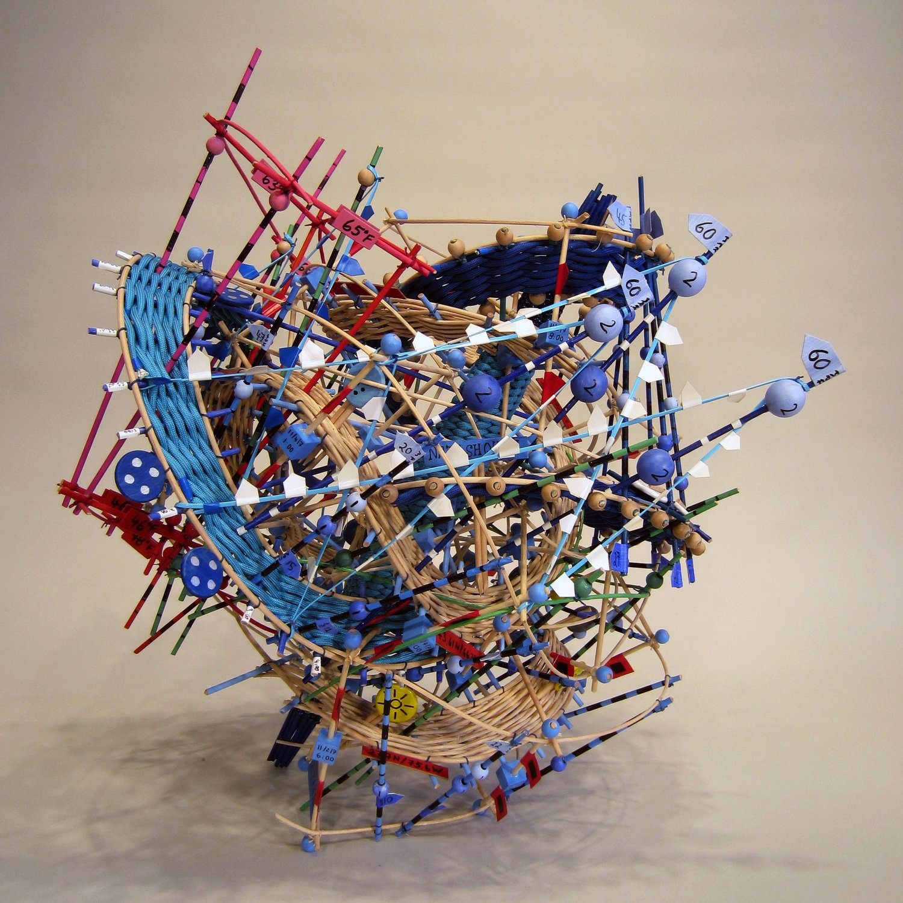
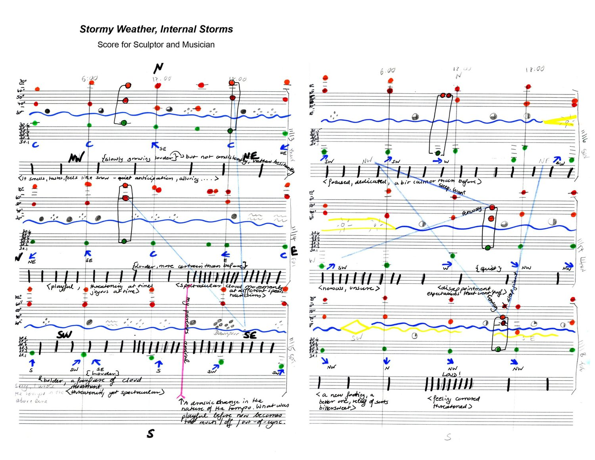
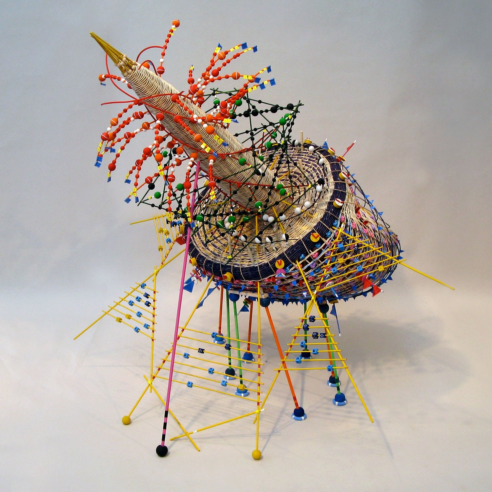

+++
author = "矢崎裕一"
title = "嵐の数値を楽譜に写し、その楽譜で籠を編む──Nathalie Miebach の気象データの彫刻"
slug = "nathalie-miebach-weather-sculptures"
date = "2026-11-06"
description = "Nathalie Miebach は、気温・気圧・風速などの気象データを、籠編みの素材の色と配置に対応させた彫刻を作り、同じデータを写した楽譜を演奏家に演奏させています。"
categories = [
    "consume"
]
tags = [
    "データ物質化",
    "ソニフィケーション",
    "気象データ"
]
image = "images/hurricane-noel-iii.jpg"
series = ["data-physicalization"]
series_weight = 99
seriesByline = "Nathalie Miebach"
seriesTitle = "楽譜を設計図に籠を編む──Nathalie Miebach の嵐"
+++

Nathalie Miebach（ナタリー・ミーバック）は、気温・気圧・風速などの気象データを、籠編みの素材の色と配置に対応させた彫刻を作り、同じデータを写した楽譜を演奏家に演奏させています。籠の縦の材には1日の時刻と温度の範囲を割り当て、その格子に潮位・水温・気温・月齢を編み込みます。2007年のハリケーン・ノエルを扱った彫刻について、CSMonitor（2010）は温度が赤、気圧が緑、風速が青「など」と書いています。

以下は、Miebach の TED 講演「Art made of storms」（TEDGlobal 2011）、本人サイトの作品解説と演奏記録、2010年のインタビューと新聞記事に沿います。制作の順序は、本人の講演に合わせます。まずデータを楽譜に写し、その楽譜を設計図にして彫刻を組みます。

<!--more-->

## 2000年、籠編みと天文学を同時に習う

始まりは2000年です。Miebach は地域の籠編み教室と、ハーバード大学の天文学の講座を同時に受けました。天文学の期末レポートの代わりに、ヘルツシュプルング・ラッセル図を表した籠を出した、と Christian Science Monitor（2010）は書いています。

気象に移ったのは2006年、ケープコッドの Fine Arts Work Center でのレジデンシーです。Wright Center for Science Education の気候教育者 Zach Smith に、気候変動のプロジェクトを持ちかけられました。同センターの観測器を浜で試しながら、データの集め方を教わったといいます（ArtSake、2010）。

データの集め方は、TED 講演（2011年7月11日収録、約4分）で話しています。ホームセンターで買えるような観測器で、特定の場所の情報を集めます。それを衛星画像や、気象観測所・沖合ブイのデータと照らし合わせ、数値をクリップボードにまとめます。そこから最初に使うのは、2〜3個の変数だけです。講演の動画は [TED のページ](https://www.ted.com/talks/nathalie_miebach_art_made_of_storms)で見られます。

## 籠の格子に、時刻と温度を割り当てる

Miebach は、籠を「翻訳の媒体」と呼びます。籠は縦の材と横の材でできています。そこに値を割り当てれば、データ点の時間変化がそのまま形になる、と講演で説明しています。

縦の材には1日の時刻を割り当て、一周で24時間にします。同じ材に温度の範囲も割り当てます。その格子に、満潮の観測値・水温・気温・月齢を編み込みます。素材に天然の籐を使う理由は、こう話しています。

> "I use natural reed, because natural reed has a lot of tension in it that I cannot fully control. That means that it is the numbers that control the form, not me."

籐には制御しきれない張力があるので、形を決めるのは数値で、自分ではない、という説明です。

色と変数の対応は、講演では語られていません。講演は「色つきのビーズや糸の一つ一つが、一つの気象要素」と言うだけです。具体的な対応を書いた資料は二つあり、どちらも2007年11月のハリケーン・ノエルを扱った作品「Hurricane Noel」についてです。

- Christian Science Monitor（2010-04-09、Kendra Nordin）は、彫刻「Hurricane Noel」について、縦方向に温度＝赤、気圧＝緑、風速＝青「など」と書いています。
- 本人サイトに載る2次元の楽譜「Hurricane Noel」（2009）は、手書きの凡例で、ハイアニスの観測所の温度＝赤、気圧＝緑、平均風速＝水色、突風＝濃い青としています。

楽譜の凡例で赤が示すのは、ハイアニスの温度だけです。ほかの作品の配色は確かめられませんでした。

| データ | 対応させたもの | 出典 |
|---|---|---|
| 時刻（24時間） | 籠の縦の材。一周で1日 | TED 講演 |
| 温度の範囲 | 同じ縦の材 | TED 講演 |
| 満潮・水温・気温・月齢 | 格子に編み込む材 | TED 講演 |
| 温度・気圧・風速 | 縦方向の籐の色（赤・緑・青） | CSMonitor 2010 |
| 観測値の上下 | 色つきの籐のゆがみ、つまり彫刻の形 | CSMonitor 2010 |
| 嵐の周期の時間帯 | 中心の円錐から出るスポーク | CSMonitor 2010 |
| 気象要素の種類 | 楽譜の音域（要素ごとに1オクターブ） | CSMonitor 2010 |
| 温度の値 | 楽譜の音高（温度ごとに一つ） | CSMonitor 2010 |

データはハイアニスとケベック州ナタシュカンの観測所、メイン湾のブイから取りました（CSMonitor）。

## 楽譜に写し、それを設計図にして組む

この作品は「彫刻が楽譜にもなる」と紹介されることがあり、TED の紹介文も、彫刻が「弦楽四重奏のための楽譜になる」と書きます。本人の講演の順序は逆で、まず気象データを楽譜に写すと話しています。

> "Meanwhile, I use these scores as blueprints to translate into sculptural forms like this, … so it can actually be read as a musical score."

その楽譜を設計図にして彫刻にする、という説明です。彫刻は楽譜の格子を中に持つので、楽譜としても読めます。

ほかの資料も同じ順です。ArtSake（2010-03-10）は、データを「まず楽譜に、それから彫刻に」翻訳するプロジェクトだと書いています。作家ステートメント（Skidmore College の Schick Art Gallery 掲載）では、数値を絵のかたちで楽譜用紙に写すとあります。演奏家はそれを曲として、Miebach は彫刻として解釈します。楽譜の題にも「Score for Musicians and Sculptor」とあります。

Nathalie Miebach「Hurricane Noel」（2009）／[nathaliemiebach.com, Musical Scores 2D](https://nathaliemiebach.com/work/new-portfolio-item) より引用

この楽譜の横軸には、2007年11月2日から5日までの時刻が書かれています。凡例は「Fixed Notes」と「Flexible Regions」を分けています。観測値を表す音符は変えず、雲量などの領域は演奏家が解釈してよい、という区別です。

Nathalie Miebach「Hurricane Noel III」（2015）／[nathaliemiebach.com, Musical Scores 3D](https://nathaliemiebach.com/work/new-portfolio-item-t7xd7) より引用

本人サイトは、こうした彫刻を「3D musical score」と呼んでいます。

| 作品 | 年 | 本人サイトの説明 |
|---|---|---|
| Hurricane Noel | 2010 | メイン湾の通過、2007年11月6〜8日 |
| Hurricane Noel III | 2015 | ニューイングランドの通過、2007年11月2〜5日。観測所二つと海洋ブイ一つ |
| Sun Gnomon for Stormy Night | 2009 | 2次元の楽譜「Stormy Weather, Internal Storm」をもとにした3次元の楽譜 |

Nathalie Miebach「Stormy Weather, Internal Storm」（2012）／[nathaliemiebach.com, Musical Scores 2D](https://nathaliemiebach.com/work/new-portfolio-item) より引用

Nathalie Miebach「Sun Gnomon for Stormy Night – Nov 13-19, 2008」（2009）／[nathaliemiebach.com, Musical Scores 3D](https://nathaliemiebach.com/work/new-portfolio-item-t7xd7) より引用

年と期間は、資料どうしで食い違います。

| 点 | 資料ごとの記載 |
|---|---|
| Hurricane Noel の期間 | 2次元の楽譜と「III」は11月2〜5日。2010年の彫刻と、The Marginalian（2011）の「Musical Buoy in Search Towards a New Shore」（別題の作品）は11月6〜8日 |
| Hurricane Noel の年 | Chipstone Foundation は「Noel, 2006」。本人サイトは楽譜2009年、彫刻2010年・2015年 |

嵐は2007年11月なので、2006年は誤りと思われます。

## 演奏家に、どこまで任せるか

楽譜を始めたのは、彫刻の言葉が自分のデータの読み方を表さなくなったからだ、と Miebach は ArtSake で話しています。楽譜なら情報を損なわずに細かく翻訳できる、と講演でも言います。

何を固定し、何を任せるかも、ArtSake で説明しています。

> "When I give musicians the score, I tell them what it's about, what portions of the score are flexible and those that aren't. Then I pretty much withdraw …"

| 項目 | 誰が決めるか | 出典 |
|---|---|---|
| 音符そのもの | 作者が集めた数値で決まる | ArtSake 2010 |
| テンポとリズム | 作者が翻訳にニュアンスを加えるのに使う | ArtSake 2010 |
| リズム・テンポ・楽器の数 | 演奏家に大きく任せる | ArtSake 2010 |
| 曲の形（Axis Ensemble の場合） | 演奏家が15分の曲にした。条件は「数値に忠実であること」だけ | CSMonitor 2010 |

2010年3月14日、ケンブリッジの Lilypad で Axis Ensemble が「Hurricane Noel」を演奏しました。編成はピアノ、ヴァイオリン、アコーディオン、クラリネット、チェロ、コントラバスです（CSMonitor）。Miebach はリハーサルを見たあと、スタジオで2時間、自分の彫刻を見つめていたと ArtSake で話しています。

本人サイトは協働の目的を二つ挙げます。彫刻では届きにくい感情の層を伝えること。演奏家が見つけるデータの模様や物語を知ることです。

この取り組みは2009年から「The Weather Score Project」として続き、本人サイトによれば20の委嘱作品と15回を超える演奏会があります。

編成も資料によって違います。TED の紹介文は「弦楽四重奏」と書きますが、講演で映るのは三重奏の「1913 Trio」です。講演冒頭のハリケーン・ノエルの音楽を誰が演奏したかは、講演にも TED のページにも書かれていません。

## 第三者はこの作品をどう見たか

論点の違う三つを挙げます。一つ目は、Issues in Science and Technology の作品紹介「Sculpting The Floods」（Winter 2026）です。

> "Rather than visualizing data for clarity or communication, Miebach's goal is to provide a different way of experiencing data—to make the complexities of natural systems physically and emotionally perceptible."

明快さや伝達のための可視化ではなく、自然の複雑さを体と感情で感じ取れるようにするものだ、という見方です。

作者本人は、正確さを強く言っています。Colossal（2016）に引用された言葉です。

> "Nothing is put on there for purely aesthetic reasons."

見た目のためだけに付けたものはない、という話です。同じ記事で「彫刻から天気を読み取れるようにしたい」とも話しています。第三者の位置づけと作者の強調点は、ずれていると読めます。

二つ目は、Christian Science Monitor（2010）の取材記事です。

> "But behind the joyful chaos is a precise order, one of surprising complexity and magnitude."

おもちゃのような見た目の奥に、精密な秩序がある、という評です。Miebach 自身も同じ記事で、遊びの要素は見る人を誘い込むためで、近づくとすべてが数値だと気づく、と話しています。

三つ目は、可視化研究の側の目録です。Pierre Dragicevic と Yvonne Jansen が編む dataphys.org の「List of Physical Visualizations」は、2006年の項目として Miebach の籠編みの彫刻を載せ、「Passive physical visualization」に分類しています。Jansen らの評価実験は[別の記事](/evaluating-physical-visualizations/)にあります。

## 使い道

可視化の仕事に持ち帰れる判断は、四つあります。

一つ目は、変数を絞ってから素材に載せることです。Miebach は数値の束から、最初は2〜3個の変数だけを選びます。素材に載せられる量に限りがあるとき、選ぶこと自体が設計になると読めます。

二つ目は、中間の表記を設計図にすることです。Miebach はデータをまず楽譜に写し、それを彫刻と演奏の両方の元にしました。**一つの表記から、見る形と聞く形を別々に起こす**と、二つが同じデータを指していることを保てる、と読めます。

三つ目は、固定する部分と任せる部分を、表記の上で分けることです。Hurricane Noel の楽譜は凡例で「Flexible Regions」を分け、観測値の音符（Fixed Notes）を変えないよう演奏家に指示しています。

四つ目は、凡例を作品の中に書き込むことです。Hurricane Noel III には「65°F」などの数値の札が付き、楽譜には色の凡例と観測所の名前があります。講演で Miebach は、美術館では彫刻、科学館では3次元の可視化、音楽ホールでは楽譜になると話しました。どこに置かれても読めるのは、凡例が作品の中にあるからだと読めます。

同じデータを音や形に渡す例として、[Chemo Singing Bowl](/chemo-singing-bowl/) や [The Tempestry Project](/tempestry-project/) と並べて読めます。

## 参考・出典

**一次情報**

- Nathalie Miebach, "Art made of storms," TEDGlobal 2011（2011-07-11 収録、2011-10-21 公開）. [講演ページ](https://www.ted.com/talks/nathalie_miebach_art_made_of_storms) / [書き起こし](https://www.ted.com/talks/nathalie_miebach_art_made_of_storms/transcript)
- Nathalie Miebach, The Weather Score Project（演奏記録）. [nathaliemiebach.com](https://nathaliemiebach.com/work/changing-weather)
- Nathalie Miebach, Musical Scores 2D. [nathaliemiebach.com](https://nathaliemiebach.com/work/new-portfolio-item)
- Nathalie Miebach, Musical Scores 3D. [nathaliemiebach.com](https://nathaliemiebach.com/work/new-portfolio-item-t7xd7)
- Nathalie Miebach, Storms, Gales and Blizzards. [nathaliemiebach.com](https://nathaliemiebach.com/work/storms-gales-and-blizzards)
- Nathalie Miebach, The Sandy Rides. [nathaliemiebach.com](https://nathaliemiebach.com/work/the-sandy-rides)
- Nathalie Miebach, Weather Sound Drawings. [nathaliemiebach.com](https://nathaliemiebach.com/work/weather-sound-drawings)
- Nathalie Miebach, Artist Statement, Schick Art Gallery, Skidmore College. [ステートメント](https://www.skidmore.edu/schick/artists/miebach-statement.php)
- "Nathalie Miebach: weaving science, sculpture, and music," ArtSake（Mass Cultural Council）, 2010-03-10. [インタビュー](https://artsake.massculturalcouncil.org/nathalie-miebach-weaving-science-sculpture-and-music/)
- Nathalie Miebach, Bruce D. Campbell, Francesca Samsel, "Nathalie Miebach: Sculpted Data Infused With Craftsmanship," *IEEE Computer Graphics and Applications* 42(1): 7–16, 2022（書誌のみ確認）. [doi:10.1109/MCG.2021.3132092](https://doi.org/10.1109/MCG.2021.3132092) / [dblp](https://dblp.org/rec/journals/cga/MiebachCS22.html)

**第三者評価**

- Kendra Nordin, "Climate change as art," *Christian Science Monitor*, 2010-04-09. [記事](https://csmonitor.com/Technology/2010/0409/Climate-change-as-art)
- "Sculpting The Floods," *Issues in Science and Technology*, Winter 2026. [PDF](https://issues.org/wp-content/uploads/2026/02/76-83-Sculpting-The-Floods-Art-Winter-2026.pdf)
- Pierre Dragicevic, Yvonne Jansen（編）, "Nathalie Miebach's Woven Sculptures," List of Physical Visualizations. [dataphys.org](https://dataphys.org/list/nathalie-miebachs-woven-sculptures/)
- Maria Popova, *The Marginalian*, 2011-07-12. [記事](https://www.themarginalian.org/2011/07/12/nathalie-miebach-musical-weather-data-sculptures/)
- *Colossal*, 2016-03. [記事](https://www.thisiscolossal.com/2016/03/nathalie-miebach-weather-sculptures/)
- Chipstone Foundation, "The New Materiality" 展の作品解説. [展示ページ](https://chipstone.org/html/SpecialProjects/Material/Pages/030Material.html)
