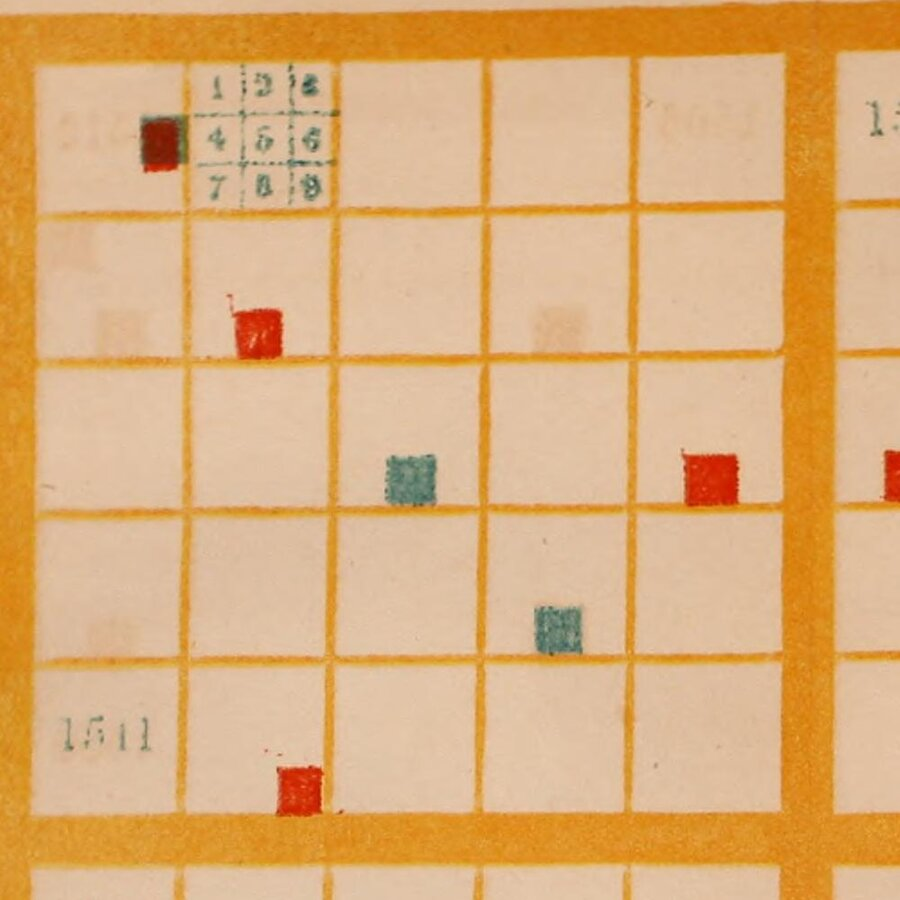
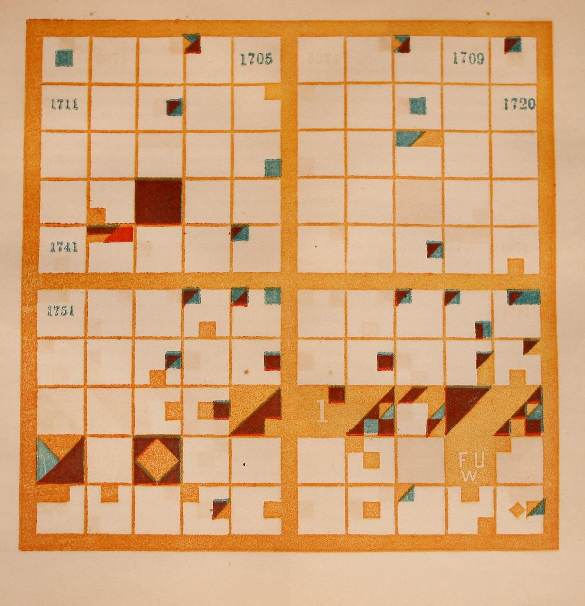
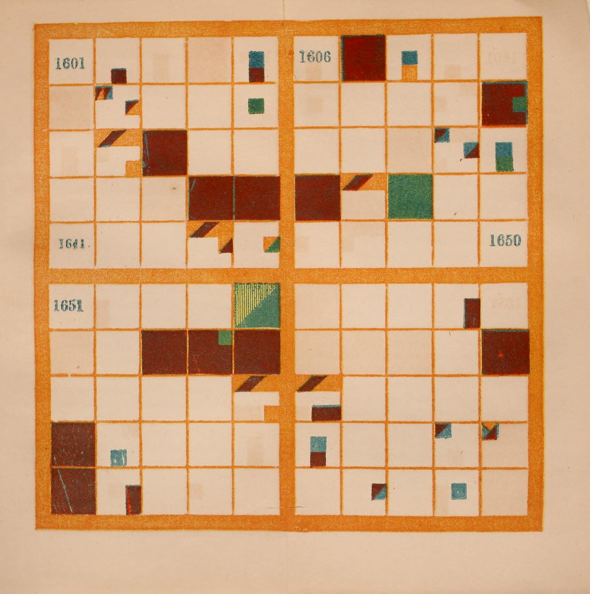

+++
author = "Yuichi Yazaki"
title = "Painting 100 Years as 10×10 and One Year as 3×3: Peabody's Chronological History of the United States (1856)"
slug = "peabody-chronological-history"
date = "2026-11-07"
description = "Peabody's chart divides a century into 10×10 cells (one cell per year) and each year into 3×3 cells (kinds of events), then paints the nations in color. In her 1850 manual it was a tool for pupils to color in themselves and so memorize dates."
categories = [
    "consume"
]
tags = [
    "Elizabeth Palmer Peabody",
    "Józef Bem",
    "timeline",
    "grid",
    "color",
    "Data Feminism"
]
image = "images/plate-17th-century.jpg"
series = ["dataviz-classics"]
series_weight = 4
seriesByline = "Elizabeth Palmer Peabody"
seriesTitle = "Painting One Year in Nine Cells: Peabody's Chronological Charts, 1856"
+++

Elizabeth Palmer Peabody's chronological chart divided a century into 10×10 cells (one cell per year) and each year into 3×3 cells (kinds of events), and painted the nations in color. In her 1850 manual, it was a tool for pupils to color in themselves in order to memorize dates. The instruction to have pupils color a blank chart is on p.5 of the 1850 edition. The 1856 *Chronological History of the United States* came with plates in which four centuries, the 16th to the 19th, were already painted.

What follows draws on the 1856 edition as scanned at the Internet Archive (from the Library of Congress collection), on Peabody's own explanatory text, and on her earlier book (1850). The second half looks at the reconstruction "The Shape of History" by Lauren F. Klein and colleagues, and at how *Data Feminism* (2020) treats Peabody.

<!--more-->

## 1850 and 1856: Bem's method applied to U.S. history

Peabody (1804–1894) was an editor and educator who ran a bookshop in Boston. In 1850 she published a manual of world history, *The Polish-American System of Chronology*. Its subtitle says that it reproduces, with some modifications, the method of General Józef Bem.

According to Klein's *Data by Design* (2026), the lecturer Joseph Podbielski, who came from Poland with Bem's charts, stayed for a time with the Peabody family. Peabody, the book says, was "captivated" by the charts.

In 1856 she published a U.S. history textbook with Sheldon, Blakeman & Company of New York. Its title says "arranged with plates on Bem's principle." The publisher's advertisement speaks of "painted Plates of the four last Centuries." These are four plates, covering the 16th to the 19th centuries, and the 19th ends at 1850. The "To the Teacher" chapter states the aim as follows.

> "A chronological outline of the chain of events may certainly be impressed on the mind, by means of that natural memorizer, the sense of sight, addressed by these colored symbols, before historical causes can be appreciated"

In other words, even before the causes are understood, colored symbols can impress the sequence of events on the memory through the sense of sight.

## A century as 10×10, a year as 3×3

The rules are in the section "THE PAINTED CENTURIES" (pp.9–10). Following the text, they can be set out in a table.

| Data | How the chart shows it | Peabody's explanation (1856 edition) |
|---|---|---|
| A century | One large square | "a large square, divided into a hundred smaller squares" |
| A year | One of the 10×10 cells | The upper left is 1501. One row is ten years. Cells in the same column share the last digit |
| 50-year and 5-year divisions | Heavy lines below the fifth row and at the middle of each row | "landmarks for the eye" |
| Kind of event | Position within the 3×3 grid of the year's cell | The nine kinds in the table below |
| Nation or people | Color | Brick red = Spain, blue = France, purple = England, bluish green = Sweden, yellowish green = Holland, orange = Americans |
| Event involving two nations | Colors meeting on a diagonal | "When colors slant to each other, the nations concur in events." |
| Several unrelated events | Parallelograms | "they are painted in parallelograms" |
| Epoch-making event | The whole cell of the year | "Epochal events fill the whole square" |

The nine small cells are as follows. The numbers are the ones used in the explanation in the text.

| | Left | Center | Right |
|---|---|---|---|
| Top | 1 Battles, sieges, declarations of war | 2 Conquests, annexations, unions | 3 Losses, disasters |
| Middle | 4 Fall of a nation | 5 Founding of a nation, revolutions | 6 Treaties, other |
| Bottom | 7 Births | 8 Deeds | 9 Deaths (in each case of eminent persons) |

The table for Plate I (pp.13–14) specifies where to paint for each event. For 1501, Henry VII's patent for colonization is painted purple in the sixth small cell of the upper-left cell. For 1512, Ponce de Leon's discovery of Florida is painted brick red in the eighth small cell of the twelfth cell. For 1565, the founding of St. Augustine has the upper halves of the first and second small cells, plus the fifth and eighth, in Spanish brick red. The lower half of the second and the third are blue, standing for France's loss.

Elizabeth P. Peabody (1856), held by the Library of Congress. From the [Internet Archive](https://archive.org/details/chronologicalhis00peab), partially enlarged (public domain)

In the scan, the sample of 1 to 9 is printed in the second cell, and the other cells have no lines marking the small cells. In a note to the 18th-century table, Peabody asks the reader to keep "keeping in mind the subdivision into ninths, even where it is not marked off". That is, even without lines, the reader is to read with the ninefold division in mind.

[Machine chronologique](/en/machine-chronologique/) set time out on a single line at 0.1 inch per year. Peabody folds 100 years back every ten years and makes a surface of them. **Every year gets a cell of the same size, and years with many events and years with few are the same size.**

## Pupils color, the teacher points with a stick

The 1850 manual says it is best for pupils to color blank charts themselves.

> "it will be best for the pupils, in all cases, to have blank representations, and to color them themselves, according to the lessons given them."

It goes on to call the coloring an "agreeable" and "profitable" exercise, in which the attention given to coloring fixes each nation's color in memory. If there are no paints, one can write color numbers instead, but "a vast advantage is given up," it adds. In class, the teacher points at a large chart with a stick and the pupils answer with the year and the event (1850 edition, pp.14–15).

The 1856 edition comes with painted plates, and says that empty cells can be filled in with pen with contemporary European events (p.6).

> "It is easier to remember the relative locality of the representation, than to remember the figures of the dates"

That is, a place in the chart is easier to remember than the digits of a year.

Elizabeth P. Peabody (1856), held by the Library of Congress. From the [Internet Archive](https://archive.org/details/chronologicalhis00peab) (public domain)

In the explanation of the 18th century (pp.122–123), the cell for 1775 is divided by a diagonal. The upper triangle is the orange of the victorious Americans, and the rest is the purple of the defeated British. The cell for 1776 is "nearly filled with the orange," and Britain's loss enters in purple in the third small cell.

According to Klein, the surviving workbooks show a few pages colored in earnest, then abandoned partway, and eventually turning into pattern play.

## Five points on which the sources differ

The following five points are described differently depending on the source. They are listed by source.

| Issue | Source | What it says |
|---|---|---|
| Who started the method | Peabody (1850 ed., p.4) | "The invention of the Charts by General Bem" |
| | Public Domain Review | Conceived by Antoni Jażwiński in the 1820s, spread by Bem |
| | *Data by Design* | Born in Poland in the 1820s, spread by Bem |
| Whose idea the ninefold division was | Peabody (1850 ed., p.10) | What she cites are the colors and the omission of the charts for ancient periods |
| | *Data by Design* | "She also borrows the idea of subdividing each square" |
| | Public Domain Review | "her chart further divides up the (previously) smallest unit into a 3x3 grid" |
| England's color | Peabody (1856 ed., p.10) | Purple |
| | *Data by Design* | The 1607 cell is "entirely red" |
| | The Shape of History CSV | #8D2B1D (reddish brown) |
| Whether the large charts survive | Abstracts of DH2017 and DH2018; main text of *Data by Design* | They do not. The text says "not a single one has been preserved" |
| | Figure data of *Data by Design* | Calls "Christian Era" (ca. 1850) "The only extant example" |
| Year of the chart | Caption of *Data Feminism* Figure 3.3; DH2018 abstract | "(1865)" |
| | Image credit in *Data Feminism*; title page of the scan | 1856 |

Peabody does not count the ninefold division among her own changes. It can be read as inherited from Bem.

As for England's color, in this scan the color said to be purple looks dark reddish brown, and France, said to be blue, looks blue-green. I have not checked whether this is fading or a difference in printing. The 1607 (Jamestown) cell is entirely that dark reddish brown, and Klein's "red" can be read as a name for the printed color as seen.

Elizabeth P. Peabody (1856), held by the Library of Congress. From the [Internet Archive](https://archive.org/details/chronologicalhis00peab) (public domain)

I have not been able to read the descriptions at the David Rumsey Map Collection and Raremaps, which are said to hold "Christian Era." "1865" can be read as a transposition of the digits in 1856.

## How third parties saw the chart

Contemporary assessment survives in the publisher's advertisements. J. H. Raymond, principal of the Polytechnic School in Brooklyn, recommended Bem's method as "OUT OF SIGHT SUPERIOR" to other mnemonic systems for dates.

In 2016, the Digital Humanities Lab at Georgia Tech created "The Shape of History" at Klein's initiative. It converts Peabody's tables into a CSV of year, nation, kind, and description. On its Compare screen, the same events are laid side by side in the grid and in an ordinary timeline. Its introduction asks:

> "What would it mean if a visualization was designed to be difficult and abstract?"

That is, what if a visualization were deliberately made difficult and abstract? Klein calls Peabody's chart "abstract rather than intuitive."

Catherine D'Ignazio and Klein's *Data Feminism* mentions Peabody on pp.77–78. It is a short introduction alongside Du Bois and others, with no explanation of the rules.

Jessica DeSpain, in a 2018 review, took issue with the reconstruction.

> "the background information on Peabody delivers minimal insight into why someone would engage with this project who is not invested in the nineteenth-century or data visualization."

The criticism is that it does not convey why anyone not interested in the 19th century or in visualization should engage with it.

## Takeaways

There are four judgments to take away.

The first is to fold time back into a surface. Folding at ten years puts years with the same last digit in the same column. This can be read as the same idea as the [calendar heat map](/en/calendar-heat-map/), which folds by the week. The form is the same as a 100-cell [waffle chart](/en/waffle-chart/), but one cell is one year, not a proportion.

The second is to express categories by position within a cell. [Playfair's circles](/en/pie-chart-william-playfair/) drew quantity with area and angle, and [Minard's map](/en/minard-napoleon-march-to-moscow/) with the width of a band. Peabody draws no quantity; she assigns kind to position and nation to color.

The third is not to draw everything. Peabody wrote that a good chronological chart, like a good school map, does not show everything but represents "enough is represented to suggest where everything else should come" (p.11). Klein lists "Design to support increased knowledge, not complete knowledge" among the takeaways for designers in Chapter 4. This can be read as overlapping with Peabody's idea on p.11.

The fourth is to check whether the rules fit the data format. The Shape of History CSV splits an event involving two nations into one row per nation. In the floor installation, there is one LED per small cell, and DH2017 writes "We cannot account for multiple simultaneous events." Diagonals and parallelograms can be read as hard to fit into a format with one value per cell.

## References

**Primary sources**

- Elizabeth P. Peabody, *Chronological History of the United States, arranged with plates on Bem's principle*, New York: Sheldon, Blakeman, 1856 (pp.5–6, 9–14, 122–123, publisher's advertisement at the end). [Internet Archive](https://archive.org/details/chronologicalhis00peab) / [Full text](https://archive.org/download/chronologicalhis00peab/chronologicalhis00peab_djvu.txt) / [Metadata](https://archive.org/metadata/chronologicalhis00peab)
- Elizabeth P. Peabody, *The Polish-American System of Chronology, reproduced, with some modifications, from General Bem's Franco-Polish Method*, Boston/New York: G. P. Putnam, 1850 (pp.3–15). [Internet Archive](https://archive.org/details/polishamericansy00peab)
- Catherine D'Ignazio, Lauren F. Klein, *Data Feminism*, MIT Press, 2020 (CC BY-NC-ND 4.0; Chapter 3, pp.77–80, Figure Credits). [Internet Archive](https://archive.org/details/mit_press_book_9780262358521)
- Source of The Shape of History (index.html, CSV). [GitHub](https://github.com/EmoryDHLab/speculative) / Site: [shapeofhistory.net](http://shapeofhistory.net/) (currently unreachable)
- Caroline Foster et al., "The Shape of History: Reimagining Nineteenth-Century Data Visualization," DH2017. [PDF](https://dh2017.adho.org/abstracts/146/146.pdf)
- Alexandra Beall, Courtney Allen et al., "Reimagining Elizabeth Palmer Peabody's Lost 'Mural Charts'," DH2018. [Abstract](https://dh2018.adho.org/en/reimagining-elizabeth-palmer-peabodys-lost-mural-charts/) / [DH Abstracts](https://dh-abstracts.library.virginia.edu/works/6348)
- Lauren F. Klein et al., "The Shape of History: Reimagining Elizabeth Palmer Peabody's Feminist Visualization Work," *Feminist Media Histories* 3(3), 2017, 149–153. [UC Press](https://online.ucpress.edu/fmh/article/3/3/149/34211) (main text not read)
- Lauren F. Klein et al., *Data by Design: An Interactive History of Data Visualization, 1789–1900*, MIT Press, 2026. Chapter 4, "Knowledge." [dataxdesign.io](https://dataxdesign.io/) / [Text and figure data (GitHub)](https://github.com/EmoryDHLab/data-by-design)

**Secondary sources**

- Jessica DeSpain, "The Feminist Forebears of Affective Design," *Commonplace* 18.1 (Winter 2018). [Article](https://commonplace.online/article/feminist-forebears/)
- Hunter Dukes, Adam Green, "Visualizing History: The Polish System," *The Public Domain Review*. [Article](https://publicdomainreview.org/collection/visualizing-history-the-polish-system)
- University of Oregon, "Polish-American System of Chronology" (prototype). [Page](https://timeonline.uoregon.edu/peabody/index.html)
- Raremaps (Ruderman Antique Maps), sales page for "Christian Era." [Page](https://raremaps.com/gallery/detail/77843/christian-era-hand-colored-chronological-mural-chart) (main text not read)
