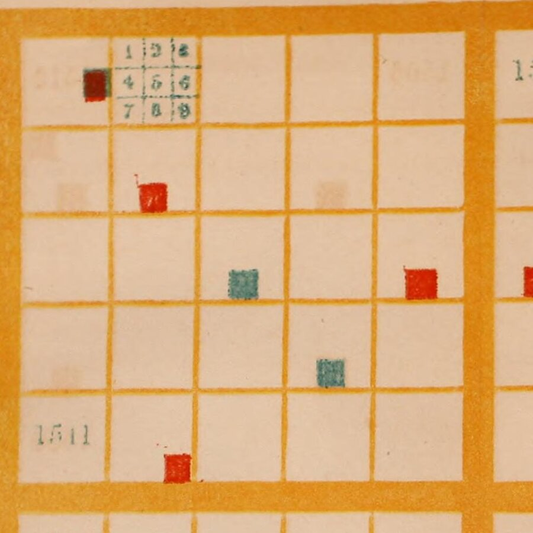
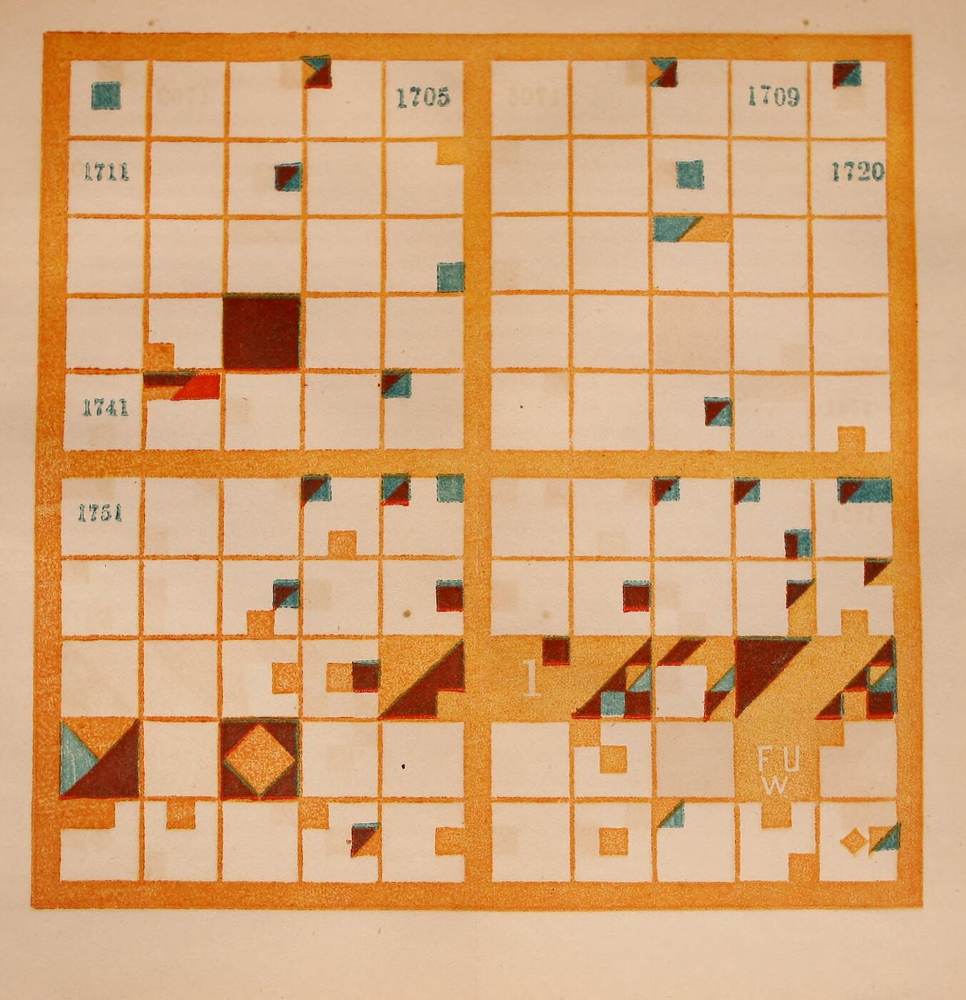
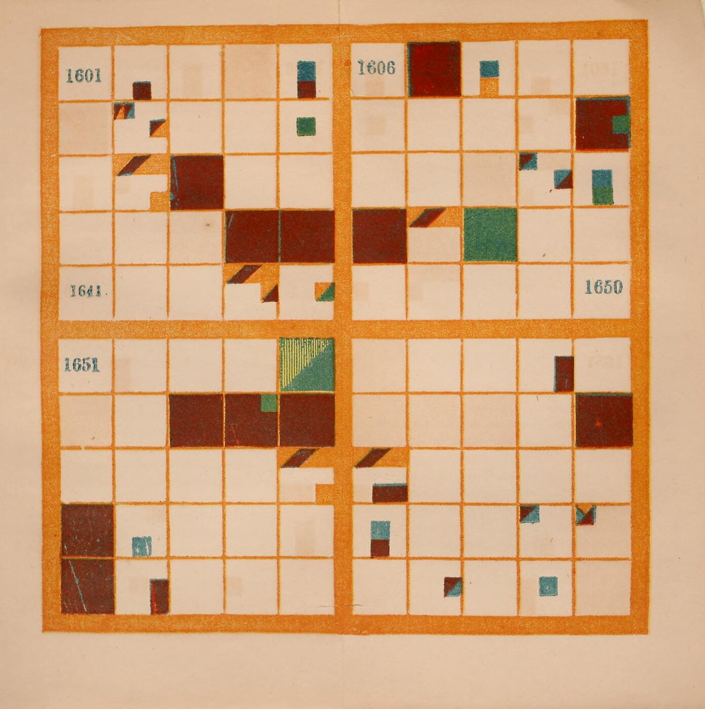

+++
author = "矢崎裕一"
title = "100年を10×10に、1年を3×3に塗り分ける──Peabody の『Chronological History of the United States』（1856）"
slug = "peabody-chronological-history"
date = "2026-11-07"
description = "Peabody の図は、1世紀を10×10のマス（1マス＝1年）に、1年を3×3のマス（出来事の種類）に分けて国を色で塗る図で、生徒が自分で塗って年代を覚えるための道具でした。"
categories = [
    "consume"
]
tags = [
    "Elizabeth Palmer Peabody",
    "Józef Bem",
    "年表",
    "グリッド",
    "色",
    "Data Feminism"
]
image = "images/plate-17th-century.jpg"
series = ["dataviz-classics"]
series_weight = 99
seriesByline = "Elizabeth Palmer Peabody"
seriesTitle = "1年を9マスに塗り分ける──Peabody の年代図 1856"
+++

Elizabeth Palmer Peabody（エリザベス・パーマー・ピーボディ）の年代図は、1世紀を10×10のマス（1マス＝1年）に、1年を3×3のマス（出来事の種類）に分けて、国を色で塗る図でした。生徒が自分で塗って年代を覚えるための道具です。1856年の『Chronological History of the United States』には、16〜19世紀の4世紀分を塗った図版が付きました。白紙の世紀を生徒が塗るやり方は、前の1850年の手引きに書かれています。

以下は、Internet Archive にある1856年版のスキャン（米国議会図書館の蔵書）と、Peabody 自身の説明文、前の本（1850）に沿います。後半では、Lauren F. Klein（ローレン・クライン）らの再現「The Shape of History」と、『Data Feminism』（2020）での扱いを見ます。

<!--more-->

## 1850年と1856年、Bem の方式を合衆国史に

Peabody（1804–1894）は、Boston で書店を営んだ編集者・教育者です。1850年、世界史の手引き『The Polish-American System of Chronology』を出しました。副題は、General Bem の方式を手を加えて写したもの、という意味です。

Klein の『Data by Design』（2026）によれば、Bem の図を持ってポーランドから来た講師 Joseph Podbielski（ジョゼフ・ポドビェルスキ）が、Peabody 家に一時住みました。Peabody は図に「captivated」されたといいます。

1856年、New York の Sheldon, Blakeman & Company から合衆国史の教科書を出します。題に「arranged with plates on Bem's principle」とあります。版元の広告は「painted Plates of the four last Centuries」と書きます。16〜19世紀の4枚で、19世紀は1850年で終わります。「To the Teacher」の章は、狙いをこう書きます。

> "A chronological outline of the chain of events may certainly be impressed on the mind, by means of that natural memorizer, the sense of sight, addressed by these colored symbols, before historical causes can be appreciated"

原因が分かる前でも、色の記号で、視覚に出来事の並びを刻める、という説明です。

## 1世紀を10×10、1年を3×3に

規則は「THE PAINTED CENTURIES」の節（pp.9–10）にあります。本文に沿って表にすると、次のとおりです。

| データ | 図での表し方 | Peabody の説明（1856年版） |
|---|---|---|
| 1世紀 | 大きな正方形1枚 | 「a large square, divided into a hundred smaller squares」 |
| 1年 | 10×10のマスの1つ | 左上が1501年。1行が10年。同じ列は下1桁が同じ |
| 50年・5年の区切り | 5行目の下と各行の中央の太い線 | 「landmarks for the eye」 |
| 出来事の種類 | 年のマスの中の3×3の位置 | 下の表の9種類 |
| 国・民族 | 色 | 煉瓦色＝Spain、青＝France、紫＝England、青みの緑＝Sweden、黄みの緑＝Holland、オレンジ＝Americans |
| 2国が関わる出来事 | 斜めに接する色 | 「When colors slant to each other, the nations concur in events.」 |
| 無関係な出来事が複数 | 平行四辺形 | 「they are painted in parallelograms」 |
| 時代を画す出来事 | 年のマス全体 | 「Epochal events fill the whole square」 |

オレンジには「whether aboriginals, or citizens of the United States」と添えてあります。先住民も合衆国の市民も同じ色です。9つの小マスは、次のとおりです。番号は本文の説明で使う番号です。

| | 左 | 中 | 右 |
|---|---|---|---|
| 上 | 1 戦い・包囲・開戦 | 2 征服・併合・統合 | 3 損失・災厄 |
| 中 | 4 国の滅亡 | 5 国の建設・革命 | 6 条約・その他 |
| 下 | 7 誕生 | 8 行い | 9 死（いずれも著名な人物の） |

Plate I の表（pp.13–14）は、塗る場所を出来事ごとに指定します。1501年、Henry VII の植民の特許は、左上のマスの6番目を紫に。1512年、Ponce de Leon の Florida 発見は、12番目のマスの8番目を煉瓦色に。1565年の St. Augustine の建設は、1番目と2番目の上半分、5番目、8番目がスペインの煉瓦色です。2番目の下半分と3番目は、フランスの損失を表す青です。

Elizabeth P. Peabody（1856）、Library of Congress 所蔵／[Internet Archive](https://archive.org/details/chronologicalhis00peab) より引用・部分拡大（パブリックドメイン）

スキャンでは、2つ目のマスに1〜9の見本が刷ってあり、ほかのマスに小マスの線はありません。Peabody は18世紀の表の注で、「keeping in mind the subdivision into ninths, even where it is not marked off」と求めています。線がなくても9分割を頭に置いて読む、ということです。

[Machine chronologique](/machine-chronologique/) は、1年を0.1インチにして時間を1本の線に並べました。Peabody は100年を10年ずつ折り返して、面にしています。**どの年も同じ広さのマスを持ち、出来事の多い年も少ない年も大きさは同じです。**

## 生徒が塗り、教師が棒で指す

1850年版の手引きは、生徒が白紙を塗るのがよいと書きます。

> "it will be best for the pupils, in all cases, to have blank representations, and to color them themselves, according to the lessons given them."

塗る作業は「agreeable」で「profitable」な練習で、塗る注意が国ごとの色を記憶に刻む、と続けます。絵の具がなければ色の番号を書けばよいが、「a vast advantage is given up」とも書きます。授業では、教師が大判の図を棒で指し、生徒が年と出来事を答えます（1850年版 pp.14–15）。

1856年版は塗った図版を付け、空いたマスには同時代のヨーロッパの出来事をペンで書き込める、とします（p.6）。

> "It is easier to remember the relative locality of the representation, than to remember the figures of the dates"

年の数字より、図の中の場所のほうが覚えやすい、という意味です。

Elizabeth P. Peabody（1856）、Library of Congress 所蔵／[Internet Archive](https://archive.org/details/chronologicalhis00peab) より引用（パブリックドメイン）

18世紀の説明（pp.122–123）では、1775年のマスを対角線で分けます。上の三角は勝ったアメリカのオレンジ、残りは敗れた英国の紫です。1776年は「nearly filled with the orange」で、英国の損失は3番目に紫で入ります。

Klein は、残った練習帳の様子を書いています。数ページは真剣に塗られ、次に途中で投げ出され、やがて模様の遊びに変わる、という順です。

## 資料によって違う5つの点

次の5点は、資料によって書き方が違います。出典ごとに並べます。

| 論点 | 出典 | 書かれていること |
|---|---|---|
| 方式を始めた人 | Peabody（1850年版 p.4） | 「The invention of the Charts by General Bem」 |
| | Public Domain Review | 1820年代に Antoni Jażwiński（アントニ・ヤジュヴィンスキ）が考え、Józef Bem（ユゼフ・ベム）が広めた |
| | 『Data by Design』 | 1820年代にポーランドで生まれ、Bem が広めた |
| 9分割は誰の考えか | Peabody（1850年版 p.10） | 自分の変更は、色と、古い時代の図を省いたことだけ |
| | 『Data by Design』 | 「She also borrows the idea of subdividing each square」 |
| | Public Domain Review | 「her chart further divides up the (previously) smallest unit into a 3x3 grid」 |
| England の色 | Peabody（1856年版 p.10） | 紫 |
| | 『Data by Design』 | 1607年のマスは「entirely red」 |
| | The Shape of History の CSV | #8D2B1D（赤茶） |
| 大判の図は残っているか | DH2017・DH2018 の要旨、『Data by Design』本文 | 残っていない。本文は「not a single one has been preserved」 |
| | 『Data by Design』の図版データ | 「Christian Era」（ca. 1850）を「The only extant example」とする |
| 図の年 | 『Data Feminism』図3.3のキャプション、DH2018 の要旨 | 「(1865)」 |
| | 『Data Feminism』の画像クレジット、スキャンの扉 | 1856 |

Peabody は9分割を自分の変更に数えていません。Bem から受け継いだと読めます。

England の色について、このスキャンでは、紫とされる色は暗い赤茶に、青とされる France は青緑に見えます。退色か刷りの違いかは確かめていません。1607年（Jamestown）のマスは全体がその暗い赤茶で、Klein の「red」は刷られた色を見た呼び方と読めます。

Elizabeth P. Peabody（1856）、Library of Congress 所蔵／[Internet Archive](https://archive.org/details/chronologicalhis00peab) より引用（パブリックドメイン）

「Christian Era」を載せた David Rumsey Map Collection と Raremaps のページは、本文を読めませんでした。「1865」は、1856の数字の入れ違いと読めます。

## 第三者はこの図をどう見たか

当時の評価は、版元の広告に残っています。Brooklyn の Polytechnic School の校長 J. H. Raymond（レイモンド）は、Bem の方式をほかの年代の記憶術より「OUT OF SIGHT SUPERIOR」と推しました。

2016年、Georgia Tech の Digital Humanities Lab は、Klein の発案で「The Shape of History」を作りました。Peabody の表を、年・国・種類・説明の CSV に直しています。Compare の画面では、同じ出来事を格子とふつうの年表に並べます。導入文はこう問います。

> "What would it mean if a visualization was designed to be difficult and abstract?"

わざと難しく、抽象的に作られた可視化があったら、という問いです。Klein は Peabody の図を「abstract rather than intuitive」と呼びます。

Catherine D'Ignazio（キャサリン・ディグナツィオ）と Klein の『Data Feminism』は、pp.77–78 で Peabody に触れます。Du Bois らと並べた短い紹介で、規則の説明はありません。

Jessica DeSpain（ジェシカ・デスペイン）は2018年の書評で、この再現に注文を付けました。

> "the background information on Peabody delivers minimal insight into why someone would engage with this project who is not invested in the nineteenth-century or data visualization."

19世紀や可視化に関心のない人には、触れる理由が伝わらない、という批判です。

## 使い道

持ち帰れる判断は、四つあります。

一つ目は、時間を折り返して面にすることです。10年で折り返すと、同じ列は下1桁が同じ年になります。週で折り返す[カレンダー・ヒートマップ](/calendar-heat-map/)と同じ考え方と読めます。形は100マスの[ワッフル・チャート](/waffle-chart/)と同じですが、1マスは割合でなく1年です。

二つ目は、カテゴリをマスの中の位置で表すことです。[プレイフェアの円](/pie-chart-william-playfair/)は面積と角度で、[ミナールの図](/minard-napoleon-march-to-moscow/)は帯の幅で量を描きました。Peabody は量を描かず、種類を位置に、国を色に割り当てています。

三つ目は、全部を描かないことです。Peabody は、よい年代図はよい学校地図と同じで、すべてを描かず「enough is represented to suggest where everything else should come」と書きました（p.11）。Klein はこれを「Design to support increased knowledge, not complete knowledge」という指針にまとめています。

四つ目は、規則がデータ形式に乗るかを確かめることです。The Shape of History の CSV は、2国の出来事を国ごとの行に分けました。床の図の LED は1小マスに1個で、DH2017 は「We cannot account for multiple simultaneous events」と書きます。対角線や平行四辺形は、1マス1値の形式には乗りにくいと読めます。

## 参考・出典

**一次情報**

- Elizabeth P. Peabody, *Chronological History of the United States, arranged with plates on Bem's principle*, New York: Sheldon, Blakeman, 1856（pp.5–6, 9–14, 28, 122–123、巻末の版元広告）. [Internet Archive](https://archive.org/details/chronologicalhis00peab) / [本文テキスト](https://archive.org/download/chronologicalhis00peab/chronologicalhis00peab_djvu.txt) / [メタデータ](https://archive.org/metadata/chronologicalhis00peab)
- Elizabeth P. Peabody, *The Polish-American System of Chronology, reproduced, with some modifications, from General Bem's Franco-Polish Method*, Boston／New York: G. P. Putnam, 1850（pp.3–15）. [Internet Archive](https://archive.org/details/polishamericansy00peab)
- Catherine D'Ignazio, Lauren F. Klein, *Data Feminism*, MIT Press, 2020（CC BY-NC-ND 4.0。第3章 pp.77–80、Figure Credits）. [Internet Archive](https://archive.org/details/mit_press_book_9780262358521)
- The Shape of History のソース（index.html、CSV）. [GitHub](https://github.com/EmoryDHLab/speculative) ／ サイト：[shapeofhistory.net](http://shapeofhistory.net/)（現在は接続できない）
- Caroline Foster ほか, "The Shape of History: Reimagining Nineteenth-Century Data Visualization," DH2017. [PDF](https://dh2017.adho.org/abstracts/146/146.pdf)
- Alexandra Beall, Courtney Allen ほか, "Reimagining Elizabeth Palmer Peabody's Lost 'Mural Charts'," DH2018. [要旨](https://dh2018.adho.org/en/reimagining-elizabeth-palmer-peabodys-lost-mural-charts/) / [DH Abstracts](https://dh-abstracts.library.virginia.edu/works/6348)
- Lauren F. Klein ほか, "The Shape of History: Reimagining Elizabeth Palmer Peabody's Feminist Visualization Work," *Feminist Media Histories* 3(3), 2017, 149–153. [UC Press](https://online.ucpress.edu/fmh/article/3/3/149/34211)（本文は未読）
- Lauren F. Klein ほか, *Data by Design: An Interactive History of Data Visualization, 1789–1900*, MIT Press, 2026. 第4章「Knowledge」. [dataxdesign.io](https://dataxdesign.io/) / [本文と図版データ（GitHub）](https://github.com/EmoryDHLab/data-by-design)

**第三者評価**

- Jessica DeSpain, "The Feminist Forebears of Affective Design," *Commonplace* 18.1 (Winter 2018). [記事](https://commonplace.online/article/feminist-forebears/)
- Hunter Dukes, Adam Green, "Visualizing History: The Polish System," *The Public Domain Review*. [記事](https://publicdomainreview.org/collection/visualizing-history-the-polish-system)
- University of Oregon, "Polish-American System of Chronology"（試作）. [ページ](https://timeonline.uoregon.edu/peabody/index.html)
- Raremaps（Ruderman Antique Maps）, "Christian Era" の販売ページ. [ページ](https://raremaps.com/gallery/detail/77843/christian-era-hand-colored-chronological-mural-chart)（本文は未読）
